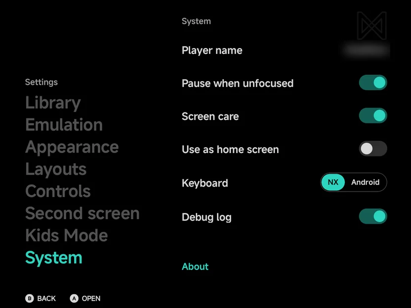

# System

**Tools → Settings → System** is the last Settings section. It holds the
app-wide settings, the app's version and your device's details, and the
licenses. The settings come first, then the **About** and **Licenses**
groups:

| Group | Rows |
| --- | --- |
| The settings | [**Player name**](#player-name), [**Pause when unfocused**](#pause-when-unfocused), [**Screen care**](#screen-care), [**Use as home screen**](#use-as-home-screen), [**Keyboard**](#keyboard) and [**Debug log**](#debug-log) |
| [**About**](#about) | The version and device rows, **Copy device info**, and **Check for updates** in the build from GitHub |
| [**Licenses**](#licenses) | What the app is made of and its licenses, and **Full list of licenses** |

{ .nx-wide }

## Player name

**Player name** is the name games show for you, such as in local
multiplayer. Until you set one, it is your device's name. Press `A` on the
row to type a new one, up to 10 characters, with the
[keyboard](#keyboard). Clear it to go back to the device's name.

| Console | Where the name shows |
| --- | --- |
| Nintendo DS | The console's nickname, which games show in [local wireless](local-wireless.md) play |
| Nintendo 3DS | The console's profile name, and the name of its own Mii, which games such as Mario Kart 7 show |
| PSP | The name the other players see in ad hoc play |

??? info "More detail"
    - It applies from the next game you start.
    - A game that saved a name in its own save keeps that one.
    - On the 3DS, a Mii you made or imported keeps its own name.

## Pause when unfocused

**Pause when unfocused** (On by default) pauses a game when another app
takes over while the game is still on screen: in split screen, in a desktop
window such as Samsung DeX, or with an app open on a second screen. Go back
to the game, by tapping or clicking it, and it plays on by itself.

Turn it off to keep a game running while you use another app beside it.

??? info "More detail"
    - The game's sound and rumble stop with it.
    - If you open the in-game menu before going back, the game stays paused
      until you choose **Continue**.
    - Your own screens don't count: the game panel, the DS or 3DS bottom
      screen and the in-game menu never pause it.
    - In a [netplay](netplay.md) match, the other player sees you paused, as
      when you leave the app.
    - Leaving the app, such as to Home, always pauses the game, whatever this
      setting says.
    - While a game is paused this way, the screen can sleep on your device's
      screen timeout.

## Screen care

**Screen care** (On by default) keeps OLED screens from marking. A game's
pad skin, frame and panel stay in the same place for hours, which can burn
into an OLED screen.

- **Everything shifts a little.** Every 2 minutes, everything on each
  screen moves by a tiny step, too little to notice: the picture, the pad
  skin, the frame, the panel and the menus. It does this in the main menu
  and in games.
- **An idle game dims.** After 5 minutes in a game with no button, stick or
  touch, the screens go dark under a dim layer. Press anything or touch a
  screen to bring them back at once.
- **Then the screen sleeps.** After 10 minutes with no input, the game lets
  your device's screen timeout turn the screens off.

??? info "More detail"
    - The shift walks a small square of steps, 1 dp at a time, and comes
      back to the middle. Touch follows it.
    - It works on both screens of a [dual-screen](dual-screen.md) handheld.
    - During a live [netplay](netplay.md) session the screens dim, but never
      sleep: the other player plays on.
    - The main menu doesn't dim: it never keeps the screen on, so your
      device's screen timeout already turns it off. Only Netplay's host and
      join pages and a running [Device Sync](device-sync.md) keep the screen
      on.
    - A running game keeps the screen on until Screen care lets go. A game
      paused under the in-game menu sleeps on your device's timeout.
    - Turn it off and everything goes back to its place, undimmed.

## Use as home screen

**Use as home screen** makes the app your Android home screen. See
[Launcher Mode & Android Games](launcher.md#use-as-home-screen).

## Keyboard

**Keyboard** picks how you type into the app's text prompts: search,
**Rename**, a new collection or folder, the **Player name**, and the
RetroAchievements, ScreenScraper and art-site sign-ins and keys.

| Value | What it is |
| --- | --- |
| **NX** (default) | The app's own keyboard, for the pad or touch |
| **Android** | Your phone's keyboard, for password managers and swipe typing |

A field on the top screen of a [dual-screen](dual-screen.md) handheld
always uses the NX keyboard.

### The NX keyboard

The NX keyboard comes up along the bottom of the screen, with the prompt's
box above it. It has a number row, the letters with `@` and `_`, a shift key
and a delete key, and a bottom row:

| Key | What it does |
| --- | --- |
| `#+=` | The symbols page; `abc` goes back to the letters |
| `.`, space, `-` | Type them |
| **Paste** | Puts what you copied at the cursor, as one line |
| **Next** | Moves to the next field, in a prompt with two (a sign-in) |
| The prompt's word | Confirms, such as **Search**, **Sign in** or **OK**. In the accent |

With a controller or the on-screen pad:

| Button | What it does |
| --- | --- |
| D-pad or stick | Move the highlight on the keys |
| `A` | Type the highlighted key |
| `X` | Delete the letter before the cursor |
| `Y` | Space |
| `L1` / `R1` | Move the cursor |
| `SELECT` | The next field |
| `START` | Confirm; in a sign-in's first field, go on to the password |
| `B` or `MENU` | Cancel |

`UP` from the top row moves into the field, where `LEFT` / `RIGHT` move
the cursor and `DOWN` goes back to the keys. The hint row under the keys
shows what the buttons do, with the prompt's word on `START` and **Cancel**
on `B`.

By touch, tap a key to type it, or tap a field to type in it. Back, or a
tap outside the box, cancels.

??? info "More detail"
    - The prompt's box has no buttons of its own: the keyboard's last key,
      `START` and `B` answer it. Typed with Android's keyboard, the box keeps
      its buttons.
    - Shift lasts one letter.
    - A held direction stops at the end of a row; it never wraps or leaves
      the keys.
    - Delete on an empty field does nothing, and a held `B` doesn't cancel.
    - A password shows as dots. In its field, `A`, or a tap on **Show**,
      shows it as typed, and **Hide** turns it back to dots.
    - Each key gives a light tick as you tap it, when your phone's touch
      feedback is on.
    - A physical keyboard types too: Enter confirms, Tab moves to the next
      field, and Ctrl+V pastes.
    - The keyboard takes at most a bit over half the screen's height; on a
      short screen its keys shrink to fit. Where less than about 200 dp is
      left above it, the prompt shows only its fields, each named inside it.
    - On a [dual-screen](dual-screen.md) handheld, the keyboard and the
      prompt open on the bottom screen.
    - Over a pad skin or the on-screen pad, the keyboard covers the pad
      while you type, so the prompt keeps the screen above it.

## Debug log

**Debug log** (Off by default) saves the app's and the emulators' detailed
logs to a `Logs` folder in your
[home folder](getting-started.md#choose-a-home-folder), for a bug report.
With it off, only errors reach Android's system log and no file is written.
It takes effect at once.

Each time the app or a game starts, a new file begins:

| File | Written by |
| --- | --- |
| `20261109-203147-app.log` | The main menu |
| `20261109-203153-game-PS2-armsx2.log` | A game, named after its console and emulator |

Attach the file to your bug report.

??? info "More detail"
    - A file's first line names the app's version, the device, its chip
      and its Android version.
    - The newest 20 files are kept. A file over 4 MB carries on in `.1` and
      `.2` files.
    - [Device Sync](device-sync.md) doesn't copy `Logs`.
    - A RetroAchievements log line can include your username, never your
      password.
    - When the app crashes, the crash is written into the file. After an
      emulator crashes, the file's last line or two can be missing.

## About

The **About** rows show the app's version and your device's details. They
are read-only.

| Row | What it shows |
| --- | --- |
| **NX Redux** | The app's version, with its build number in brackets |
| **Build** | The commit the app was built from |
| **Released** | The date of that commit |
| **Platform** | The Android version and its API level |
| **Device** | The phone's maker and model |
| **Chip** | The phone's processor |
| **GPU** | The graphics chip |
| **Page size** | The memory page size, e.g. 4 KB |

??? info "More detail"
    - **GPU** reads **…** for a moment while the app asks for it.
    - A row the app can't read shows **Unknown**.

### Copy device info

Select **Copy device info** and press `A` **Copy**, then paste the text into
a bug report so the details are exact.

??? info "More detail"
    It copies every About row as text. The app shows "Device info copied".

### Check for updates

In the build from GitHub, the last About row is **Check for updates**.
`A` **Check** looks for a newer version. When there is one, the row reads
**Update to** and the version: `A` **Update** downloads and installs it.

??? info "More detail"
    - While it works, the row shows what it is doing, such as **Checking for
      updates…** or **Downloading** with a percentage.
    - With nothing newer, it reads **Up to date** with your version.
    - The app also looks for a newer version on the main menu, once a day
      at most, and asks **Update available** with **Update** and **Not now**.
      **Not now** stops it asking about that version.
    - An update is only downloaded from GitHub, and only when GitHub gives
      its checksum. Without one the row reads **Update not verified: GitHub
      sent no checksum**. A download that doesn't match its checksum isn't
      installed.

## Licenses

A few short paragraphs say what NX Redux is made of and under which
licenses: the app itself (GPL-3.0), the MiSans font by Xiaomi, the libretro
emulator cores, the game runner and its libraries, and the Kotlin and
Android libraries.

**Full list of licenses** opens the [Licenses](../reference/licenses.md)
page of this site in your browser.

??? info "More detail"
    - The paragraphs credit MiSans as its license asks.
    - The **?** icon on **Full list of licenses** shows the address it opens.
