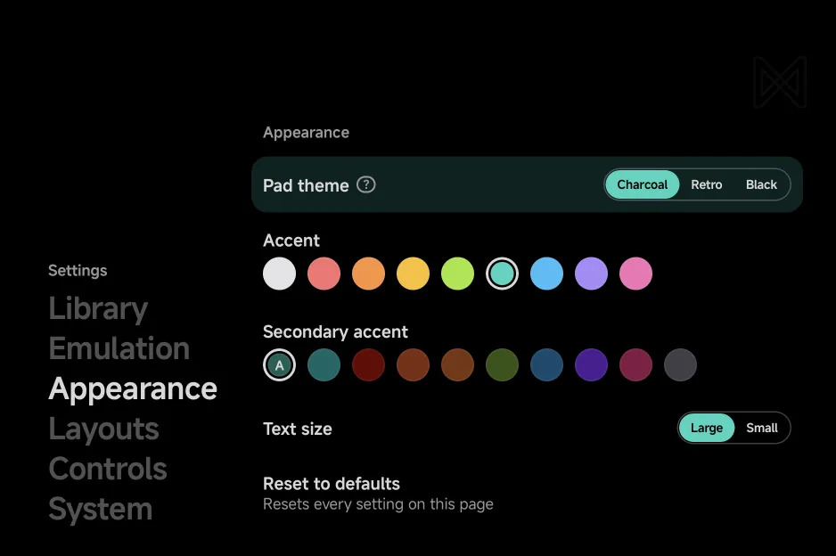
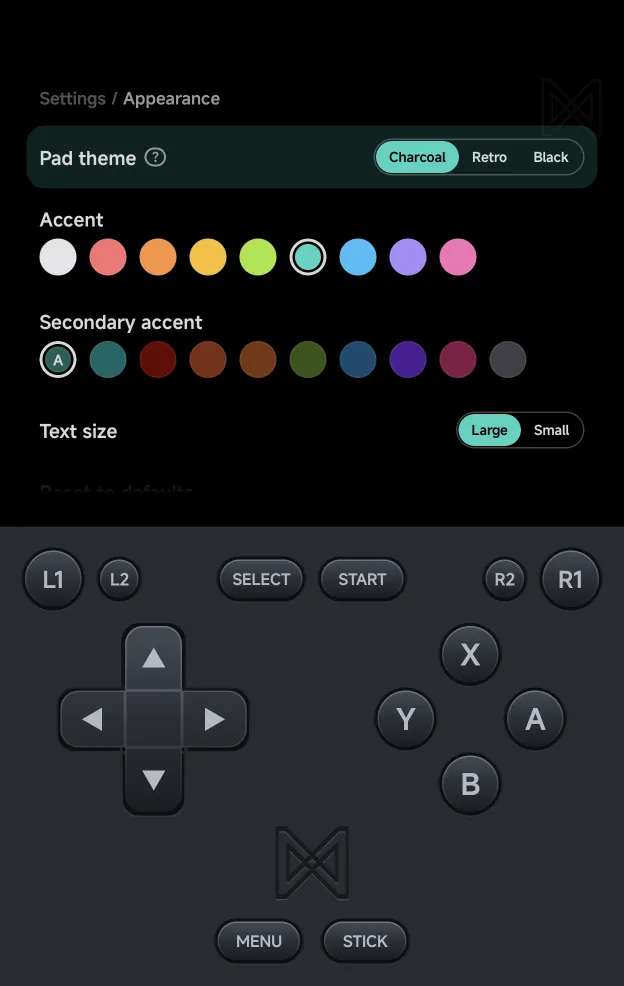
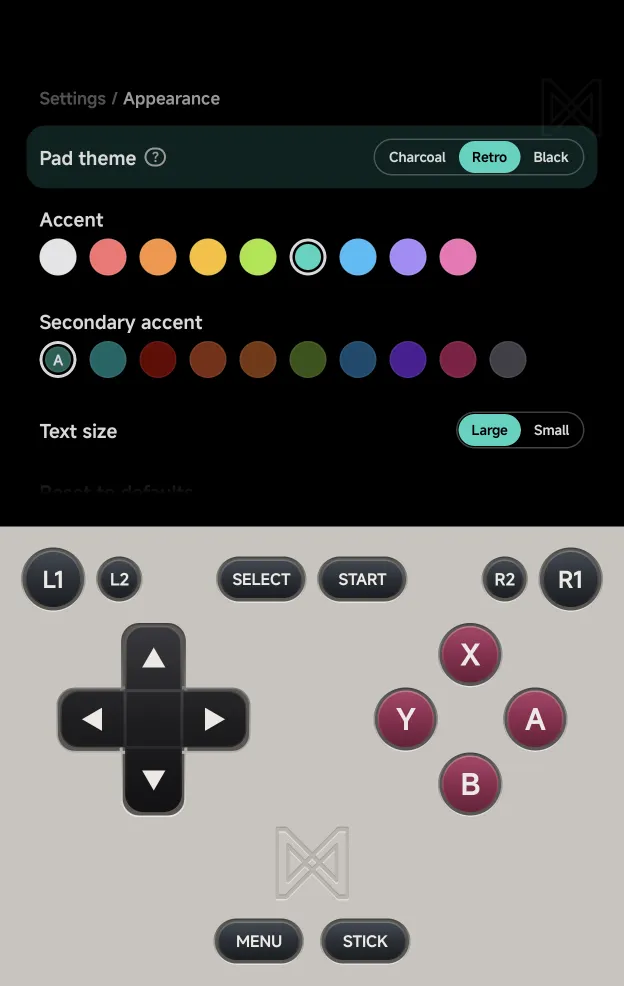
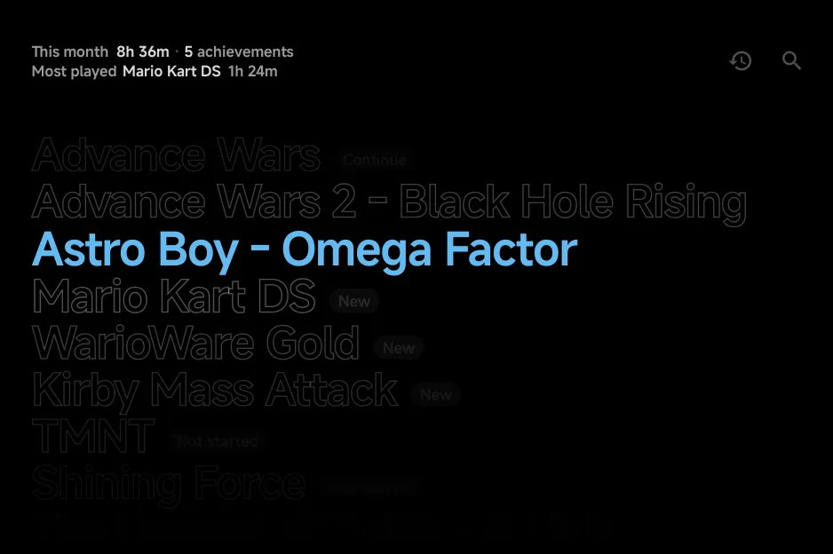

# Appearance

**Tools → Settings → Appearance** sets the look of the app: the on-screen
pad, the text size and the colours. The menu styles have their own category,
[Layouts](layouts.md).

- `Left` / `Right` step the highlighted row's value.
- **Accent** and **Secondary accent** show a circle per colour under the
  row's name, the current one ringed: tap one, or press `A` to step to the
  next. **Pad theme**, **Pad buttons** and **Text size** show their choices
  on the row the same way. See [Settings](settings.md#touch).

{ .nx-wide }

| Setting | What it does | Values | Default |
| --- | --- | --- | --- |
| [**Pad theme**](#pad-theme) | Colours of the portrait pad | Charcoal, Retro, Black | Charcoal |
| [**Pad buttons**](#pad-buttons) | How the Black pad's buttons look. Shows only with the Black theme | Grey, Outline | Grey |
| [**Accent**](#accent) | The selection colour | White, Red, Orange, Amber, Lime, Teal, Sky, Violet, Pink | White |
| [**Secondary accent**](#secondary-accent) | The bar behind a selected value | Auto, Teal, Red, Rust, Bronze, Moss, Navy, Plum, Wine, Graphite | Auto |
| [**Text size**](#text-size) | Size of the text across the app | Large, Small | Large |
| [**Reset to defaults**](#reset-to-defaults) | Puts this page back to its defaults | | |

## Pad theme

The colours of the on-screen pad in portrait, in the menus and in games.

- **Charcoal** (default): the dark pad.
- **Retro**: a light grey body with magenta face buttons.
- **Black**: a pure black body, its buttons set by [Pad buttons](#pad-buttons).

<figure class="nx-phone" markdown>
{ .nx-phone__screen }
{ .nx-phone__frame }
</figure>

Charcoal

<figure class="nx-phone" markdown>
{ .nx-phone__screen }
{ .nx-phone__frame }
</figure>

Retro

The landscape pad halves always stay Charcoal. See
[Controls](controls.md) for the pad itself.

??? info "More detail"
    The landscape pad's opacity is set per game or console with **Pad
    Opacity (landscape)** in the in-game [Frontend](in-game-menu.md#frontend)
    options, not here.

## Pad buttons

How the buttons look on the **Black** pad theme. The row shows only while
**Pad theme** is **Black**.

- **Grey** (default): Charcoal's grey buttons on the black body.
- **Outline**: each button drawn as a thin outline with its label, lit
  faintly while you hold it.

## Accent

The selection colour: the highlight on the selected row, the name of the
selected game or tile, the current tab's word and the current Settings
section. It also colours Home's **Pick a game**
picture and the in-game menu.

There are nine light colours, shown as swatches: **White** (default),
**Red**, **Orange**, **Amber**, **Lime**, **Teal**, **Sky**, **Violet** and
**Pink**. Text on the accent is black.

*Home with the Sky accent*

## Secondary accent

The colour of the bar behind a selected setting's value, as in
**< Charcoal >** above. It shows on the Settings pages, a game's
[Game Settings](emulator-settings.md) and the
[in-game menu](in-game-menu.md).

- **Auto** (default) uses a dark shade of the Accent; its circle shows that
  shade with an **A**. With the White accent, Auto gives Teal.
- Or pick one of nine dark colours, shown as swatches: **Teal**, **Red**,
  **Rust**, **Bronze**, **Moss**, **Navy**, **Plum**, **Wine** and
  **Graphite**. Text on them is light.

## Text size

The size of the text across the app.

- **Large** (default).
- **Small**: three quarters of the size, with more rows per screen.

The text also follows Android's own font size setting.
[First-run setup](getting-started.md) asks for the text size before anything
else.

??? info "More detail"
    - It sizes every list, the Settings pages and the in-game menu included,
      with the page titles, the tab names and the hint bar. It also sizes the
      game names and stats in the game lists' Carousel, Backdrop and Grid,
      Home's cards and stats strip, the RetroAchievements lists and the
      achievements panel, the value lists and the dialogs. The on-screen pad's
      labels keep their size.
    - Android's font size is held between 85% and 130%, so a very small or
      very large system font does not crowd the screens. Text on fixed
      shapes, such as the pad's labels, the tab names and the hint bar, keeps
      its size there.

## Reset to defaults

Puts **Pad theme**, **Pad buttons**, **Accent**, **Secondary accent** and
**Text size** back to their defaults. It asks first: `A` resets, `B` keeps everything. It leaves the
[Layouts](layouts.md) page alone: that page has its own **Reset to
defaults**.
