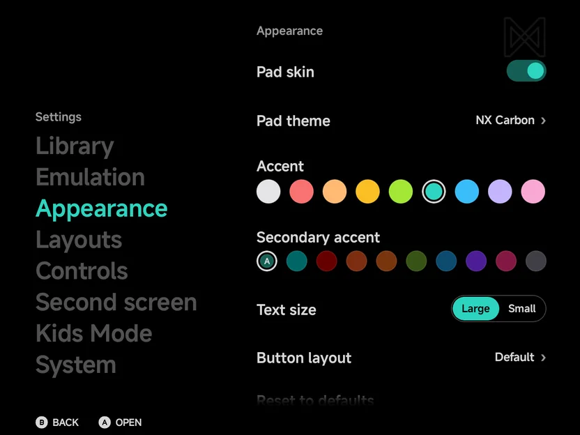
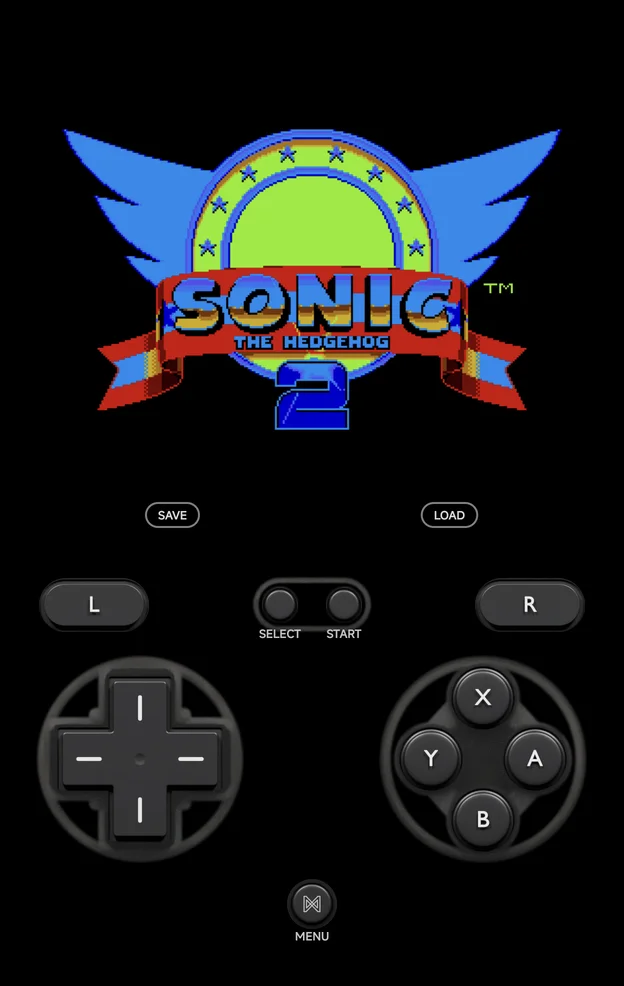
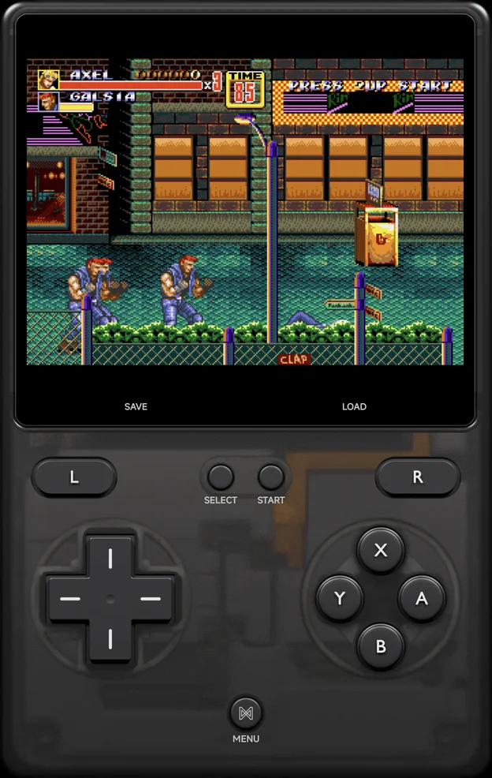
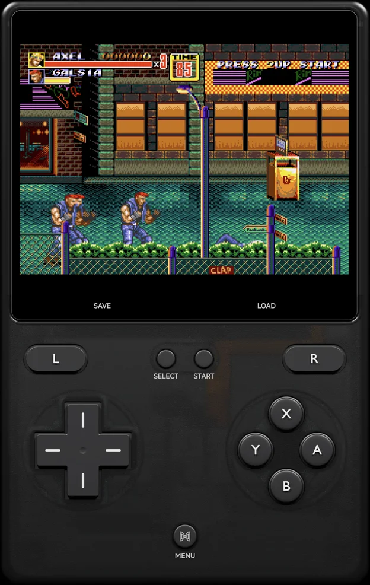
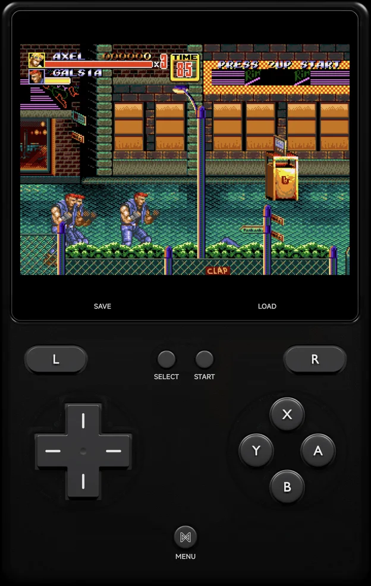
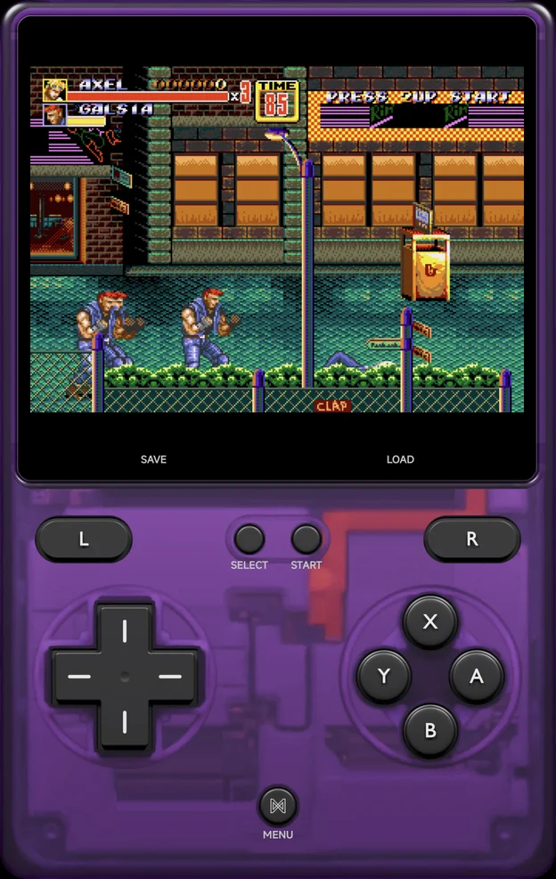
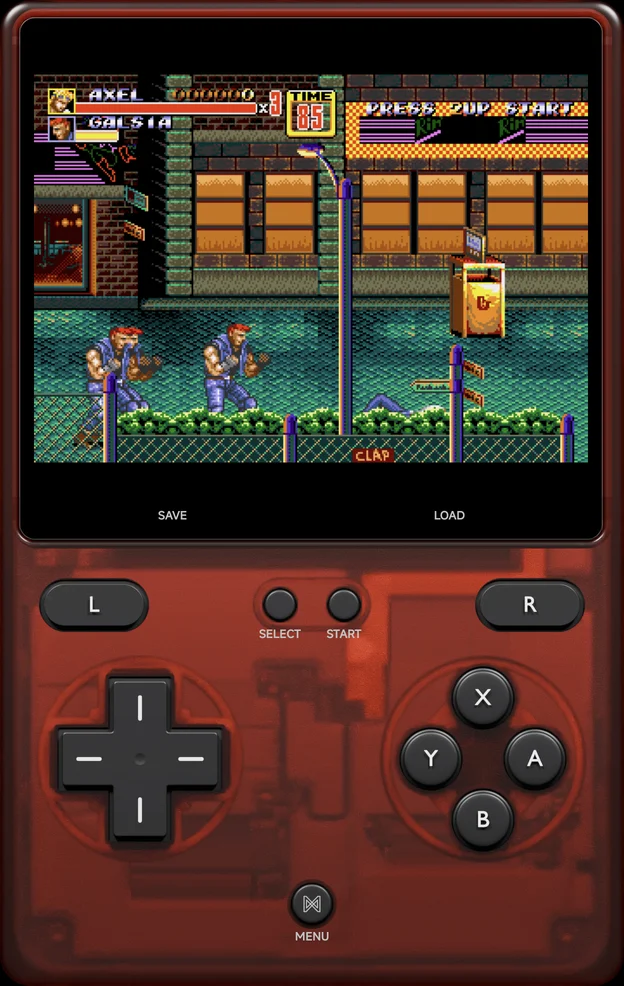
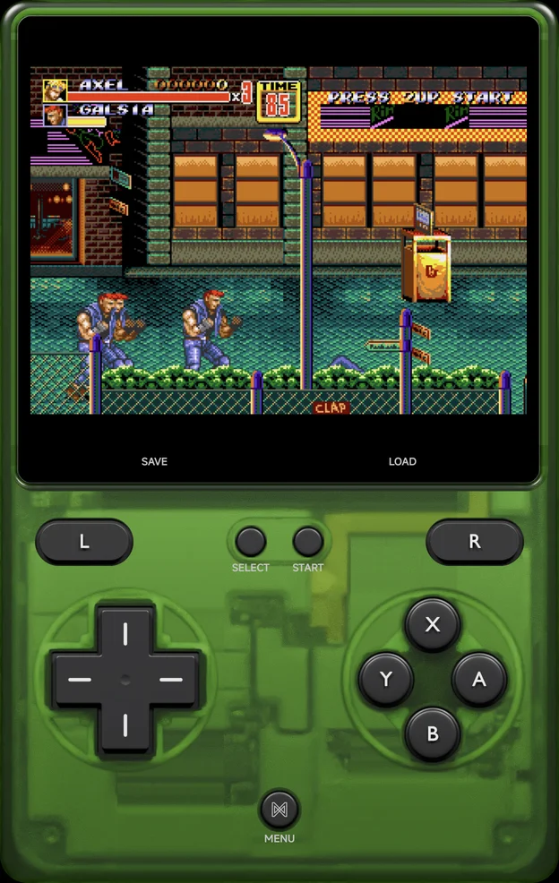
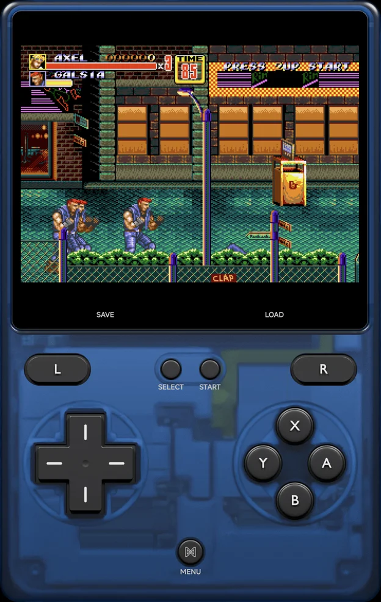
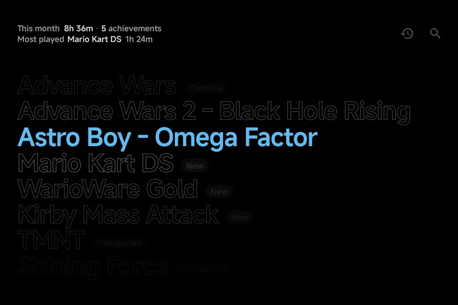

# Appearance

**Tools → Settings → Appearance** sets the look of the app: the pad skin,
the colours, the text size and where the on-screen buttons sit. The menu
styles have their own category, [Layouts](layouts.md).

- `Left` / `Right` step the highlighted row's value. Where Settings shows
  two panes, press `A` on the row first; see
  [Two-pane screens](foldables.md#settings).
- **Accent** and **Secondary accent** show a circle per colour under the
  row's name, the current one ringed: tap one, or press `A` to step to the
  next. **Text size** shows its choices on the row the same way. See
  [Settings](settings.md#touch).

{ .nx-wide }

| Setting | What it does | Values | Default |
| --- | --- | --- | --- |
| [**Pad skin**](#pad-skin) | The handheld drawn around the game and the menus, or full screen | On, Off | On |
| [**Pad theme**](#pad-theme) | The skin's colour. Shows only with Pad skin On | NX Carbon, NX Onyx, NX Obsidian, NX Plasma, NX Ember, NX Volt, NX Tide | NX Carbon |
| [**Accent**](#accent) | The selection colour | White, Red, Orange, Amber, Lime, Teal, Sky, Violet, Pink | White |
| [**Secondary accent**](#secondary-accent) | Switches that are on, and the bar behind a selected value | Auto, Teal, Red, Rust, Bronze, Moss, Navy, Plum, Wine, Graphite | Auto |
| [**Text size**](#text-size) | Size of the text across the app | Large, Small | Large |
| [**Button layout**](#button-layout) | Move and resize the on-screen buttons, per console | Default, Custom | Default |
| [**Reset to defaults**](#reset-to-defaults) | Puts this page back to its defaults | | |

## Pad skin

- **On** (default): the [pad skin](controls.md#pad-skins), a whole handheld
  drawn around the game and the menus, with its buttons and its screen.
- **Off**: a game runs full screen with see-through buttons over it, and
  the menus have no on-screen pad. See
  [Pad skin off](controls.md#pad-skin-off).

With a controller connected, the game and the menus show no skin and no
on-screen buttons either way.

<figure class="nx-phone" markdown>
{ .nx-phone__screen }
{ .nx-phone__frame }
</figure>

??? info "More detail"
    How see-through the buttons are is set per game or console with **Pad
    Opacity (landscape)** in the in-game
    [Options → Controls](in-game-menu.md#options), not here.

## Pad theme

The colour of the pad skin, in portrait and landscape, in the menus and in
games. The row shows only while **Pad skin** is **On**.

- **NX Carbon** (default): smoke grey.
- **NX Onyx**: smoked black.
- **NX Obsidian**: translucent near-black.
- **NX Plasma**, **NX Ember**, **NX Volt** and **NX Tide**: translucent
  purple, red, green and blue.

<figure class="nx-phone" markdown>
{ .nx-phone__screen }
{ .nx-phone__frame }
</figure>

NX Carbon

<figure class="nx-phone" markdown>
{ .nx-phone__screen }
{ .nx-phone__frame }
</figure>

NX Onyx

<figure class="nx-phone" markdown>
{ .nx-phone__screen }
{ .nx-phone__frame }
</figure>

NX Obsidian

<figure class="nx-phone" markdown>
{ .nx-phone__screen }
{ .nx-phone__frame }
</figure>

NX Plasma

<figure class="nx-phone" markdown>
{ .nx-phone__screen }
{ .nx-phone__frame }
</figure>

NX Ember

<figure class="nx-phone" markdown>
{ .nx-phone__screen }
{ .nx-phone__frame }
</figure>

NX Volt

<figure class="nx-phone" markdown>
{ .nx-phone__screen }
{ .nx-phone__frame }
</figure>

NX Tide

Every theme has the same layouts and buttons. See
[Controls](controls.md#pad-skins) for the skin itself.

## Accent

The selection colour: the highlight on the selected row, the name of the
selected game or tile, the current tab's word and the current Settings
section. It also colours Home's **Pick a game**
picture and the in-game menu.

There are nine light colours, shown as swatches: **White** (default),
**Red**, **Orange**, **Amber**, **Lime**, **Teal**, **Sky**, **Violet** and
**Pink**. Text on the accent is black.

*Home with the Sky accent*

## Secondary accent

The colour of a switch that is on, and of the bar behind a selected
setting's value. It shows on the Settings pages, a game's
[Game Settings](emulator-settings.md) and the
[in-game menu](in-game-menu.md).

- **Auto** (default) uses a dark shade of the Accent; its circle shows that
  shade with an **A**. With the White accent, Auto gives Teal.
- Or pick one of nine dark colours, shown as swatches: **Teal**, **Red**,
  **Rust**, **Bronze**, **Moss**, **Navy**, **Plum**, **Wine** and
  **Graphite**. Text on them is light.

## Text size

The size of the text across the app.

- **Large** (default).
- **Small**: three quarters of the size, with more rows per screen.

The text also follows Android's own font size setting.
[First-run setup](getting-started.md) asks for the text size before anything
else.

??? info "More detail"
    - It sizes every list, the Settings pages and the in-game menu included,
      with the page titles, the tab names and the hint bar. It also sizes the
      game names and stats in the game lists' Carousel, Backdrop and Grid,
      Home's cards and stats strip, the RetroAchievements lists and the
      achievements panel, the value lists and the dialogs. The on-screen pad's
      labels keep their size.
    - Android's font size is held between 85% and 130%, so a very small or
      very large system font does not crowd the screens. Text on fixed
      shapes, such as the pad's labels, the tab names and the hint bar, keeps
      its size there.

## Button layout

Moves and resizes the on-screen buttons, for one console at a time. The row
reads **Custom** once any console has a change. `A` opens its page, where
you pick the console and open the editor for portrait or landscape. See
[Button layout](controls-settings.md#button-layout).

## Reset to defaults

Puts **Pad skin**, **Pad theme**, **Accent**, **Secondary accent** and
**Text size** back to their defaults, and every console's
[button layout](#button-layout) back where the skin puts it. It asks first:
`A` resets, `B` keeps everything. It leaves the [Layouts](layouts.md) page
alone: that page has its own **Reset to defaults**.
