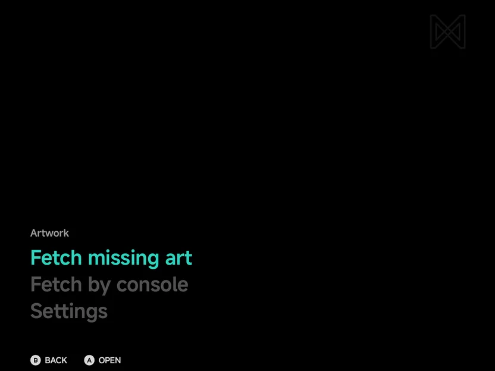
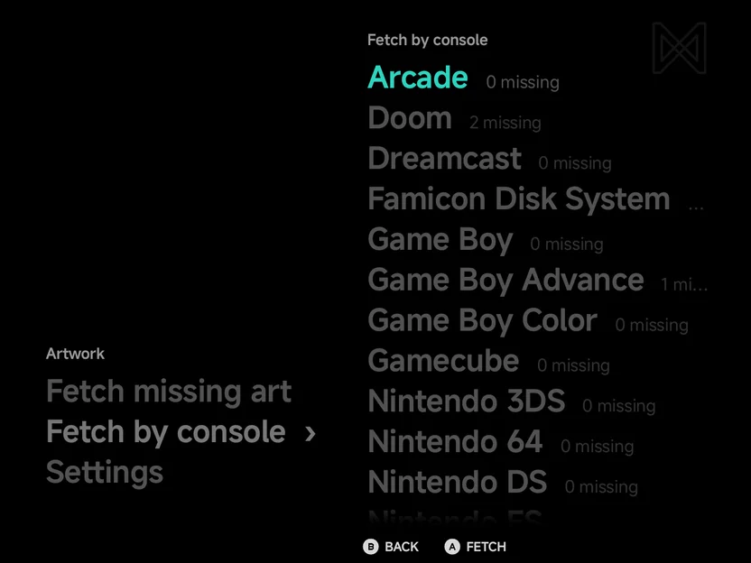
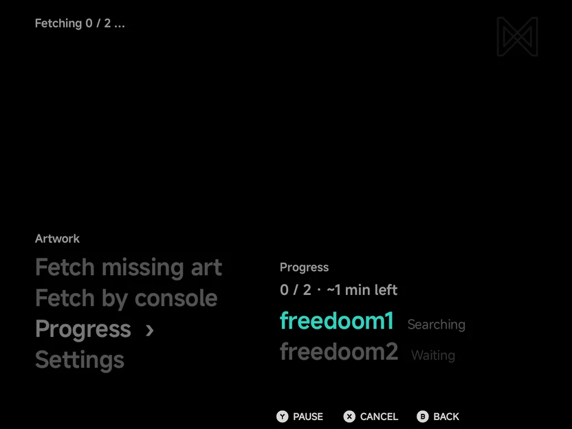
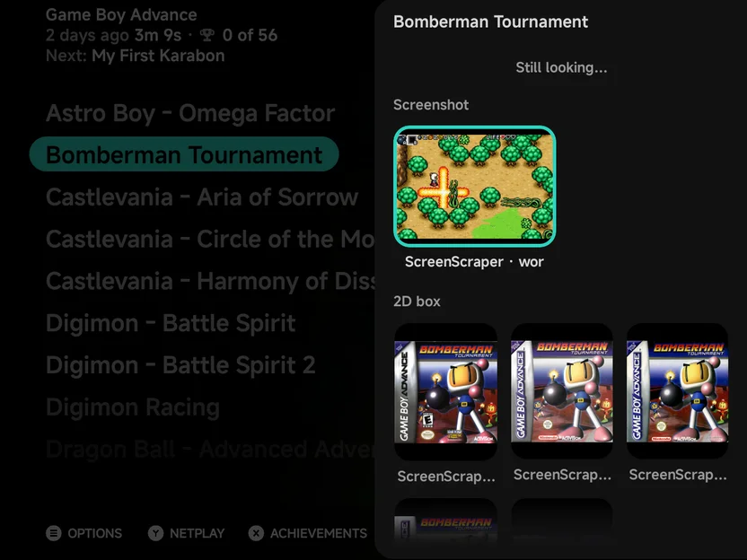
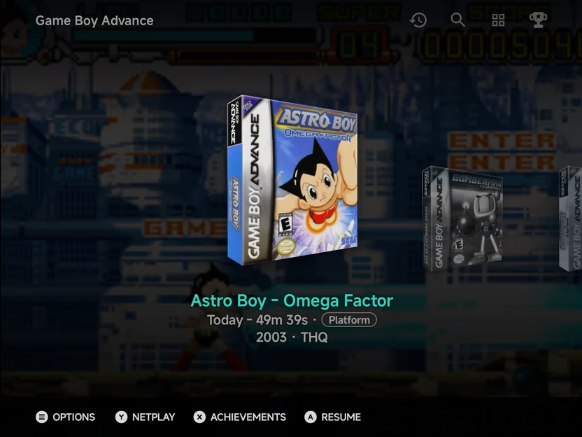
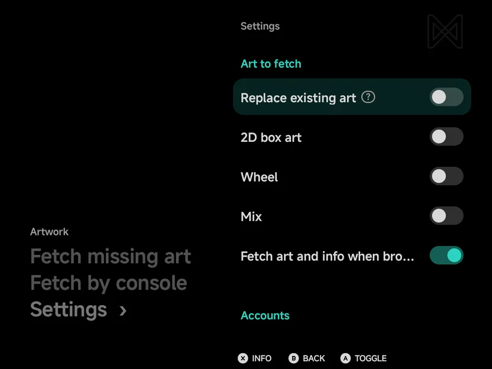

# Artwork

**Tools → Artwork** fetches box art and screenshots for your games, and
each game's [info](#game-info): its synopsis, genre, year and publisher. It
works through your whole library in the background, and you can keep playing
while it runs.

{ .nx-wide }

The page opens with the actions as large words at the bottom left, under a
small **Artwork** label. While a fetch runs or is paused, a line at the top
of the page shows how far it is. `A` opens
a word and `B` goes back to Tools. The words are:

| Row | What it does |
| --- | --- |
| **Resume art fetch (d/t)** | Carries on a paused fetch. Only shown while one is paused. |
| **Fetch missing art** | Fetches art for every game that has none. Reads **Fetch all art** when **Replace existing art** is on. |
| **Fetch by console** | Fetches art for one console. |
| **Progress** | Shows the current or last fetch. Only shown while there is a fetch, until you choose **Done** there. |
| **Settings** | What to fetch, your ScreenScraper login, the SteamGridDB and TheGamesDB keys, **Clear unused images** and **Reset artwork**. See [Settings](#settings). |

??? info "More detail"

    - A source that stopped gets a note at the top of the page.
    - Unassigned games, and folders whose tag no art source knows, are left
      out of the counts and are never fetched.

## Where the art comes from

The app asks several sources in turn and stops as soon as a game has what it
needs. A game is only asked for what it lacks.

- **libretro-thumbnails** and **ScreenScraper** work with nothing from you.
- A free ScreenScraper account goes much further, and **SteamGridDB** and
  **TheGamesDB** are only used with your own free API key. See
  [Accounts and keys](#accounts-and-keys).

??? info "More detail: the order of sources"

    | Art | Sources, in order |
    | --- | --- |
    | **Box art** (3D box) | ScreenScraper 3D box |
    | **2D box art** | ScreenScraper, libretro-thumbnails, TheGamesDB, then a SteamGridDB grid |
    | **Screenshot** | ScreenScraper, libretro-thumbnails, TheGamesDB, then a SteamGridDB hero |
    | **Wheel** (optional) | ScreenScraper, SteamGridDB, then TheGamesDB |

    - A game with its box art and a screenshot is skipped, unless **Replace
      existing art** is on.
    - SteamGridDB fills the gaps. A tall **grid** image is saved as 2D box
      art and a wide **hero** image as the screenshot, each only when that
      picture is still missing.
    - The wheel is only fetched when you turn it on in [Settings](#settings).
    - When a source runs out of requests or stops answering, the fetch carries
      on with the others. The Artwork page shows a note for the source that
      stopped.

## Fetching art

### The whole library or one console

Choose **Fetch missing art** for everything, or **Fetch by console** to pick
one. Fetch by console lists each console with how many of its games lack
art, such as **Dreamcast 6 missing**. Press `A` **Fetch** on one.

{ .nx-wide }

First-run setup can start the same fetch for you. See
[Getting Started](getting-started.md).

??? info "More detail"

    - If there is nothing to fetch, the app says **Every game has art**, or
      **Every *console* game has art** for one console.
    - In first-run setup, the **Fetch artwork** step's **Fetch now** starts
      **Fetch missing art** in the background, or **Fetch all art** with
      **Replace existing art** on.

### Progress

Starting a fetch opens **Progress**. It shows how far it is and the time
left, such as **1 / 2 · ~1 min left**, and each game's status, such as
**Done**, **Partial** or **Not found**.

{ .nx-wide }

| Button | What it does |
| --- | --- |
| `Y` **Pause** / **Resume** | Pauses the fetch, or carries it on |
| `X` **Cancel** | Asks **Cancel art fetch?** Games already fetched keep their art. **Stop** ends the fetch. |
| `A` **Done** | Once the fetch has ended: clears it, and the **Progress** row with it |
| `B` **Back** | Leaves the page. The fetch keeps running. |

On touch, **Pause**, **Cancel** and **Done** are buttons above the list.

??? info "More detail: what each status means"

    The first line can also read **paused**, **done** or **cancelled**. The
    second line counts what the games came to so far, such as **12 fetched ·
    2 partial · 3 not found**.

    | Status | Meaning |
    | --- | --- |
    | **Waiting** | Queued |
    | **Searching** / **Downloading** | Being fetched now |
    | **Done** | Box art and a screenshot were found, followed by the sources used. It adds **no screenshot** when the screenshot is a SteamGridDB hero, not a real one |
    | **Partial** | Only part was found, followed by **no box**, **no screenshot** or, with **Mix** on, **no mix** |
    | **Not found** | No source had art for it |
    | **Skipped** | It already has art, or no source covers its console |
    | **Error** | Something went wrong, followed by the reason |

    Once a fetch has ended, the list keeps only the games to look at: those
    **Not found** and those with an **Error**. The second line counts the
    rest, and with a cancelled fetch, the games **not fetched**.

### In the background

A fetch keeps running when you leave the page, start a game or switch to
another app, with a **Fetching artwork** notification. Art shows up in the
menus as each game finishes. There is no need to rescan.

A paused fetch is kept, even after the app closes. **Resume art fetch (d/t)**
on the Artwork page carries on from where it stopped.

??? info "More detail"

    - The notification has **Pause** and **Cancel** buttons.
    - Android asks once whether the app may show notifications. If you say no,
      the fetch still runs, just without the notification.
    - A fetch pauses by itself when the connection drops, or when it cannot
      write to your home folder.

### On a wide screen

In landscape on a wide screen, such as an unfolded Fold, Artwork works like
[Settings](settings.md): the page of the highlighted word shows on the right.
With a [pad skin](controls.md#pad-skins) on the menu, the skin's screen
decides, not the whole window.
**Fetch missing art** and **Resume art fetch** have no page, so they show
nothing. See
[Foldables & Large Screens](foldables.md#two-pane-screens).

??? info "More detail"

    - A tap on a row of the preview opens that page on the row.
    - With a page open, the Artwork words stay on the left. A tap on one
      opens its page instead.
    - **Reset artwork** opens in the right frame with **Settings ›** lit on
      the left.

### One game

Open a game's context menu with `MENU` in a game list, and choose **Fetch
art**. A panel opens on the right and the app fetches that game straight
away, then shows the pictures it found. `B` closes the panel. See
[Context menus](main-menu.md#context-menus) for the rest of the menu.

A game that already has art shows **Change art** there instead. See
[Change art](#change-art).

??? info "More detail"

    - While it works, the panel says **Fetching art…**, then **Looking for
      pictures…**. Pictures show as each source answers, under **Still
      looking…** until the search ends.
    - With nothing to show it says **No pictures found**.
    - **Fetch art** and **Change art** are only offered for games in a console
      an art source knows.
    - You don't have to fetch a game by hand: resting on a game fetches its
      missing art too. See [Game info](#game-info).

## Change art

**Fetch art** picks one picture for each kind of art and stops. **Change art**
lets you look at what every source has for a game and choose the pictures you
like. It is in a game's context menu (`MENU`), in the same place as **Fetch
art**: a game with no art yet shows **Fetch art**, and a game that has art
shows **Change art**.

Both open a panel on the right. **Fetch art** fetches the game first, then
shows what it found. **Change art** opens straight on the pictures the app
already knows about.

{ .nx-wide }

The panel has one section for each kind of art, in this order. A section with
nothing to pick is left out, and the picture in use is marked.

| Section | Saved to | Pictures come from |
| --- | --- | --- |
| **Screenshot** | `.media/screenshot/` | ScreenScraper, TheGamesDB, libretro-thumbnails, SteamGridDB heroes |
| **2D box** | `.media/boxart2d/` | ScreenScraper, TheGamesDB, libretro-thumbnails, SteamGridDB grids |
| **3D box** | `.media/boxart/` | ScreenScraper |
| **Wheel** | `.media/wheel/` | ScreenScraper, TheGamesDB, SteamGridDB logos |
| **Mix** | `.media/mix/` | ScreenScraper, or the one the app built |

Choose a picture to use it. It replaces the file in that kind's folder, and
you can pick in several sections at once. **Search again**, at the end, asks
the sources for more pictures.

| Button | What it does |
| --- | --- |
| D-pad | Move over the pictures, then to **Search again** |
| `A` | Use the highlighted picture, or search again |
| `B` | Close the panel |

On touch, tap a picture to use it, and tap beside the panel to close it.

??? info "More detail: small previews, and picks that stay"

    - The panel shows small previews. The full picture is only downloaded
      when you pick it. libretro-thumbnails has no small version, so its
      preview is the full picture.
    - The app remembers the links, so opening **Change art** again does not
      ask the sources again. **Clear unused images** deletes the previews.
    - ScreenScraper offers each picture for every region, and they all show.
    - A picture you pick is kept. Later fetches leave it alone, even with
      **Replace existing art** on, until you pick another one or use
      **Reset artwork**.
    - The panel uses **Replace existing art** for the pictures you did not
      pick.
    - A picture whose link no longer works leaves the list. A preview that
      would not load reads **Couldn't load**.
    - The panel takes 60% of the screen's width in portrait and 45% in
      landscape, never under 320 dp and never over 80%.

### Which layout shows it

Picking a 2D box, 3D box or wheel can leave the layout showing a different
kind of box. The panel then asks **Show this picture?**, such as **Layouts →
Backdrop art is set to 3D box art. Switch it to 2D box art?** Choose
**Switch** to change that setting, or **Keep** to leave it.

??? info "More detail"

    - It asks about [Backdrop art](layouts.md#backdrop-art). When Backdrop art
      already matches but [List art](layouts.md#list-art) is a different box
      kind, it asks about List art instead. When both differ, one answer
      switches both.
    - It does not ask when the setting already matches, or when List art is
      Screenshot, Mix or None.
    - Picking a mix asks about List art only: when List art isn't Mix, it
      asks to switch List art to Mix.

### Android games

Games in the Android console have the same menu item and panel. Their
sections are **Screenshot**, **2D box** and **Wheel**, with no 3D box and no
**Mix**. The pictures come from ScreenScraper and SteamGridDB, searched by the
app's name.

??? info "More detail"

    A picked picture is kept in the app's own storage, with the game's
    screenshot. Until a game has a 2D box or a wheel, its screenshot is used
    wherever a box is shown.

    With **Mix** on, an Android game also gets a mix the app builds from its
    screenshot, 2D box and wheel (never from a SteamGridDB hero). It is kept
    with the game's other pictures, shown by
    [List art](layouts.md#list-art) → **Mix**, and deleted by
    [Reset artwork](#reset-artwork).

## Game info { #game-info }

Beside the pictures, the app keeps a few facts about each game: its
**synopsis**, **genre**, **year** and **publisher**. They come from
ScreenScraper, in the same answer as the art, so they cost no extra
requests.

- **With the art:** every fetch on this page, and a game's **Fetch art**,
  store the info of the games they look up.
- **When browsing:** rest on a game in a list for a moment and the app
  fetches its info in the background, along with any art it lacks. This is
  **Fetch art and info when browsing** in [Settings](#settings), on by
  default.

The genre, year and publisher show under a game's play time in the menus,
or the game's achievements where it has some, as
[Layouts → Game info](layouts.md#game-info) picks (achievements by
default). On two screens, the top screen shows them with the synopsis.
See [Dual Screens](dual-screen.md).

{ .nx-wide }

??? info "More detail"

    - The info is kept next to the art, in `.media/info/<game>.json`.
      [Reset artwork](#reset-artwork) deletes it with the art, and
      [Device Sync](device-sync.md) carries it with the art.
    - The browsing fetch is quiet: no notification, no progress and no
      message. It looks up one game at a time, only the game you rest on,
      and never while a fetch from this page runs.
    - When ScreenScraper's daily allowance runs out, the browsing fetch
      stops until the next day. When ScreenScraper can't be reached, it
      tries again a few minutes later.
    - A game that already has all its art is skipped by **Fetch missing
      art**, so its info comes from the browsing fetch, or from a fetch with
      **Replace existing art** on.
    - A game ScreenScraper has no info for is remembered and not asked for
      again while browsing. A fetch with **Replace existing art** on asks
      again.
    - Android games and unassigned games have no info. An Android game shows
      **Game** as its genre.

## Settings

**Artwork → Settings** holds what to fetch, your accounts and keys, Clear
unused images and Reset artwork, on one page, in groups: **Art to fetch**,
**Accounts**, then **Clear unused images** and **Reset artwork**. Its rows
work like [Settings](settings.md#buttons): the On/Off rows are switches, and
the ? icon or `X` **Info** shows a row's full description.

{ .nx-wide }

| Row | Default | What it does |
| --- | --- | --- |
| **Replace existing art** | Off | Fetch art again for games that already have it. **Fetch missing art** then reads **Fetch all art**. |
| **2D box art** | Off | Also fetch the flat 2D cover, beside the 3D box. A SteamGridDB grid is saved as 2D box art either way. |
| **Wheel** | Off | Also fetch the game's logo. |
| **Mix** | Off | Also fetch the handheld's mix picture, or make it on the phone. See [Wheel and mix](#wheel-and-mix). |
| **Fetch art and info when browsing** | On | Fetch a game's missing art and its info when you rest on it in a list. See [Game info](#game-info). |
| **ScreenScraper login** / **ScreenScraper logout** | — | Log in to ScreenScraper, or log out. |
| **SteamGridDB API key** | Not set | `A` asks for the key. Once a key is set, the row is replaced by **Remove SteamGridDB key**. |
| **TheGamesDB API key** | Not set | `A` asks for the key. Once a key is set, the row is replaced by **Remove TheGamesDB key**. |
| **Clear unused images** | — | Delete the small previews kept for Change art. Shows how much space they take. |
| **Reset artwork** | — | Delete art the app fetched. See [Reset artwork](#reset-artwork). |

??? info "More detail"

    - `A`, `LEFT` / `RIGHT` or a tap on the row switch the On/Off rows.
    - Once logged in, the ScreenScraper row shows today's requests under its
      name, such as `312 / 20,000 today`.
    - A key row shows until its key is set; then only **Remove SteamGridDB
      key** or **Remove TheGamesDB key** shows.
    - Once your TheGamesDB key is set, a **TheGamesDB** row shows the requests
      left under its name, such as `896 left this month`.

### Accounts and keys

| Source | What you need |
| --- | --- |
| **ScreenScraper** | Works without an account, on a shared allowance. A free [ScreenScraper](https://www.screenscraper.fr/) account gives you your own daily allowance, which goes much further. |
| **SteamGridDB** | Only used with your own free key from [SteamGridDB](https://www.steamgriddb.com/). |
| **TheGamesDB** | Only used with your own free key from [TheGamesDB](https://thegamesdb.net/). |

Choose **ScreenScraper login** to sign in, or a key row to enter a key. You
type them on the [NX keyboard](about.md#keyboard), which a controller can
drive.

??? info "More detail"

    - **ScreenScraper login** opens **Sign in to ScreenScraper**, with a
      **Username** and a **Password** field. Once you are in, the row reads
      **ScreenScraper logout** with your requests used today. Logout asks
      first: fetches then use the anonymous allowance again.
    - A key is checked before it is saved. If the source turns it down, the
      app says so and does not save it.
    - Login and logout are dimmed while art is downloading.

### Reset artwork

**Reset artwork** opens a list: **All**, then each console. Pick one, and
the app asks **Delete fetched art for *console*? Art you added yourself is
kept.** **Delete** removes it and says how many files went.

Only art the app fetched itself is deleted. Images you put in the folders
yourself stay.

??? info "More detail"

    - A fetch running for the same games is paused first.
    - It also forgets the pictures you picked in Change art for those games,
      along with their saved links and previews.
    - The games' [info](#game-info) files are deleted too.

### Clear unused images

**Clear unused images** deletes the small previews that Change art keeps,
except the pictures in use. It asks **Clear unused images?** first, and
**Delete** removes them. Nothing you see in the menus is lost: the previews
download again the next time you open **Change art**.

### Wheel and mix

The NX Redux handheld shows a game's **wheel** (its logo) and a **mix**: one
picture of the screenshot, the box and the wheel. The app can fetch both, so
a card shared with a handheld has them ready. The app shows them too:
[List art](layouts.md#list-art) can be **Mix** or **Wheel**, and
[Backdrop art](layouts.md#backdrop-art) can be **Wheel**.

??? info "More detail"

    - The mix is 384 × 288.
    - With **Mix** on, ScreenScraper's mix is fetched first and placed on the
      same canvas size as the mixes the app makes. Only when ScreenScraper
      has none does the app build one from the screenshot, box and wheel, the
      way the handheld's
      [Artwork Manager](../handheld/apps/artwork-manager.md) does.
    - A game missing only its mix costs one ScreenScraper request. While
      ScreenScraper is paused or out of quota, it waits.
    - A game needs a screenshot or a box for a built mix. A wheel alone makes
      none. **Wheel** is never locked: it stays your own choice.
    - **Mix** and **Wheel** are separate switches: turning **Mix** on does
      not turn **Wheel** on.
    - With **Mix** on, a game counts as missing art until it has its mix. A
      downloaded or picked mix is never rebuilt. When a later fetch brings a
      new screenshot, box or wheel, an app-made mix is made again, and
      **Replace existing art** may swap it for ScreenScraper's.

## Where art is kept

Fetched art goes in the `.media` folder next to the games, one folder per
kind of image, named after the game's file:

```
Roms/Game Boy Advance (GBA)/Golden Sun.gba
Roms/Game Boy Advance (GBA)/.media/boxart/Golden Sun.png
Roms/Game Boy Advance (GBA)/.media/screenshot/Golden Sun.png
```

- **Your own art:** put images in the same folders by hand. The app picks
  them up when you come back to it or open **Artwork**, and notices art you
  delete the same way.
- **Art from the handheld:** the `.media/` folders made by the handheld's
  [Artwork Manager](../handheld/apps/artwork-manager.md) work here too.

??? info "More detail: folders and special cases"

    | Folder | Image |
    | --- | --- |
    | `.media/boxart/` | 3D box art |
    | `.media/boxart2d/` | Flat 2D cover, including SteamGridDB grids. An older `.media/box2d/` folder is still read. |
    | `.media/screenshot/` | In-game screenshot, including SteamGridDB heroes |
    | `.media/wheel/` | The game's logo, with **Wheel** on |
    | `.media/mix/` | The mix, with **Mix** on |

    - SteamGridDB grids are saved as 2D box art and heroes as screenshots.
      Older `grid/` and `hero/` folders are moved there once, the first time
      the library is scanned; a file is left where it is when its new folder
      already has one you placed yourself.
    - Each image is named after the game's file without its extension, as a
      `.png` or `.jpg`. The app uses your own images like fetched art.
    - The handheld's old untyped mix image (`.media/<game>.png`) is ignored.
    - `.media/info/` holds each game's [info](#game-info) as a `.json` file,
      not a picture.
    - **Multi-disc games** kept in their own folder: the art goes in the
      `.media` of the folder above it, named after the game's folder.
    - **Extra ROM folders:** the app writes only inside your home folder. Art
      it fetches for a game in an extra folder goes in
      `Roms/.sources/<id>/<folder>/.media/` in your home folder. A `.media`
      folder you keep next to the games in the extra folder is still read,
      and its images win.

## Where each image shows

Backgrounds and tiles show the screenshot. Boxes show the box art that
[Backdrop art](layouts.md#backdrop-art) picks, and the app falls back to
another kind when that one is missing.

??? info "More detail: every place and its fallbacks"

    **The screenshot only:** every full-screen background (including game
    list backgrounds in List and Backdrop), Carousel tiles, Grid tiles and
    Home's pinned games. Without a screenshot they show the generated
    [abstract art](#abstract-art). A SteamGridDB hero is wide, so it is used
    on wide tiles and landscape backgrounds, but never on a portrait
    background.

    **Boxes** follow **Layouts → Backdrop art** (3D box art, 2D box art or
    Wheel), then fall back through 3D box, 2D box, then wheel. They are:

    | Place | What it shows |
    | --- | --- |
    | **The box** in Backdrop | The box, drawn in a case. A wheel keeps its own shape. Without any, an empty case. |
    | **List art**, with a boxed kind | The same chain, starting from the picture List art names |
    | **The game panel** header | The same chain. Without any, the console's logo. |
    | **The [Game Switcher](game-switcher.md)**, when a game has no resume screenshot | The same chain. Without any, **No Preview**. |

    Other places:

    | Place | What it shows |
    | --- | --- |
    | **Home's Continue card** | The game's last frame, then the screenshot |
    | **[RetroAchievements](retroachievements.md)** game list | The screenshot, then the 3D box art, then the 2D cover |
    | **[Game Tracker](game-tracker.md)** | The 3D box art, then the 2D cover, then the screenshot |

    - Android games keep their screenshot as the last fallback for a box and
      the game panel header. They have no 3D box.

### Abstract art

A game with nothing to show gets generated abstract art: a soft gradient
with a few large shapes. It does not count as art, so the game still shows as
missing and is still fetched.

??? info "More detail"

    It is the same for the same game every time, and fills any place above
    that has no real image.

### Android games

Games in the Android console get their art here too, through **Fetch
missing art** or **Fetch by console → Android**. Only a screenshot is
fetched. Pick a 2D box or a wheel in [Change art](#android-games). See [Android games](launcher.md#android-games) for adding them.

??? info "More detail"

    - The fetched screenshot comes from ScreenScraper only.
    - With **Mix** on, the app also builds a mix from the screenshot. See
      [Change art](#android-games).
    - It is kept inside the app's own storage, not in your home folder.
    - Until it has one, an Android game shows abstract art in its icon's
      colours, with the icon in the middle.

## Credits

Art comes from these sources.

- [ScreenScraper](https://www.screenscraper.fr/): box art, screenshots and
  wheels
- [libretro-thumbnails](https://github.com/libretro-thumbnails/libretro-thumbnails):
  box art and screenshots, from the libretro project
- [TheGamesDB](https://thegamesdb.net/): box art, screenshots and logos
- [SteamGridDB](https://www.steamgriddb.com/): grids (as 2D box art),
  heroes (as screenshots) and logos
