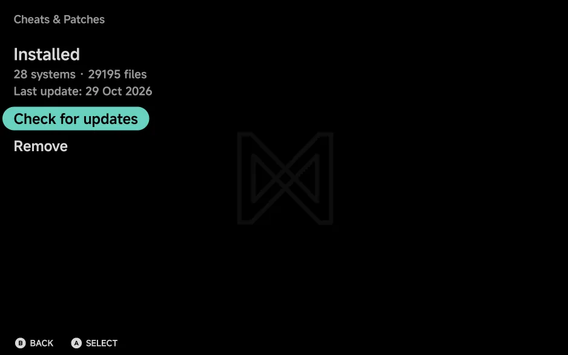

# Cheats & Patches

NX Redux uses [libretro](https://www.libretro.com/)'s cheat
collection, and [PCSX2](https://pcsx2.net/)'s game patches for the
PlayStation 2. Download them once from **Tools → Cheats & Patches**, then turn
cheats on and off on the **Cheats** tab of a game's
[in-game menu](in-game-menu.md#cheats). PS2 patches and cheats work
differently: see [PlayStation 2](#playstation-2).

Unlike the handheld, there is no separate tool to install first: Cheats &
Patches is part of the app.

## Downloading the cheats

Open **Tools → Cheats & Patches** and choose **Download (about 39 MB)**.

{ .nx-wide }

- You need about 400 MB of free space. With less, it stops with **Not enough
  space (needs about 400 MB free)**.
- A progress bar follows the download and install. `B` cancels.
- When it is done, the page shows **Installed**.

One download covers every supported system: libretro's cheats and PCSX2's
PS2 patches come down together. Wii and GameCube games use
Dolphin's own codes instead. See
[Nintendo Wii & GameCube](emulators/wii-gamecube.md#cheats-and-achievements).

??? info "More detail"

    - Before the first download the page shows **Not installed**, the download
      size and how many systems it covers.
    - The install goes system by system (**Installing** followed by the
      system's tag and count).
    - Once installed, the page shows the number of systems and files, and the
      date of the last update.
    - The download has no Wii or GameCube cheats.
    - If PCSX2's patches can't be fetched, libretro's cheats still install,
      and the message ends **(PS2 patches could not be downloaded)**. The next
      **Check for updates** tries again.

## Keeping it up to date

With the cheats installed, the page offers **Check for updates** and
**Remove**.

- **Check for updates** downloads again only when libretro's cheats or
  PCSX2's patches have changed, or when the app now has cheats for systems
  your copy doesn't.
- **Remove** deletes the downloaded files, after asking. Your own cheat files
  stay.

??? info "More detail"

    - When nothing changed, **Check for updates** reports **Cheats & Patches
      are up to date**. With no connection it reports **Could not check for
      updates (Wi-Fi?)**.
    - libretro's cheats count as changed when someone edits them in
      libretro's database, not merely when libretro rebuilds its download. If
      that can't be checked, the download's date decides.
    - **Remove** asks **Remove Cheats & Patches?** Your own cheat and patch
      files stay.

## Where the files go

With [All files access](library.md#all-files-access) on, the cheats go in
your home folder, in `Cheats/<TAG>/`, one folder per system, as on the
handheld. They stay there if you uninstall the app, so a reinstall finds them
already installed.

Without All files access, they go in `Cheats/<TAG>/` inside
`Android/media/com.nxredux.mobile/` instead, which Android removes if you
uninstall the app.

Some systems have no cheats, because their emulators don't take them, such as
Nintendo 3DS and Atari 2600.

??? info "More detail"

    - The systems with no cheats: Neo Geo Pocket, Virtual Boy, Atari 2600 and
      5200, Pokémon mini, PICO-8 and Nintendo 3DS.
    - The cheats are libretro `.cht` files. To add your own, put them in the
      system's `Cheats/<TAG>/` folder, such as `Cheats/GBA/`.
    - There is one folder per console, as in `Roms`, whichever emulator runs
      the game: Game Boy Advance on mGBA reads `Cheats/GBA/`, Super Nintendo
      on Supafaust reads `Cheats/SFC/`, PlayStation on SwanStation reads
      `Cheats/PS/`, and Genesis Plus GX reads `Cheats/MD/`. Super Game Boy
      has its own `Cheats/SGB/`.
    - Cheats an earlier version kept inside the app move to the home folder by
      themselves the first time you open the app with All files access on.
      A file already in the home folder is never replaced.
    - The download's list of what it installed is kept in
      `.userdata/shared/xtras/cheatdb.manifest`, next to the cheats.
    - With All files access off, or a home folder the app can't reach, the
      app reads and installs cheats in `Android/media/com.nxredux.mobile/`.
    - The download installs folders only for systems whose core takes cheats.
    - Arcade (`FBN`), Dreamcast, ColecoVision, Atari 7800 and Atari Lynx
      cheats change the game's memory directly, every frame, instead of going
      through the emulator. You turn them on and off the same way.
    - A game reads its own system's folder, even when it sits in another
      system's `Roms` folder: a Sega CD disc in `Sega Genesis (MD)` reads
      `Cheats/SEGACD/`, a `.fds` disk in `Nintendo ES (FC)` reads
      `Cheats/FDS/`, and a PC Engine CD game reads the PC Engine CD cheats.
      Game Boy and Game Boy Color look in each other's folder when their
      own has nothing.

## Using cheats in a game

1. Open the [in-game menu](in-game-menu.md). The game panel sits beside the
   first page.
2. Open its **Cheats** tab: tap it, or press `RIGHT` to move into the panel
   and `L1` / `R1` to reach the tab.
3. Tap a cheat to turn it **On** or **Off**, or move `DOWN` onto it and
   press `A`. It applies straight away.
4. To keep your cheats for next time, use **Options → Save Changes → Save
   for game**.

{ .nx-wide }

If no cheat file matches the game, the tab says **No cheats for this game.**
and how to add some: download them with **Tools → Cheats & Patches**, or add a
RetroArch `.cht` file to the game's `Cheats/<TAG>/` folder.

!!! tip "Variants are merged"
    Some games have cheats from several sources, such as GameShark or Action
    Replay. They all show in one list, and each cheat names its source under
    its name, such as **GameShark**.

{ .nx-wide }

??? info "More detail: how a game's cheats are found"

    - The app finds the game's cheat file by the ROM's file name first, then
      by the game's name, then by the first file whose name starts with the
      game's name.
    - PSP games are matched by their game ID, such as `ULUS10041`, from the
      disc itself. When the ID can't be read, such as for a `.chd`, the
      region in the file name picks the file.
    - A ROM named without a region, such as `Contra III - The Alien Wars.sfc`,
      takes the USA cheats, then World, then Europe. Packs named only after
      their source, such as `(Rumbles)`, come after those.
    - Names that differ only in spaces or punctuation still match:
      `Soulcalibur` finds `Soul Calibur.cht`, and `Marvel vs Capcom 2` finds
      `Marvel Vs. Capcom 2.cht`.
    - With no match, the tab also names the file it looked for, such as
      `Cheats/GBA/` and the file name.
    - For merged cheats, the app loads every cheat file for the game's name
      and region into one list.

## PlayStation 2

The PS2 core reads cheats and patches itself, so PS2 games have no list on the
**Cheats** tab. Turn them on in **Core Options** in
[Game Settings](emulator-settings.md#game-settings) or
[Emulator Settings](emulator-settings.md); they need the game restarted, so
the in-game menu doesn't list them.

| What | Where | Core Option |
| --- | --- | --- |
| PCSX2's widescreen and no-interlacing patches | `Cheats/PS2/Patches/`, from the download | **Widescreen Patches**, **No-Interlacing Patches** |
| Your own `.pnach` cheats | `Cheats/PS2/`, named after the game's serial and CRC, such as `SLUS-21678_428113C2.pnach` | **Cheats** |

With **Cheats** on, every cheat in the game's file is on: delete the lines for
the ones you don't want. See
[PlayStation 2](emulators/playstation-2.md#cheats-patches).

## Cheats and RetroAchievements

[RetroAchievements](retroachievements.md) on mobile is **softcore only**,
so there is no hardcore mode to block cheats. You can turn cheats on
with achievements enabled.
