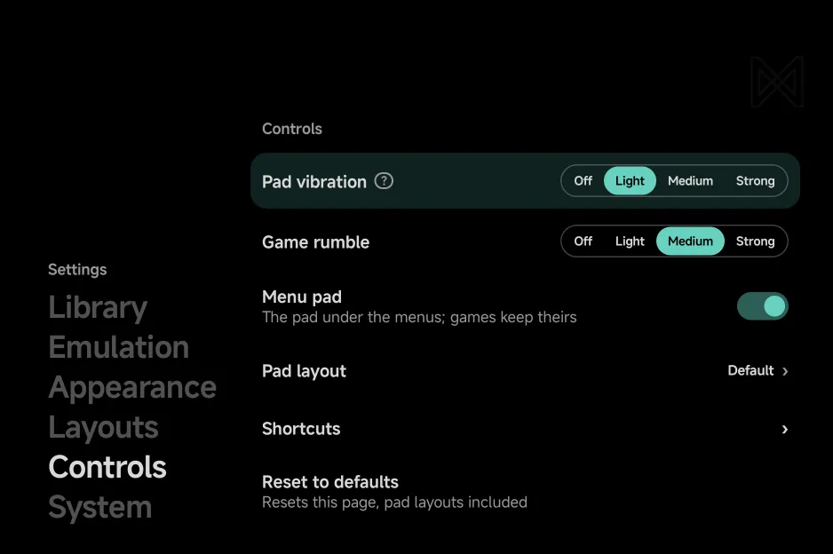
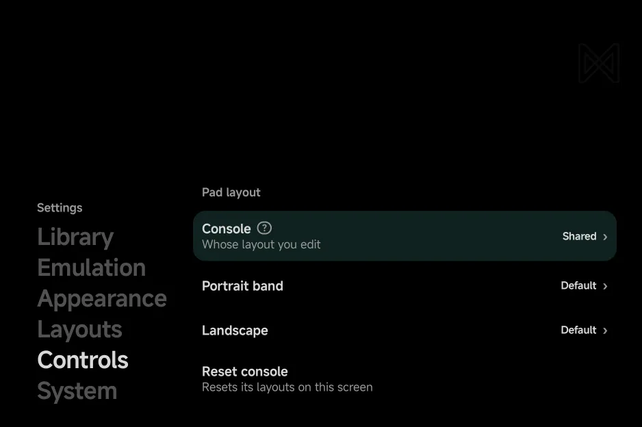

# Controls settings

**Tools → Settings → Controls** sets how strong the vibration is, whether the
main menu has the on-screen pad, where the pad's buttons sit, and your
in-game shortcuts. The rows
work as on every [Settings](settings.md#buttons) page: `Left` / `Right` step
a value, and `A` or a tap flips a switch or picks a choice.

| Setting | What it does | Values | Default |
| --- | --- | --- | --- |
| [**Pad vibration**](#pad-vibration) | Tick when you press the on-screen pad | Off, Light, Medium, Strong | Light |
| [**Game rumble**](#game-rumble) | Strength of the game's own rumble | Off, Light, Medium, Strong | Medium |
| [**Menu pad**](#menu-pad) | On-screen pad below the main menu | On, Off | On |
| [**Pad layout**](#pad-layout) | Move and resize the pad's buttons | Default, Custom | Default |
| [**Shortcuts**](#shortcuts) | Controller buttons and touch buttons for fast forward, rewind, reset and Save & Quit | | |
| [**Reset to defaults**](#reset-to-defaults) | Puts this page back to its defaults | | |

{ .nx-wide }

## Pad vibration

A short tick when you press the on-screen pad. A controller never makes the
phone tick. It also follows Android's touch feedback setting: with that off,
the pad stays silent whatever you pick here.

When it ticks: see [Controls → Pad vibration](controls.md#pad-vibration).

## Game rumble

The game's own rumble, on the controller you play with when it has a motor,
else on the phone. Changing the level plays a short pulse at that strength,
so you can feel it. **Off** plays none. In a
[multiplayer](multiplayer.md#rumble) game it sets the strength for every
player.

Which consoles rumble, and the Nintendo 64's Rumble Pak: see
[Controls → Game rumble](controls.md#game-rumble).

## Menu pad

The on-screen pad below the main menu in portrait. Set it to **Off** to take
the pad away: the main menu, the game lists and the Game Switcher then run to
the bottom of the screen, and you use them by touch or with a controller.
Games keep their pad, whatever this says.

??? info "More detail"
    - With it on, the pad shows on the main menu, the game lists, the Game
      Switcher and a game's Game Settings, and on the **Appearance** and
      **Controls** pages. The tools never show it.
    - With the pad off and no controller, the screens have no hint bar and
      use touch controls instead. See
      [Controls → In the menus](controls.md#in-the-menus).

## Pad layout

Moves and resizes the on-screen pad's buttons. The row reads **Custom** once
you have changed a layout, and `A` opens its page:

| Row | What it does |
| --- | --- |
| **Console** | Whose layout you edit: **Shared**, or one of the consoles in your library |
| **Portrait band** | Opens the editor for the pad below the screen in portrait, in games and on the main menu |
| **Landscape** | Opens the editor for the pad halves beside a landscape game |
| **Half-folded** | Opens the editor for the Nintendo DS and 3DS pad beside the touch screen on a [half-folded](foldables.md#nintendo-ds-and-3ds-half-folded) foldable. Shows for **Shared**, Nintendo DS and Nintendo 3DS, on the inner screen of a foldable |
| **Reset console** | Puts the chosen console's layouts on this screen back |

{ .nx-wide }

**Shared** is the layout every console uses. A console you give a layout of
its own uses that instead.

In the editor:

- Tap a group of buttons to select it, and drag it to move it.
- Drag the selected group's corner to resize it.
- Press **Save** when you are done. Leaving with changes you haven't saved
  asks **Discard changes?** first.

??? info "More detail"
    - Each layout row reads **Default** (the default pad), **Custom**, or
      **Shared** (a console that follows Shared).
    - The main menu's pad always uses the Shared portrait layout.
    - Each screen size keeps its own layouts: a Fold's cover screen and its
      inner screen, for example, are set up apart. The page edits the screen
      you are on. A screen with no layout yet starts from the other screen's.
    - The editor opens full screen, turned to the layout's orientation, with
      a grey block where the game goes. In landscape the block and the pad
      sit where a game of that console puts them, so the preview matches
      the game. **Half-folded** shows the DS or 3DS top screen above a line
      for the hinge, and the touch screen between the two halves below it.
    - Landscape moves and sizes made before the pad moved beside the game
      were cleared once, since they were made for the old spots. Portrait
      layouts were kept.
    - A group is the d-pad, the face buttons, a pair of shoulders or a pair
      of system buttons. Dropped near its usual spot, a group snaps back
      there.
    - Groups resize from 70% to 150%. Groups that overlap are outlined in
      red.
    - The panel names what you are editing, or the selected group's size,
      over **Reset** (the selected group), **Reset all**, **Cancel** and
      **Save**. Drag the panel aside when it covers a group.

## Shortcuts

Actions you can run during play: from a controller button or a `MENU` +
button combination, or from up to two touch buttons on the on-screen pad.
Nothing is bound by default. Every console and game uses these, unless its
in-game [Options → Shortcuts](in-game-menu.md#shortcuts) page sets its own.

| Shortcut | What it does |
| --- | --- |
| **Toggle FF** / **Hold FF** | Fast forward: on and off with each press, or only while held. |
| **Toggle Rewind** / **Hold Rewind** | Rewind: on and off with each press, or only while held. Needs [Rewind](in-game-menu.md#console-settings) turned on for the console. |
| **Reset Game** | Restart the game. It asks first. |
| **Save & Quit** | Save your place and leave the game, as the in-game menu's [Save & Quit](in-game-menu.md#quitting) does. A controller's only: it can't be a touch button. |
| **Toggle mic** | Nintendo DS and 3DS only, as its row says: turn the game's [Mic](emulators/nintendo-ds.md#microphone) on or off. A controller's only: the pad has its own mic button. |

Fast forward runs at the console's **Max FF Speed**, and turning on fast
forward turns rewind off, and the other way round. See
[Console Settings](in-game-menu.md#console-settings).

### Binding a button

- Press `A` on a shortcut, then press the button you want. For a
  combination, hold `MENU` and press another button.
- `B` cancels the wait, and `X` sets the shortcut back to **None**.
- Each button or combination does one thing. Pressing one another shortcut
  already uses moves it to this shortcut, and the other one becomes
  **None**.

Binding needs a controller, since the on-screen pad can't be bound. With
no controller connected, the shortcut rows are hidden and the page reads
**Connect a controller to bind buttons**: use the
[touch buttons](#touch-buttons) instead. The rows come back, with what you
bound, when a controller connects.

Prefer `MENU` + button combinations. A shortcut on a plain button the game
also uses takes that button from the game, while a combination leaves every
button to the game.

??? info "More detail"
    - `MENU` alone and `SELECT` + `START` open the in-game menu, and `SELECT`
      and `START` stay the game's, so `MENU` alone, `SELECT` and `START`
      can't be bound, alone or in a combination.
    - A console's own hotkeys win over shortcuts. On the Nintendo DS, for
      example, `R2` swaps the screens and `L2` is the stylus, so a shortcut
      on either shows **Unavailable** in that console's games. See
      [Console shortcuts](controls.md#console-shortcuts).
    - With any `MENU` combination bound, `MENU` opens the menu when you let
      go of it, and only after a short press: holding it for a combination
      never opens the menu.
    - Shortcuts are off during a [netplay](netplay.md) match, since they
      would put the players out of step.
    - Only the first player's controller runs shortcuts.

### Touch buttons

**Touch button 1** and **Touch button 2** put a button on the on-screen pad
for one action. **None**, the default, leaves it off the pad. A hold action
works while your finger stays on it, and a toggle flips with each tap.
Move them with the other buttons in [Pad layout](#pad-layout).

??? info "More detail"
    - A rewind button is hidden while the console's **Rewind** is off, or in
      a game that can't rewind.
    - **Save & Quit** and **Toggle mic** aren't offered for the touch buttons.
    - The touch buttons are hidden during a netplay match.

### Clear all

Sets every shortcut to **None** and takes both touch buttons off the pad.
With no controller connected, it still clears the hidden shortcut rows.

## Reset to defaults

Puts **Pad vibration**, **Game rumble** and **Menu pad** back to their
defaults, and every pad layout back to the default pad. It does not ask
first. Your [shortcuts](#shortcuts) stay: **Clear all** on their page
clears them.
