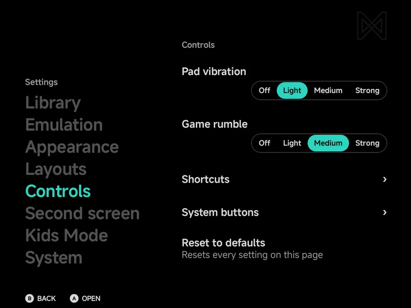
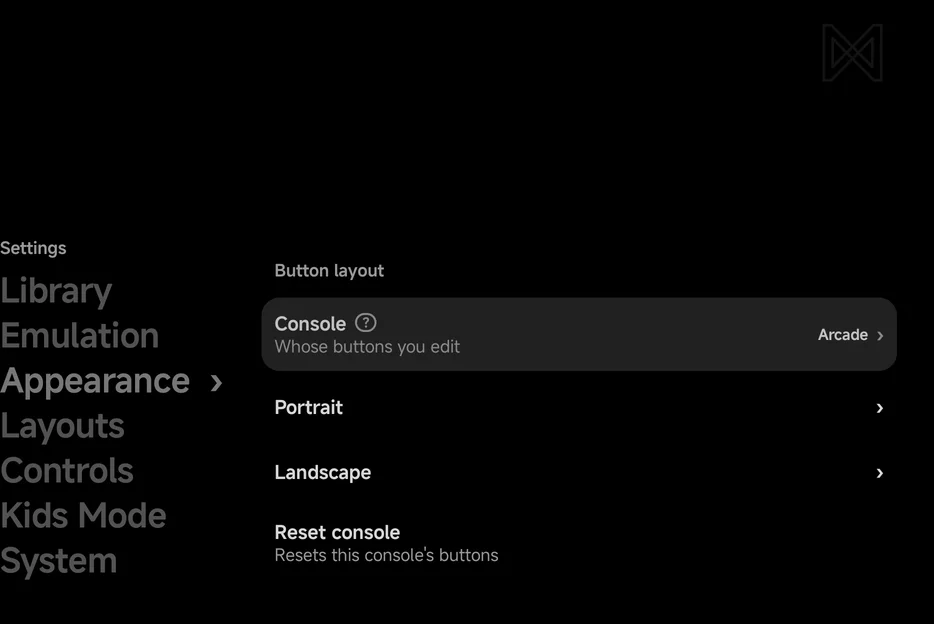
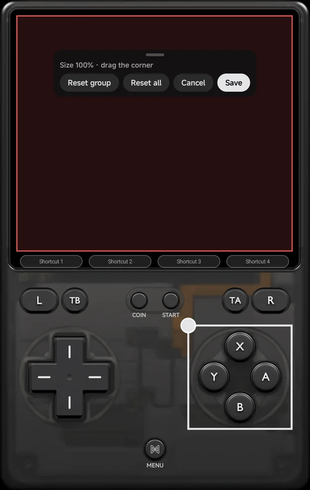

# Controls settings

**Tools → Settings → Controls** sets how strong the vibration is, your
in-game shortcuts, and which controller buttons are `SELECT`, `START` and
`MENU`. The rows work as on every [Settings](settings.md#buttons) page:
`Left` / `Right` step a value, and `A` or a tap flips a switch or picks a
choice. Where Settings shows two panes, press `A` on a row first; see
[Two-pane screens](foldables.md#settings).

| Setting | What it does | Values | Default |
| --- | --- | --- | --- |
| [**Pad vibration**](#pad-vibration) | Tick when you press the on-screen pad | Off, Light, Medium, Strong | Light |
| [**Game rumble**](#game-rumble) | Strength of the game's own rumble | Off, Light, Medium, Strong | Medium |
| [**Shortcuts**](#shortcuts) | Controller buttons and touch buttons for fast forward, rewind, save states and reset | | |
| [**System buttons**](#system-buttons) | Which buttons on your controller are `SELECT`, `START` and `MENU` | | |
| [**Reset to defaults**](#reset-to-defaults) | Puts this page back to its defaults | | |

Moving and resizing the on-screen buttons is on the Appearance page: see
[Button layout](#button-layout).

{ .nx-wide }

## Pad vibration

A short tick when you press the on-screen pad. A controller never makes the
phone tick. It also follows Android's touch feedback setting: with that off,
the pad stays silent whatever you pick here.

When it ticks: see [Controls → Pad vibration](controls.md#pad-vibration).

## Game rumble

The game's own rumble, on the controller you play with when it has a motor,
else on the phone. Changing the level plays a short pulse at that strength,
so you can feel it. **Off** plays none. In a
[multiplayer](multiplayer.md#rumble) game it sets the strength for every
player.

Which consoles rumble, and the Nintendo 64's Rumble Pak: see
[Controls → Game rumble](controls.md#game-rumble).

## Button layout

Moves and resizes the on-screen buttons, for one console at a time. Open it
from **Tools → Settings → [Appearance](appearance.md#button-layout) → Button
layout**, or during a game from the in-game menu's **Options → Controls →
Adjust buttons**. The Appearance row reads **Custom** once any console has a
change, and `A` opens its page:

| Row | What it does |
| --- | --- |
| **Console** | Whose buttons you edit: any console, by name |
| **Controller** | On the Wii, which controller: **Classic**, **Nunchuk**, **Sideways** or **Upright**. On the Nintendo 3DS, **Regular** or **New** (with `ZL`, `ZR` and the C-stick). Other consoles have no such row |
| **Portrait** | Opens the editor for the console's portrait layout |
| **Landscape** | Opens the editor for the console's landscape layout |
| **Reset console** | Puts the chosen console's buttons back where the skin puts them, portrait and landscape. It asks first |

{ .nx-wide }

**Adjust buttons** skips this page: it opens the editor on the layout the
game is showing.

In the editor:

- Tap a group of buttons to select it, and drag it to move it.
- Drag the selected group's corner to resize it.
- Press **Save** when you are done. Leaving with changes you haven't saved
  asks **Discard changes?** first.

The editor edits what is drawn. With
[Pad skin](appearance.md#pad-skin) on it edits the skin, and its title ends
in **Pad skin**. With Pad skin off, or where no skin layout fits, it edits
the see-through buttons, and its title ends in **Overlay**.

| | Pad skin | Overlay |
| --- | --- | --- |
| Where a group can go | Anywhere in the window, and up to 10% into a screen from each edge. The rest of the screen is tinted red | Anywhere, over the game too |
| Starts from | The skin's own layout | The skin's layout, with your Pad skin changes, until you move a button here |

<figure class="nx-phone" markdown>
{ .nx-phone__screen }
{ .nx-phone__frame }
</figure>

In both, a group can be made as small as a 32 dp touch area, buttons may
overlap to the eye, and two buttons' touch areas never overlap.

??? info "More detail"
    - Each console keeps its own layout, in portrait and in landscape, and
      each Wii controller and the regular and New 3DS keep theirs.
    - The editor opens full screen, turned to the layout's orientation, and
      shows the layout a game would show on this screen. From **Adjust
      buttons** the paused game is behind it.
    - A group is the buttons drawn together on the skin, such as the d-pad,
      the face buttons or a pair of shoulders: pieces join a group only
      where they overlap by at least a quarter of the smaller one. The row
      of touch shortcuts is a group too, and shows as **Shortcut 1** to
      **Shortcut 4** so you can see it. On a Nintendo DS or 3DS skin whose
      shortcut row hangs under the touch screen, that row is a group of its
      own, so it can be moved.
    - The editor draws every button at full opacity, whatever
      **Pad Opacity (landscape)** is.
    - The panel names what you are editing, or the selected group's size,
      over **Reset group**, **Reset all**, **Cancel** and **Save**. Drag the
      panel aside when it covers a group.
    - On the Overlay, **Reset group** and **Reset all** go back to the
      skin's positions.
    - A drag stops at a neighbouring group. To pass it, drag clear to the
      far side in one movement.
    - On a layout made for half-folding, the band round the hinge stays
      clear.
    - A window with no layout of its own, such as split screen, uses the
      closest layout, scaled.

## Shortcuts

Actions you can run during play: from a controller button or a `MENU` +
button combination, or from up to four touch buttons on the on-screen pad.
Out of the box no controller button is bound, and **Touch button 3** and
**Touch button 4** are **Save State** and **Load State**. Every console and
game uses these, unless its in-game
[Options → Shortcuts](in-game-menu.md#shortcuts) page sets its own.

| Shortcut | What it does |
| --- | --- |
| **Toggle FF** / **Hold FF** | Fast forward: on and off with each press, or only while held. |
| **Toggle Rewind** / **Hold Rewind** | Rewind: on and off with each press, or only while held. Needs **Rewind** turned on for the console, under [Options → Gameplay](in-game-menu.md#options). |
| **Reset Game** | Restart the game. It asks first. |
| **Save State** / **Load State** | Save to, or load from, the save state slot you used last. |
| **Save & Quit** | Save your place and leave the game, as the in-game menu's [Save & Quit](in-game-menu.md#quitting) does. A controller's only: it can't be a touch button. |
| **Toggle mic** | Nintendo DS and 3DS only, as its row says: turn the game's [Mic](emulators/nintendo-ds.md#microphone) on or off. A controller's only: the pad has its own mic button. |

Fast forward runs at the console's **Max FF Speed**, and turning on fast
forward turns rewind off, and the other way round. See
[Options → Gameplay](in-game-menu.md#options).

### Binding a button

- Press `A` on a shortcut, then press the button you want. For a
  combination, hold `MENU` and press another button.
- `B` or Back cancels the wait, and `X` sets the shortcut back to **None**.
- Each button or combination does one thing. Pressing one another shortcut
  already uses moves it to this shortcut, and the other one becomes
  **None**.

Binding needs a controller, since the on-screen pad can't be bound. With
no controller connected, the shortcut rows are hidden and the page reads
**Connect a controller to bind buttons**: use the
[touch buttons](#touch-buttons) instead. The rows come back, with what you
bound, when a controller connects.

Prefer `MENU` + button combinations. A shortcut on a plain button the game
also uses takes that button from the game, while a combination leaves every
button to the game.

??? info "More detail"
    - `MENU` alone and `SELECT` + `START` open the in-game menu, and `SELECT`
      and `START` stay the game's, so `MENU` alone, `SELECT` and `START`
      can't be bound, alone or in a combination. `B` and Back alone cancel
      the wait, so they bind only in a `MENU` combination.
    - A console's own hotkeys win over shortcuts. On the Nintendo DS, for
      example, `L3`, `R3`, `L2`, `R2`, `SELECT` + `L1` and `SELECT` + `R1`
      are taken, so a shortcut on one of them shows **Unavailable** in that
      console's games. See
      [Console shortcuts](controls.md#console-shortcuts).
    - With any `MENU` combination bound, `MENU` opens the menu when you let
      go of it, and only after a short press: holding it for a combination
      never opens the menu.
    - Shortcuts are off during a [netplay](netplay.md) match, since they
      would put the players out of step.
    - Only the first player's controller runs shortcuts.
    - If your `MENU` button does nothing, set it in
      [System buttons](#system-buttons).

### Touch buttons

**Touch button 1** to **Touch button 4** each put a button on the on-screen
pad for one action. **None** leaves it off the pad. A hold action works
while your finger stays on it, and a toggle flips with each tap.

- With a [pad skin](controls.md#pad-skins), all four sit in the row under
  the skin's screen.
- With Pad skin off, they are see-through pills over the game.
- With a controller connected, the ones you set show as pills in the
  bottom-right corner of the screen.

Move the row with the other buttons in [Button layout](#button-layout).

??? info "More detail"
    - A rewind button is hidden while the console's **Rewind** is off, or in
      a game that can't rewind.
    - **Save & Quit** and **Toggle mic** aren't offered for the touch buttons.
    - Two touch buttons can have the same action.
    - The touch buttons are hidden during a netplay match. While a game's
      [local wireless](local-wireless.md) is on, the save, load, fast
      forward, rewind and reset buttons are hidden.

### Clear all

Sets every shortcut to **None** and takes every touch button off the pad,
**Save State** and **Load State** included. It asks first. With no
controller connected, it still clears the hidden shortcut rows.

## System buttons

Which buttons on your controller are `SELECT`, `START` and `MENU`. Most
controllers need nothing here: where a controller has no `SELECT`, `START`
or mode button, the app already reads its Back or Menu key as the missing
one (see [Controller buttons](controls.md#controller-buttons)). Use this
page when a button still does nothing or does the wrong thing. Pick the
button to use for each, and it then acts only as that, in the menu and in
games.

The page shows the controller you pressed last, with a row for each
button:

| Row | Value |
| --- | --- |
| **SELECT**, **START**, **MENU** | **Standard** (the controller's own button), or the button you picked |
| **Reset to defaults** | Puts this controller's three buttons back to **Standard**. It asks first |

Select a row and press `A`, then press the button to use. `B` cancels. A
button another row already had swaps with this one. Each controller model
keeps its own buttons. With no controller connected, the page says to
connect one.

While a row waits, it also takes a button from a device that isn't a
gamepad, such as a handheld's own buttons that sit beside its pad. Volume
and power are never bound.

`MENU` is optional: without one, `SELECT` + `START` opens the menu.

??? info "More detail"

    - A controller's Back key can be bound like any button.
    - A button Android has no key code for is kept by its scan code and
      shows as **Button** and a number.
    - A button you bind wins over the Back and Menu stand-ins, and a role
      you bind to another button no longer takes its stand-in.
    - A second device that also reports itself as a gamepad counts as
      another controller, so its buttons aren't taken while the first one's
      row waits.
    - Some handhelds' own apps catch a button before any game does. On the
      AYANEO Pocket Air Mini, remove AYASpace's Custom Keys action for the
      button first, or NX Redux never receives it.

## Reset to defaults

Puts **Pad vibration** and **Game rumble** back to their defaults. It asks
first: `A` resets, `B` keeps everything. Your [shortcuts](#shortcuts),
[system buttons](#system-buttons) and [button layouts](#button-layout)
stay: each has its own reset.
