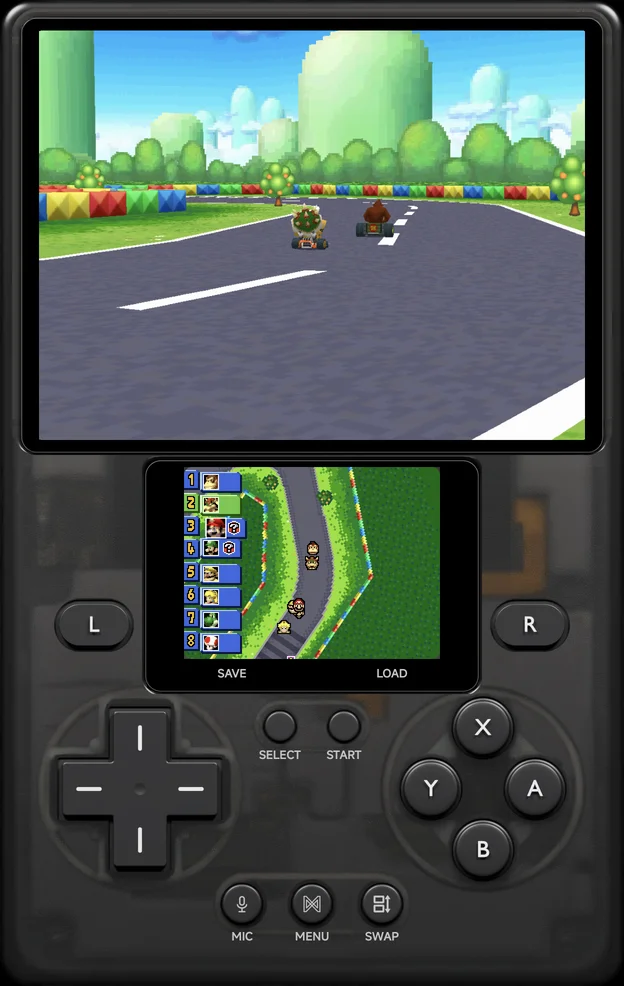
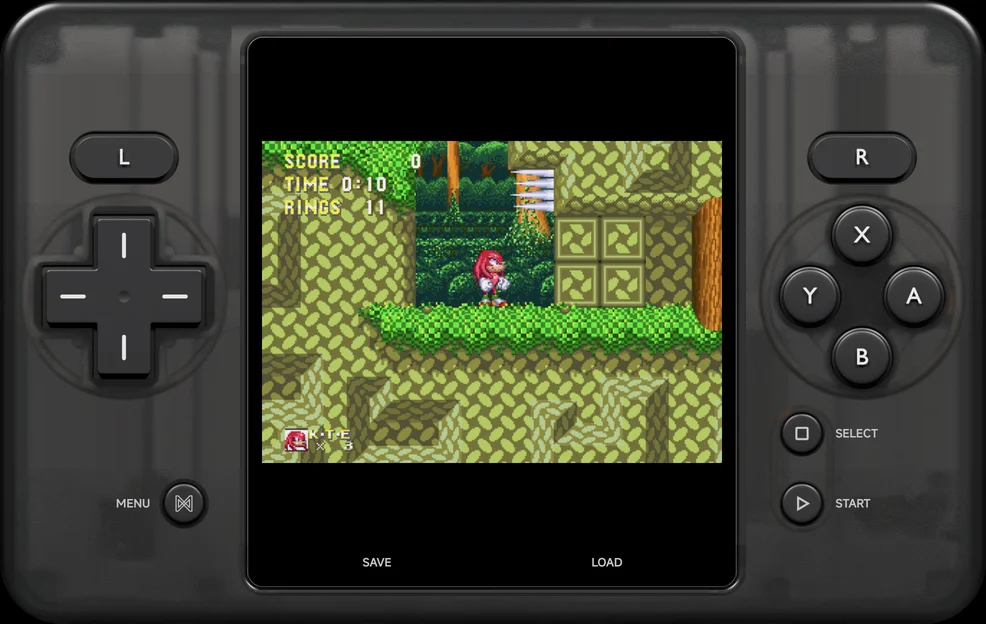
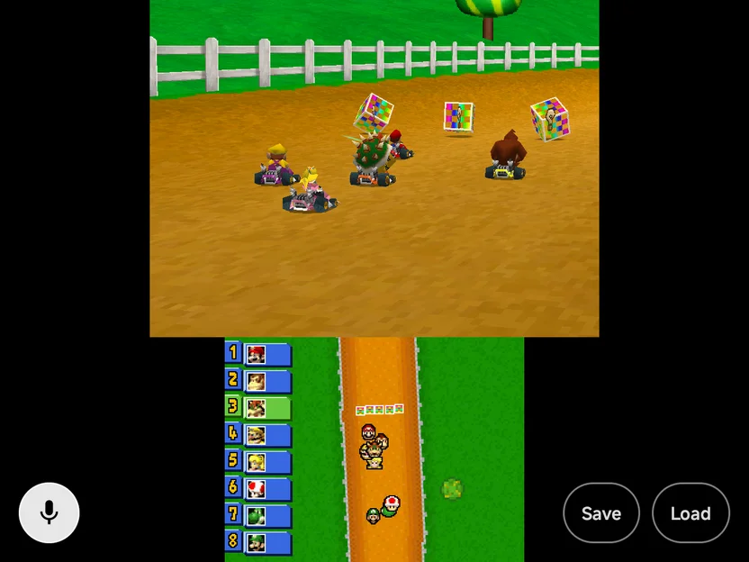
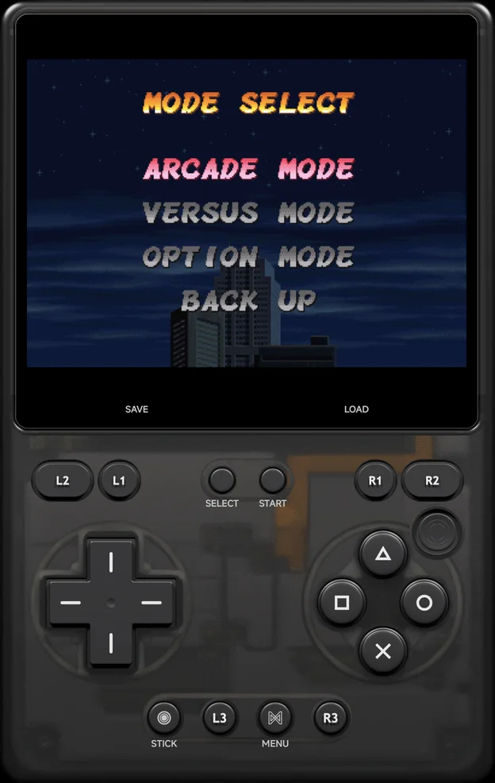
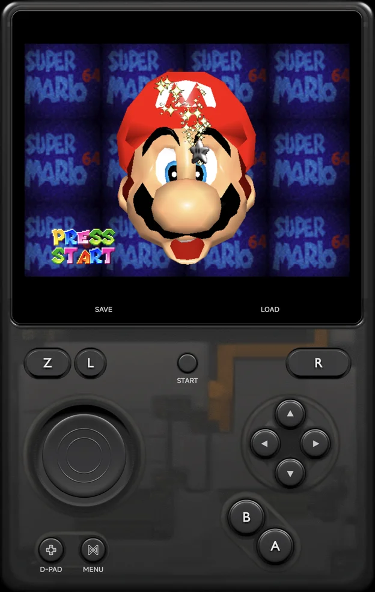
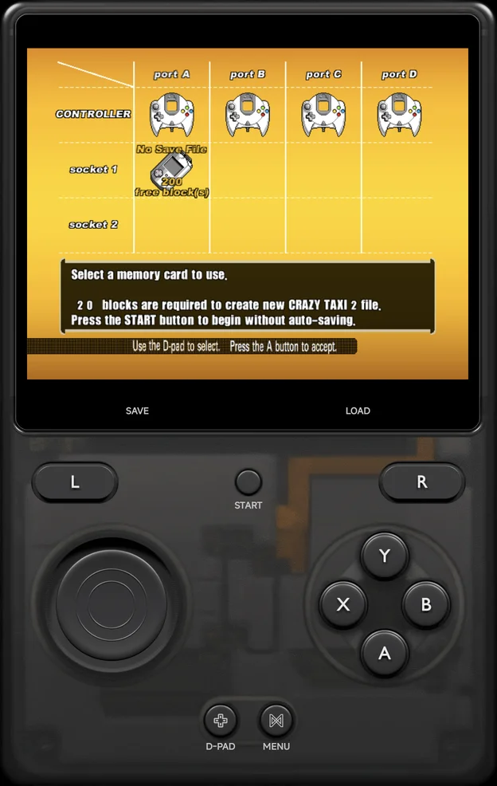
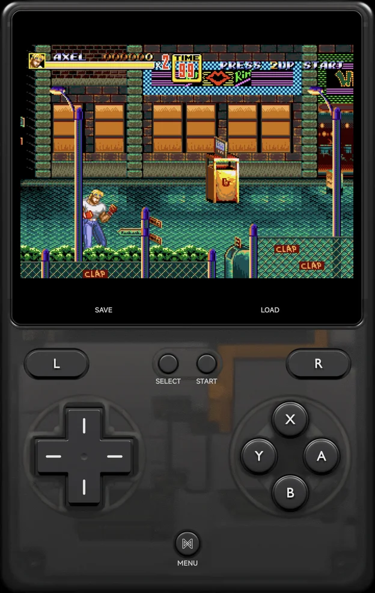
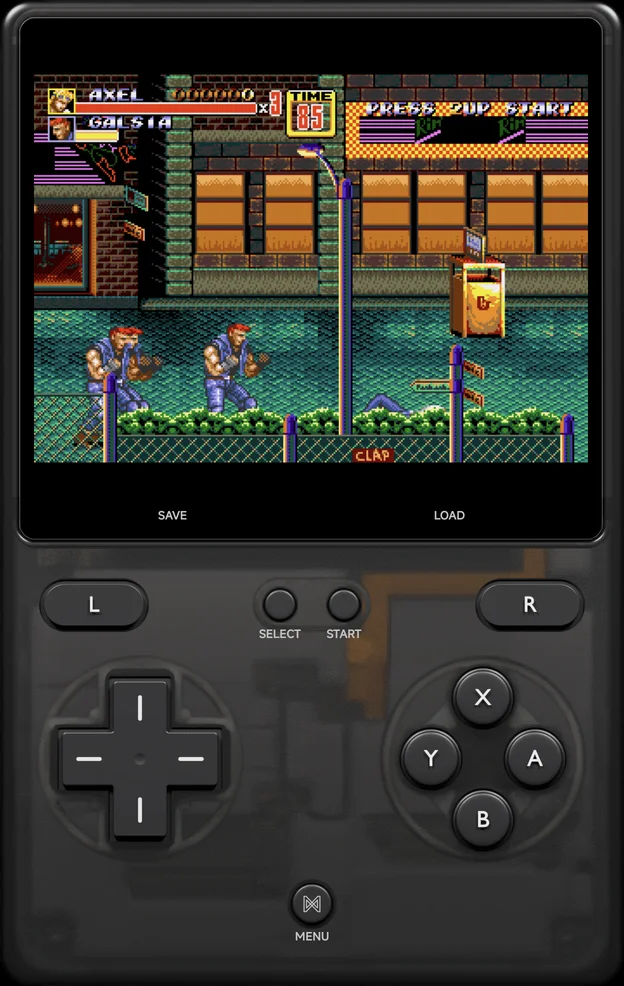
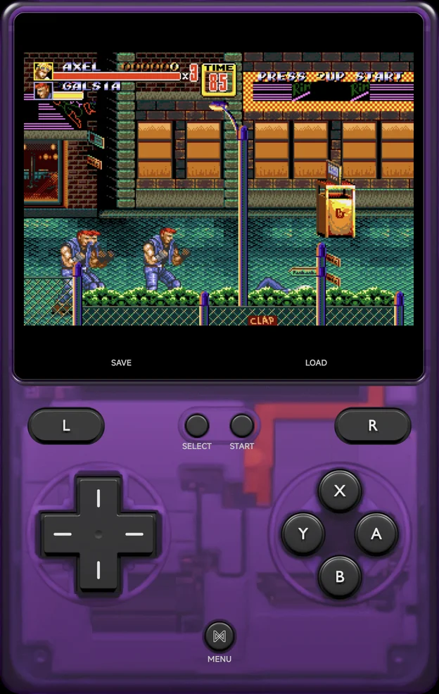

# Controls

## On-screen pad and controllers

Without a controller the app draws a **pad skin**: a whole handheld around
the screen, with the game or the menu in its screen glass and the buttons
where your thumbs are. Connect any Android controller to play with real
buttons instead. With a controller each, two to four people can play one
game; see [Local Multiplayer](multiplayer.md).

- **Portrait:** the screen is at the top and the buttons are below it.
- **Landscape:** the screen is in the middle, with the buttons in a grip
  either side. See [Landscape](#landscape).
- **With a controller:** the skin and its buttons go away, in games and in
  the menus, and the game or the menu fills the screen. See
  [With a controller](#with-a-controller).
- **Pad skin Off:** the game runs full screen under see-through buttons,
  and the menus have no on-screen pad. See [Pad skin off](#pad-skin-off).
- To move or resize the buttons, use
  [**Button layout**](controls-settings.md#button-layout).

??? info "More detail"
    - The skin is drawn round every menu screen, the tools' pages too.
    - A clip-on controller, such as the GameSir Pocket Taco or the 8BitDo
      FlipPad, counts as a controller: no skin shows. In a portrait game the
      room it covers below the picture is kept empty.
    - In a [multiplayer](multiplayer.md) game the on-screen pad stays for
      Player 1 while the connected controllers belong to other players.
    - Where no layout of the skin fits the window, such as in split screen,
      a game shows the see-through buttons instead and the menu fills the
      window.

### Pad skins

A skin comes in seven colours, picked with
[**Pad theme**](appearance.md#pad-theme) in **Tools → Settings →
Appearance**: **NX Carbon** (the default), **NX Onyx**, **NX Obsidian**,
**NX Plasma**, **NX Ember**, **NX Volt** and **NX Tide**.
[**Pad skin**](appearance.md#pad-skin) on the same page turns the skin on
or off.

Each skin has layouts for a phone in portrait and in landscape, a shorter
screen such as the Galaxy Z Fold's cover screen, the unfolded Fold and
tablets, and every console has its own buttons in them (see
[Each console's buttons](#each-consoles-buttons)).

- A row of [touch shortcuts](#touch-shortcuts) sits under the skin's
  screen.
- The [in-game menu](in-game-menu.md) opens inside the skin's screen.
- A touch on the skin's screen reaches the game, so a Nintendo DS or 3DS
  touch screen works as it is drawn.
- On a foldable's inner screen and on tablets held upright, the skin is
  split at the middle, where the hinge is. See
  [Foldables & Large Screens](foldables.md#half-folded).

<figure class="nx-phone" markdown>
{ .nx-phone__screen }
{ .nx-phone__frame }
</figure>

??? info "More detail"
    - A one-screen console's glass takes the shape of the game's picture.
    - On a console with an analog stick the skin draws the stick and the
      d-pad. Where a layout has room for only one, a swap button on the
      skin switches between them. The choice is kept for the game while the
      app runs.
    - A Nintendo DS or 3DS skin has **MIC** and **SWAP** buttons of its own.
      On a portrait phone its in-game menu covers the top screen and runs
      down to just above `L` and `R`.

### Landscape

In landscape the skin is one handheld held sideways: the screen in the
middle, the d-pad or stick in the left grip and the face buttons in the
right grip, with the shoulder buttons above them. The touch shortcuts sit
under the screen. Where the window is tall enough, the small buttons
(`MENU`, `SELECT`, `START` and the like) stack in a column on each side.

{ .nx-wide }

**Nintendo DS and 3DS:** on a regular phone in landscape the skin's screen
follows the game's layout setting (**Single screen** by default), and
`SELECT` + `Left` / `Right` changes it. A tip names the layout and swap
buttons when the game starts, with **Don't show again**. On the Fold, on
tablets and in portrait the skin places the two screens itself, and the
game's layout rows read **The pad skin places the screens**. See
[Nintendo DS](emulators/nintendo-ds.md) and
[Nintendo 3DS](emulators/nintendo-3ds.md).

### Pad skin off

With [**Pad skin**](appearance.md#pad-skin) set to **Off**, a game runs
full screen and the skin's buttons alone are drawn over it, see-through.
The menus have no on-screen pad: you use them by touch.

- **Pad Opacity (landscape)** sets how see-through the buttons are, in
  portrait and in landscape: **100%**, **60%** (the default), **40%** or
  **25%**. It is in the in-game menu under **Options →
  [Controls](in-game-menu.md#options)**, and is saved per game or console
  with Save Changes.
- The buttons are drawn solid while the game's picture doesn't reach them.
  Once you move a button over the picture in portrait, they keep **Pad
  Opacity (landscape)**.
- The buttons take the touches that land on them; touches between them
  reach the game.
- The touch shortcuts show as see-through pills.
- The buttons hide while the in-game menu is open.

??? info "More detail"
    - These buttons have a layout of their own. Until you move one, it sits
      where the skin puts it. See
      [Button layout](controls-settings.md#button-layout).
    - In portrait the picture keeps its size however you move the buttons.

### Touch shortcuts

Up to four touch buttons sit in a row under the skin's screen, each for an
action you choose in
[**Shortcuts**](controls-settings.md#touch-buttons). Out of the box the row
has **Save** and **Load**, for the save state slot you used last.

- A hold action works while your finger stays on it; a toggle lights while
  it is on.
- The row hides while the in-game menu is open, and during a
  [netplay](netplay.md) match.
- While a game's [local wireless](local-wireless.md) is on, save, load,
  fast forward, rewind and reset are hidden.

### With a controller

With a controller connected no pad is drawn, and the game is sized for the
whole screen. Two things stay on screen, see-through, in the bottom corners:

- **Bottom right:** the touch shortcuts you have set, as a row of pills.
- **Bottom left:** on the Nintendo DS and 3DS, the round
  [mic button](emulators/nintendo-ds.md#microphone).

They hide while the in-game menu is open.

{ .nx-wide }

??? info "More detail"
    - The main menu's skin hides with any controller, in portrait and in
      landscape.
    - Without a pad skin the Nintendo DS and 3DS screens use the game's own
      layout rows (see [Nintendo DS](emulators/nintendo-ds.md)).

### Each console's buttons

The skin draws each console's own buttons, and leaves out the ones the
console doesn't have:

| Console | What the skin shows |
| --- | --- |
| Game Boy, Game Boy Color, NES | The d-pad, `A` `B`, turbo `TA` `TB`, `SELECT` and `START`; no shoulder buttons |
| Game Boy Advance | The same, with `L` `R` and turbo `TL` `TR` |
| Famicom Disk System | The Game Boy set, with a `DISK` button that flips the disk |
| Arcade (FBNeo), NAOMI, Atomiswave | The d-pad, `A` `B` `X` `Y`, `L` `R`, `COIN` and `START` |
| PlayStation, PlayStation 2 | `△` `○` `×` `□`, `L1` `L2` `R1` `R2`, the right stick, `L3` and `R3` |
| PSP | `△` `○` `×` `□`, `L` `R`, the analog nub, `SELECT` and `START` |
| Nintendo 64 | The stick and d-pad, `A` `B`, the C buttons, `Z`, `L` and `R` |
| Dreamcast | The stick and d-pad, `A` `B` `X` `Y`, the `L` `R` triggers and `START` |
| GameCube | The stick and d-pad, `A` `B` `X` `Y`, `Z`, the `L` `R` triggers, the C-stick and `START` |
| Wii | The game's Wii controller (Classic, Nunchuk, sideways or upright Remote), with `HOME`, `SHAKE` and `MOTION`; see [Nintendo Wii & GameCube](emulators/wii-gamecube.md#wii) |
| Nintendo DS | Two screens, `A` `B` `X` `Y`, `L` `R`, **MIC** and **SWAP** |
| Nintendo 3DS | The DS set with the Circle Pad; a New 3DS game adds `ZL` `ZR` and the C-stick |
| PICO-8 | The d-pad, `O` `X` and `START` |
| Atari 5200 | The joystick, two fire buttons, `*` `#`, `PAUSE`, `START` and `KEYPAD` |
| Doom | The d-pad, `A` `B` `X` `Y`, `L` `R` `L2` `R2`, `L3` and `R3` |
| Every other console | The shared layout: the d-pad, `A` `B` `X` `Y`, `L` `R`, `SELECT` and `START` |

<figure class="nx-phone" markdown>
{ .nx-phone__screen }
{ .nx-phone__frame }
</figure>

<figure class="nx-phone" markdown>
{ .nx-phone__screen }
{ .nx-phone__frame }
</figure>

<figure class="nx-phone" markdown>
{ .nx-phone__screen }
{ .nx-phone__frame }
</figure>

<figure class="nx-phone" markdown>
{ .nx-phone__screen }
{ .nx-phone__frame }
</figure>

### Pad themes

**Pad theme** in **Tools → Settings → [Appearance](appearance.md#pad-theme)**
picks the skin's colour, in portrait and landscape, in the menus and in
games:

| Theme | Look |
| --- | --- |
| **NX Carbon** (default) | Smoke grey |
| **NX Onyx** | Smoked black |
| **NX Obsidian** | Translucent near-black |
| **NX Plasma** | Translucent purple |
| **NX Ember** | Translucent red |
| **NX Volt** | Translucent green |
| **NX Tide** | Translucent blue |

<figure class="nx-phone" markdown>
{ .nx-phone__screen }
{ .nx-phone__frame }
</figure>

NX Carbon

<figure class="nx-phone" markdown>
{ .nx-phone__screen }
{ .nx-phone__frame }
</figure>

NX Plasma

## Controller buttons

A controller's face buttons work **as printed**: the button with `A` on it
is the console's `A`, whatever controller you use. So `A` is the Super
Nintendo's `A`, the Nintendo 64's `A` and the Dreamcast's `A`.

The app detects your controller's layout: a **Nintendo-layout** pad has `A`
on the right and `B` at the bottom, and any other pad is read as **Xbox
layout**, with `A` at the bottom and `B` on the right.

**Controller Layout**, in the in-game menu's
**Options → [Controls](in-game-menu.md#options)**, names
the letters printed on your controller. Every console has it. Save it for
the console or the game with Save Changes.

| Value | Use it for |
| --- | --- |
| **Auto-detect** (default) | Let the app read your controller |
| **Xbox (A at the bottom)** | A pad with `A` at the bottom |
| **Nintendo (A on the right)** | A pad with `A` on the right |

PlayStation, PSP, the Sega consoles, TurboGrafx-16, PICO-8, Atari,
ColecoVision, Doom and arcade go **by position** instead, like the console's
own pad: the bottom button is the PlayStation's `×` on every controller.

??? info "More detail: by letter and by position"
    - Nintendo's own controllers and pads in Switch mode are recognised as
      Nintendo layout.
    - Pick the layout that isn't your controller's to play with the console's
      original button positions. On an Xbox pad set to **Nintendo**, the
      right button is `A` on Super Nintendo, Nintendo DS and Nintendo 3DS, as
      on the console's own pad.
    - These consoles go by the printed letter: Super Nintendo, NES and
      Famicom Disk System, Game Boy, Game Boy Color, Game Boy Advance,
      Nintendo DS, Nintendo 3DS, Virtual Boy, Atari Lynx, Pokémon mini,
      WonderSwan, Nintendo 64, Nintendo Wii, Nintendo GameCube, Sega
      Dreamcast, NAOMI, Atomiswave and Neo Geo Pocket.
    - The Sega consoles that go by position are Genesis, Sega CD, 32X, Master
      System, Game Gear and SG-1000. These consoles' buttons have no letters,
      or, on the Sega pad, `C` and `Z` would end up on the shoulders by
      letter.
    - On the by-position consoles, Controller Layout only changes which
      button confirms in the in-game menu, so it can't fix a Nintendo-layout
      pad that the app reads as Xbox layout.

The other buttons:

| Controller | NX Redux |
| --- | --- |
| `L1`, `R1`, `L2`, `R2` | `L1`, `R1`, `L2`, `R2` |
| `START`, `SELECT` | `START`, `SELECT` |
| Mode button (Android's `BUTTON_MODE`) | `MENU` |
| D-pad | `UP`, `DOWN`, `LEFT`, `RIGHT` |
| Left and right sticks | The core's analog sticks. On consoles without an analog stick, the left stick also works as the d-pad |
| `L3`, `R3` (pressing the sticks) | `L3`, `R3`, for the consoles that use them, such as the NAOMI and Atomiswave Test and Service buttons |

On a controller without a mode button, hold `SELECT` and `START` together to
open the in-game menu. In a multiplayer game only Player 1's `SELECT` +
`START` does; see [Local Multiplayer](multiplayer.md#the-in-game-menu).

Some controllers have no `SELECT`, `START` or mode button of their own, and
send Android's Back or Menu key instead. The app reads those keys as the
button the controller lacks:

| The controller's key | NX Redux |
| --- | --- |
| Back, on a controller with no `SELECT` | `SELECT` |
| Back, on a controller that has `SELECT` | `MENU` |
| Menu, on a controller with no `START` | `START` |
| Menu, on a controller that has `START` | `MENU` |
| The small button beside the logo button on an AYANEO handheld | `MENU` |

To use another button for `SELECT`, `START` or `MENU`, bind it in
[**System buttons**](controls-settings.md#system-buttons). A button you
bind there wins over this table.

??? info "More detail"
    On Nintendo DS the left stick is the d-pad, or moves the pen in stylus
    mode.

Each console's own mapping, such as the [Nintendo 64](emulators/nintendo-64.md#controls)
or the Sega [Controller Type](emulators/sega.md#controller-type)
(3 or 6 buttons), is on its [emulator page](emulators/index.md).

## Vibration

The app vibrates in two ways: a tick under your thumb on the on-screen pad,
and the game's own rumble. Set how strong each one is, or turn it off, in
[**Tools → Settings → Controls**](controls-settings.md).

### Pad vibration

A short tick when you press the on-screen pad. A controller never makes the
phone tick.

Pad vibration follows the phone's own touch feedback setting: with touch
feedback off in Android's settings, the pad stays silent too.

??? info "More detail: when it ticks"
    - When you press a button, not when you let go.
    - When the d-pad moves to a new direction, diagonals included. Holding a
      direction, or letting go back to the centre, does not tick.
    - When your thumb slides onto another button.
    - When the on-screen stick moves to a new direction (up, down, left or
      right), in the main menu only. In games the stick never ticks.
    - On Android 13 and later, Android's touch vibration strength also
      scales it.

### Game rumble

The game's own rumble, for the games and consoles that have it. It goes to
the controller you are playing with when it has a rumble motor, and to the
phone when it doesn't.

Game rumble plays as media vibration, so turning touch feedback off in
Android's settings does not silence it. Set it to **Off** in
[Controls settings](controls-settings.md#game-rumble) instead.

These consoles rumble:

| Console | Which games |
| --- | --- |
| Game Boy, Game Boy Color | Games on a rumble cartridge, such as Pokémon Pinball |
| Game Boy Advance | Games with rumble |
| PlayStation | Games with DualShock rumble |
| Dreamcast | Games that use the Vibration Pack. It is in each controller's second slot out of the box |
| Pokémon mini | Games with rumble |
| Doom (PrBoom) | Rumble is on out of the box |
| Arcade (FBNeo) | Games with rumble. It is on out of the box |
| Nintendo 64 | Only with the Rumble Pak inserted (see below) |

Other consoles have no rumble.

**Nintendo 64:** out of the box the controller holds the Controller Pak (for
saves). To feel a game's rumble:

1. Open [Emulator Settings](emulator-settings.md) for the console, or **Game
   Settings** for one game.
2. Under **Emulator → Pak/Controller Options**, set **Player 1 Pak** to
   **rumble**. For more players, set **Player 2 Pak** to **Player 4 Pak** the
   same way.
3. Start the game again for the change to take effect.

!!! note
    The Rumble Pak takes the Controller Pak's place, so a game can't save to
    the Controller Pak while it is in.

??? info "More detail"
    - Without a controller motor, rumble goes to the phone (or the
      handheld's motor). Pressing the on-screen pad moves it back to the
      phone.
    - In a [multiplayer](multiplayer.md#rumble) game each player's rumble
      goes to their own controller. Only Player 1 falls back to the phone.
    - Changing the level plays a short pulse at that strength, so you can
      feel it. **Off** plays none.
    - The rumble stops while the [in-game menu](in-game-menu.md) is open and
      picks up again when you close it. It also stops when you leave the app
      or quit the game.
    - The emulators' own rumble options are under **Emulator** too, such
      as **Rumble Effects** for PlayStation and Doom, **Device in Expansion
      Slot A2** for Dreamcast, and **Controller Rumble Strength** for Game
      Boy. Leave them as they are; **Game rumble** sets how strong it feels.

## In the menus

| Button | What it does |
| --- | --- |
| `A` | Open or start the highlighted item. On a game with a save state it resumes the game (**Resume**) |
| `B` | Back. Android's Back gesture does the same. |
| `X` | In a game list, open the [achievements panel](main-menu.md#achievements-panel) for the highlighted game, while you are signed in to [RetroAchievements](retroachievements.md) |
| `Y` | On a game that has [netplay](netplay.md), open the Netplay menu |
| `SELECT` | Open the [Game Switcher](game-switcher.md). The main menu's hint reads **Recent**. |
| `START` | On the main menu, [search](main-menu.md#search) your games. In a game list, [search that list's games](main-menu.md#searching-a-game-list) |
| `MENU`, or a long press | Open the context menu |
| `L1` / `R1` | Switch main menu tabs. In a console's game list, jump to the previous or next letter |
| `L2` / `R2` | On the [Games tab](main-menu.md#games-tab), jump to the previous or next letter |
| `Left` / `Right` | In a game list drawn as a List, Minimal or a vertical Carousel or Backdrop, move a page. See [Game lists](main-menu.md#game-lists) |

**Which button confirms:**

- On a controller, `A` confirms and `B` goes back, by the letters printed on
  it. In the in-game menu too, with the letters
  [Controller Layout](#controller-buttons) names.
- On the on-screen pad, the button drawn as `A` confirms and the one drawn as
  `B` goes back. On PlayStation and PSP, `×` confirms and `○` goes back.

Menus show key hints you can tap when a controller or the pad skin is
present.

Text is typed on the [NX keyboard](about.md#keyboard), which the pad drives
too.

On a page with two panes side by side, `Left` / `Right` move between the
panes. To change a row's value there, press `A` on it, step it with `Left` /
`Right`, then press `A` or `B`. See
[Two-pane screens](foldables.md#two-pane-screens).

??? info "More detail: hint order"
    **Options** (`MENU`) always comes first. The other hints follow the pad
    from left to right: the d-pad and left shoulders, `SELECT`, `START`, then
    `Y` `X` `B` `A`, then the right shoulders.

With touch alone (no controller and no pad skin: with
[Pad skin](appearance.md#pad-skin) Off, or where no skin layout fits the
window), there is no hint bar:

- Tap an item to select it, tap it again to open it, and long-press for its
  menu. Android's Back gesture goes back.
- **Recent** and **Search** are icons at the right of the tab row, and a
  page's own actions are icons by its title or buttons on the page.
- Dialogs have real buttons.
- A Settings switch flips on a tap, a row of choices takes a tap on one, and
  a value with `›` opens a list to pick from. See
  [Settings](settings.md#touch).

## Game-list context menu

Press `MENU`, or long-press a game, for its context menu: Pin Item, Hide
Game, Rename Rom, Add to Collection, Game Settings, Netplay, Fetch art or
Change art, and Emulator. See [Context menus](main-menu.md#context-menus) for what each does
and where it shows.

??? info "More detail: menu order"
    - A game with a save state starts the menu with **Play from start**.
    - While the Netplay hint is hidden, or with touch alone, **Netplay**
      comes next.
    - With the
      [Achievements panel](layouts.md#layout-options-and-achievements-panel)
      row set to Hide, **Achievements** comes last.
    - With [Kids Mode](kids-mode.md) on, the menu offers play items only.

## In-game menu

Press `MENU`, hold `SELECT` + `START`, or use Android's Back gesture during a
game. The menu has Continue, Save, Load, Reset, Options and Quit, with tabs
for Achievements, Cheats and Players where they apply. **Options** holds
Display, Controls, Gameplay, Multiplayer, Audio, Shortcuts, Shaders,
Emulator and Save Changes. With a pad skin, the menu opens inside the
skin's screen. See [In-game Menu](in-game-menu.md).

For fast forward, rewind, reset and Save & Quit without the menu, bind
[shortcuts](controls-settings.md#shortcuts) to your controller's buttons.

## Console shortcuts

`MENU`, `SELECT` + `START` and Back open the in-game menu on every console.
In a multiplayer game, `SELECT` + `START` works on Player 1's controller only.

??? info "More detail"
    `MENU` and the combo never reach the game, but the game does see the
    `SELECT` press before `START`, except on the Nintendo 3DS.

Some consoles have buttons and shortcuts of their own, and they win over
the [shortcuts](controls-settings.md#shortcuts) you bind. They are on each
console's page. On the Nintendo DS and 3DS, stylus mode moves the pen with
the right stick, the left stick or the d-pad, and `R3` or `A` taps.

| Console | Its own buttons |
| --- | --- |
| [Nintendo DS](emulators/nintendo-ds.md#controls) | **SWAP**, `L3` or `SELECT` + `L1` swaps screens (`L2` too), `SELECT` + `R1` turns stylus mode on or off (`R2` too), `SELECT` + `LEFT` / `RIGHT` changes the layout, `SELECT` + `UP` / `DOWN` moves the inset |
| [Nintendo 3DS](emulators/nintendo-3ds.md#controls) | **SWAP**, `L3` or `SELECT` + `L1` swaps screens, `SELECT` + `R1` turns stylus mode on or off, `SELECT` + `LEFT` / `RIGHT` changes the layout, `L2` / `R2` are `ZL` / `ZR`, the right stick is the C-stick |
| [Nintendo Wii](emulators/wii-gamecube.md#wii) | `L3` recentres motion, `R3` is `HOME` |
| [Sega Dreamcast, NAOMI, Atomiswave](emulators/dreamcast.md#controls) | Analog `L2` / `R2`, and on the arcade boards `SELECT` for a coin, `L3` for Test and `R3` for Service |
| [Arcade (FBNeo)](emulators/arcade.md#controls) | `SELECT` inserts a coin; the on-screen pad labels it **COIN** |
| [Nintendo 64](emulators/nintendo-64.md#controls) | Buttons by letter, `Z` on `L2`, the C buttons on the right stick |
| [PlayStation](emulators/playstation.md#controls), [PSP](emulators/psp.md#controls) | `×` `○` `△` `□` by position |
| [Sega consoles](emulators/sega.md) | The Sega pad, `Mode` and **Controller Type** |
| [Game Boy & Game Boy Advance](emulators/game-boy.md) | Turbo buttons and the link cable |
| [Other systems](emulators/other-systems.md) | NES disk and coin buttons, Neo Geo Pocket `Option` and more |
