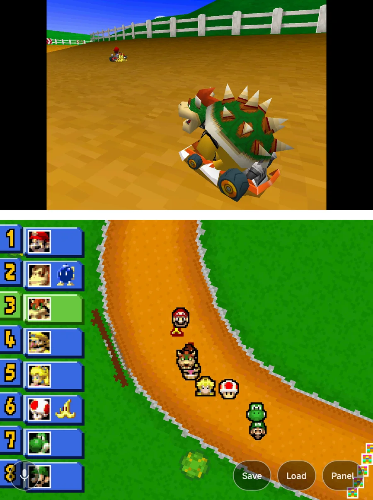
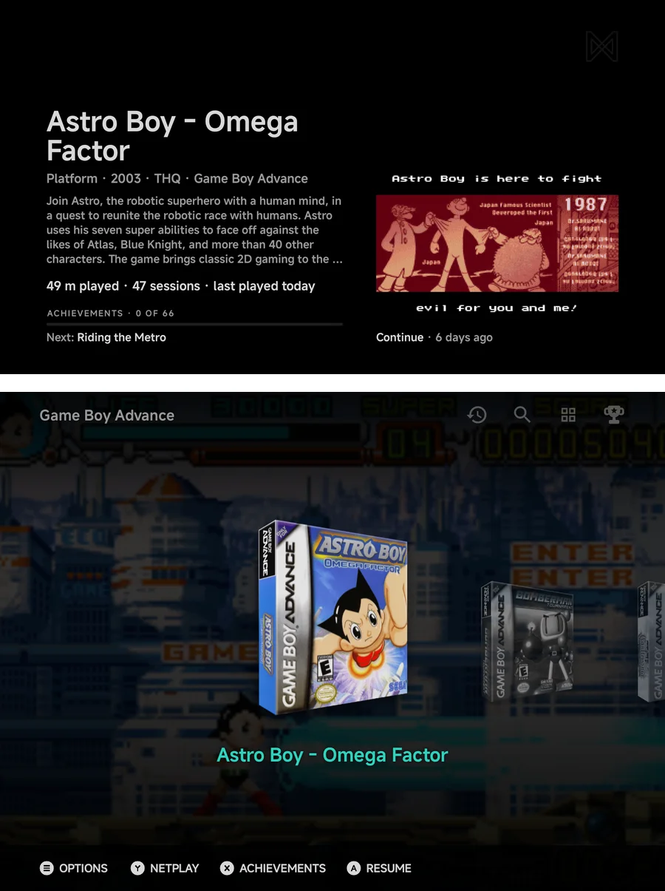
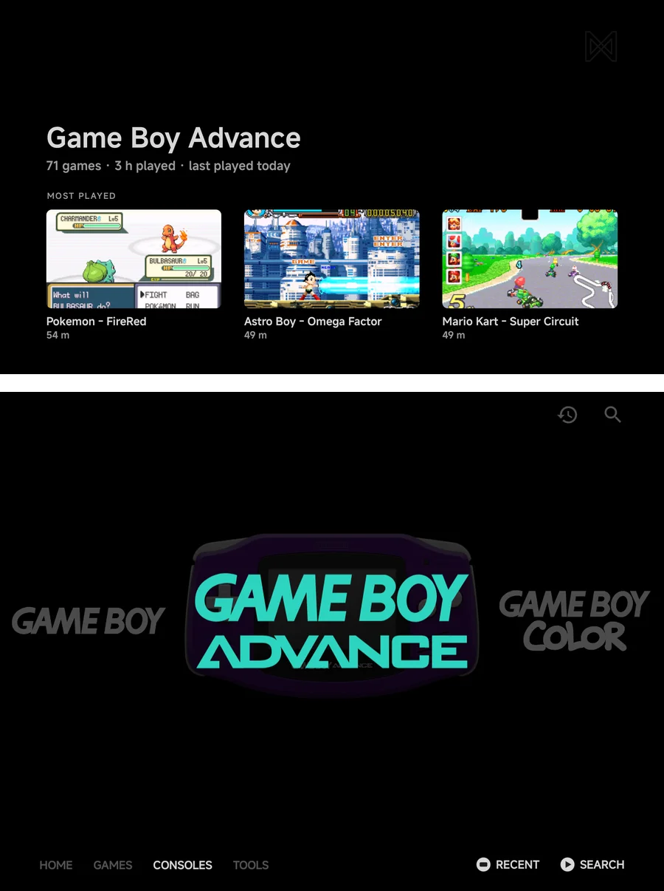
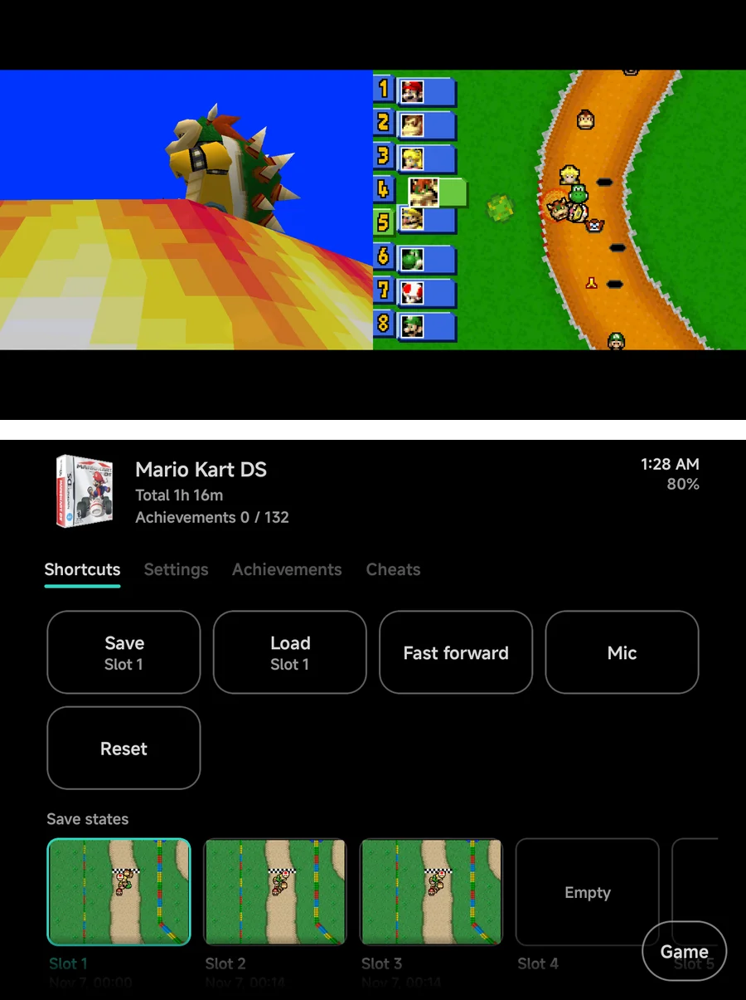
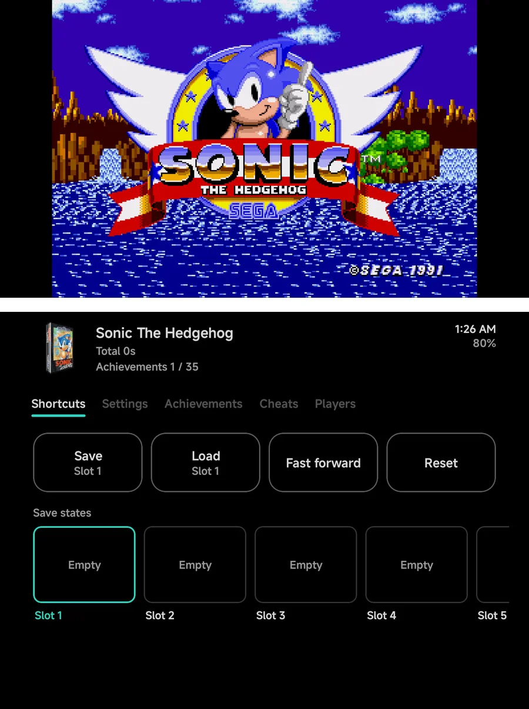
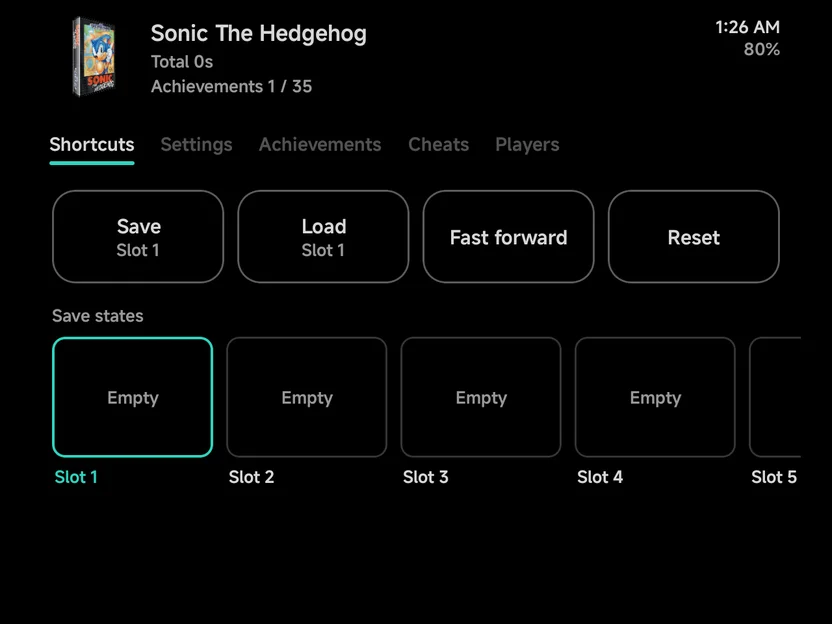
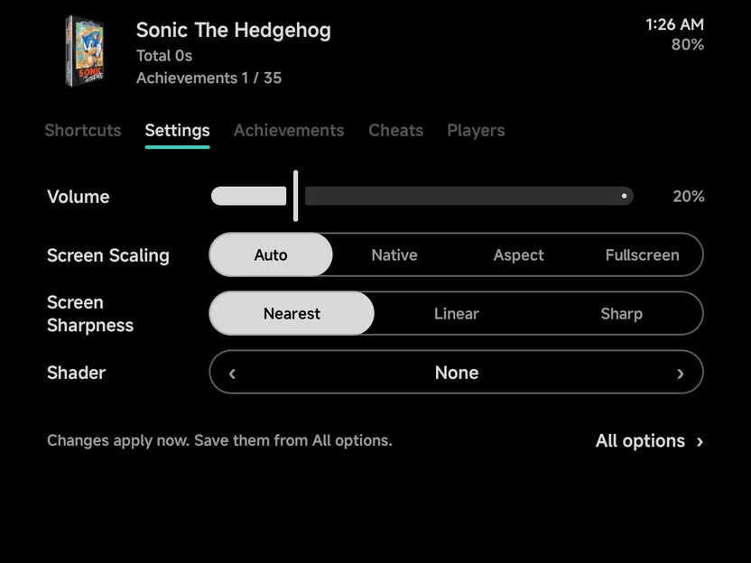

# Dual Screens & External Displays

On a handheld with a second screen, NX Redux uses both, by one rule: the
bottom screen is where you act, and the top screen shows you things. In the
[main menu](#the-main-menu), you browse on the bottom screen while the top
screen shows the highlighted game's details. Nintendo DS and 3DS games get
one screen each, like the real console. Other games show the game on the top
screen and a [game panel](#the-game-panel) on the bottom one, with your play
time, achievements, shortcuts and save states.

Two kinds of second screen count:

- **A built-in second screen**, as on dual-screen Android handhelds.
- **A wired display on USB-C**, such as a clip-on screen add-on, a monitor
  or a TV.

Casting and wireless displays, and a foldable's cover screen, are never used.
On a phone with one screen, nothing on this page applies, and the panel's
tabs show in the [in-game menu](in-game-menu.md) instead.

??? info "More detail"
    - Plug a display in or unplug it during a game and the game carries on: the
      layout switches straight away.
    - Android doesn't tell an add-on screen from a monitor or a TV, so a
      wired monitor counts as a second screen too.

## Which screen is which

One screen is the **top screen** and the other the **bottom screen**:

- The **top screen** shows the game, or the DS or 3DS top screen. In the
  main menu it shows details of what you have highlighted.
- The **bottom screen** is the one you touch. It shows the DS or 3DS bottom
  screen, or the game panel. In the main menu it shows the menu, and every
  list, tool, prompt and the in-game menu opens there.

By default the wider screen is the top screen. When both have the same
shape, the second screen is the top one. To choose yourself, set
[**Bottom screen**](#settings) to the screen you want to touch.

While the second screen is in use, the game stays in landscape, either way
up. Unplug the display, or turn the second screen off, and the game gets its
usual orientation back.

??? info "More detail"
    - Games drawn on their side, such as vertical arcade and WonderSwan
      games, are turned the right way on the second screen too.
    - While the game panel fills the main screen, the on-screen pad is
      hidden: it would cover the panel. Dual-screen handhelds have their own
      buttons.
    - [Screen care](about.md#screen-care) shifts and dims both screens.

## First-run setup

On a handheld with a built-in second screen, setup asks **Which is the bottom
screen?** right after the text size. Both screens show a **This is the bottom
screen** button: tap the one on the screen below. **Skip** leaves it on
**Auto**.

A wired display never gets this question. Change the answer any time in
[Settings](#settings).

## The main menu

With a second screen in use, everything you do in the main menu happens on
the bottom screen: the tabs, game lists, Tools, Settings, the Apps drawer
and every prompt. The top screen follows what you highlight.

- **A game**, in a game list, on the Games tab, on Home or in the
  [Game Switcher](game-switcher.md): the top screen shows the
  [game's details](#game-details).
- **A console or a collection**: the top screen shows its
  [stats](#console-and-collection-stats).
- **Anything else**, such as a tool or a Settings page: the top screen
  shows the backdrop with the NX logo.

Your buttons always work on the bottom screen, and the button hints show
there only. Text is typed there too, on the
[NX keyboard](about.md#keyboard).

### Game details

For the highlighted game, the top screen shows:

- its name, then its genre, year, publisher and console;
- a synopsis, up to five lines;
- its play time, sessions and when you last played it;
- with a [RetroAchievements](retroachievements.md) set, your count, a bar
  and the next achievement to earn;
- one picture on the right: the save you would resume from, else the
  game's screenshot, else its box art.

The genre, year, publisher and synopsis come with the art. See
[Game info](artwork.md#game-info).

### Console and collection stats

For the highlighted console or collection, the top screen shows one line of
facts, such as **71 games · 3 h played · last played today**, and a shelf
of up to three games: the most played, filled up with the newest added. A
game on the shelf shows its play time, or **Not played yet**. Tap a game on
the shelf to start it.

??? info "More detail"
    - Game lists on the bottom screen leave out each game's stats line and
      the **N games** counts, since the top screen shows them. A vertical
      **Carousel** or **Backdrop** runs across the screen instead, and the
      vertical layouts are not offered.
    - The [achievements panel](main-menu.md#achievements-panel) opens on the
      bottom screen: from the trophy icon, from the game's context menu, or
      with a tap on the achievements on the top screen.
    - On a short top screen the details drop parts to fit: the synopsis
      first, then the picture, then the next achievement.
    - A collection's line also counts its consoles. A console with a
      missing BIOS shows a **BIOS missing** pill.
    - Only a tap starts a game from the shelf. A resting finger, a drag or
      a long press does nothing.
    - Signed out of RetroAchievements, the details show the game's info only.
    - With [**Enable**](#settings) off, the main menu uses one screen.

### Apps on the top screen { #apps-on-the-picture-screen }

With a second screen in use, apps you open from NX Redux open on the top
screen, and the menu stays on the bottom one. This covers apps in **Tools**,
tools pinned to Home, and [Android games](launcher.md).

While an app has the top screen:

- **The menu keeps working below it.** Tools and game lists open on the
  bottom screen as usual.
- **A one-screen game plays on the bottom screen only**, so you can watch
  the app while you play. **Use top screen**, in the
  [in-game menu](in-game-menu.md), moves the game up anyway.
- **A DS or 3DS game takes the top screen**, since it needs both.

To have the top screen back, close the app or press Home. You can also tap
the floating **Top screen** button on the main menu, or choose **Use top
screen** at the end of the main menu's context menu.

??? info "More detail"
    - Home brings the menu's top screen back over the app. The app stays
      open behind it.
    - After a game that took the top screen, the menu has it again.
    - The **Top screen** button shows on a touchscreen only.
    - Highlighting **Apps** in Tools shows nothing on the top screen. `A`
      opens it on the bottom screen, like any other tool.

## Settings

**Tools → Settings → Second screen** has the system-wide settings. The
**Second screen** section, between **Controls** and **System**, shows only
while a second screen is connected.

| Row | Values | Default | What it does |
| --- | --- | --- | --- |
| **Enable** | On, Off | On | **Off** leaves the second screen alone, free for another app. |
| **Bottom screen** | Auto, Main screen, Second screen | Auto | Which screen is the bottom screen, the one you touch. **Auto** picks by shape. |

With **Enable** off, DS and 3DS games use their usual
[single-screen layouts](emulators/nintendo-ds.md#screen-layouts) and other
games show no panel.

### For one console

Each console has its own **Bottom screen** row, in the **Display** group of
its settings: **System default**, **Main screen** or **Second screen**.
**System default** follows the setting above. Set it in
[Emulator Settings](emulator-settings.md), or during a game in
[**Options → Display**](in-game-menu.md#options), where it applies straight
away.

??? info "More detail"
    - The console's **Bottom screen** row shows only while a second screen is
      connected, like the system-wide rows. Values you set are kept while it's
      hidden.
    - Keep an in-game change with
      [Save Changes](in-game-menu.md#save-changes), for the game or the
      console.

## Nintendo DS and 3DS

With a second screen, a DS or 3DS game starts split across both screens:
its top screen on your top screen and its bottom screen on your bottom
screen.

- **Touch** goes to the game's bottom screen, on whichever screen it shows.
  Touching its top screen does nothing.
- **SWAP**, `L3` or `SELECT` + `L1` swaps the two screens over. On the DS,
  `L2` works too.
- In [stylus mode](emulators/nintendo-ds.md#stylus-mode) the DS stylus dot
  follows the bottom screen to whichever screen shows it.

### The Panel and Game pills

A **Panel** pill sits at the bottom right of the bottom screen, or at the
end of the row of corner touch buttons when those show. Tap it and the
bottom screen shows the [game panel](#the-game-panel), while both DS or 3DS
screens move side by side onto the top screen. Touch reaches the game's
bottom screen there.

On the panel, the **Game** pill, in the same corner and with the same look,
brings the game's bottom screen back.

Opening the [in-game menu](in-game-menu.md) flips the panel up by itself, so
the menu always opens on the bottom screen. Closing the menu brings the
game's bottom screen back.

??? info "More detail"
    - On the DS, **SWAP** while split changes the **Big Screen** setting, the
      same as on one screen, so it carries over when you play without the
      second screen. On the 3DS the swap lasts for this session.
    - The screen layout settings, such as **Layout (landscape)**, aren't used
      while the game is split or the panel is up, and neither is the
      [half-folded](foldables.md#nintendo-ds-and-3ds-half-folded) layout.
      `SELECT` + `Left` / `Right` does nothing then.
    - A shader is drawn on the game's top screen only.
    - **3D Resolution** is worked out from the size the screens have on the
      displays that show them.

## Other games

Every other game shows its picture on the top screen and the game panel on
the bottom screen while you play. The panel works by touch only: your
buttons keep playing the game.

Opening the [in-game menu](in-game-menu.md) pauses the game and puts the
menu on the bottom screen, in the panel's place under its header. The top
screen keeps the paused picture, dimmed under a pause mark. Closing the menu
brings the panel back.

??? info "More detail"
    - The picture on the top screen follows **Screen Scaling**, **Offset
      X** and **Offset Y**, and your shader, as they are set in the in-game
      menu.
    - The dimming lifts while you highlight a row that changes the picture,
      such as a shader, so you can see what it does.
    - Under the panel, the bottom screen doesn't draw the game, which saves
      battery. Save-state pictures are taken from the top screen.
    - On PlayStation 2, **3D Resolution** is worked out from the size of
      the picture on the top screen.

## The game panel

The panel shows on the bottom screen while you play. On a phone with one
screen, its Achievements, Cheats and Players tabs are in the
[in-game menu](in-game-menu.md) instead.

{ .nx-wide }

Across the top, the game's header shows:

- its box art, or the console's logo when it has none;
- its name;
- its total play time, such as **Total 4h 12m**;
- with a [RetroAchievements](retroachievements.md) set, your count, such as
  **Achievements 3 / 40**;
- the time and the battery level, since the game hides Android's status bar.

Below it are up to five tabs. A tab shows only when it applies.

| Tab | Shows when | What it holds |
| --- | --- | --- |
| **Shortcuts** | Always | One-tap tiles and your save states. See [below](#shortcuts). |
| **Settings** | Always | Volume and a few picture settings. See [below](#panel-settings). |
| **Achievements** | The game has a RetroAchievements set | The game's achievements, in your **Achievement sort order**. |
| **Cheats** | The game's emulator takes cheats | The game's cheats, each with a switch. See [below](#cheats). |
| **Players** | The game has more than one player | Which controller is which player. See [Local Multiplayer](multiplayer.md#the-players-page). |

??? info "More detail"
    - The play time is the total before this launch. It doesn't count up while
      you play.
    - The clock follows the phone's 12 or 24-hour setting.
    - On a panel less than 320 dp tall the header is one line: the name,
      the clock and the battery.
    - A foldable's inner screen or a tablet can show the panel inside the
      pad skin. See
      [Two screens in one skin](foldables.md#two-screen-skin).

### Shortcuts

The tab is a grid of tiles. Your
[touch buttons](controls-settings.md) come first, then the panel's own:

| Shortcut | Shows when | What it does |
| --- | --- | --- |
| Your touch buttons | Always | **Save** and **Load** by default, each naming its slot, such as **Slot 2**. A tile works as its button on the pad does: a hold action runs while you hold the tile. |
| **Swap disc** | A game with more than one disc | Puts the next disc in. The tile shows the disc in use, such as `1/2`. |
| **Fast forward** | Always | Turns fast forward on or off. Filled while on. |
| **Rewind** | The console's [Rewind](in-game-menu.md#options) is on | Turns rewind on or off. Filled while on. |
| **Mic** | A Nintendo DS or 3DS game | Lets the game hear the microphone, or stops it. Filled while on. See [Microphone](emulators/nintendo-ds.md#microphone). |
| **Reset** | Always | Restarts the game. It asks first. |

Under the tiles, a strip shows your save-state slots, each with its
screenshot and time. Tap a slot to make it the one **Save** and **Load**
use.

??? info "More detail"
    - **Swap disc** works as the in-game menu's **Disc** row does, while the
      game keeps running.
    - **Fast forward** and **Rewind** work as the Toggle
      [shortcuts](controls-settings.md#shortcuts): turning one on turns the
      other off.
    - A touch button set to **Toggle FF**, **Toggle Rewind** or **Reset**
      gets no tile of its own: the panel's tile does the same.
    - **Mic** is the same switch as the pad's mic button.
    - In a [netplay](netplay.md) match, the tiles and the save-state strip
      are hidden. While a game's [local wireless](local-wireless.md) is
      on, only **Swap disc** and **Mic** stay.

### Settings { #panel-settings }

The **Settings** tab changes a few things without opening the in-game menu.
Each applies straight away.

| Row | What it does |
| --- | --- |
| **Volume** | The device's media volume. |
| **Screen Scaling** | How the picture fits the screen. |
| **Screen Sharpness** | How the picture is smoothed. |
| **Shader** | The shader drawn over the picture. |
| **All options** | Opens the in-game menu on its [Options](in-game-menu.md#options) page. |

To keep a change for next time, save it from **All options**. A row the
game's layout holds is dimmed.

{ .nx-wide }

### Achievements

Each row shows the achievement's badge, its name with its points in a small
pill, and its description. The badge says where you are: in colour once
unlocked, greyed while locked. Rows open nothing.

{ .nx-wide }

### Cheats

Each row shows a cheat's name and its switch. Tap a row to turn the cheat
**On** or **Off**; it applies straight away. To keep them for next time,
use [Save Changes → Save for game](in-game-menu.md#save-changes).

With no cheats for the game, the tab says **No cheats for this game.** and
how to add some. See [Cheats](cheats.md).

??? info "More detail"
    - When a game's cheats come from several files, each row names its
      source under the cheat, such as **GameShark**.
    - In a [netplay](netplay.md) match, the tab is hidden.

### Players

The **Player 1** to **Player 4** rows show each player's controller, **Empty**
or the name with **(disconnected)**. Tap a row to step it to the next
controller, or **Empty**. It works as the
[Players page](multiplayer.md#the-players-page).

## Kids Mode

With [Kids Mode](kids-mode.md) on, its tiles and the parent's PIN pad show
on the bottom screen, and the top screen shows the backdrop. While games
are closed, an app that isn't allowed is sent back from either screen. See
[On two screens](kids-mode.md#on-two-screens).

## Limits

- While an app covers the bottom screen, the top screen's page hides until
  you come back.
- The panel can't be driven with buttons. Its tabs in the
  [in-game menu](in-game-menu.md) on one screen can.
- The panel's Settings tab has no brightness row.
- Achievements in the panel have no details page for now.
