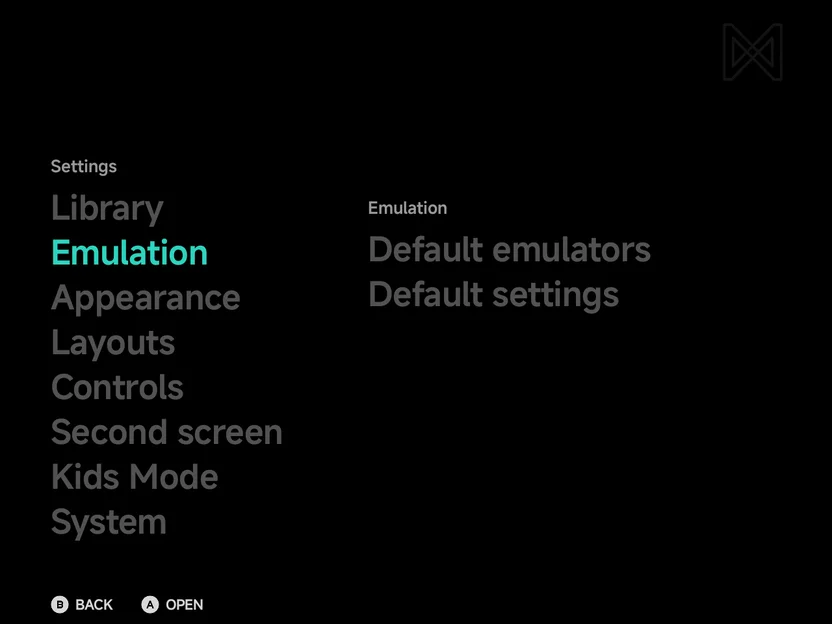
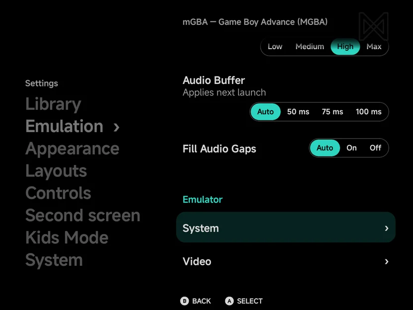
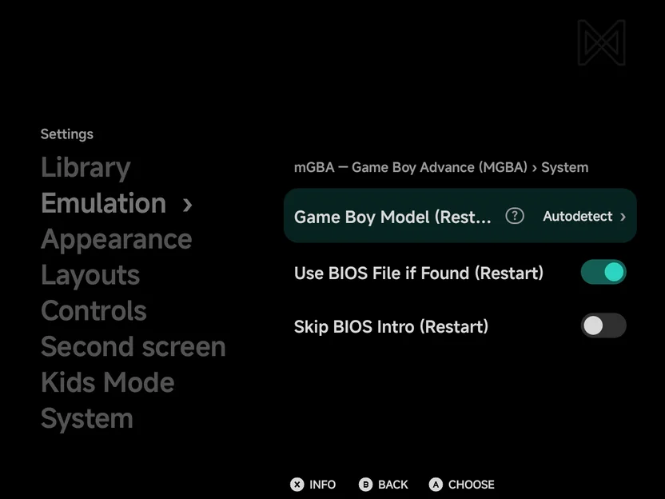
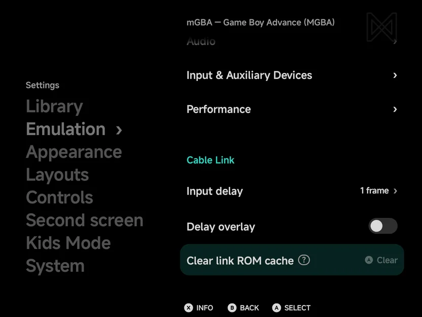
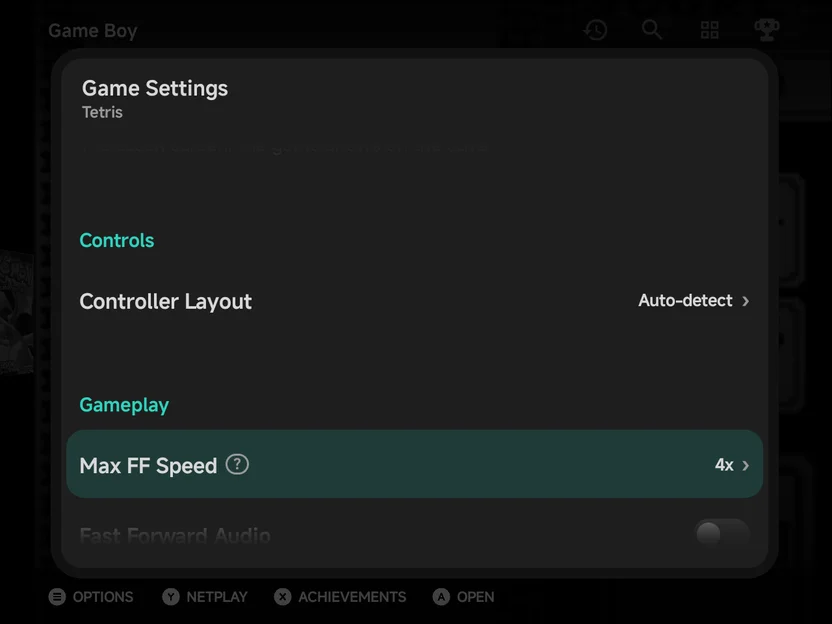
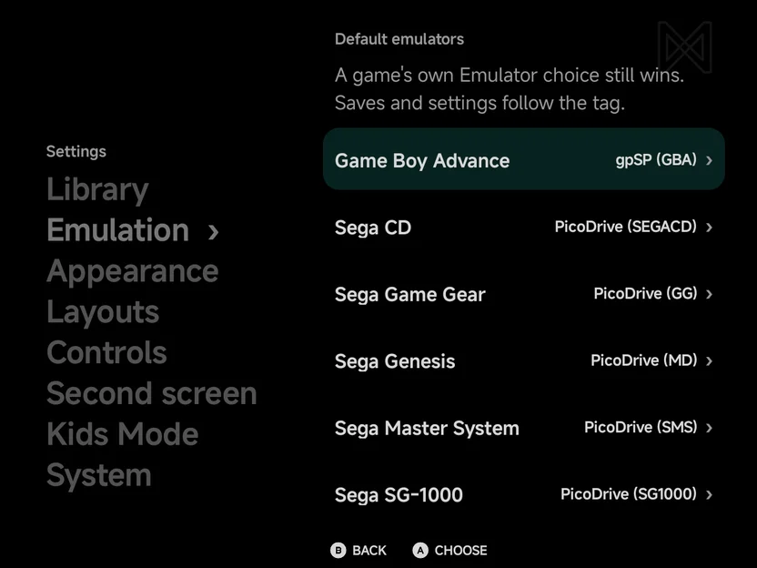

# Emulator Settings

**Tools → Settings → Emulation → Default settings** opens **Emulator Settings**. It
sets each emulator's options for a whole console, without starting a game
first.

The **Emulation** section holds two rows: **Default emulators** (see
[below](#default-emulators)) and **Default settings**.

{ .nx-wide }

For one game, use **Game Settings** in the game's context menu instead. See
[Game Settings](#game-settings).

## The emulator list

The page lists each emulator that runs one of your consoles, with the tags it
covers, such as **Gambatte GB · GBC**. Press `A` on an emulator. When it
covers more than one tag, the app asks for the console first.

{ .nx-wide }

??? info "More detail"

    Emulators for consoles you have no games for are not listed.

## An emulator's settings

The page is titled with the emulator, the console and the tag, such as
**PicoDrive — Sega Genesis (MD)**. Its rows sit under a label per group:

| Group | What it holds |
| --- | --- |
| **Display** | The picture: the Nintendo DS and 3DS screen rows, **3D Resolution**, **Graphics API**, **Wii Screen** and **Bottom screen**. See [Display](in-game-menu.md#display). |
| **Controls** | **Controller Layout**, **Controller Type**, and the Nintendo 3DS and Wii controls. See [Controls](in-game-menu.md#controls). |
| **Gameplay** | Fast forward, rewind, **Frame Skip** and **PS2 BIOS**. See [Gameplay](in-game-menu.md#gameplay). |
| **Multiplayer** | **Local Wireless**, on Nintendo DS, 3DS and PSP. See [Local Wireless](local-wireless.md). |
| **Audio** | **Audio Resampling Quality**, **Audio Buffer** and **Fill Audio Gaps**. See [Audio](in-game-menu.md#audio). |
| **Emulator** | The emulator's own options. Rows with `›` open a group of options, such as **Video** or **Audio**. |

The first five are the app's own settings for the console: the same rows as
the in-game [Options](in-game-menu.md#options) pages, plus the ones read
only when a game starts. A group shows only when it has rows for the
console.

{ .nx-wide }

- The rows work as on the [Settings](settings.md#buttons) pages: a switch,
  a row of choices, or a value with `›` that opens the list of its values.
- `A` flips a switch and opens the list on a value with `›`. `LEFT` /
  `RIGHT` change a value where the page shows alone. Beside the Settings
  sections, press `A` on a row of choices first, as on any
  [Settings](settings.md#buttons) page. By touch, tap the switch, the
  choice, or the row.
- The **?** icon, or `X` **Info**, shows an option's full description.
- Each change is saved straight away. There is no **Save** row.
- Some options only take effect when a game starts, such as the N64
  resolution. The new value is used the next time you start a game.

**Audio Buffer** (Auto, 50 ms, 75 ms, 100 ms; Auto by default) is how much
sound is kept ready ahead of the speaker. **Auto** keeps 50 ms on Wii,
GameCube and PlayStation 2, and about 33 ms elsewhere. More covers slow
moments without crackling, but the sound comes later against the picture.
It applies the next time the game starts.

What you set here is the console's setting, the same as the in-game menu's
**Save Changes → Save for console**. See the
[in-game menu](in-game-menu.md) for the options themselves.

??? info "More detail"

    - The rows read only when a game starts are **Graphics API**
      ([Graphics API](emulators/index.md#graphics-api)), **Audio Buffer**,
      **Local Wireless**, **PS2 BIOS**, and the Wii's **Wii Screen** and
      **Pointer** rows
      ([Nintendo Wii & GameCube](emulators/wii-gamecube.md#console-settings)).
      The in-game menu leaves them out.
    - **Controller Layout**, the fast forward rows and the three **Audio**
      rows are there for every console. **Controller Type** is for Sega
      Genesis, Sega CD and Sega 32X, the rewind rows for emulators that can
      rewind, and **Frame Skip** for Wii and GameCube.
    - While a second screen is connected, every console also has **Bottom
      screen**: **System default**, **Main screen** or **Second screen**. See
      [Dual Screens & External Displays](dual-screen.md#for-one-console).
    - **Screen Scaling**, **Screen Sharpness**, **Overlay**, the offsets,
      **Pad Opacity (landscape)** and **Debug HUD** are in the in-game menu
      only. Keep them for the console with **Save Changes → Save for
      console** there.
    - The in-game [Emulator](in-game-menu.md#emulator) page leaves out the
      options that only take effect when a game starts.
    - When the app cannot read an emulator's options outside a game,
      **Emulator** shows **This emulator's options aren't available outside
      a game.** Change them from the in-game menu instead.
    - The console's settings and **Save for console** write the same file.

## Cable Link

mGBA's page for Game Boy Advance ends with a **Cable Link** group, the
settings of [Cable Link over Wi-Fi](netplay.md#cable-link-over-wi-fi). They
are the app's own, not one console's or game's, so Game Settings doesn't
list them.

| Row | Values | Default | What it does |
| --- | --- | --- | --- |
| **Input delay** | Auto, 1 frame to 8 frames | 1 frame | How many frames a button press waits in a session, the same on both phones. **Auto** starts at 2 and rises when the network stalls. It applies from the next session. |
| **Delay overlay** | Off, On | Off | Shows the current input delay in a corner of the game. |
| **Clear link ROM cache** | | | Deletes the game files kept from Cable Link sessions; they are sent again next time. The row shows the cache's size. |

mGBA is listed for this whichever emulator is your default for Game Boy
Advance: a Cable Link session always runs mGBA.

{ .nx-wide }

## Game Settings

Open a game's context menu with `MENU` in a game list, or a long press on
the game, and choose **Game Settings**. The same page opens over the list, for that one game.

- The first change gives the game its own settings, starting from the
  console's.
- To go back to the console's settings, press `A` on **Use emulator
  settings**, the last row.
- `B` goes back to the game list.
- There is no hint bar: the rows work as on the
  [emulator's page](#an-emulators-settings), by buttons or touch. `LEFT`
  and `RIGHT` change a value straight away.

??? info "More detail"

    - The game's settings are the same file **Save Changes → Save for game**
      writes.
    - **Use emulator settings** shows only while the game has its own
      settings. `A` on it deletes them, so the game follows the console's
      again.
    - `B` returns to the game list on the same game.

## Pause when unfocused

Whether a game pauses while another app takes over is set in **Tools →
Settings → System → Pause when unfocused**. See
[System](about.md#pause-when-unfocused).

The second screen has its own section in Settings: see
[Dual Screens & External Displays](dual-screen.md#settings).

## Default emulators

Some consoles can run on more than one emulator. **Tools → Settings →
Emulation → Default emulators** picks the emulator for a game with
no emulator of its own.

{ .nx-wide }

The consoles with more than one emulator come first, then the consoles you
have games for that have only one, each group A to Z. Each row shows the
console's emulator and tag, such as **gpSP (GBA)**. On a console with more
than one emulator, pick another one as on any
[Settings](settings.md#buttons) row: `A`, `LEFT` / `RIGHT` where the page
shows alone, or a tap.

- Saves and BIOS are shared by the console's emulators, so switching emulator
  copies nothing.
- To switch one game to another emulator, use **Emulator** in its context
  menu. See [Emulators](emulators/index.md).

??? info "More detail"

    - The line under the page's title reads **A game's own Emulator choice
      still wins. Saves and settings follow the tag.**

    - The consoles with more than one emulator (listed in
      [Choosing an emulator](emulators/index.md#choosing-an-emulator)) always
      show. The other rows are dimmed and only show the emulator in use.
