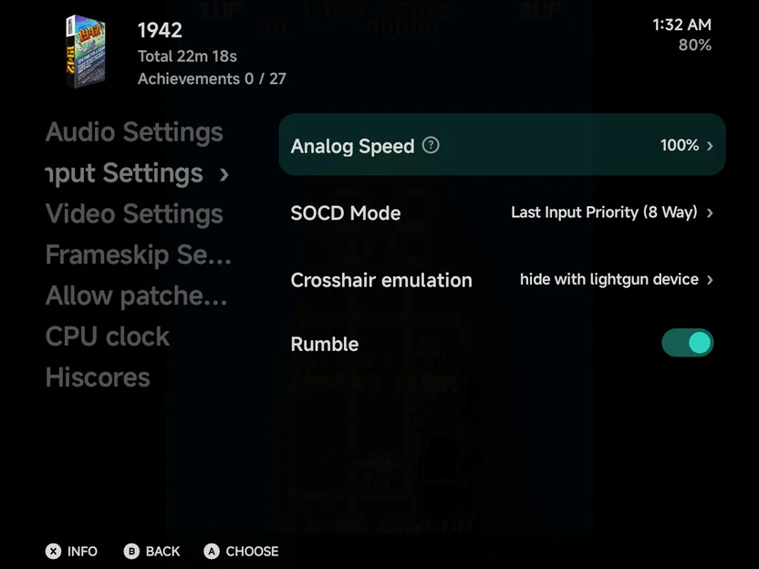

# Arcade (FBNeo)

Arcade games run on the bundled **FinalBurn Neo** core.

| | FinalBurn Neo |
| --- | --- |
| Folder | `Roms/Arcade (FBN)/` |
| Saves | `Saves/FBN/` |
| BIOS | BIOS sets, such as `neogeo.zip`, next to the games or in `Bios/FBN/` |
| [File types](index.md) | `zip` `7z` (MAME-style sets) |

- NAOMI and Atomiswave games run on Flycast instead, from the Dreamcast
  folder. See [Sega Dreamcast](dreamcast.md#naomi-and-atomiswave).

## Controls

| Control | What it does |
| --- | --- |
| `SELECT` (**COIN** on the on-screen pad) | Insert a coin |
| `START` | Start |
| D-pad, left stick | The joystick |
| Face buttons and shoulders | The game's buttons |

- `MENU`, or `SELECT` + `START`, opens the [in-game menu](../in-game-menu.md).
  The game sees the `SELECT` press first, so it may count a coin.
- Some games put extra buttons, such as Service, on `L3` and `R3` (pressing
  the sticks), on controllers only.
- The on-screen pad is the arcade [pad skin](../controls.md#pad-skins).
- Games with rumble shake the controller or the phone; see
  [Vibration](../controls.md#game-rumble).
- Vertical games, such as many shoot-'em-ups, show a tall picture. To give
  one the whole screen in portrait, turn
  [Pad skin](../appearance.md#pad-skin) off: the buttons are then drawn
  see-through over the game.
- On a [second display](../dual-screen.md), a vertical game is turned the
  right way up there, like any other game.

## Adding games

- Put the zips (or 7z) in the folder as they are. Each one *is* the game.
- Put BIOS sets, such as `neogeo.zip`, next to the games or in `Bios/FBN/`.
- A missing BIOS set stops the launch with a message.

??? info "More detail"
    - Arcade sets are never unpacked.
    - Parent sets are read from the same folder or from `Bios/FBN/`. A
      missing parent set doesn't stop the launch: the game is tried without
      it.
    - BIOS sets are not listed as games.
    - Games show their arcade titles, with bracketed text dropped as on the
      handheld.
    - FinalBurn Neo knows 8,510 sets, and each zip must match its ROM list.
      A zip from an older collection may be missing files or carry a name
      the core no longer uses. 89 sets changed their ROMs and need updated
      zips. Some sets were renamed: `alienaru` is now `alienar`, `gradiusb`
      `bs_gradius`, `sailormnj` `sailormn`, `sailormnn` `sailormnne` and
      `sailormno` `sailormnoe`. `marioe`, `tigeroadb2` and `twinbeeb` are
      gone.

!!! warning "Don't rename the zips"
    FBNeo finds a game by its short zip name (`sf2.zip`). The game list shows
    the readable title anyway. To pick your own name, use **Rename Rom** or a
    `map.txt` alias.

## Options

FinalBurn Neo's own options are on the **Emulator** page of the in-game
menu's [Options](../in-game-menu.md#options), and outside a game under
**Emulator** in [Emulator Settings](../emulator-settings.md). Two of them:

| Option | Under | What it does |
| --- | --- | --- |
| **Rumble** | **Emulator → Input Settings** | Game rumble. On by default. |
| **Resolution** | **Emulator → Video Settings** | The size vector games are drawn at. 640x480 by default. |

{ .nx-wide }

**Vertical mode** is fixed and not listed: the app turns vertical games
itself.

## Save states

Save states work as on the other consoles. A state made by another version
of FinalBurn Neo, such as one synced from a handheld, is refused when its
size doesn't match this version's. Neo Geo games' states changed size, so
an older one is refused and the game starts fresh instead of resuming.

## Multiplayer

- Up to four players can play, each on their own controller, as many as the
  game has. See [Local Multiplayer](../multiplayer.md).
- Arcade games also play over [Netplay](../netplay.md).

## Cheats and achievements

- [Cheats](../cheats.md): the cheat download has codes for arcade games.
  They change the game's memory directly. They don't work over
  [Netplay](../netplay.md).
- [RetroAchievements](../retroachievements.md) works for arcade games it
  recognises.
