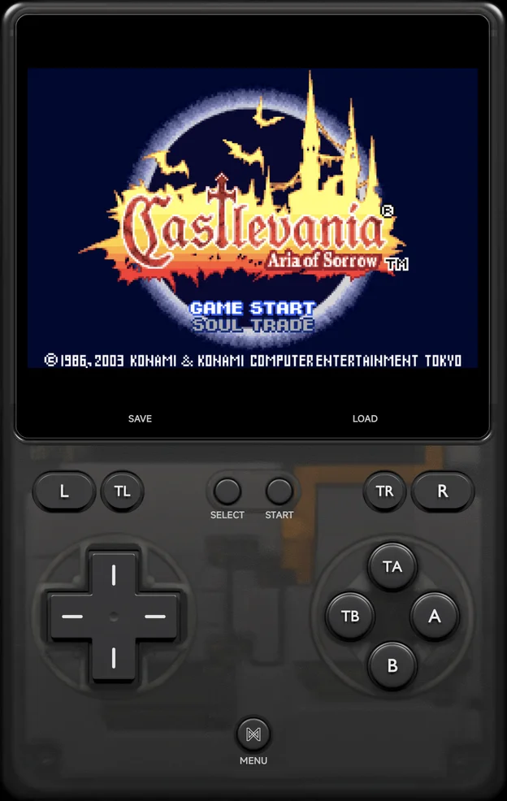

# Game Boy & Game Boy Advance

Game Boy and Game Boy Color games run on the bundled **Gambatte** core, Game
Boy Advance games on **gpSP** by default or **mGBA**, and Super Game Boy
games on **mGBA**. To pick gpSP or mGBA for the Game Boy Advance, see
[Choosing an emulator](index.md#choosing-an-emulator).

| | Folder | BIOS | [File types](index.md) |
| --- | --- | --- | --- |
| Game Boy | `Roms/Game Boy (GB)/` | Not needed | `gb` `dmg` |
| Game Boy Color | `Roms/Game Boy Color (GBC)/` | Not needed | `gbc` |
| Game Boy Advance | `Roms/Game Boy Advance (GBA)/` | Optional: an open BIOS is built in. A real `gba_bios.bin` in `Bios/GBA/` is used when present. | `gba` `bin` `agb` `gbz` `u1` |
| Super Game Boy | `Roms/Super Game Boy (SGB)/` | Not needed | `gb` `gbc` |

Saves go in `Saves/<tag>/`, such as `Saves/GBA/`.

??? info "More detail"
    - gpSP and mGBA share the Game Boy Advance's battery saves. Save states
      stay per emulator.
    - gpSP plays the Game Boy Advance's sampled sound as the hardware does,
      so music sounds the same on gpSP and mGBA, at the same volume.
    - A Classic NES Series cart, such as Pac-Man, doesn't run on gpSP: its
      first launch moves it to mGBA. See
      [Choosing an emulator](index.md#choosing-an-emulator).

## Controls

<figure class="nx-phone" markdown>
{ .nx-phone__screen }
{ .nx-phone__frame }
</figure>

A controller's face buttons work **by the printed letter**: `A` is the Game
Boy's `A`. On top of the Game Boy's own buttons:

| Control | What it does |
| --- | --- |
| `X`, `Y` | Turbo `A`, Turbo `B` |
| `L2`, `R2` | Turbo `L`, Turbo `R` (mGBA and Super Game Boy only) |

The on-screen pad marks them `TA`, `TB`, `TL` and `TR`.

## Link cable

Game Boy, Game Boy Color and Game Boy Advance games link with another phone
or an NX Redux handheld over [Netplay](../netplay.md), for trades and versus
battles. Each player keeps their own save. See
[Netplay → Game Boy Advance link](../netplay.md#game-boy-advance-link).

| Tag | Links over |
| --- | --- |
| `GB`, `GBC` | Wi-Fi or the USB Cable |
| `GBA` (gpSP) | Wi-Fi (as the wireless adapter) or the USB Cable (as a real link cable) |
| `MGBA` (mGBA) | Wi-Fi for games with a Wi-Fi mode (wireless adapter, Pokémon, Advance Wars), otherwise the USB Cable |
| `GBA` and `MGBA`, two phones | [Cable Link over Wi-Fi](../netplay.md#cable-link-over-wi-fi): a real link cable for any two-player cable game |
| `SGB` | No link play |

gpSP and mGBA can link with each other when both games use the same Wi-Fi
mode. Both emulators have a **Link Cable Connectivity** option that picks
the link mode: leave it on its default unless
[Netplay](../netplay.md#game-boy-advance-link) says otherwise.

??? info "More detail"
    - gpSP's **Link Cable Connectivity** is **Automatic** by default. Its
      other values are **GBA Wireless Adapter**, the Pokémon and Advance
      Wars cable modes, **Link Cable - Real (USB only)** and **Disabled**.
    - mGBA's is in **Settings → Emulation → Default settings → mGBA →
      Input & Auxiliary Devices**, and applies when a game starts.
    - The Cable Link settings (**Input delay**, **Delay overlay** and
      **Clear link ROM cache**) are at the end of mGBA's page there.

## Cheats and achievements

- [Cheats](../cheats.md): the cheat download has codes for Game Boy, Game Boy
  Color and Game Boy Advance games, or add your own `.cht` files.
- [RetroAchievements](../retroachievements.md) works for all of them,
  including Super Game Boy games (as Game Boy).
