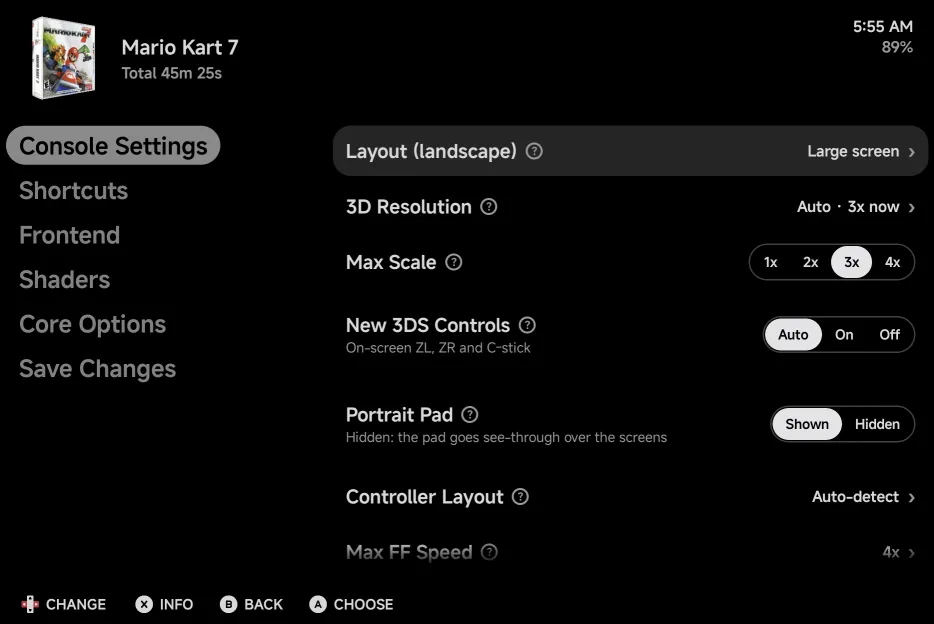
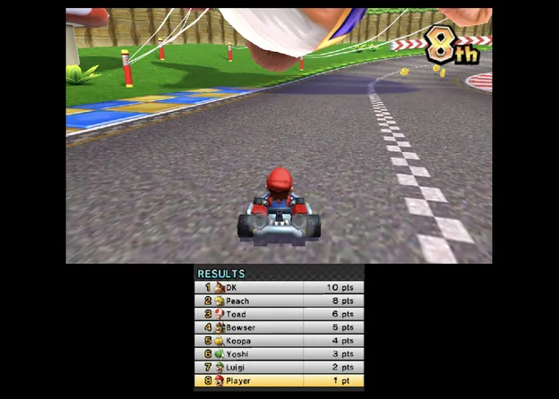
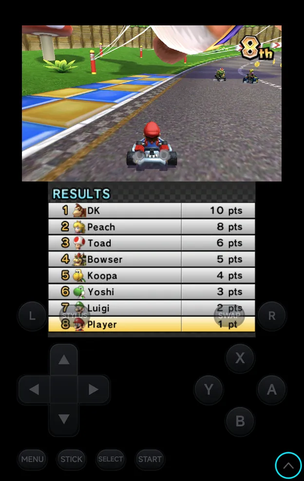

# Nintendo 3DS

Nintendo 3DS games run on the bundled **Azahar** core, which draws both
screens.

| | Azahar |
| --- | --- |
| Folder | `Roms/Nintendo 3DS (3DS)/` |
| Saves | `Saves/3DS/Azahar/` (the 3DS's own storage: its SD card and system memory) |
| BIOS | Not needed |
| [File types](index.md) | Decrypted `3ds` `cci` `cxi` `3dsx`, and their compressed versions `zcci` `zcxi` `z3dsx` |

- **Encrypted games don't load.** Decrypt them first.
- `.cia` install files are not supported.
- **Graphics API** can switch a game to Vulkan. See
  [Graphics API](index.md#graphics-api).

## Controls

<figure class="nx-phone" markdown>
{ .nx-phone__screen }
{ .nx-phone__frame }
</figure>

The 3DS pad

<figure class="nx-phone" markdown>
{ .nx-phone__screen }
{ .nx-phone__frame }
</figure>

With <a href="#new-3ds-controls">New 3DS controls</a>

The on-screen pad is laid out like a 3DS. `STICK` / `D-PAD` switches between
the d-pad and the Circle Pad. Games that use the New 3DS buttons also get
`ZL`, `ZR` and the C-stick: see [New 3DS controls](#new-3ds-controls).
The round button in the pad's bottom-left corner (right of `L` in
landscape) is the [mic button](#microphone).

The pad also has **STYLUS**, which turns [stylus mode](#stylus-mode) on or
off (pressed in while it's on), and **SWAP**, which swaps the screens. In
portrait they sit either side of `MENU` and `STICK`. In landscape
**STYLUS** is under `MENU` and **SWAP** under `START`; with the portrait
[pad hidden](#portrait-pad) they sit beside the shoulder buttons.

On a controller the shortcuts are `SELECT` combos, because `L2` and `R2` are
the 3DS's own `ZL` and `ZR`:

| Buttons | What they do |
| --- | --- |
| `SELECT` + `R1`, or **SWAP** | Swap the screens. |
| `SELECT` + `L1`, or **STYLUS** | Turn stylus mode on or off. |
| `SELECT` + `LEFT` / `RIGHT` | Change the layout of the orientation you're in: **Large screen**, **Stacked**, **Single screen**, **Side by side**, and round again. [Half-folded](#half-folded) it only shows **Layout is set by the fold**. |
| `SELECT` + `START`, or `MENU` | Open the [in-game menu](../in-game-menu.md). |

A controller adds:

| Control | Nintendo 3DS |
| --- | --- |
| `L2`, `R2` | `ZL`, `ZR`, also on controllers whose triggers are analog only |
| Left stick | The Circle Pad |
| Right stick | The C-stick, and the touch cursor |
| `R3` (press the right stick) | Tap at the cursor |
| `L3` (press the left stick) | Swap the screens |

A controller's face buttons work as printed: its `A` is the 3DS's `A`. To
use the 3DS's positions on an Xbox pad (`A` on the right), set
**Controller Layout** to **Nintendo** in **Options → Console Settings**; see
[Controls](../controls.md#controller-buttons).

!!! note "`SELECT` waits"
    The game gets `SELECT` when you let go of it, so a combo doesn't pause
    the game.

??? info "More detail: `SELECT`"
    Many 3DS games pause on Select, so the game never sees `SELECT` while you
    hold it:

    - Tap it and the game gets `SELECT` when you let go.
    - Hold it longer than 1 second without a combo and nothing is sent.
    - After a combo (`SELECT` + `R1`, `L1`, `LEFT`, `RIGHT` or `START`) the
      game gets nothing.

### New 3DS controls

**New 3DS Controls** adds `ZL` and `ZR` and the C-stick to the on-screen pad.
Set it for the console in [Emulator Settings](../emulator-settings.md), or
in the in-game menu under **Options → Console Settings**, where
[Save Changes](../in-game-menu.md#save-changes) keeps it for the game or the
console:

| Value | What the pad shows |
| --- | --- |
| **Auto** (default) | The extra controls for games known to use them, such as Majora's Mask 3D (camera). |
| **On** | The extra controls for every game. |
| **Off** | No extra controls. |

A controller's right stick, `L2` and `R2` always reach the game, whatever
the setting. Azahar runs as a New 3DS, so Circle Pad Pro games work without
extra setup.

??? info "More detail"
    - **Auto** covers games that use the C-stick, `ZL` / `ZR` or the Circle
      Pad Pro, such as Majora's Mask 3D, Monster Hunter 4 Ultimate and
      Xenoblade Chronicles 3D.
    - `ZL` and `ZR` sit where `L2` and `R2` are on other consoles. The
      C-stick is centred under `SELECT` and `START` in portrait, at the top
      left of the face buttons in landscape, and between the d-pad and the
      face buttons with the portrait [pad hidden](#portrait-pad).
    - A change in the in-game menu updates the pad straight away.

    **Auto** finds the game by the title ID in `.3ds`, `.cci` and `.cxi`
    files. It can't read the compressed `zcci`, `zcxi` and `z3dsx` files or
    `3dsx` files, so for those set **On** yourself.

## Console Settings

The 3DS's own options are in the in-game menu under **Options → Console
Settings**, and for the console in
[Emulator Settings](../emulator-settings.md). `LEFT` / `RIGHT` change a
value; keep it for the game or the console with
[Save Changes](../in-game-menu.md#save-changes).

In a game the page lists only one **Layout** row, the one in use for the way
you're holding the phone (**Layout (portrait, controller)** while a controller
hides the pad); the other rows all stay. Turn the phone or pick another layout and the row follows. Emulator
Settings and Game Settings list every row, so you can set up each
orientation there.

{ .nx-wide }

This picture predates 3D Resolution and the in-game filter: a game now lists
one Layout row, with the 3D Resolution rows under it.

| Row | Values | Default | See |
| --- | --- | --- | --- |
| **Layout (portrait)** | Large screen, Stacked, Single screen, Side by side | Stacked | [Screen layouts](#screen-layouts) |
| **Layout (portrait, controller)** | The same | Stacked | [Screen layouts](#screen-layouts) |
| **Layout (landscape)** | The same | Depends on the screen | [Screen layouts](#screen-layouts) |
| **3D Resolution** | Auto, Quality, Performance | Auto | [3D rendering](#3d-rendering) |
| **Max Scale** | 1x up to what the display can show (shown in Auto only) | 3x | [3D rendering](#3d-rendering) |
| **Scale** | 1x up to half of the most the display can show, rounded up (shown in Performance only) | 2x | [3D rendering](#3d-rendering) |
| **New 3DS Controls** | Auto, On, Off | Auto | [New 3DS controls](#new-3ds-controls) |
| **Portrait Pad** | Shown, Hidden | Shown | [Portrait pad](#portrait-pad) |
| **Controller Layout** | Auto-detect, Xbox (A at the bottom), Nintendo (A on the right) | Auto-detect | [Controls](../controls.md#controller-buttons) |

Every row takes effect straight away; none needs the game restarted.
**Graphics API** is read only when a game starts, so it's not here: set it
in [Game Settings](../emulator-settings.md#game-settings) or Emulator
Settings (see [Graphics API](index.md#graphics-api)).

## Screen layouts

The layouts have the [Nintendo DS](nintendo-ds.md#screen-layouts) names.
Azahar draws both screens as one picture, which fills the room the
[on-screen pad](../controls.md#landscape) leaves, at its shape.

| Layout | Picture |
| --- | --- |
| **Large screen** The top screen big, the bottom screen half its size centred under it. |  |
| **Stacked** The top screen above the bottom screen, at the same scale. |  |
| **Single screen** Only the top screen. |  |
| **Side by side** The two screens next to each other. |  |

The pictures are in portrait; landscape draws the same layouts across the
wider screen. **SWAP** (or `SELECT` + `R1`) swaps which screen is the big
or upper one, in every layout.

As on the DS, each orientation keeps its own layout: **Layout (portrait)**
and **Layout (landscape)** in [Console Settings](#console-settings). With a
controller connected the on-screen pad goes away in portrait and **Layout
(portrait, controller)** is used. `SELECT` + `LEFT` / `RIGHT` changes the
one you're in and saves it for the game straight away, without Save
Changes.

Until you pick one, the screen decides:

| Screen | Portrait | Landscape |
| --- | --- | --- |
| A phone | Stacked | Side by side |
| A squarer screen or a tablet, such as the Galaxy Z Fold's cover and inner screens | Stacked | Large screen |

??? info "More detail"
    - A squarer screen is the same as on the
      [DS](nintendo-ds.md#which-layout-by-default).
    - The app sets Azahar's own **Screen Layout** option from the layout rows,
      so it no longer appears in **Core Options**.
    - **Screen Swap Mode** in **Core Options** sets whether the swap toggles
      (the default) or lasts only while you hold the buttons.
    - Azahar's own large screen, with the bottom screen beside the top one,
      isn't offered. A layout saved as it reads as **Large screen**.
    - A layout you picked before these layouts came is kept. One left at the
      old default, **Top over bottom**, now follows the screen's default.

## 3D rendering

**3D Resolution** in [Console Settings](#console-settings) sets how sharply
the games are drawn. Azahar renders at a whole multiple of the 3DS's own
top-screen width (400 px).

| Mode | What it does |
| --- | --- |
| **Auto** | Draws at the largest multiple that fits the width the screens are shown at, up to **Max Scale** (3x by default). |
| **Quality** | The same with no cap: as sharp as the display can show, up to Azahar's 10x. |
| **Performance** | A fixed **Scale**, from 1x up to half of the most the display can show, rounded up. 2x by default. |

**Max Scale** shows only in Auto and **Scale** only in Performance. A higher
scale is sharper but slower: if a game stutters, try Performance at a lower
**Scale**.

In a game the row reads like **Auto · 3x now** in Auto and Quality, the scale
in use (Performance shows its **Scale**). It follows turning the phone,
folding it and changing the layout, straight away. These rows show no
preview strip.

??? info "More detail"
    - The lists follow the display: a phone tops out lower than the unfolded
      Galaxy Z Fold. The core's own limit is 10x.
    - Azahar's own **Internal Resolution**, **Large Screen Proportion** and
      **Stereoscopic 3D Mode** no longer appear in Core Options: the app sets
      the resolution, and the app fixes the other two.
      **Prominent 3DS Screen** and **Screen Swap Mode** stay.

## Motion

Games that use the 3DS's gyroscope and tilt read your phone's: turn or tip
the phone the way you would turn or tip a 3DS. In Mario Kart 7's first-person
view, for example, you steer by turning the phone.

{ .nx-wide }

Motion is always on, like on a 3DS. Hold the phone the way the game expects,
as you would a 3DS.

??? info "More detail"
    - There's no setting for motion.
    - It works in portrait and in both landscape directions. The game reads
      the phone's tilt as it is.
    - The sensors only run while you play. They stop while the game is
      paused, in the in-game menu, or in the background.
    - On a phone without a gyroscope, tilting still works, but aiming by
      turning the phone does nothing.

## Stylus mode

In stylus mode a dot on the bottom screen is the pen, for touching it without
your finger.

| Control | What it does |
| --- | --- |
| D-pad or left stick | Move the dot. The d-pad speeds up the longer you hold it. |
| `A` | Touch at the dot. |
| **STYLUS**, or `SELECT` + `L1` on a controller | Turn stylus mode on or off. |

Stylus mode is off each time a game starts, and is not saved.

## Touch

Touch the bottom screen wherever it is drawn, as long as the on-screen pad
doesn't cover part of the picture: in portrait with the pad band, in
landscape with the pad solid beside the picture, half-folded, or with a
controller.

While the pad covers part of the picture (in landscape, its see-through
halves overlapping the screens, or in portrait with the
[pad hidden](#portrait-pad), the screens reaching into it), only the main
screen takes touches: the big one, or the first (top or left) when both are
the same size.

**For games that need buttons and touch together**, press **SWAP** to make
the bottom screen the main one. Then touch it anywhere between the buttons
while you play with them. A layout with one big screen gives it the most
room.

??? info "More detail"
    - The see-through buttons still take the touches that land on them. To
      reach something under a button, such as a menu item in a corner of the
      bottom screen, use [stylus mode](#stylus-mode), whose pen reaches the
      bottom screen either way, or turn the phone to portrait.

## Microphone

Games that listen for a blow, a shout or your voice hear your phone's
microphone while the **Mic** is on. Turn it on with the round **mic button**
on the on-screen pad, the **Mic** tile in the game panel's
[Shortcuts](../dual-screen.md#shortcuts) tab, or a **Toggle mic**
[shortcut](../controls-settings.md#shortcuts) on a controller. It works as on
the [Nintendo DS](nintendo-ds.md#microphone): Android asks the first time,
and without the permission the game hears a made-up blow. The Mic is off
each time a game starts.

??? info "More detail"
    - Even with the Mic on, the phone's microphone only opens while the game
      is listening, so Android's recording dot shows only then.
    - While the Mic is off, the menu is open or the app is in the
      background, the game hears silence and the microphone is closed.

## Portrait pad

In portrait, long-press the arrow in the pad's bottom-right corner to hide
the pad band. The two screens get its room, and one see-through pad lies
across the bottom of the screen instead; the screens reach into it by a
third of its height at most. The arrow stays in the
corner: long-press it again to bring the band back. A plain tap does
nothing.

<figure class="nx-phone" markdown>
{ .nx-phone__screen }
{ .nx-phone__frame }
</figure>

Pad shown

<figure class="nx-phone" markdown>
{ .nx-phone__screen }
{ .nx-phone__frame }
</figure>

Pad hidden

The choice is **Portrait Pad** (Shown or Hidden) in **Options → Console
Settings**, and the long-press saves it for the console.

??? info "More detail"
    - Touch follows the [touch rule](#touch): swap the bottom screen up with
      **SWAP** to touch it, or use [stylus mode](#stylus-mode).
    - The pad is drawn solid when the screens stop above it.
    - With a controller connected the pad hides too, as in landscape.
    - Landscape is not affected.

## Half-folded

On a foldable such as the Galaxy Z Fold, fold the inner screen partway, like
a small laptop, and the top screen moves right above the hinge, the touch
screen right below it, with the pad either side of the touch screen. Each
screen is as big as its half allows, at its shape, whatever layout you saved, and the
touch screen takes touches. Open the phone flat and your layout comes back.
See [Foldables & Large Screens](../foldables.md#nintendo-ds-and-3ds-half-folded).

## Second screen

On a handheld with a second screen, or with a display on USB-C, the game
starts split: the top screen on one screen and the bottom screen on the
other, which takes the touches. **SWAP** (or `SELECT` + `R1`) swaps them over
for this session. The **Panel** pill at the bottom right shows the game panel
instead, with both 3DS screens side by side on the other screen. See
[Dual Screens & External Displays](../dual-screen.md#nintendo-ds-and-3ds).

??? info "More detail"
    The **Layout** rows aren't used while split or with the panel up, nor is
    the [half-folded](#half-folded) layout.

## Cheats and achievements

- Cheats: not available. Azahar's libretro core doesn't support them, so the
  in-game menu has no **Cheats** page for 3DS games.
- RetroAchievements: not available for 3DS games in the app.
