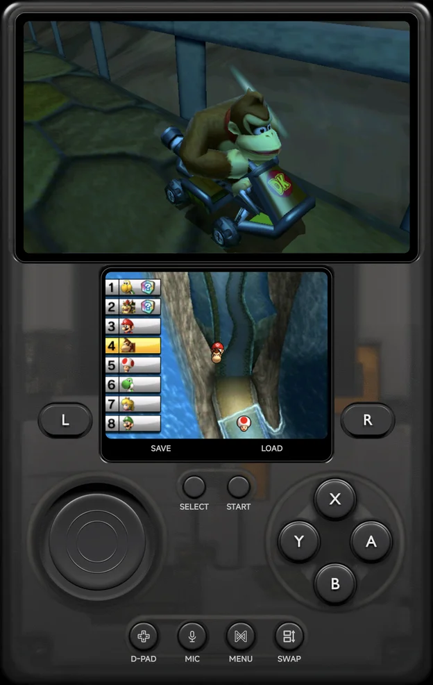
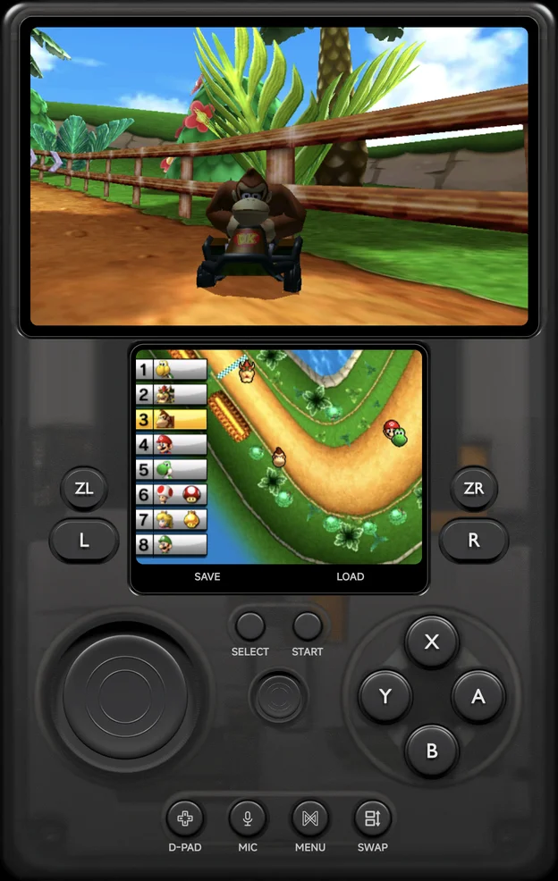
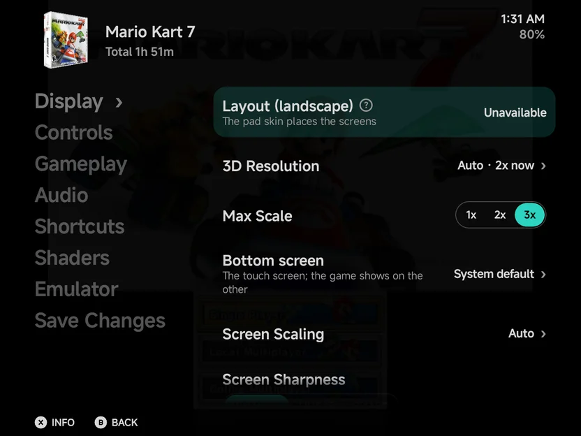
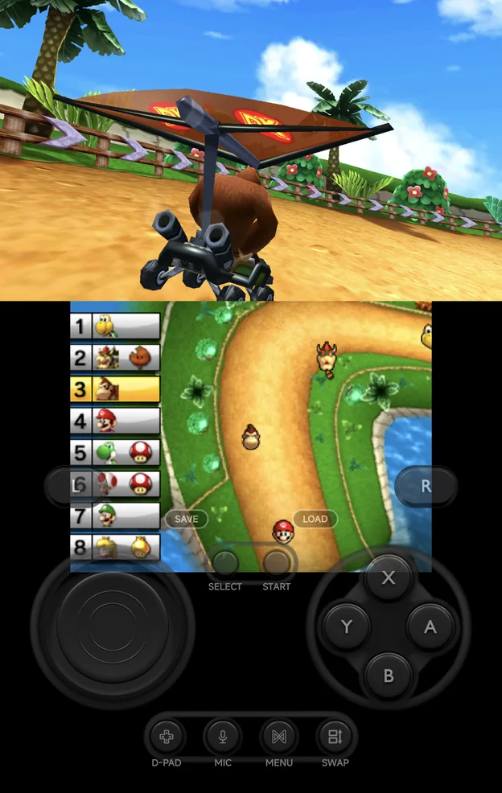
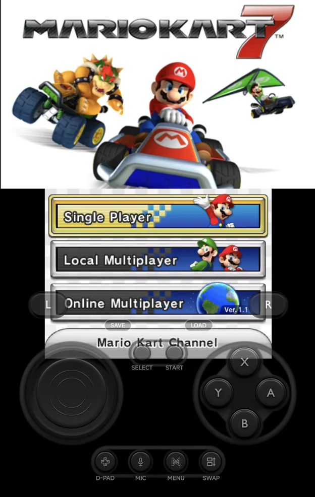

# Nintendo 3DS

Nintendo 3DS games run on the bundled **Azahar** core (2126.2). The app
lays out the two screens. Games with local play link with other phones:
see [Local wireless](#local-wireless).

| | Azahar |
| --- | --- |
| Folder | `Roms/Nintendo 3DS (3DS)/` |
| Saves | `Saves/3DS/Azahar/` (the 3DS's own storage: its SD card and system memory) |
| BIOS | Not needed |
| [File types](index.md) | Decrypted `3ds` `cci` `cxi` `3dsx`, and their compressed versions `zcci` `zcxi` `z3dsx` |

- **Encrypted games don't load.** Decrypt them first.
- `.cia` install files are not supported.
- **Graphics API** can switch a game to Vulkan. See
  [Graphics API](index.md#graphics-api).

## Controls

<figure class="nx-phone" markdown>
{ .nx-phone__screen }
{ .nx-phone__frame }
</figure>

The 3DS pad

<figure class="nx-phone" markdown>
{ .nx-phone__screen }
{ .nx-phone__frame }
</figure>

With <a href="#new-3ds-controls">New 3DS controls</a>

The [pad skin](../controls.md#pad-skins) is laid out like a 3DS, with the
Circle Pad and the d-pad. Games that use the New 3DS buttons also get
`ZL`, `ZR` and the C-stick: see [New 3DS controls](#new-3ds-controls). Two
buttons are the app's:

- **SWAP** swaps the two screens.
- **MIC** lets the game hear the [microphone](#microphone).

Touch the skin's touch screen with your finger, as on a 3DS.

With a controller the pad goes away, and these shortcuts work. They are
the same as on the [Nintendo DS](nintendo-ds.md#controls), except that
`L2` and `R2` are the 3DS's own `ZL` and `ZR`:

| Buttons | What they do |
| --- | --- |
| `L3`, or `SELECT` + `L1` | Swap the screens. |
| `SELECT` + `R1` | Turn [stylus mode](#stylus-mode) on or off. |
| `SELECT` + `LEFT` / `RIGHT` | Change the layout of the orientation you're in: **Large screen**, **Stacked**, **Single screen**, **Side by side**, and round again. |
| `SELECT` + `START`, or `MENU` | Open the [in-game menu](../in-game-menu.md). |

A controller adds:

| Control | Nintendo 3DS |
| --- | --- |
| `L2`, `R2` | `ZL`, `ZR`, also on controllers whose triggers are analog only |
| Left stick | The Circle Pad |
| Right stick | The C-stick |

A controller's face buttons work as printed: its `A` is the 3DS's `A`. To
use the 3DS's positions on an Xbox pad (`A` on the right), set
**Controller Layout** to **Nintendo** in **Options →
[Controls](../in-game-menu.md#controls)**; see
[Controls](../controls.md#controller-buttons).

!!! tip "The layout tip"
    When a game starts, a notice reads **SELECT + Left / Right changes the
    screen layout** and **L3 or SELECT + L swaps the screens**. Tap **Don't
    show again** to hide it for good. It shows where the layout shortcut
    works: not while a pad skin places the screens.

!!! note "`SELECT` waits"
    The game gets `SELECT` when you let go of it, so a combo doesn't pause
    the game.

??? info "More detail: `SELECT`"
    Many 3DS games pause on Select, so the game never sees `SELECT` while you
    hold it:

    - Tap it and the game gets `SELECT` when you let go.
    - Hold it longer than 1 second without a combo and nothing is sent.
    - After a combo (`SELECT` + `L1`, `R1`, `LEFT`, `RIGHT` or `START`) the
      game gets nothing.

??? info "More detail"
    - A short label shows the new layout, or **Stylus on** / **Stylus
      off**.
    - [Half-folded](#half-folded) the fold sets the layout, whatever
      `SELECT` + `LEFT` / `RIGHT` picks.
    - While a pad skin places the screens, `SELECT` + `R1` and `SELECT` +
      `LEFT` / `RIGHT` do nothing. `SELECT` + `L1` still swaps.
    - `SELECT` + `LEFT` / `RIGHT` saves the layout for the game straight
      away, without Save Changes. Stylus mode is not saved.

### New 3DS controls

**New 3DS Controls** adds `ZL` and `ZR` and the C-stick to the pad skin.
Set it for the console in [Emulator Settings](../emulator-settings.md), or
in the in-game menu under **Options → Controls**, where
[Save Changes](../in-game-menu.md#save-changes) keeps it for the game or the
console:

| Value | What the pad shows |
| --- | --- |
| **Auto** (default) | The extra controls for games known to use them, such as Majora's Mask 3D (camera). |
| **On** | The extra controls for every game. |
| **Off** | No extra controls. |

A controller's right stick, `L2` and `R2` always reach the game, whatever
the setting. Azahar runs as a New 3DS, so Circle Pad Pro games work without
extra setup.

??? info "More detail"
    - **Auto** covers games that use the C-stick, `ZL` / `ZR` or the Circle
      Pad Pro, such as Majora's Mask 3D, Monster Hunter 4 Ultimate and
      Xenoblade Chronicles 3D.
    - A change in the in-game menu updates the pad straight away.

    **Auto** finds the game by the title ID in `.3ds`, `.cci` and `.cxi`
    files. It can't read the compressed `zcci`, `zcxi` and `z3dsx` files or
    `3dsx` files, so for those set **On** yourself.

## Console Settings

The 3DS's own options are in the in-game menu under **Options →
[Display](../in-game-menu.md#display)**, and for the console in
[Emulator Settings](../emulator-settings.md). Keep a change for the game
or the console with [Save Changes](../in-game-menu.md#save-changes).

In a game the page lists only one **Layout** row, the one in use for the way
you're holding the phone (**Layout (portrait, controller)** while a controller
hides the pad); the other rows all stay. The **Layout** rows change in place
without a preview: the new layout shows when you go back to the game. Turn
the phone or pick another layout and the row follows. Emulator Settings
and Game Settings list every row, so you can set up each orientation there.

{ .nx-wide }

| Row | Values | Default | See |
| --- | --- | --- | --- |
| **Layout (portrait)** | Large screen, Stacked, Single screen, Side by side | Large screen | [Screen layouts](#screen-layouts) |
| **Layout (portrait, controller)** | The same | Stacked | [Screen layouts](#screen-layouts) |
| **Layout (landscape)** | The same | Depends on the screen | [Screen layouts](#screen-layouts) |
| **3D Resolution** | Auto, Quality, Performance | Auto | [3D rendering](#3d-rendering) |
| **Max Scale** | 1x up to what the display can show (shown in Auto only) | 3x | [3D rendering](#3d-rendering) |
| **Scale** | 1x up to half of the most the display can show, rounded up (shown in Performance only) | 2x | [3D rendering](#3d-rendering) |

Three more rows are in other groups:

| Row | Group | Values | Default | See |
| --- | --- | --- | --- | --- |
| **New 3DS Controls** | Controls | Auto, On, Off | Auto | [New 3DS controls](#new-3ds-controls) |
| **Controller Layout** | Controls | Auto-detect, Xbox (A at the bottom), Nintendo (A on the right) | Auto-detect | [Controls](../controls.md#controller-buttons) |
| **Local Wireless** | Multiplayer | On, Off | On | [Local wireless](#local-wireless) |

Every Display and Controls row takes effect straight away; none needs the
game restarted. **Local Wireless** and **Graphics API** are read only when a
game starts, so they're not in the in-game menu: set them in
[Game Settings](../emulator-settings.md#game-settings) or Emulator Settings
(see [Graphics API](index.md#graphics-api)).

## Screen layouts

The layouts have the [Nintendo DS](nintendo-ds.md#screen-layouts) names.
The app places the two screens from where Azahar says they are in its
picture, so they fill the room at their shape.

| Layout | Picture |
| --- | --- |
| **Large screen** The top screen big, the bottom screen centred under it: half its size, or in portrait as big as the height left allows, up to the top's size. |  |
| **Stacked** The top screen above the bottom screen, at the same scale. In portrait the top screen takes the full width, and the bottom screen is the same size where the height allows, else as big as the height left allows. |  |
| **Single screen** Only the top screen. |  |
| **Side by side** The two screens next to each other. |  |

The pictures are in portrait; landscape draws the same layouts across the
wider screen. **SWAP** (or `L3`, or `SELECT` + `L1`) swaps which screen is
the big or upper one, in every layout.

As on the DS, each orientation keeps its own layout: **Layout (portrait)**
and **Layout (landscape)** in [Console Settings](#console-settings). With a
controller connected the on-screen pad goes away in portrait and **Layout
(portrait, controller)** is used. `SELECT` + `LEFT` / `RIGHT` changes the
one you're in and saves it for the game straight away, without Save
Changes.

Until you pick one, the screen decides:

| Screen | Portrait | Landscape |
| --- | --- | --- |
| A phone | Large screen | Single screen |
| A squarer screen or a tablet, such as the Galaxy Z Fold's cover and inner screens | Large screen | Large screen |

With a controller connected, **Layout (portrait, controller)** starts on
**Stacked** instead.

!!! note "A pad skin has its own places for the screens"
    With [Pad skin](#pad-skin) on and no controller, the skin draws the
    top screen above the touch screen, and the **Layout** rows it doesn't
    use read **Unavailable** with **The pad skin places the screens**. On
    a phone in landscape the skin has one screen, which shows **Layout
    (landscape)**, so that row and `SELECT` + `LEFT` / `RIGHT` work there.

??? info "More detail"
    - A squarer screen is the same as on the
      [DS](nintendo-ds.md#which-layout-by-default).
    - The app sets Azahar's own **Screen Layout** option from the layout rows,
      so it doesn't appear under **Emulator**.
    - **Screen Swap Mode** under **Emulator** sets whether the swap toggles
      (the default) or lasts only while you hold the button. **Prominent
      3DS Screen** sets which screen a game starts with as the big one.
    - Azahar's own large screen, with the bottom screen beside the top one,
      isn't offered. A layout saved as it reads as **Large screen**.
    - [Shader](../in-game-menu.md#shaders) presets apply to the top screen
      only, as a whole picture. The bottom screen is drawn without them.
    - Screen Scaling, **Overlay** and the screen offsets don't apply to the
      3DS screens. Overlay and the offsets aren't listed for 3DS games.

## 3D rendering

**3D Resolution** in [Console Settings](#console-settings) sets how sharply
the games are drawn. Azahar renders at a whole multiple of the 3DS's own
top-screen width (400 px).

| Mode | What it does |
| --- | --- |
| **Auto** | Draws at the largest multiple that fits the width the screens are shown at, up to **Max Scale** (3x by default). |
| **Quality** | The same with no cap: as sharp as the display can show, up to Azahar's 10x. |
| **Performance** | A fixed **Scale**, from 1x up to half of the most the display can show, rounded up. 2x by default. |

**Max Scale** shows only in Auto and **Scale** only in Performance. A higher
scale is sharper but slower: if a game stutters, try Performance at a lower
**Scale**.

In a game the row reads like **Auto · 3x now** in Auto and Quality, the scale
in use (Performance shows its **Scale**). It follows turning the phone,
folding it and changing the layout, straight away. These rows show no
preview strip.

??? info "More detail"
    - The lists follow the display: a phone tops out lower than the unfolded
      Galaxy Z Fold. The core's own limit is 10x.
    - With the [panel up](#second-screen) on a second display, **3D
      Resolution** goes by the size of the screens there.
    - Azahar's own **Internal Resolution**, **Large Screen Proportion** and
      **Stereoscopic 3D Mode** don't appear under **Emulator**: the app sets
      the resolution, and fixes the other two.
    - The first time a game draws something new, its shaders are built,
      which can stutter for a moment. On OpenGL ES, Azahar's **Hardware
      Shader Cache** keeps them for the next time you play. On Vulkan, new
      shaders are built in the background: the game keeps running, and
      what they draw can be missing for a few frames.

## Motion

Games that use the 3DS's gyroscope and tilt read your phone's: turn or tip
the phone the way you would turn or tip a 3DS. In Mario Kart 7's first-person
view, for example, you steer by turning the phone.

{ .nx-wide }

Motion is always on, like on a 3DS. Hold the phone the way the game expects,
as you would a 3DS.

??? info "More detail"
    - There's no setting for motion.
    - It works in portrait and in both landscape directions. The game reads
      the phone's tilt as it is.
    - The sensors only run while you play. They stop while the game is
      paused, in the in-game menu, or in the background.
    - On a phone without a gyroscope, tilting still works, but aiming by
      turning the phone does nothing.

## Stylus mode

Stylus mode is for playing with a controller. A dot on the bottom screen is
the pen, for touching it without your finger.

| Control | What it does |
| --- | --- |
| Right stick, left stick or d-pad | Move the dot. The d-pad speeds up the longer you hold it. |
| `R3` or `A` | Touch at the dot. |
| `SELECT` + `R1` | Turn stylus mode on or off. |

Stylus mode is off each time a game starts, and is not saved. Out of
stylus mode the right stick is the C-stick alone. With the pad skin there
is no stylus mode: touch the bottom screen itself.

## Touch

Touch the bottom screen wherever it is drawn: in portrait and landscape,
in the pad skin or without it, half-folded, or with a controller.

**For games that need buttons and touch together**, a layout with one big
screen gives the bottom screen the most room; press **SWAP** to make it the
big one.

??? info "More detail"
    - With [Pad skin](#pad-skin) off, the see-through buttons take the
      touches that land on them. To reach something under a button, such
      as a menu item in a corner of the bottom screen, use
      [stylus mode](#stylus-mode), whose pen reaches the bottom screen
      either way, or turn Pad skin on.

## Microphone

Games that listen for a blow, a shout or your voice hear your phone's
microphone while the **Mic** is on. Turn it on with **MIC** on the pad
skin, with a controller the round **mic button** in the screen's
bottom-left corner, the **Mic** tile in the game panel's
[Shortcuts](../dual-screen.md#shortcuts) tab, or a **Toggle mic**
[shortcut](../controls-settings.md#shortcuts) on a controller. It works as on
the [Nintendo DS](nintendo-ds.md#microphone): Android asks the first time,
and without the permission the game hears a made-up blow. The Mic is off
each time a game starts.

??? info "More detail"
    - Even with the Mic on, the phone's microphone only opens while the game
      is listening, so Android's recording dot shows only then.
    - While the Mic is off, the menu is open or the app is in the
      background, the game hears silence and the microphone is closed.

## Pad skin

With no controller connected, [**Pad skin**](../appearance.md#pad-skin) in
**Tools → Settings → Appearance** decides how a 3DS game is drawn:

- **On** (default): the skin frames the game like a 3DS, the top screen
  above the touch screen, with the buttons around them. On a phone in
  landscape the skin has one screen, which shows your **Layout
  (landscape)**: Single screen until you pick another.
- **Off**: the two screens get the whole screen in the
  [layout](#screen-layouts) you picked, and the skin's buttons lie over
  them, see-through.

<figure class="nx-phone" markdown>
{ .nx-phone__screen }
{ .nx-phone__frame }
</figure>

Pad skin on

<figure class="nx-phone" markdown>
{ .nx-phone__screen }
{ .nx-phone__frame }
</figure>

Pad skin off

??? info "More detail"
    - Pad skin is one setting for every console. See
      [Controls → Pad skins](../controls.md#pad-skins) and
      [Pad skin off](../controls.md#pad-skin-off).
    - On a portrait phone the in-game menu covers the skin's top screen
      and runs down to just above `L` and `R`.
    - Move or resize the buttons in
      [Button layout](../controls-settings.md#button-layout).

## Half-folded

On a foldable such as the Galaxy Z Fold, fold the inner screen partway, like
a small laptop, and the top screen moves right above the hinge, the touch
screen right below it, with the pad either side of the touch screen. Each
screen is as big as its half allows, at its shape, whatever layout you saved, and the
touch screen takes touches. Open the phone flat and your layout comes back.
See [Foldables & Large Screens](../foldables.md#nintendo-ds-and-3ds-half-folded).

## Second screen

On a handheld with a second screen, or with a display on USB-C, the game
starts split: the top screen on one screen and the bottom screen on the
other, which takes the touches. **SWAP** (or `L3`, or `SELECT` + `L1`)
swaps them over for this session. The **Panel** pill at the bottom right
shows the game panel instead, with both 3DS screens side by side on the
other screen. See
[Dual Screens & External Displays](../dual-screen.md#nintendo-ds-and-3ds).

??? info "More detail"
    - The **Layout** rows aren't used while split or with the panel up, nor
      is the [half-folded](#half-folded) layout, and `SELECT` + `LEFT` /
      `RIGHT` does nothing.
    - With the panel up, **3D Resolution** goes by the size of the screens
      on the second display.
    - The in-game menu always opens on the bottom screen: opening it brings
      the panel up.

## Local wireless

3DS games with local play, Download Play included, link with other phones
on the same Wi-Fi, or over a USB cable between two phones. Start the game
on each phone and use the game's own local play menu. See
[Local Wireless](../local-wireless.md).

- **Local Wireless** is **On** by default, in the **Multiplayer** group of
  [Emulator Settings](../emulator-settings.md) and Game Settings.
- Your [Player name](../about.md#player-name) is the console's profile
  name and its Mii's name, which games such as Mario Kart 7 show to the
  others.
- 3DS games also have `Y` **Netplay**, to host or join by hand. See
  [Netplay](../netplay.md).
- While the game's wireless is on, the in-game menu is **Continue ·
  Disconnect · Quit**, and save states, rewind, fast forward and reset are
  off.

??? info "More detail"
    - A Mii you made or imported yourself keeps its name.
    - A game that saved a name in its own save keeps showing that one.

## Save states

Save states from earlier Azahar versions load. If one can't be read, the
load fails with a message and the game plays on.

## Cheats and achievements

- Cheats: not available. Azahar's libretro core doesn't support them, so the
  in-game menu has no **Cheats** tab for 3DS games.
- RetroAchievements: not available for 3DS games in the app.
