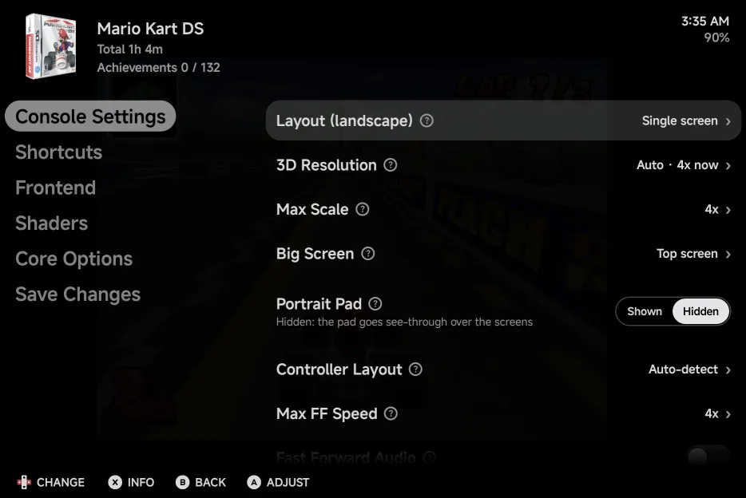
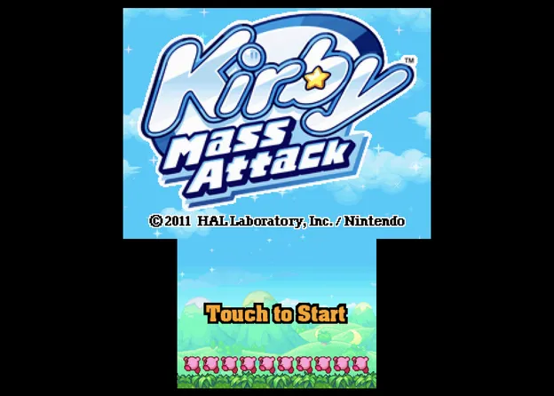
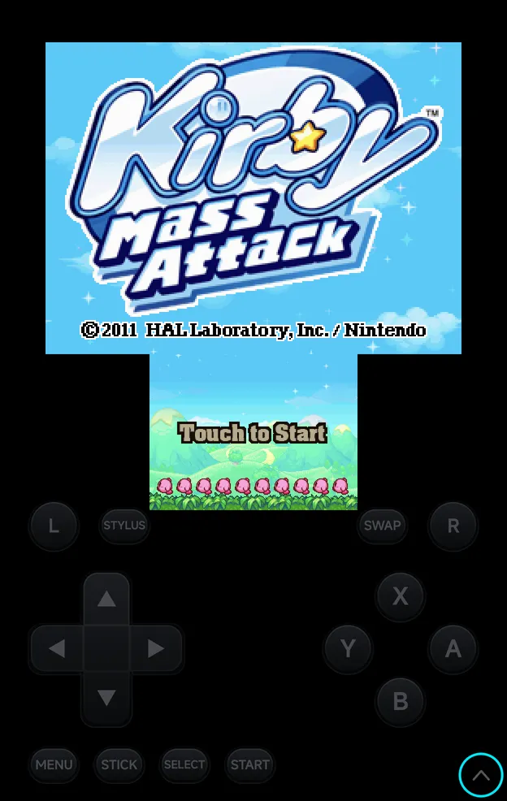

# Nintendo DS

Nintendo DS games run on the bundled **melonDS DS** core. The app lays out
the two screens.

| | melonDS DS |
| --- | --- |
| Folder | `Roms/Nintendo DS (NDS)/` |
| Saves | `Saves/NDS/`. Saves from other DS emulators carry over (see [below](#saves-from-other-ds-emulators)). |
| BIOS | Not needed: free BIOS and firmware are built in. Real ones in `Bios/NDS/` are used when present. |
| [File types](index.md) | `nds` (also inside a zip or 7z) |

## Controls

<figure class="nx-phone" markdown>
{ .nx-phone__screen }
{ .nx-phone__frame }
</figure>

The face buttons, d-pad, `L1`, `R1`, `START` and `SELECT` are the DS's own:
the on-screen pad labels `L1` and `R1` as **L** and **R**. Two more buttons
on the pad are the app's, and a round one:

- **STYLUS** turns [stylus mode](#stylus-mode) on or off. It stays pressed in
  while stylus mode is on.
- **SWAP** swaps the big screen.
- The **mic button** lets the game hear the
  [microphone](#microphone). It sits in the pad's bottom-left corner in
  portrait, and right of `L` in landscape.

In portrait they sit either side of `MENU` and `STICK`. In landscape
**STYLUS** is under `MENU` and **SWAP** under `START`; with the portrait
[pad hidden](#portrait-pad) they sit beside the shoulder buttons, with your
[touch buttons](../controls-settings.md#touch-buttons) next to them toward
the middle: **Touch button 1** beside **STYLUS**, **Touch button 2** beside
**SWAP**.

With a controller or the on-screen pad:

| Buttons | What they do |
| --- | --- |
| `R2` on a controller, or **SWAP** | Swap the big screen. |
| `SELECT` + `LEFT` / `RIGHT` | Change the layout of the orientation you're in: Large screen, Stacked, Single screen, Picture in picture, Side by side, and round again. |
| `SELECT` + `UP` / `DOWN` | Move the picture-in-picture inset to the previous or next corner, clockwise. |
| `L2` on a controller, or **STYLUS** | Turn stylus mode on or off. |
| `MENU`, or `SELECT` + `START` | Open the [in-game menu](../in-game-menu.md). |

The layout hotkeys (swap and `SELECT` + a direction) are saved straight
away, without Save Changes. Stylus mode is not saved.

??? info "More detail"
    - A short label shows the new setting.
    - [Half-folded](#half-folded) the fold sets the layout: `SELECT` +
      `LEFT` / `RIGHT` only shows **Layout is set by the fold**.
    - A controller's `L2` and `R2` never reach the game: the DS has no such
      buttons.
    - `SELECT` on its own still reaches the game. Only `SELECT` + a direction
      is kept by the app.
    - A controller's left stick works as the d-pad, except in stylus mode,
      where it moves the pen.

    Saving a layout hotkey gives the game its own settings, copied from the
    console's if it had none. From then on the game uses only its own
    settings. Later **Save for console** changes don't reach it until you use
    **Restore defaults** in that game.

## Console Settings

The DS's own options are in the in-game menu under **Options → Console
Settings**, and for the console in
[Emulator Settings](../emulator-settings.md). `LEFT` / `RIGHT` change a
value; keep it for the game or the console with
[Save Changes](../in-game-menu.md#save-changes).

In a game the page lists only the **Layout** row in use, for the way you're
holding the phone (**Layout (portrait, controller)** while a controller hides
the pad), and **Inset Corner**, **Inset Size** and **Inset Opacity** only
while that layout is **Picture in picture**. Turn the phone or pick another layout and the rows follow.
Emulator Settings and Game Settings list every row, so you can set up each
orientation there.

{ .nx-wide }

| Row | Values | Default | See |
| --- | --- | --- | --- |
| **Layout (portrait)** | Large screen, Stacked, Single screen, Picture in picture, Side by side | Large screen | [Screen layouts](#screen-layouts) |
| **Layout (portrait, controller)** | The same | Large screen | [Screen layouts](#screen-layouts) |
| **Layout (landscape)** | The same; no Side by side on a [squarer screen](#which-layout-by-default) | Depends on the screen | [Screen layouts](#screen-layouts) |
| **3D Resolution** | Auto, Quality, Performance | Auto | [3D rendering](#3d-rendering) |
| **Max Scale** | 1x up to what the display can show (shown in Auto only) | 4x | [3D rendering](#3d-rendering) |
| **Scale** | 1x up to half of the most the display can show, rounded up (shown in Performance only) | 2x | [3D rendering](#3d-rendering) |
| **Big Screen** | Top screen, Bottom screen | Top screen | [Big screen and inset](#big-screen-and-inset) |
| **Inset Corner** | Top left, Top right, Bottom left, Bottom right | Top right | [Big screen and inset](#big-screen-and-inset) |
| **Inset Size** | Small, Medium, Large | Medium | [Big screen and inset](#big-screen-and-inset) |
| **Inset Opacity** | 100%, 75%, 50% | 100% | [Big screen and inset](#big-screen-and-inset) |
| **Portrait Pad** | Shown, Hidden | Shown | [Portrait pad](#portrait-pad) |
| **Controller Layout** | Auto-detect, Xbox (A at the bottom), Nintendo (A on the right) | Auto-detect | [Controls](../controls.md#controller-buttons) |

Every row takes effect straight away; none needs the game restarted. Only
**Render Mode** in **Core Options** waits for the next start (see
[3D rendering](#3d-rendering)).

## Screen layouts

The DS has two screens, and there's more than one way to fit them on a
phone. Pick a layout for each orientation to suit the game and how you
like to play: one big with the other smaller, both the same size, or just
one. Every layout draws the screens at whole-number scales, so the pixels
stay even, in the room the [on-screen pad](../controls.md#landscape) leaves.
The pictures are in portrait; landscape draws the same layouts across the
wider screen. Portrait and landscape keep their own layout, so turning the
phone switches between them, and `SELECT` + `LEFT` / `RIGHT` changes the
one you're in without opening the menu.

| Layout | Picture |
| --- | --- |
| **Large screen** The big screen, with the other one smaller, at least half its size, centred below it. |  |
| **Stacked** Both screens the same size, one above the other. |  |
| **Single screen** Only the big screen. |  |
| **Picture in picture** The big screen, with the other small in a corner over it. `SELECT` + `UP` / `DOWN` moves the small screen to another [corner](#controls). |  |
| **Side by side** Both screens the same size, next to each other. |  |

**Layout (portrait)** and **Layout (landscape)** in
[Console Settings](#console-settings) pick the layout for each orientation.
Until you pick one, the screen decides (see
[below](#which-layout-by-default)).

With a controller connected, the on-screen pad goes away in portrait and the
screens get the full height. **Layout (portrait, controller)** is used then:
the same choices, with the same default as portrait.

??? info "More detail"
    - In Large screen the small screen takes the largest whole-number scale
      that fits under the big one, at least half the big one's. In portrait,
      where that would leave it under 2×, it fills the room left up to 2×.
      **Inset Corner** and **Inset Size** don't move or size it.
    - On a wide tablet in landscape, Single screen and Picture in picture
      are one step smaller than the most that fits.
    - A clip-on controller that holds the phone keeps the pad band and the
      normal portrait layout. The GameSir Pocket Taco is recognised as one.
      The 8BitDo FlipPad is expected to be recognised too.
    - Screen Scaling and the screen offsets don't apply to the DS screens.
    - A layout you picked before these layouts came is kept. One left at
      its old default (**Auto** in portrait, **Stacked** in landscape and
      with a controller) now follows the screen's default.

### Which layout by default

| Screen | Portrait | Landscape |
| --- | --- | --- |
| A phone | Large screen | Side by side |
| A squarer screen or a tablet, such as the Galaxy Z Fold's cover and inner screens | Large screen | Large screen |

On a squarer screen **Side by side** isn't offered in landscape: the two
screens would come out too small. A Side by side picked elsewhere shows as
Large screen there, and `SELECT` + `LEFT` / `RIGHT` skips it. In portrait it
stays.

??? info "More detail"
    - A squarer screen is a phone screen less than 1.8 times as long as it
      is wide, such as the Fold's cover screen, or a tablet-size screen (at
      least 600 dp across) less than 1.5 times, such as the unfolded Fold.
    - The app goes by the size of its window, not the device, so split
      screen and DeX windows follow these rules too.

### Big screen and inset

These apply in both orientations, straight away: no restart needed.

| Option | Values | Default | What it does |
| --- | --- | --- | --- |
| **Big Screen** | Top screen, Bottom screen | Top screen | The screen shown big in large screen, picture in picture and single screen, and first in stacked and side by side. **SWAP** or `R2` swaps it. |
| **Inset Corner** | Top left, Top right, Bottom left, Bottom right | Top right | Where the small screen sits in picture in picture. |
| **Inset Size** | Small, Medium, Large | Medium | The small screen's width in picture in picture: 25%, 33% or 40% of the big screen's width. |
| **Inset Opacity** | 100%, 75%, 50% | 100% | How opaque the small screen is in picture in picture. Below 100%, the big screen shows through it. |

??? info "More detail"
    - Overlays are off while the DS screens are drawn apart. The **Overlay**
      row shows **Unavailable**.
    - Shader presets apply to the screens drawn at the big screen's size:
      both in stacked and side by side, the big one alone in large screen
      and picture in picture. A smaller screen is drawn without them.

## Stylus mode

In stylus mode a dot on the bottom screen is the pen, for touching it without
your finger.

| Control | What it does |
| --- | --- |
| D-pad or left stick | Move the dot. The d-pad speeds up the longer you hold it. |
| `A` | Touch at the dot. |
| **STYLUS**, or `L2` on a controller | Turn stylus mode on or off. |

Stylus mode is off each time a game starts, and is not saved.

## Touch

Touch the bottom screen wherever it is drawn, except as the small screen of
picture in picture.

The on-screen pad's buttons take the touches that land on them, also where
they overlap the game. Touches between them reach the game, so you can play
with the buttons and touch the bottom screen together.

??? info "More detail"
    - To reach something under a button, such as a menu item in a corner of
      the bottom screen, use [stylus mode](#stylus-mode), whose pen reaches
      the bottom screen anywhere, or turn the phone to portrait.
    - To touch the bottom screen in picture in picture, press **SWAP** to
      make it the big one.

## Microphone

Some games ask you to blow or shout into the DS's microphone: Fossil Fighters,
Zelda Spirit Tracks and Nintendogs, for example. Turn the **Mic** on when the
game asks, and off again afterwards:

- tap the round **mic button** on the on-screen pad,
- or tap **Mic** in the game panel's
  [Shortcuts](../dual-screen.md#shortcuts) tab,
- or bind **Toggle mic** to a controller button in
  [Shortcuts](../controls-settings.md#shortcuts).

All three flip the same switch. The mic button is dimmed while the Mic is off
and pressed in while it is on, and the **Mic** tile is filled.

The first time you turn it on, Android asks whether NX Redux may use the
microphone:

- **Allow**: the game hears your phone's microphone.
- **Don't allow**: the game hears a made-up blow instead, so blowing puzzles
  can still be passed. The app doesn't ask again.

Change your answer later in
**Tools → Settings → Library → [Microphone access](../library.md#microphone-access)**.

The Mic is off each time a game starts, and is not saved.

??? info "More detail"
    - While the Mic is off the game hears silence and the phone's microphone
      is closed, so Android shows no recording dot. It also closes while the
      in-game menu is open and while the app is in the background, and
      opens again when you go back to the game.
    - A phone without a microphone, or an Android TV, never asks: the game
      hears the made-up blow.
    - What the game hears never leaves your phone and is not recorded.
    - In a [netplay](../netplay.md) match the Mic is hidden, since the other
      player's game wouldn't hear it.
    - Where the mic button sits:
        - Portrait: the band's bottom-left corner, level with the arrow
          that hides the band. With the band hidden, it is first in the
          bottom row, left of `MENU`.
        - Landscape and half-folded: right of `L`, in the left half's
          top row.
    - The mic button is not part of [Pad layout](../controls-settings.md#pad-layout):
      it stays where it is. The editor draws it so you can keep other
      buttons clear of it.

## Portrait pad

In portrait, long-press the arrow in the pad's bottom-right corner to hide
the pad band. The two screens get its room, and one see-through pad lies
across the bottom of the screen instead; the screens reach into it by a
third of its height at most. The arrow stays in the
corner: long-press it again to bring the band back. A plain tap does
nothing.

<figure class="nx-phone" markdown>
{ .nx-phone__screen }
{ .nx-phone__frame }
</figure>

Pad shown

<figure class="nx-phone" markdown>
{ .nx-phone__screen }
{ .nx-phone__frame }
</figure>

Pad hidden

The choice is **Portrait Pad** (Shown or Hidden) in **Options → Console
Settings**, and the long-press saves it for the console.

??? info "More detail"
    - The pad's buttons take their own touches; touches between them reach
      the screens. See [Touch](#touch).
    - The pad is drawn solid when the screens stop above it.
    - With a controller connected the pad hides too, as in landscape.
    - Landscape is not affected.

## Half-folded

On a foldable such as the Galaxy Z Fold, fold the inner screen partway, like
a small laptop, and the game lays itself out like a DS: the top screen right
above the hinge, the touch screen right below it, with the pad either side
of the touch screen. Open the phone flat and your layout comes back. See
[Foldables & Large Screens](../foldables.md#nintendo-ds-and-3ds-half-folded).

## Second screen

On a handheld with a second screen, or with a display on USB-C, the game
starts split: the top screen on one screen and the bottom screen on the
other, which takes the touches. **SWAP** (or `R2`) swaps them over, and the
stylus dot in [stylus mode](#stylus-mode) follows the bottom screen. The
**Panel** pill at the bottom right shows the game panel instead, with both
DS screens side by side on the other screen. See
[Dual Screens & External Displays](../dual-screen.md#nintendo-ds-and-3ds).

??? info "More detail"
    - While split, **SWAP** changes **Big Screen**, so the screen on the
      picture screen is the one **Big Screen** names.
    - The **Layout** rows aren't used while split or with the panel up, nor
      is the [half-folded](#half-folded) layout.

## 3D rendering

**3D Resolution** in [Console Settings](#console-settings) sets how sharply
3D models are drawn. 2D art, text and the screen's size don't change.

| Mode | What it does |
| --- | --- |
| **Auto** | Draws the 3D at the size the bigger screen is shown, up to **Max Scale** (4x by default). |
| **Quality** | The same with no cap: as sharp as the display can show. |
| **Performance** | A fixed **Scale**, from 1x up to half of the most the display can show. 2x by default. |

**Max Scale** shows only in Auto and **Scale** only in Performance. A higher
scale is sharper but slower: if a game stutters, try Performance at a lower
**Scale**.

In a game the row reads like **Auto · 6x now** in Auto and Quality, the scale in use (Performance shows its **Scale**). It follows
turning the phone, folding it and changing the layout, straight away.

??? info "More detail"
    - The lists follow the display: a phone tops out lower than the unfolded
      Galaxy Z Fold. The core's own limit is 8x.
    - 3D renders on the GPU on devices with OpenGL ES 3.2, else in software.
    - In Software **Render Mode** the rows can't be changed and show **Needs
      Render Mode → OpenGL** (greyed in Emulator Settings and Game Settings):
      melonDS's software renderer doesn't use the setting.
    - melonDS's own **Internal Resolution** and its unused screen options
      (for example Secondary Screen Scale and Filtering, OpenGL Filtering, Screen
      Layout #2 to #8, the Hybrid options, Cursor Timeout, Show Screen Layout) no longer appear in Core
      Options: the app sets the resolution and draws the screens itself.
    - A **Render Mode** change in Core Options applies the next time the game
      starts, once you keep it with Save Changes.
    - If the GPU renderer can't start, the game runs in software and the app
      shows **GPU renderer unavailable — using software** once. The next
      launch tries the GPU again.

## Cheats and achievements

- [Cheats](../cheats.md): the cheat download has codes for Nintendo DS
  games, or add your own `.cht` files.
- [RetroAchievements](../retroachievements.md) works for Nintendo DS games.

## Saves from other DS emulators

Battery saves from the older melonDS core and from DraStic carry over. Save
states from the older melonDS core don't load.

??? info "More detail"
    Battery saves from the older melonDS core (`.sav`) and from DraStic
    (`.dsv`) are converted to `.srm` on a game's first launch.
