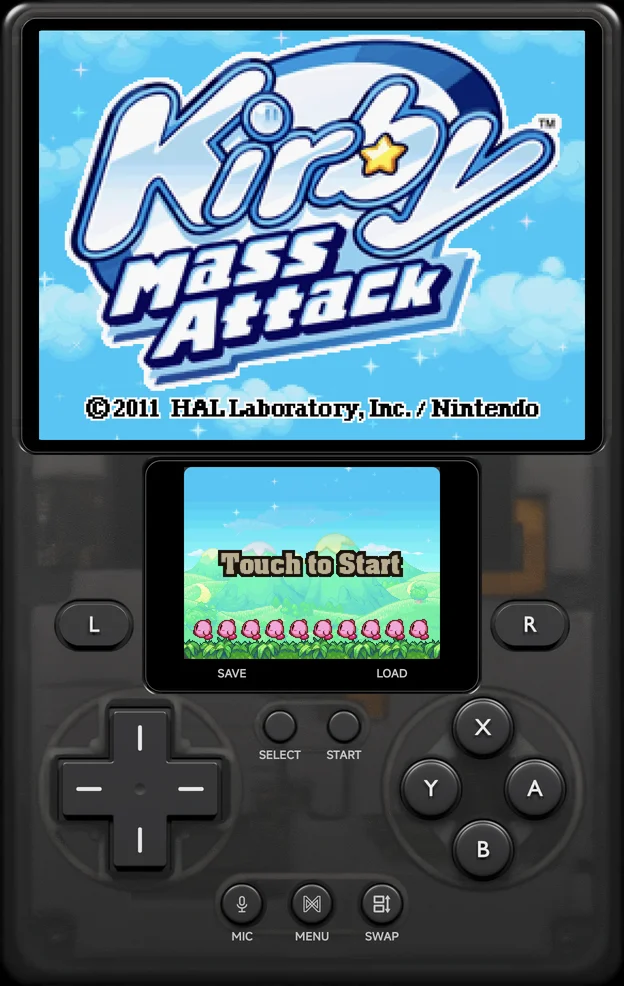
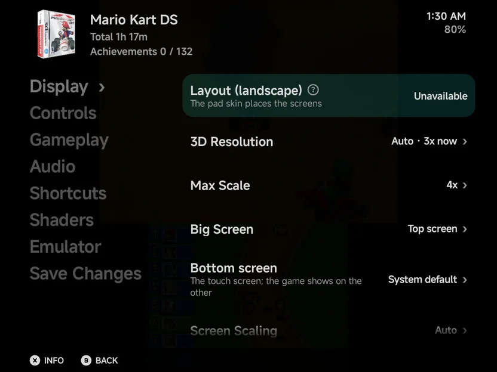
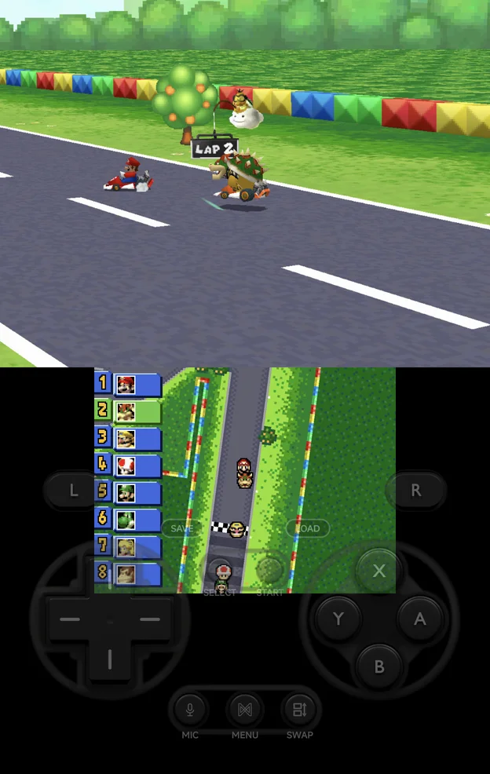
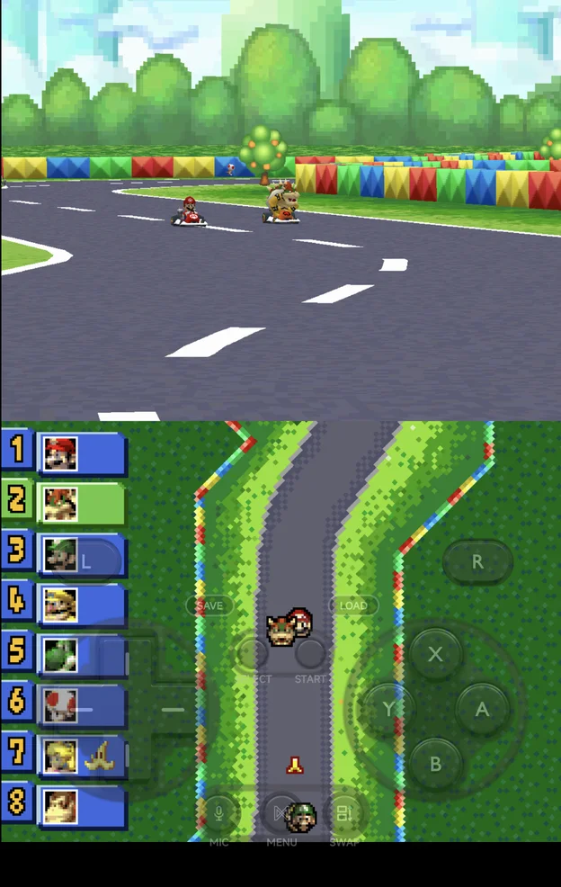
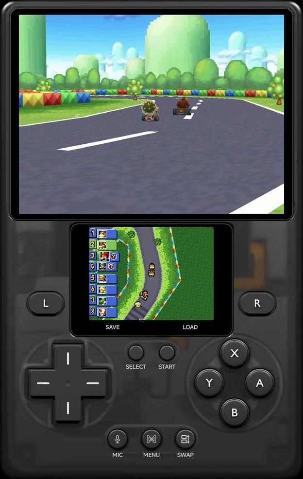

# Nintendo DS

Nintendo DS games run on the bundled **melonDS DS** core (1.4.0). The app
lays out the two screens. Games with DS wireless play link with other phones: see
[Local wireless](#local-wireless).

| | melonDS DS |
| --- | --- |
| Folder | `Roms/Nintendo DS (NDS)/` |
| Saves | `Saves/NDS/`. Saves from other DS emulators carry over (see [below](#saves-from-other-ds-emulators)). |
| BIOS | Not needed: free BIOS and firmware are built in. Real ones in `Bios/NDS/` are used when present. |
| [File types](index.md) | `nds` (also inside a zip or 7z) |

## Controls

<figure class="nx-phone" markdown>
{ .nx-phone__screen }
{ .nx-phone__frame }
</figure>

The face buttons, d-pad, `L1`, `R1`, `START` and `SELECT` are the DS's own:
the on-screen pad labels `L1` and `R1` as **L** and **R**. The
[pad skin](../controls.md#pad-skins) adds two buttons of the app's:

- **SWAP** swaps the two screens.
- **MIC** lets the game hear the [microphone](#microphone).

Touch the skin's touch screen with your finger, as on a DS.

With a controller the pad goes away, and these shortcuts work. Except for
`L2` and `R2`, they are the same on the
[Nintendo 3DS](nintendo-3ds.md#controls):

| Buttons | What they do |
| --- | --- |
| `L3`, or `SELECT` + `L1` | Swap the screens. `L2` does too. |
| `SELECT` + `R1` | Turn [stylus mode](#stylus-mode) on or off. `R2` does too. |
| `SELECT` + `LEFT` / `RIGHT` | Change the layout of the orientation you're in: Large screen, Stacked, Single screen, Picture in picture, Side by side, and round again. |
| `SELECT` + `UP` / `DOWN` | Move the picture-in-picture inset to the previous or next corner, clockwise. |
| `MENU`, or `SELECT` + `START` | Open the [in-game menu](../in-game-menu.md). |

The layout shortcuts (swap and `SELECT` + a direction) are saved straight
away, without Save Changes. Stylus mode is not saved.

!!! tip "The layout tip"
    When a game starts, a notice reads **SELECT + Left / Right changes the
    screen layout** and **L3 or SELECT + L swaps the screens**. Close it,
    or tap **Don't show again** to hide it for good. It shows where the
    layout shortcut works: not while a pad skin places the screens.

??? info "More detail"
    - A short label shows the new setting.
    - `SELECT` + `LEFT` / `RIGHT` work from the on-screen pad too, where
      the [layout rows](#screen-layouts) apply.
    - [Half-folded](#half-folded) the fold sets the layout, whatever
      `SELECT` + `LEFT` / `RIGHT` picks.
    - A controller's `L2`, `R2` and `L3` never reach the game: the DS has
      no such buttons.
    - `L3`, `R3`, `SELECT` + `L1` and `SELECT` + `R1` are kept for these
      shortcuts, so a [shortcut](../controls-settings.md#shortcuts) of
      your own can't be bound to them.
    - `SELECT` on its own still reaches the game. Only `SELECT` + a
      direction, `L1` or `R1` is kept by the app.
    - A controller's left stick works as the d-pad, except in stylus mode,
      where it moves the pen.

    Saving a layout shortcut gives the game its own settings, copied from
    the console's if it had none. From then on the game uses only its own
    settings. Later **Save for console** changes don't reach it until you
    use **Restore defaults** in that game.

## Console Settings

The DS's own options are in the in-game menu under **Options →
[Display](../in-game-menu.md#display)**, and for the console in
[Emulator Settings](../emulator-settings.md). Keep a change for the game
or the console with [Save Changes](../in-game-menu.md#save-changes).

In a game the page lists only the **Layout** row in use, for the way you're
holding the phone (**Layout (portrait, controller)** while a controller hides
the pad), and **Inset Corner**, **Inset Size** and **Inset Opacity** only
while that layout is **Picture in picture**. Turn the phone or pick another
layout and the rows follow. Emulator Settings and Game Settings list every
row, so you can set up each orientation there.

{ .nx-wide }

| Row | Values | Default | See |
| --- | --- | --- | --- |
| **Layout (portrait)** | Large screen, Stacked, Single screen, Picture in picture, Side by side | Large screen | [Screen layouts](#screen-layouts) |
| **Layout (portrait, controller)** | The same | Large screen | [Screen layouts](#screen-layouts) |
| **Layout (landscape)** | The same; no Side by side on a [squarer screen](#which-layout-by-default) | Depends on the screen | [Screen layouts](#screen-layouts) |
| **3D Resolution** | Auto, Quality, Performance | Auto | [3D rendering](#3d-rendering) |
| **Max Scale** | 1x up to what the display can show (shown in Auto only) | 4x | [3D rendering](#3d-rendering) |
| **Scale** | 1x up to half of the most the display can show, rounded up (shown in Performance only) | 2x | [3D rendering](#3d-rendering) |
| **Big Screen** | Top screen, Bottom screen | Top screen | [Big screen and inset](#big-screen-and-inset) |
| **Inset Corner** | Top left, Top right, Bottom left, Bottom right | Top right | [Big screen and inset](#big-screen-and-inset) |
| **Inset Size** | Small, Medium, Large | Medium | [Big screen and inset](#big-screen-and-inset) |
| **Inset Opacity** | 100%, 75%, 50% | 100% | [Big screen and inset](#big-screen-and-inset) |

Two more rows are in other groups:

| Row | Group | Values | Default | See |
| --- | --- | --- | --- | --- |
| **Controller Layout** | Controls | Auto-detect, Xbox (A at the bottom), Nintendo (A on the right) | Auto-detect | [Controls](../controls.md#controller-buttons) |
| **Local Wireless** | Multiplayer | On, Off | On | [Local wireless](#local-wireless) |

Every Display row takes effect straight away; none needs the game
restarted. **Local Wireless** is read when a game starts, so it is only in
Emulator Settings and Game Settings. **Render Mode**, under **Options →
[Emulator](../in-game-menu.md#emulator)**, waits for the next start too
(see [3D rendering](#3d-rendering)).

## Screen layouts

The DS has two screens, and there's more than one way to fit them on a
phone. Pick a layout for each orientation to suit the game and how you
like to play: one big with the other smaller, both the same size, or just
one. The screens fill the room they have, as [Screen
Scaling](../in-game-menu.md#options) **Auto** does; set Screen Scaling to
**Native** to keep them at whole-number scales.
The pictures are in portrait; landscape draws the same layouts across the
wider screen. Portrait and landscape keep their own layout, so turning the
phone switches between them, and `SELECT` + `LEFT` / `RIGHT` changes the
one you're in without opening the menu.

| Layout | Picture |
| --- | --- |
| **Large screen** The big screen, with the other one smaller, at least half its size, centred below it. In portrait the big screen takes the full width. |  |
| **Stacked** Both screens the same size, one above the other. In portrait both take the full width, or as wide as the height allows. |  |
| **Single screen** Only the big screen. |  |
| **Picture in picture** The big screen, with the other small in a corner over it. `SELECT` + `UP` / `DOWN` moves the small screen to another [corner](#controls). |  |
| **Side by side** Both screens the same size, next to each other. |  |

**Layout (portrait)** and **Layout (landscape)** in
[Console Settings](#console-settings) pick the layout for each orientation.
Until you pick one, the screen decides (see
[below](#which-layout-by-default)).

With a controller connected, the on-screen pad goes away and the screens
get the whole screen. In portrait **Layout (portrait, controller)** is used
then: the same choices, with the same default as portrait.

!!! note "A pad skin has its own places for the screens"
    With [Pad skin](#pad-skin) on and no controller, the skin draws the
    top screen above the touch screen, and the **Layout** rows read
    **Unavailable** with **The pad skin places the screens**. On a phone in
    landscape the skin has one screen, which shows **Layout (landscape)**,
    so that row and `SELECT` + `LEFT` / `RIGHT` work there. Turn Pad skin
    off, or connect a controller, to use every layout.

??? info "More detail"
    - With Screen Scaling on **Native**, every layout draws the screens at
      whole-number scales, centred. In Large screen the small screen then
      takes the largest whole-number scale that fits under the big one, at
      least half the big one's; in portrait, where that would leave it under
      2×, it fills the room left up to 2×.
    - With any other Screen Scaling, the screens are drawn at any scale, and
      with **Screen Sharpness** on **NEAREST** they are drawn sharp, as
      **SHARP** draws them, so the pixels stay even.
    - With Pad skin off, Large screen and Stacked in portrait start at the
      very top of the screen, behind the camera cutout, so the screens can
      take the phone's full width. Other layouts, and **Native**, keep below
      the cutout.
    - **Inset Corner** and **Inset Size** don't move or size Large screen's
      small screen.
    - On a wide tablet in landscape, Single screen and Picture in picture
      are one step smaller than the most that fits.
    - A clip-on controller that holds the phone keeps the normal portrait
      layout. The GameSir Pocket Taco is recognised as one. The 8BitDo
      FlipPad is expected to be recognised too.
    - **Overlay** and the screen offsets don't apply to the DS screens, and
      aren't listed for DS games. Of the Screen Scaling choices, only
      **Native** draws them differently.
    - On the Fold and on tablets, a pad skin places the screens in
      landscape too, so **Layout (landscape)** reads **Unavailable**
      there as well.

### Which layout by default

| Screen | Portrait | Landscape |
| --- | --- | --- |
| A phone | Large screen | Single screen |
| A squarer screen or a tablet, such as the Galaxy Z Fold's cover and inner screens | Large screen | Large screen |

On a squarer screen **Side by side** isn't offered in landscape: the two
screens would come out too small. A Side by side picked elsewhere shows as
Large screen there, and `SELECT` + `LEFT` / `RIGHT` skips it. In portrait it
stays.

??? info "More detail"
    - A squarer screen is a phone screen less than 1.8 times as long as it
      is wide, such as the Fold's cover screen, or a tablet-size screen (at
      least 600 dp across) less than 1.5 times, such as the unfolded Fold.
    - The app goes by the size of its window, not the device, so split
      screen and DeX windows follow these rules too.

### Big screen and inset

These apply in both orientations, straight away: no restart needed.

| Option | Values | Default | What it does |
| --- | --- | --- | --- |
| **Big Screen** | Top screen, Bottom screen | Top screen | The screen shown big in large screen, picture in picture and single screen, and first in stacked and side by side. **SWAP** or `L3` swaps it. |
| **Inset Corner** | Top left, Top right, Bottom left, Bottom right | Top right | Where the small screen sits in picture in picture. |
| **Inset Size** | Small, Medium, Large | Medium | The small screen's width in picture in picture: 25%, 33% or 40% of the big screen's width. |
| **Inset Opacity** | 100%, 75%, 50% | 100% | How opaque the small screen is in picture in picture. Below 100%, the big screen shows through it. |

??? info "More detail"
    - [Shader](../in-game-menu.md#shaders) presets apply to the top
      screen only, as a whole picture. The bottom screen is drawn without
      them.
    - Save-state pictures show the top screen only.

## Stylus mode

Stylus mode is for playing with a controller. A dot on the bottom screen is
the pen, for touching it without your finger.

| Control | What it does |
| --- | --- |
| Right stick, left stick or d-pad | Move the dot. The d-pad speeds up the longer you hold it. |
| `R3` or `A` | Touch at the dot. |
| `SELECT` + `R1`, or `R2` | Turn stylus mode on or off. |

Stylus mode is off each time a game starts, and is not saved. With the
on-screen pad there is no stylus mode: touch the bottom screen itself.

## Touch

Touch the bottom screen wherever it is drawn, except as the small screen of
picture in picture.

With [Pad skin](#pad-skin) off, the see-through buttons take the touches
that land on them, also where they overlap the game. Touches between them
reach the game, so you can play with the buttons and touch the bottom
screen together.

??? info "More detail"
    - To touch the bottom screen in picture in picture, press **SWAP** to
      make it the big one.

## Microphone

Some games ask you to blow or shout into the DS's microphone: Fossil Fighters,
Zelda Spirit Tracks and Nintendogs, for example. Turn the **Mic** on when the
game asks, and off again afterwards:

- tap **MIC** on the on-screen pad,
- or, with a controller, tap the round **mic button** in the screen's
  bottom-left corner,
- or tap **Mic** in the game panel's
  [Shortcuts](../dual-screen.md#shortcuts) tab on a second screen,
- or bind **Toggle mic** to a controller button in
  [Shortcuts](../controls-settings.md#shortcuts).

All of them flip the same switch.

The first time you turn it on, Android asks whether NX Redux may use the
microphone:

- **Allow**: the game hears your phone's microphone.
- **Don't allow**: the game hears a made-up blow instead, so blowing puzzles
  can still be passed. The app doesn't ask again.

Change your answer later in
**Tools → Settings → Library → [Microphone access](../library.md#microphone-access)**.

The Mic is off each time a game starts, and is not saved.

??? info "More detail"
    - While the Mic is off the game hears silence and the phone's microphone
      is closed, so Android shows no recording dot. It also closes while the
      in-game menu is open and while the app is in the background, and
      opens again when you go back to the game.
    - A phone without a microphone, or an Android TV, never asks: the game
      hears the made-up blow.
    - What the game hears never leaves your phone and is not recorded.
    - In a session started from the [Netplay](../netplay.md) menu the Mic
      is hidden.
    - The corner mic button hides while the in-game menu is open.

## Pad skin

With no controller connected, [**Pad skin**](../appearance.md#pad-skin) in
**Tools → Settings → Appearance** decides how a DS game is drawn:

- **On** (default): the skin frames the game like a DS, the top screen
  above the touch screen, with the buttons around them. On a phone in
  landscape the skin has one screen, which shows your **Layout
  (landscape)**: Single screen until you pick another.
- **Off**: the two screens get the whole screen in the
  [layout](#screen-layouts) you picked, and the skin's buttons lie over
  them, see-through.

<figure class="nx-phone" markdown>
{ .nx-phone__screen }
{ .nx-phone__frame }
</figure>

Pad skin on

<figure class="nx-phone" markdown>
{ .nx-phone__screen }
{ .nx-phone__frame }
</figure>

Pad skin off

??? info "More detail"
    - Pad skin is one setting for every console. See
      [Controls → Pad skins](../controls.md#pad-skins) and
      [Pad skin off](../controls.md#pad-skin-off).
    - With Pad skin off in portrait, the screens keep above the band the
      buttons take at the bottom, except that the full-width Large screen
      and Stacked layouts reach down behind the buttons when they need the
      room.
    - On a portrait phone the in-game menu covers the skin's top screen
      and runs down to just above `L` and `R`.
    - Move or resize the buttons in
      [Button layout](../controls-settings.md#button-layout).

## Half-folded

On a foldable such as the Galaxy Z Fold, fold the inner screen partway, like
a small laptop, and the game lays itself out like a DS: the top screen right
above the hinge, the touch screen right below it, with the pad either side
of the touch screen. Open the phone flat and your layout comes back. See
[Foldables & Large Screens](../foldables.md#nintendo-ds-and-3ds-half-folded).

## Second screen

On a handheld with a second screen, or with a display on USB-C, the game
starts split: the top screen on one screen and the bottom screen on the
other, which takes the touches. **SWAP** (or `L3`) swaps them over, and the
stylus dot in [stylus mode](#stylus-mode) follows the bottom screen. The
**Panel** pill at the bottom right shows the game panel instead, with both
DS screens side by side on the other screen. See
[Dual Screens & External Displays](../dual-screen.md#nintendo-ds-and-3ds).

??? info "More detail"
    - While split, **SWAP** changes **Big Screen**, so the screen on the
      picture screen is the one **Big Screen** names.
    - The **Layout** rows aren't used while split or with the panel up, nor
      is the [half-folded](#half-folded) layout, and `SELECT` + `LEFT` /
      `RIGHT` does nothing.
    - With the panel up, **3D Resolution** goes by the size of the screens
      on the second display.
    - The in-game menu always opens on the bottom screen: opening it brings
      the panel up.

## Local wireless

DS games with wireless multiplayer link with other phones on the same
Wi-Fi, or over a USB cable between two phones. Start the game on each
phone and use the game's own wireless menu: up to 8 players meet in a
room. See [Local Wireless](../local-wireless.md).

- **Local Wireless** is **On** by default, in the **Multiplayer** group of
  [Emulator Settings](../emulator-settings.md) and Game Settings.
- Your [Player name](../about.md#player-name) is the DS nickname the
  others see.
- DS games also have `Y` **Netplay**, to host or join by hand. See
  [Netplay](../netplay.md).
- While the game's wireless is on, the in-game menu is **Continue ·
  Disconnect · Quit**, and save states, rewind, fast forward and reset are
  off.

??? info "More detail"
    - Only local wireless modes link. Nintendo Wi-Fi Connection modes and
      infrared don't.
    - A real `firmware.bin` of your own keeps its nickname and address on
      disk: the app sets its own for the session only.

## 3D rendering

**3D Resolution** in [Console Settings](#console-settings) sets how sharply
3D models are drawn. 2D art, text and the screen's size don't change.

| Mode | What it does |
| --- | --- |
| **Auto** | Draws the 3D at the size the bigger screen is shown, up to **Max Scale** (4x by default). |
| **Quality** | The same with no cap: as sharp as the display can show. |
| **Performance** | A fixed **Scale**, from 1x up to half of the most the display can show. 2x by default. |

**Max Scale** shows only in Auto and **Scale** only in Performance. A higher
scale is sharper but slower: if a game stutters, try Performance at a lower
**Scale**.

In a game the row reads like **Auto · 6x now** in Auto and Quality, the scale in use (Performance shows its **Scale**). It follows
turning the phone, folding it and changing the layout, straight away.

??? info "More detail"
    - The lists follow the display: a phone tops out lower than the unfolded
      Galaxy Z Fold. The core's own limit is 8x.
    - 3D renders on the GPU on devices with OpenGL ES 3.2, else in software.
      On the GPU, screen captures and scaled or rotated 2D are drawn at the
      3D Resolution too.
    - In Software **Render Mode** the rows can't be changed and show **Needs
      Render Mode → OpenGL** (greyed in Emulator Settings and Game Settings):
      melonDS's software renderer doesn't use the setting.
    - melonDS's own **Internal Resolution**, **Improved Polygon Splitting**
      and its unused screen options (for example Secondary Screen Scale and
      Filtering, OpenGL Filtering, Screen Layout #2 to #8, the Hybrid
      options, Cursor Timeout, Show Screen Layout) aren't listed under
      **Emulator**: the app sets the resolution and draws the screens
      itself, and Improved Polygon Splitting stays off because it warps
      textures on phones.
    - A **Render Mode** change under **Emulator** applies the next time the
      game starts, once you keep it with Save Changes.
    - If the GPU renderer can't start, the game runs in software and the app
      shows **GPU renderer unavailable — using software** once. The next
      launch tries the GPU again.

## Cheats and achievements

- [Cheats](../cheats.md): the cheat download has codes for Nintendo DS
  games, or add your own `.cht` files.
- [RetroAchievements](../retroachievements.md) works for Nintendo DS games.

## Saves from other DS emulators

Battery saves from the older melonDS core and from DraStic carry over. Save
states from the older melonDS core don't load, and neither do states from
melonDS DS versions before 1.4.0: the load fails with a message and the
game plays on.

??? info "More detail"
    Battery saves from the older melonDS core (`.sav`) and from DraStic
    (`.dsv`) are converted to `.srm` on a game's first launch.
