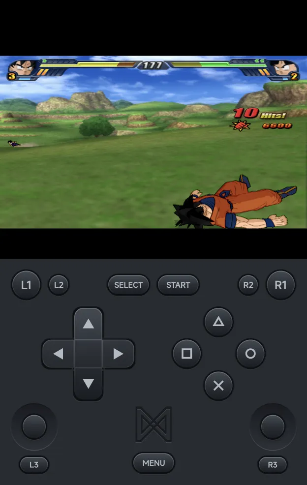
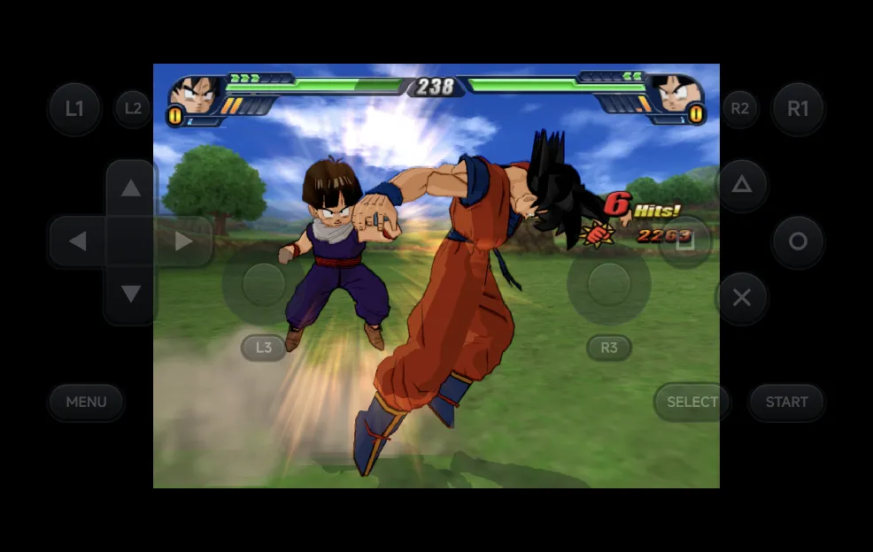
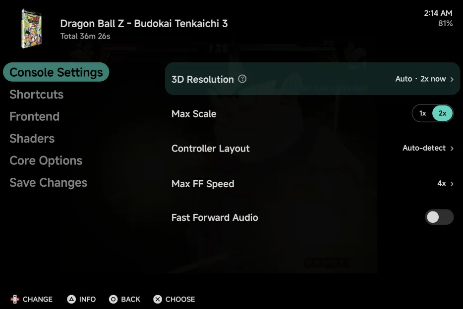

# PlayStation 2

PlayStation 2 games run on the bundled **ARMSX2** core, a PCSX2 build for
Android phones.

| | ARMSX2 |
| --- | --- |
| Folder | `Roms/Sony PlayStation 2 (PS2)/` |
| Saves | `Saves/PS2/<game>/Mcd001.ps2`: one memory card per game |
| BIOS | Needed: any PS2 BIOS dump ending in `.bin`, in `Bios/PS2/` |
| [File types](index.md) | `iso` `chd` `zso`, and `cso` in the PS2 folder |

- **A BIOS is needed.** Without one the game doesn't start and the app says
  **Sony PlayStation 2 needs a BIOS: put a .bin file in Bios/PS2/**. PS2
  dumps have no standard name, so any `.bin` file in that folder counts. With
  more than one, pick which in [Console Settings](#console-settings).
- Games open in place: a 4 GB ISO is never copied.
- **Graphics API** can switch a game to Vulkan. See
  [Graphics API](index.md#graphics-api).
- PS2 games need a fast phone. They run at full speed on a Snapdragon 8 Elite
  class phone such as the Galaxy Z Fold.

??? info "More detail"
    - A loose `.cso` file belongs to the [PSP](psp.md), which uses the same
      extension. Put a PS2 `.cso` in the PS2 folder and it runs here.
    - Multi-disc games load from an `.m3u` playlist.
    - Phones with 16 KB memory pages are supported.

## Controls

<figure class="nx-phone" markdown>
{ .nx-phone__screen }
{ .nx-phone__frame }
</figure>

The on-screen pad is a full DualShock 2: the d-pad and both sticks are always
there, with no `STICK` / `D-PAD` switch, because PS2 games move between them
mid-game. **L3** and **R3** are their own buttons, under each stick.

| Layout | Where things sit |
| --- | --- |
| Portrait | The d-pad and the face buttons in the middle row, each stick under its side by the pad's edge, `L3` / `R3` under the sticks. |
| Landscape | The d-pad and the face buttons by the screen's edges, each stick beside them toward the middle, `L3` / `R3` under the sticks. Touch shortcut 1 sits in `MENU`'s place with `MENU` under it, and touch shortcut 2 in `START`'s place with `SELECT` and `START` under it. |

{ .nx-wide }

The buttons carry the PlayStation's labels, ○ × △ □, and × confirms in the
app's menus, as on the [PlayStation](playstation.md). Move any of the groups,
the sticks included, in [Pad layout](../controls-settings.md).

A controller works 1:1, including both sticks, `L3` and `R3` (press the
sticks) and all four shoulder buttons.

??? info "More detail"
    - In landscape the pieces are drawn as big as in portrait where the
      screen allows. On a screen tall enough for it, each stick sits below
      its d-pad or face buttons instead of beside them.
    - The sticks take touches only inside their round well, so the d-pad's
      corners stay the d-pad's.
    - The face buttons are on or off: games that read how hard a button is
      pressed (such as aiming gently in Metal Gear Solid 2) see it fully
      pressed.

## Multiplayer

Two players can play with two controllers: connect a second one and it's
Player 2, as on the other consoles. See [Multiplayer](../multiplayer.md).

- Each player gets a DualShock 2: the d-pad, both sticks, `L3` and `R3`, and
  all four shoulder buttons.
- The on-screen pad and the in-game menu stay Player 1's.
- Games save to the one memory card in slot 1, Player 1's, as most PS2 games
  expect.
- Rumble goes to each player's own controller when Android can drive its
  motor. Otherwise Player 1's rumble plays on the phone, and Player 2 gets
  none. See [Rumble](../multiplayer.md#rumble).

??? info "More detail"
    - The PS2 multitap (3 or 4 players) isn't supported.
    - Netplay isn't available for PS2 games.
    - A second controller port is always plugged in, even when you play
      alone. Games ignore a pad nobody uses.

## Console Settings

The PS2's own options are in the in-game menu under **Options → Console
Settings**, and for the console in
[Emulator Settings](../emulator-settings.md). `LEFT` / `RIGHT` change a
value; keep it for the game or the console with
[Save Changes](../in-game-menu.md#save-changes).

{ .nx-wide }

| Row | Values | Default | See |
| --- | --- | --- | --- |
| **PS2 BIOS** | Auto, then each `.bin` file in `Bios/PS2/` (shown when there is more than one) | Auto | [BIOS](#bios) |
| **3D Resolution** | Auto, Quality, Performance | Auto | [3D rendering](#3d-rendering) |
| **Max Scale** | 1x up to what the display can show (shown in Auto only) | 2x | [3D rendering](#3d-rendering) |

**3D Resolution** and **Max Scale** take effect straight away. **PS2 BIOS**
is read when the game starts. **Graphics API** is read only when a game
starts, so it's not here: set it in
[Game Settings](../emulator-settings.md#game-settings) or Emulator Settings
(see [Graphics API](index.md#graphics-api)).

## BIOS

Put a PS2 BIOS dump in `Bios/PS2/`. Any file ending in `.bin` counts, whatever
its name. With one file, the game boots it. With several, **PS2 BIOS** in
[Console Settings](#console-settings) picks one; **Auto** lets the core
choose.

??? info "More detail"
    - The `.nvm` and `.mec` files PCSX2 writes beside a BIOS don't count as a
      BIOS.
    - The app copies the BIOS before each launch, so a file you add shows up
      the next time you start a game.

## Saves

Each game gets its own memory card, as if every game had a card of its own
in slot 1: `Saves/PS2/<game>/Mcd001.ps2`, in a folder named after the game.
`Mcd001.ps2` is the card's file name ("memory card 1"), the same for every
game; the folder tells them apart.

Save states, the [Game Switcher](../game-switcher.md) and resuming where you
left off work as on the other consoles. Rewind isn't available for PS2: a
PS2 state is up to 68 MB.

## 3D rendering

**3D Resolution** in [Console Settings](#console-settings) sets how sharply
the game is drawn. The screen's size doesn't change. ARMSX2 renders at a
whole multiple of the PS2's own picture (640 × 448), from 1x to 4x.

| Mode | What it does |
| --- | --- |
| **Auto** | Draws at the multiple the picture is shown at, up to **Max Scale** (2x by default). |
| **Quality** | The same with no cap: as sharp as the display can show, up to 4x. |
| **Performance** | Native, 1x. |

**Max Scale** shows only in Auto. A higher scale is sharper but slower: if a
game stutters, lower **Max Scale** or try Performance.

In a game the row reads like **Auto · 2x now** in Auto and Quality, the scale
in use. A change takes effect after about a second, without restarting the
game.

??? info "More detail"
    - The lists follow the display: the Galaxy Z Fold's inner screen reaches
      4x, its cover screen less.
    - Dragon Ball Z: Budokai Tenkaichi 3 holds 60 fps at 4x on the Galaxy Z
      Fold, with Vulkan. Heavier games may not, which is why Auto stops at 2x
      unless you raise **Max Scale**.
    - ARMSX2's own **GS Renderer**, **Internal Resolution** and **BIOS**
      options don't appear in Core Options: **Graphics API**, **3D
      Resolution** and **PS2 BIOS** set them. **Software Renderer Threads**
      is hidden too: the app never uses the Software renderer.

## Cheats & Patches

**Cheats & Patches** (in [Cheats](../cheats.md)) downloads PCSX2's
`patches.zip` for PS2 alongside libretro's cheats for the other consoles. It
holds widescreen and no-interlacing patches for many games, matched to each
game by the game itself. Turn them on in **Core Options** in
[Game Settings](../emulator-settings.md#game-settings) for one game, or in
[Emulator Settings](../emulator-settings.md) for every PS2 game. They need the
game restarted, so the in-game menu doesn't list them:

| Option | What it does |
| --- | --- |
| **Widescreen Patches** | Draws supported games in 16:9. Set **Aspect Ratio** to 16:9 alongside it. |
| **No-Interlacing Patches** | Draws supported games progressive, sharper than any deinterlacer. |
| **Cheats** | Loads your own `.pnach` cheat files from `Cheats/PS2/`. Every cheat in the game's files is turned on. |

Leave **Aspect Ratio** on Auto: the widescreen patch switches the picture to
16:9 itself. The picture gets wider without stretching: you see more of the
scene at the sides.

??? info "More detail"
    - libretro's cheat collection has no PS2 cheats, so the in-game menu's
      **Cheats** page has none for PS2 games. PS2 cheats come as `.pnach`
      files, each named after the game's CRC: put them in `Cheats/PS2/`.
    - The patches come from the PCSX2 project and are downloaded to your
      phone when you ask; the app doesn't include them.

## Achievements

RetroAchievements: not available for PS2 games in the app.
