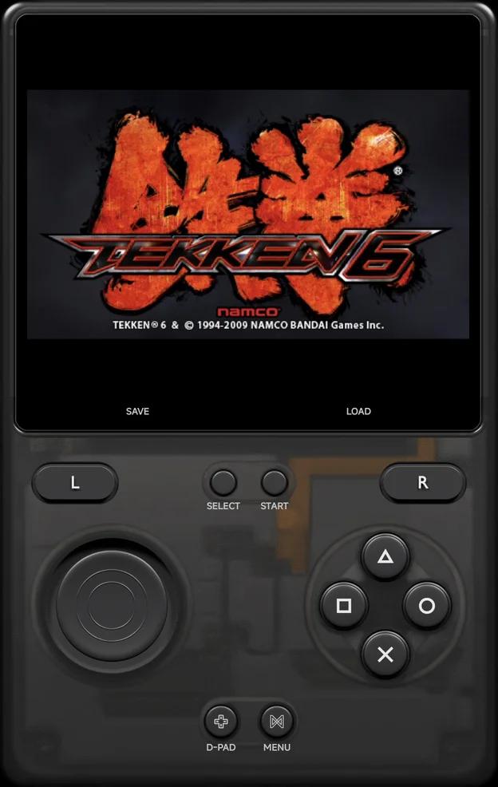

# PlayStation Portable

PSP games run on the bundled **PPSSPP** core.

| | PPSSPP |
| --- | --- |
| Folder | `Roms/Sony Playstation Portable (PSP)/` |
| Saves | `Saves/PSP/` (the PSP's own `SAVEDATA` folder) |
| BIOS | Not needed: PPSSPP's own files are bundled |
| [File types](index.md) | `iso` `cso` `chd` `pbp` `elf` `prx` |

- **Graphics API** can switch a game to Vulkan. See
  [Graphics API](index.md#graphics-api).

## Controls

<figure class="nx-phone" markdown>
{ .nx-phone__screen }
{ .nx-phone__frame }
</figure>

The face buttons map to the PSP buttons **by position**:

| Position | PSP button |
| --- | --- |
| Bottom | Cross (×) |
| Right | Circle (○) |
| Top | Triangle (△) |
| Left | Square (□) |

| Control | PSP control |
| --- | --- |
| D-pad | D-pad |
| Left stick | Analog stick |
| `L1` / `R1` | `L` / `R` |
| `START`, `SELECT` | `START`, `SELECT` |

- In the app's menus, `×` confirms and `○` goes back.
- `MENU`, or `SELECT` + `START`, opens the [in-game menu](../in-game-menu.md).

## Emulator options

Some options, such as the CPU core and the PSP model, only take effect when
a game starts. They are in [Emulator Settings](../emulator-settings.md), not
in the in-game menu's **Options → [Emulator](../in-game-menu.md#emulator)**.
The software renderer and **VR Mode** are not offered, and PPSSPP's own
network options are hidden: the app sets them for
[ad hoc play](#ad-hoc-multiplayer).

## Ad hoc multiplayer

A game's ad hoc mode links two to four phones on the same Wi-Fi, with
nothing to set up: start the game on each phone and open its ad hoc
multiplayer menu. See [Local Wireless](../local-wireless.md).

- **Local Wireless**, in the **Multiplayer** group of
  [Emulator Settings](../emulator-settings.md) and Game Settings, is **On**
  by default and read when a game starts.
- PSP games also have `Y` **Netplay**, also in the game's context menu,
  to host or join by hand. See [Netplay](../netplay.md).
- The other players see your
  [Player name](../about.md#player-name).
- A save state can't be loaded while the game is in ad hoc mode.
- Wi-Fi only: there is no USB cable link for PSP.

## Cheats and achievements

- [Cheats](../cheats.md): the cheat download has codes for PSP games, or add
  your own `.cht` files.
- [RetroAchievements](../retroachievements.md) works for PSP games.
