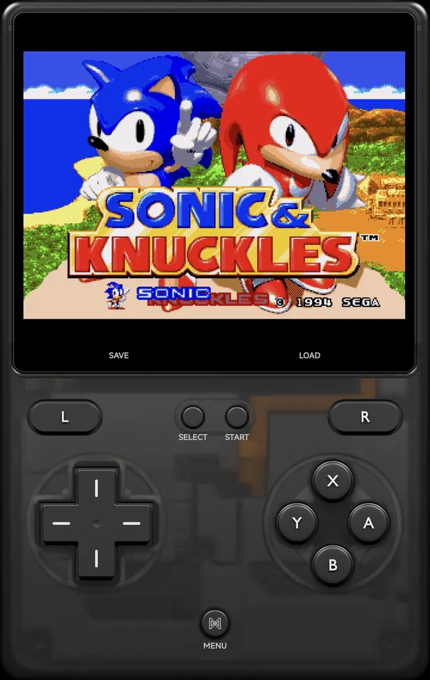
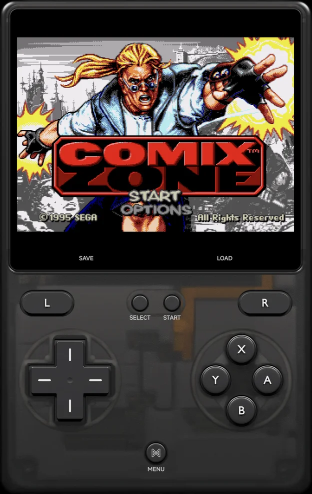

# Sega Consoles

Sega Genesis, Sega CD, 32X, Master System, Game Gear and SG-1000 games run on
the bundled **PicoDrive** core by default. All but the 32X can run on
**Genesis Plus GX** instead; see
[Choosing an emulator](index.md#choosing-an-emulator). The Sega Saturn and
Dreamcast have their own pages: [Sega Saturn](saturn.md) and
[Sega Dreamcast](dreamcast.md).

| | Folder | BIOS | [File types](index.md) |
| --- | --- | --- | --- |
| Sega Genesis | `Roms/Sega Genesis (MD)/` | Not needed | `md` `gen` `smd` `bin` `68k` |
| Sega CD | `Roms/Sega CD (SEGACD)/` | `bios_CD_U.bin` (USA), `bios_CD_E.bin` (Europe) or `bios_CD_J.bin` (Japan) in `Bios/SEGACD/` | `chd` `cue` `iso` `m3u` |
| Sega 32X | `Roms/Sega 32X (32X)/` | Not needed | `32x` |
| Master System | `Roms/Sega Master System (SMS)/` | Not needed | `sms` |
| Game Gear | `Roms/Sega Game Gear (GG)/` | Not needed | `gg` |
| SG-1000 | `Roms/Sega SG-1000 (SG1000)/` | Not needed | `sg` |

Saves go in `Saves/<tag>/`, such as `Saves/MD/`.

??? info "More detail"
    - Battery saves are shared by PicoDrive and Genesis Plus GX, so a game
      switched to the other emulator keeps its progress. Save states stay
      per emulator.
    - A handheld `Sega Genesis (GPGX)` or `Sega Master System (GPGX)` folder
      is just that console's folder. Its tag names the console, not the
      emulator.

## Controls

<div class="nx-phones" markdown>
<div markdown>
<figure class="nx-phone" markdown>
{ .nx-phone__screen }
{ .nx-phone__frame }
</figure>
<p class="nx-phones__caption">Sonic &amp; Knuckles</p>
</div>
<div markdown>
<figure class="nx-phone" markdown>
{ .nx-phone__screen }
{ .nx-phone__frame }
</figure>
<p class="nx-phones__caption">Comix Zone</p>
</div>
</div>

The game gets a Sega 3-button pad, or the 6-button pad when it was made
for one (see [Controller Type](#controller-type)). A controller plays the
Genesis, Sega CD and 32X **by position**, and so do the buttons of the
on-screen [pad skin](../controls.md#pad-skins):

| Button | 6-button pad | 3-button pad |
| --- | --- | --- |
| Left, top and right face buttons | `A`, `B`, `C` | `A`, `B`, `C` |
| Bottom face button | `X` | Not used |
| `L1`, `R1` | `Y`, `Z` | Not used |
| `SELECT` | `Mode` | Not used |

On the Master System, Game Gear and SG-1000, the bottom and right face
buttons are `1` and `2`.

## Settings

Genesis, Sega CD and 32X games have two rows on the **Controls** page of
the in-game menu's [Options](../in-game-menu.md#options), also set for the
console in [Emulator Settings](../emulator-settings.md). Both take effect
straight away; keep them for the game or the console with
[Save Changes](../in-game-menu.md#save-changes).

| Row | Values | Default | See |
| --- | --- | --- | --- |
| **Controller Type** | Auto, 3 buttons, 6 buttons | Auto | [Controller Type](#controller-type) |
| **Controller Layout** | Auto-detect, Xbox (A at the bottom), Nintendo (A on the right) | Auto-detect | [Controls](../controls.md#controller-buttons) |

### Controller Type

| Value | What the game sees |
| --- | --- |
| **Auto** (default) | A 6-button pad only for games made for one, else a 3-button pad |
| **3 buttons** | A 3-button pad |
| **6 buttons** | A 6-button pad |

Some older games misbehave with a 6-button pad. Player 2 gets the same pad
as Player 1.

??? info "More detail"
    - The emulator's own options are on the **Emulator** page of
      [Options](../in-game-menu.md#options). Neither emulator has a pad
      option of its own: **Controller Type** sets the pad for both.
    - On PicoDrive, **Mega Drive FM chip type** under **Emulator → Audio**
      picks the sound chip: **YM2612**, the first Mega Drive's, or
      **YM3438**, the later models'.

## Sega CD BIOS

The Sega CD is region-locked: a US disc boots only with the US BIOS,
`bios_CD_U.bin`, a European disc with `bios_CD_E.bin`, and a Japanese disc
with `bios_CD_J.bin`. Before a disc starts, the app reads its region and
checks for that BIOS. When it's missing, the message says which file to add,
and where your other BIOS files are:

> This game is a US disc: put bios_CD_U.bin in Bios/SEGACD/. Bios/MD/ has
> bios_CD_E.bin and bios_CD_J.bin, which only boot European and Japanese
> discs.

[Import BIOS](../library.md#import-bios) puts each file under the right
name, whatever it's called.

??? info "More detail"
    - The region is read from `.cue` / `.bin`, `.iso`, `.chd` and `.m3u`
      discs, and from a zipped disc once it's unpacked.
    - PicoDrive also accepts the redump names, such as `us_scd2_9306.bin`
      (or `.zip`).
    - On Genesis Plus GX, a region forced in its Emulator settings decides
      the BIOS, as it does in the emulator.
    - A disc whose header can't be read gets the general check: any of the
      three files.

## MSU-MD

MSU-MD games are Mega Drive cartridges patched to play CD-quality music
from a set of audio tracks. They show an **MSU-MD** badge by their name.

Put the set in `Roms/Sega Genesis (MD)/`: the cartridge, and a `.cue` of the
same name with the tracks it lists. A set in a folder of its own lists as one
game, named after the folder. Unzip the set first: music can't stream from
inside a zip.

```text
Roms/Sega Genesis (MD)/
└── Sonic 3D Blast MSU/
    ├── Sonic 3D Blast MSU.md
    ├── Sonic 3D Blast MSU.cue
    ├── Sonic 3D Blast MSU-01.wav
    └── …
```

- **PicoDrive** (the default) needs no BIOS for MSU-MD.
- **Genesis Plus GX** needs the Sega CD BIOS of the cartridge's region in
  `Bios/MD/`; the message names it if it's missing.

??? info "More detail"
    - The cue and its tracks are hidden from the game list; the cartridge
      stands for the set.
    - A track the cue lists that is missing is named in the error.
    - Moves and [Device Sync](../device-sync.md) take the set's files along.
    - Art is looked up by the folder's name, and
      [RetroAchievements](../retroachievements.md) treats the game as its
      Mega Drive cartridge.

## Multiplayer

- Two players can play on the Genesis, Sega CD, 32X, Master System and
  SG-1000, each on their own controller; see
  [Local Multiplayer](../multiplayer.md). The Game Gear is one player.
- Every Sega console here also plays over [Netplay](../netplay.md).

## Cheats and achievements

- [Cheats](../cheats.md): the cheat download has codes for every Sega console
  here, or add your own `.cht` files.
- [RetroAchievements](../retroachievements.md) works for all of them.
