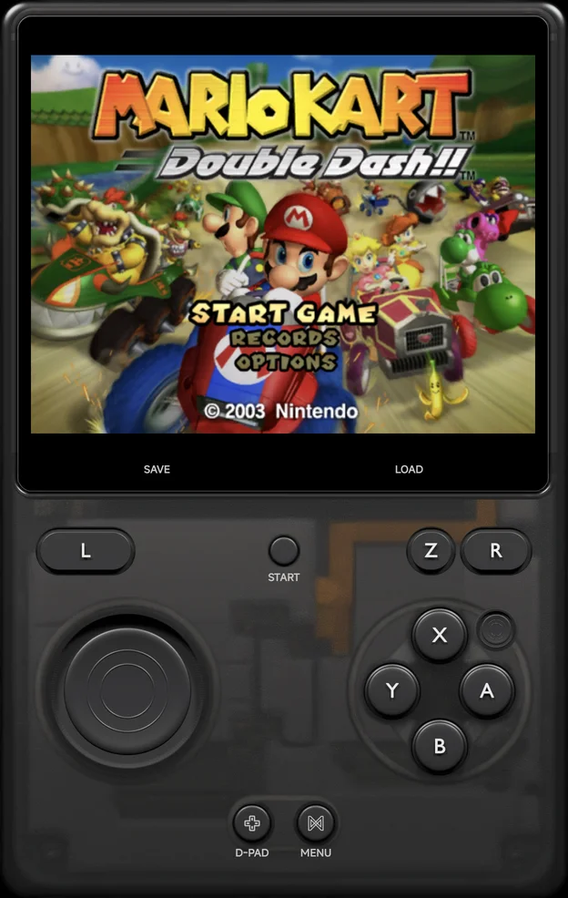
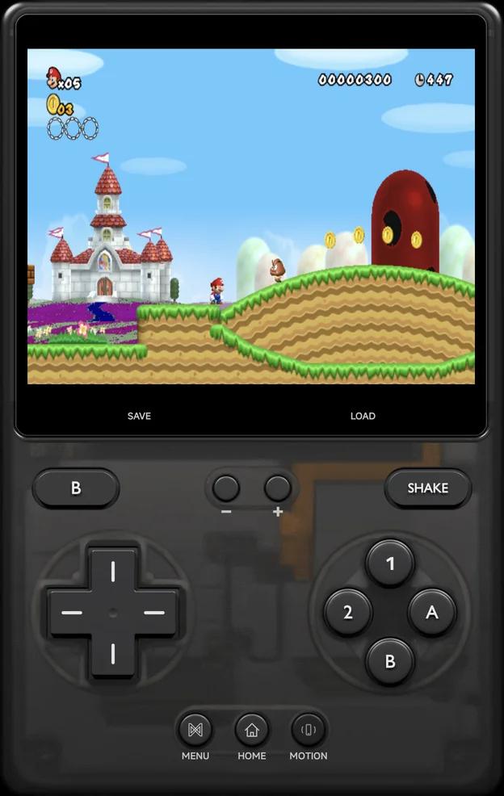
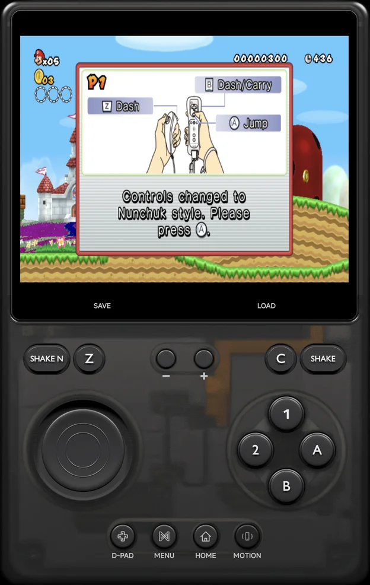
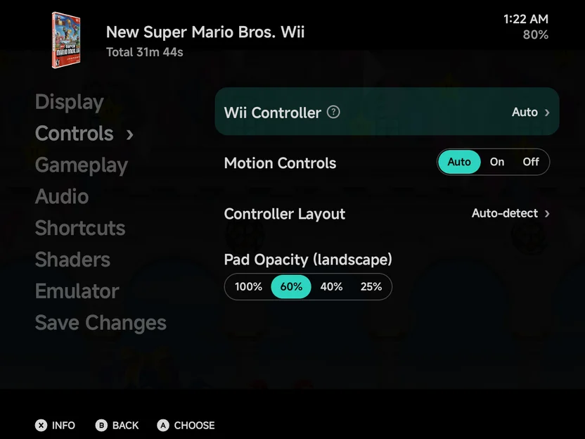
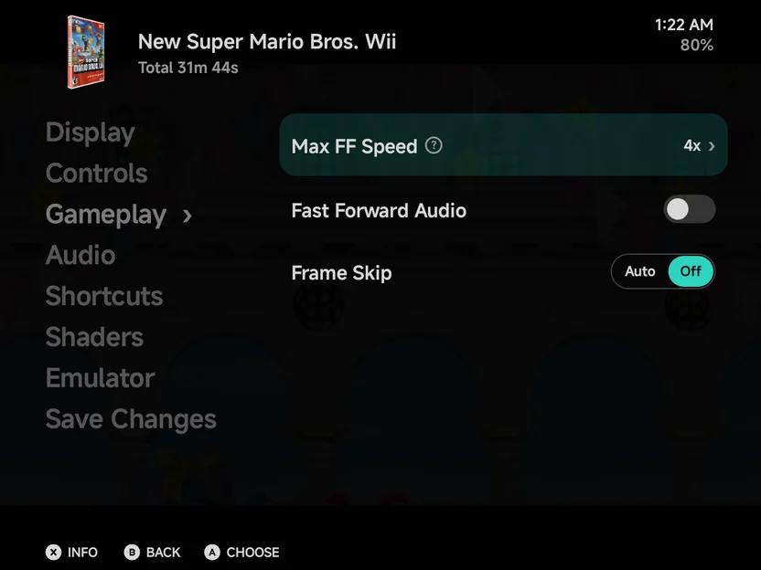

# Nintendo Wii & GameCube

Wii and GameCube games run on the bundled **Dolphin** core.

| | Wii | GameCube |
| --- | --- | --- |
| Folder | `Roms/Nintendo Wii (WII)/` | `Roms/Nintendo GameCube (GC)/` |
| Saves | Game saves in `Saves/WII/` | Memory cards in `Saves/GC/` |
| BIOS | Not needed | Not needed |
| [File types](index.md) | `wbfs` `wia` `rvz`, and `iso` `ciso` `gcz` `wad` `elf` `dol` `m3u` in the Wii folder | `gcm` `gcz` `tgc` `ciso`, and `iso` `elf` `dol` `m3u` in the GameCube folder |

- A GameCube disc in the Wii folder plays as GameCube.
- Save states are large, about 100 MB each.
- **Graphics API** can switch a game to Vulkan. See
  [Graphics API](index.md#graphics-api).

??? info "More detail"
    - The first launch copies Dolphin's system files, which takes a second
      or two.
    - On a [second display](../dual-screen.md), such as a TV, each frame is
      shown whole once the game has drawn it. While the game is paused, the
      second display keeps its last frame.

## Controls

<figure class="nx-phone" markdown>
{ .nx-phone__screen }
{ .nx-phone__frame }
</figure>

GameCube

<figure class="nx-phone" markdown>
{ .nx-phone__screen }
{ .nx-phone__frame }
</figure>

Sideways Wiimote

<figure class="nx-phone" markdown>
{ .nx-phone__screen }
{ .nx-phone__frame }
</figure>

Wiimote + Nunchuk

The on-screen pad is a [pad skin](../controls.md#pad-skins) that follows
the console: the GameCube pad for GameCube games, and for Wii games the
controller **Wii Controller** picks (see [Wii](#wii)).

### GameCube

The on-screen pad is the GameCube's. Where the layout has room for only one
of them, it shows the control stick, and **D-PAD** / **STICK** switches
between it and the d-pad.

`L` and `R` are analog triggers on a GameCube:

- **Tap** `L` or `R` to squeeze it half-way. It stays squeezed until you
  tap it again.
- **Hold** it for a full press, for as long as your finger stays down.

??? info "More detail"
    - The pad has the d-pad and control stick, the C-stick, `A`, `B`, `X`,
      `Y`, `Z`, `L`, `R` and `START`.
    - A full press is the click at the end of the trigger. It needs a hold
      of about a third of a second or more.

A controller adds:

| Control | GameCube |
| --- | --- |
| `A` `B` `X` `Y` | `A` `B` `X` `Y`, by the letters printed on your controller |
| `R1` | `Z` |
| `L2`, `R2` | `L`, `R`. Analog triggers press them as far as you pull. |
| Left stick | The control stick |
| Right stick | The C-stick |

### Wii

A Wii game needs a Wiimote, held one way or another, or another Wii
controller. **Wii Controller** picks it:

| Value | What the game gets |
| --- | --- |
| **Auto** (default) | The controller the game expects, from its disc. A game that takes the Classic Controller gets it. Games that require the Wii MotionPlus get it attached. |
| **Sideways Wiimote** | A Wiimote held sideways, like an NES pad |
| **Wiimote** | A Wiimote held upright and pointed at the screen |
| **Wiimote + Nunchuk** | A Wiimote with the Nunchuk |
| **Classic Controller** | The Classic Controller Pro |

It's a row on the **Controls** page of [Settings](#console-settings) and
applies straight away.

The on-screen pad follows the controller you picked. Its extra buttons:

- **`HOME`** (every Wii pad): opens the game's HOME menu.
- **`Shake`** (Wiimote pads): shakes the Wiimote, for a spin jump or a
  swing. The Nunchuk pad adds **`Shake N`** for the Nunchuk.
- **`MOTION`** (Wiimote pads): turns [motion controls](#motion-controls) on
  or off.

On a controller, **`R3`** (press the right stick) is `HOME` and **`L3`**
recentres motion. With a Wiimote, the right stick moves the pointer.

??? info "More detail: the pads and controller buttons"
    - The pads show the sideways Wiimote's `1` and `2`, the Nunchuk's
      stick, `C` and `Z`, or the Classic Controller's two sticks and
      shoulder buttons. The Classic Controller pad has no `Shake` or
      `MOTION`.
    - The Nunchuk and Classic Controller pads start on the stick. Where the
      layout has room for only one, **D-PAD** / **STICK** switches between
      it and the d-pad.
    - `HOME` saves a resume point first, so the game pauses for about a
      second.

    A controller adds:

    | Controller | Sideways Wiimote | Wiimote | Wiimote + Nunchuk | Classic Controller |
    | --- | --- | --- | --- | --- |
    | `A` | `2` | `A` | `A` | `a` |
    | `B` | `1` | `B` | `B` | `b` |
    | `X` | `A` | `1` | `C` | `x` |
    | `Y` | `B` | `2` | `Z` | `y` |
    | `SELECT`, `START` | `−`, `+` | `−`, `+` | `2`, `1` | `−`, `+` |
    | `L1`, `R1` | | | `−`, `+` | `L`, `R` |
    | `L2`, `R2` | `R2`: Shake | `R2`: Shake | Shake Nunchuk, Shake | `ZL`, `ZR` |
    | Left stick | | | The Nunchuk's stick | The left stick |
    | Right stick | The pointer | The pointer | The pointer | The right stick |

    The sideways Wiimote works like the NES pad: printed `A` is `2` and
    printed `B` is `1`.

## Settings { #console-settings }

The rows that apply while you play are in the in-game menu's
[Options](../in-game-menu.md#options), each on its group's page, and for
the console in [Emulator Settings](../emulator-settings.md) under the same
group names. Keep a change for the game or the console with
[Save Changes](../in-game-menu.md#save-changes).

{ .nx-wide }

| Row | Group | Values | Default | See |
| --- | --- | --- | --- | --- |
| **Wii Controller** (Wii) | Controls | Auto, Sideways Wiimote, Wiimote, Wiimote + Nunchuk, Classic Controller | Auto | [Wii](#wii) |
| **Motion Controls** (Wii) | Controls | Auto, On, Off | Auto | [Motion controls](#motion-controls) |
| **Controller Layout** | Controls | Auto-detect, Xbox (A at the bottom), Nintendo (A on the right) | Auto-detect | [Controls](../controls.md#controller-buttons) |
| **Frame Skip** | Gameplay | Auto, Off | Off | [Frame Skip](#frame-skip) |
| **Fill Audio Gaps** | Audio | Auto, On, Off | Auto | [Frame Skip](#frame-skip) |

These take effect straight away. A few more are read only when the game
starts, so they're not in the in-game menu: set them in
[Game Settings](../emulator-settings.md#game-settings) for one game, or in
Emulator Settings for the console. They apply at the next start.

| Row | Group | Values | Default | See |
| --- | --- | --- | --- | --- |
| **Wii Screen** (Wii) | Display | Auto, 4:3, 16:9 | Auto | [Wii Screen](#wii-screen) |
| **Graphics API** | Display | Auto, OpenGL ES, Vulkan | Auto | [Graphics API](index.md#graphics-api) |
| **Pointer Width**, **Pointer Height**, **Pointer Offset** (Wii) | Controls | 50% to 150%, 50% to 150%, −20 to +20 | 100%, 100%, 0 | [Pointing](#pointing) |
| **Audio Buffer** | Audio | Auto, 50 ms, 75 ms, 100 ms | Auto | [Frame Skip](#frame-skip) |

Dolphin's own options are on the **Emulator** page.

??? info "More detail"
    - **Synchronize GPU Thread**, under **Emulator → Core**, is off by
      default, as in Dolphin itself. Turn it on only for a game that needs
      it.
    - Dolphin's own fixes for a game stay on when you change an option
      while you play.

## Frame Skip

**Frame Skip** sets what a game does when the phone can't keep up:

| Value | What it does |
| --- | --- |
| **Off** (default) | Shows every frame and lets the game slow down a little. |
| **Auto** | Skips frames to hold the game's speed. |

{ .nx-wide }

With **Off**, a slowed game's sound is stretched at the same pitch instead
of crackling. That is **Fill Audio Gaps** on **Auto**; **On** stretches
with **Frame Skip** on **Auto** too, and **Off** never does.

??? info "More detail"
    - **Audio Buffer** is how much sound is kept ready ahead of the
      speaker. **Auto** keeps 50 ms on Wii and GameCube, more than on
      lighter consoles. A larger buffer covers slow moments, but the sound
      comes later against the picture.
    - Filling the gaps plays the sound about 50 ms later.

## Pointing

With a Wiimote, touch the picture to aim. The cursor jumps to your finger
and stays where you lift it. A controller's right stick moves it too.

If a tap lands off your finger in a game, adjust the **Pointer** rows for
that game in [Game Settings](../emulator-settings.md#game-settings).

??? info "More detail: the Pointer rows"
    The new values apply the next time the game starts.

    | Row | Values | What it does |
    | --- | --- | --- |
    | **Pointer Width** | 50% to 150% | Lower it if the cursor lands further out sideways than your finger, raise it if it falls short. |
    | **Pointer Height** | 50% to 150% | The same, up and down. |
    | **Pointer Offset** | −20 to +20 | Moves the cursor up (+) or down (−) against your finger. |

## Motion controls

Tilt and turn the phone to move the Wiimote. **Motion Controls** sets when
the phone's motion is used:

| Value | What it does |
| --- | --- |
| **Auto** (default) | On for games that require the Wii MotionPlus, such as Wii Sports Resort. |
| **On** | On for every game. |
| **Off** | Off. The left stick tilts the Wiimote instead. |

- Tap **`MOTION`** on the pad to turn it on or off while you play.
- Hold **`MOTION`**, or press **`L3`** on a controller, to recentre: the way
  you hold the phone now becomes straight ahead.
- Motion needs a phone with a gyroscope.

??? info "More detail"
    - The sensors only run while you play.
    - The Classic Controller has no motion, whatever the setting.

## Wii Screen

**Wii Screen** is the shape the Wii draws: **Auto** (default), **4:3** or
**16:9**. **Auto** picks 16:9 when the game starts in landscape on a wide
screen, and 4:3 in portrait or on a squarer screen, such as a 4:3 handheld
or the unfolded Galaxy Z Fold. Set it in
[Game Settings](../emulator-settings.md#game-settings).

The game reads the shape only once, when it first starts, so rotating the
phone keeps it.

A save state keeps the shape its game started with. When you resume one
saved in the other shape, the game stays in the save's shape and a note
says so, such as **This save is in 16:9. Wii Screen 4:3 applies when the
game starts fresh.** The touch pointer follows the shape the game really
has.

## The Wii Menu

**Wii Menu** in a game's HOME menu closes the game and goes back to the game
list. Resuming later starts from the point saved when you pressed `HOME`.

## Multiplayer

Up to four players can play, each on their own controller; see
[Local Multiplayer](../multiplayer.md).

- Every player gets the same controller as Player 1.
- Each player shakes their own Wiimote with `R2`.
- Only Player 1 can point at the screen or use the phone's motion.

??? info "More detail"
    - Players 2 to 4 are plugged in only when a controller joins. Until
      then, the game sees one player, so a Wii game shows no extra cursors.
    - "The same controller" is the GameCube pad, or the Wii controller the
      game uses.

## Cheats and achievements

- [Cheats](../cheats.md): Dolphin's own codes for the game are listed after
  the game's first start. The cheat download has no Wii or GameCube codes.
- [RetroAchievements](../retroachievements.md) works for Wii and GameCube
  in every file type above.

??? info "More detail"
    A game is identified once, then remembered. Compressed discs listed in
    an `.m3u`, and split WBFS files, aren't identified. They still play.
