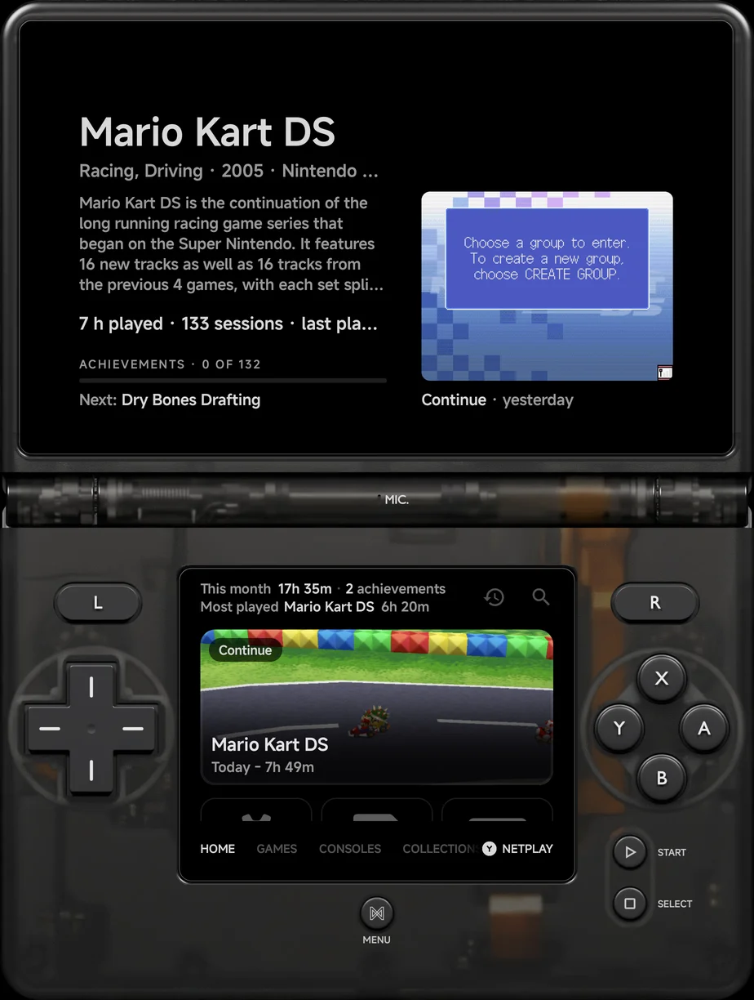
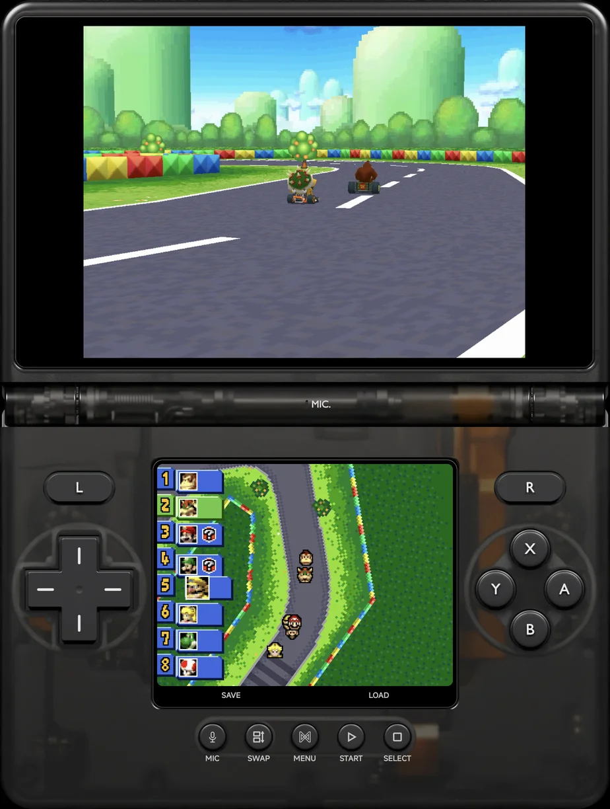
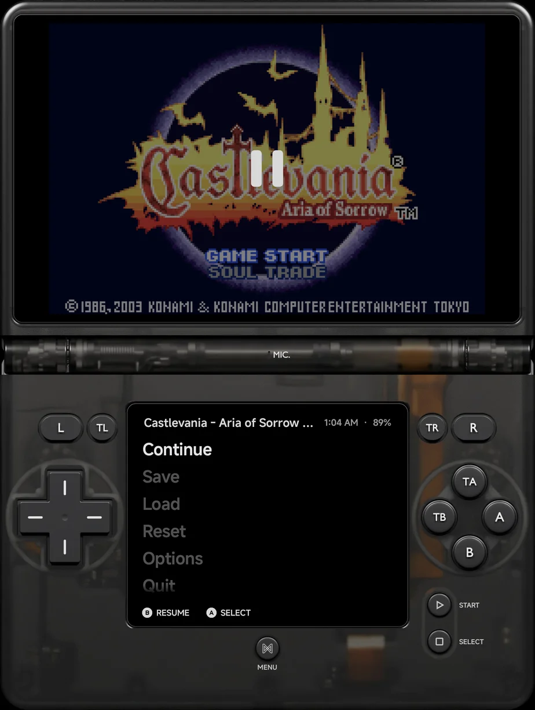
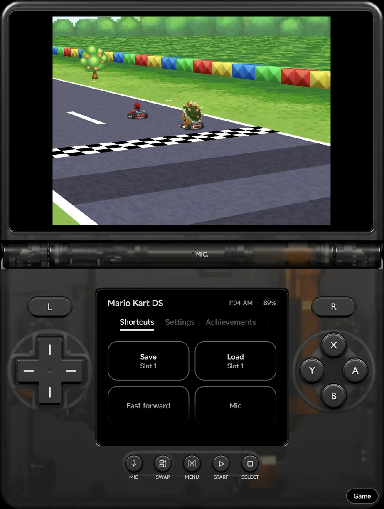
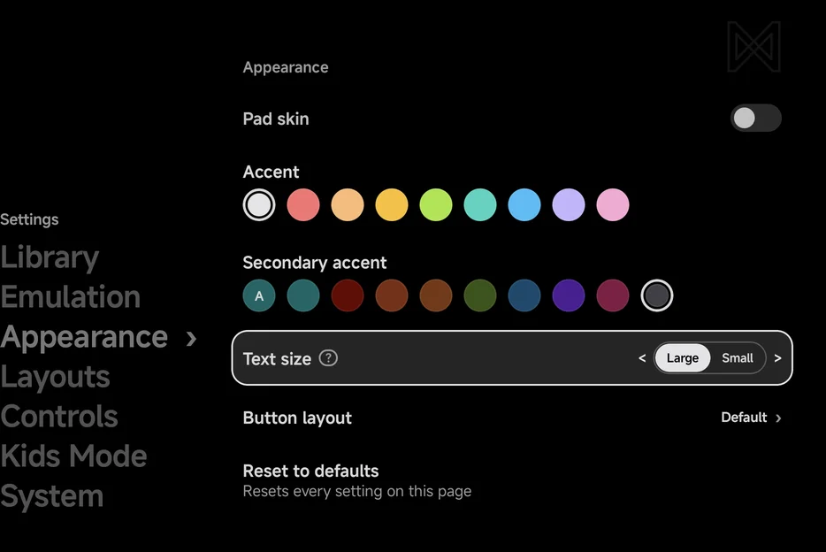

# Foldables & Large Screens

NX Redux fits itself to the screen it's on. On a foldable the pad skin is
split where the hinge is, a wide or large screen gets a fuller Home, and
Settings and the in-game menu split into two panes when there is room. For
handhelds with a second screen, and displays on USB-C, see
[Dual Screens & External Displays](dual-screen.md).

## Half-folded

Fold a foldable partway, like a small laptop, with the hinge running across
the screen. With a [pad skin](controls.md#pad-skins) the app splits at the
hinge:

- **Above the hinge:** the skin's screen, with the game.
- **Below the hinge:** the skin's buttons.

There is no setting. The skin follows the fold when you fold the phone and
when you open it flat, and a game you start while half-folded starts on the
hinge. Nintendo DS and 3DS games put their touch screen below the hinge: see
[below](#nintendo-ds-and-3ds-half-folded).

- **A foldable's inner screen, and tablets, held upright:** the skin is
  already split at the middle when the screen is flat, so folding or
  opening it mid-game doesn't change the layout.
- **The main menu on those screens:** the menu is on two screens. The menu
  itself is below the hinge with the buttons, and the frame above the hinge
  shows the highlighted game's details, as the top screen of a
  [dual-screen handheld](dual-screen.md) does.

{ width="320" }
- **A narrower foldable, such as a Galaxy Z Flip:** flat, it uses the
  phone's layouts. Half-folded, a game's screen moves above the hinge and
  the buttons below it; the main menu fills the screen with no skin.
- **With a controller connected:** there is no skin, and the game or the
  menu uses the whole screen as it does flat.
- **With [Pad skin](appearance.md#pad-skin) Off:** the game stays full
  screen, and its see-through buttons sit below the hinge.

??? info "More detail"
    - The hinge must run across the screen, and each half must be at least a
      quarter of the screen. A book-style fold, with the hinge from top to
      bottom, keeps the usual layout.
    - On a phone that doesn't report its half-folded state, such as the
      Galaxy Z Fold, the app reads the hinge angle: between 30° and 150°
      counts as folded.
    - On a pad skin's screen, Settings, RetroAchievements, the Game Tracker
      and Artwork decide between one page and two panes from the skin's
      screen, not the whole window. Grids and Home lay out for it too.
    - When a game resumes from a save state, the save's picture shows on
      the skin's screen until the game's own picture replaces it. On the
      Nintendo DS and 3DS it shows on the top screen.

### Nintendo DS and 3DS half-folded

Half-fold the inner screen of a foldable such as the Galaxy Z Fold, and a DS
or 3DS game with a pad skin is held like the real handheld:

- **Above the hinge:** the top screen.
- **Below the hinge:** the touch screen, with the skin's buttons round it.

The touch screen takes touches, and **SWAP** trades the two screens across
the hinge. Fold or open the phone mid-game and the layout follows. On the
inner screen it looks the same half-folded as flat, except that the
**Panel** pill (see [below](#two-screen-skin)) shows only when the phone is
flat.

{ width="320" }

??? info "More detail"
    - The skin places the two screens here, so the game's **Layout** rows
      don't apply. On a phone that can half-fold, they say they set the
      layout used when the phone isn't half-folded.
    - With a controller connected, or with Pad skin Off, there is no skin:
      the game keeps its own
      [layout](emulators/nintendo-ds.md#screen-layouts), folded or flat.
    - Move or resize these buttons with
      [Button layout](controls-settings.md#button-layout). The band round
      the hinge stays clear.
    - With a [second screen](dual-screen.md#nintendo-ds-and-3ds) the game
      keeps the split across the two screens instead.

### Two screens in one skin { #two-screen-skin }

On a foldable's inner screen and on tablets held upright, and on a
half-folded Galaxy Z Flip with a Nintendo DS or 3DS game, the skin works
like a [dual-screen handheld](dual-screen.md) with no second display:

- **The top screen** shows the game, or the DS or 3DS top screen.
- **The bottom screen** shows the DS or 3DS touch screen. On the Fold's
  inner screen and on tablets, a one-screen game shows its
  [game panel](dual-screen.md#the-game-panel) there instead, beside the
  buttons.

The [in-game menu](in-game-menu.md) opens in the bottom screen, the menu
alone with no tab row. The top screen keeps the paused game, dimmed under
a pause mark.

{ width="320" }

{ width="320" }

On the Nintendo DS and 3DS a **Panel** pill sits at the bottom right of the
window while the phone is flat. Tap it and the game panel covers the touch screen; the **Game**
pill in the same spot brings the touch screen back. Fast forward, rewind
or the mic started from the panel bring it back too.

??? info "More detail"
    - The skin's row of touch shortcuts hides while the game panel sits in
      the skin: the panel's own shortcuts stand in for it.
    - A panel or menu less than 320 dp tall shows a one-line header: the
      game's name, the clock and the battery.
    - With a controller connected, or with Pad skin Off, there is no skin,
      and the menu opens over the game as usual.

## Home on wide and large screens

Home lays itself out for the screen's shape. In portrait and on most
screens it looks as in [Main Menu](main-menu.md#home). In landscape the
first one or two pinned games sit beside the Continue card, and your pinned
tools are a row of tiles under them.

??? info "More detail"
    **Portrait:** the pinned tools are up to two rows of tiles under the
    Continue card. With more, the last tile is **+N**, which opens Tools.

    **Landscape:** Continue and the first one or two pinned games fill the
    first screen. One row of tool tiles comes under them, a scroll away,
    then the rest of the pinned games. A narrow landscape phone keeps the
    row of tools on the first screen and has no games beside Continue.

    **Large face:** a landscape screen at least 840 × 480 dp, such as an
    unfolded Galaxy Z Fold or a tablet.

    - The other pinned games fill the rows below, four to a row.
    - Under them come the [shelves](#shelves), up to four games each in one
      row, at the pinned games' size.

    The pinned tools use the Tools tab's tile on every screen: an icon over
    a two-line name.

### Shelves

Home shows up to four shelves of games from your library, to help you
pick something to play. They show on every screen size and in every Home
layout.

| Shelf | What it holds |
| --- | --- |
| **Most played** | The games you've played longest, most first, each with its play time. Right under your pinned games. |
| **New** | Games the app first found in the last 30 days, newest first. |
| **Not started** | Games you have never played. Picked again each day. |
| **Pick up again** | Games you last played more than 14 days ago, most played first. |

[Layouts](layouts.md) can hide the **Most played**, **New** and **Not
started** shelves, each with its own row in **Layouts → Home**. **Pick up
again** always shows when it has games.

??? info "More detail"
    - Shelves show in portrait and landscape alike. Each shelf shows only
      when it has games, and a game is never on two shelves, the shelves
      filling in the order of the table. A shelf holds at most 4 games; Grid
      Home in landscape shows as many whole rows as fit within that.
    - Each shelf has its name as a label above it; on Carousel and List Home
      each game wears it as a badge or tag instead. A **Most played** game's
      badge is its play time.
    - The game on the Continue card, your pinned games, Unassigned games and
      Android games are left off the shelves.
    - A hidden shelf takes no games, so the shelves after it can show them.

## Two-pane screens

On a wide screen, such as most phones in landscape or an unfolded Fold held
sideways, some pages show two panes side by side. Portrait screens keep one
page at a time.

With a controller or the on-screen pad, two panes change what `Left` and
`Right` do:

- `Left` / `Right` move between the panes. They never change a value.
- To change a row with choices, swatches or a stepped value, press `A` on
  it. The row gets a ring and `<` `>` round its value, and the hints read
  **Change** and **Done**. `Left` / `Right` now step it; `A` or `B`
  finishes, and `Up` / `Down` finishes and moves on.
- `A` on a switch flips it, and `A` on a long list opens its list to pick
  from, as on one page.
- The row that opened the right pane is grey in the left pane, with a `›`
  after it.

{ .nx-wide }

On one page, `Left` / `Right` change a value straight away. Touch changes
values directly everywhere.

??? info "More detail"
    - A window counts as wide when it is at least 600 dp wide and at least
      1.3 times as wide as it is tall.
    - Inside a [pad skin](controls.md#pad-skins) the skin's screen is what
      counts, not the window. A landscape skin's screen is close to square,
      so it shows one page at a time.
    - Holding `Left` goes up one level, and holding `Right` opens one page.

### Settings

**Tools → Settings** shows its sections on the left and the selected
section's page on the right. Moving through the sections previews each page.

### RetroAchievements

Below the [RetroAchievements](retroachievements.md) page, each level opens
beside the one it came from, such as an achievement's details beside the
game's achievements list. The page you came from stays on the left, dimmed.
The [Game Tracker](game-tracker.md) shows a game's sessions the same way.

??? info "More detail"
    The dimmed page keeps the row that opened the right pane highlighted. A
    game's achievements open beside the games list.

### Artwork

[Artwork](artwork.md) works the same way: its pages open beside the
Artwork page. Tap a row in the dimmed left pane to open it instead.

??? info "More detail"
    **Fetch by console**, **Progress** and **Settings** open beside the
    Artwork page, and **Reset artwork** beside Settings. The page you came
    from keeps its row lit.

### In-game menu

The [in-game menu](in-game-menu.md) splits too, on its **Menu** tab. The
Achievements, Cheats and Players tabs use the whole width.

- On the first page, the right pane shows the save slot on **Save** and
  **Load** and a preview of the page on **Options**. It is empty on the
  other rows.
- Deeper in, the open page is on the right and the page it came from on the
  left, dimmed.
- `RIGHT` on a row that opens a page opens it, as `A` does, and `LEFT` goes
  back. To change a value, press `A` on its row first.
- Tap a row in the dimmed pane to go back to it.
