# Getting Started

NX Redux for Android brings the NX Redux look, folder layout and in-game
features to Android phones, tablets, foldables and Android handhelds. It runs retro
systems through emulators bundled in the app, with nothing extra to download.

<figure class="nx-phone" markdown>
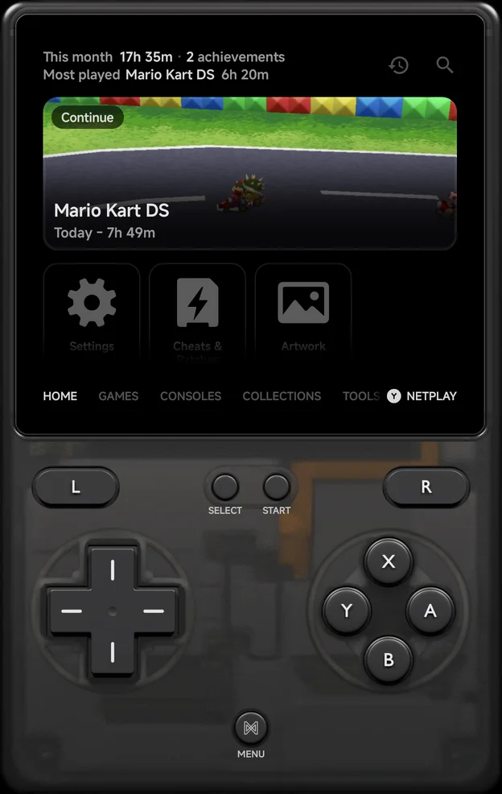{ .nx-phone__screen }
{ .nx-phone__frame }
</figure>

New to NX Redux? See [About NX Redux](../about.md) first.

## What's different from the handheld

- **Emulators:** the app adds Nintendo 3DS and Nintendo Wii & GameCube, which
  the handheld doesn't have. Nintendo DS runs melonDS DS (DraStic is not
  available). See [Emulators](emulators/index.md),
  [Nintendo 3DS](emulators/nintendo-3ds.md) and
  [Wii & GameCube](emulators/wii-gamecube.md).
- **Library:** besides the home folder, the app can scan extra folders in
  place. See [Library & ROM folders](library.md).
- **Controls:** an on-screen pad drawn as a [pad skin](controls.md#pad-skins)
  for each console, or any Android controller. See [Controls](controls.md).
- **Home screen:** the app can be your phone's home screen, and list your
  Android games and apps. See [Launcher Mode & Android Games](launcher.md).
- **Kids Mode:** games open only in the play times a parent sets. See
  [Kids Mode](kids-mode.md).
- **Foldables:** on a half-folded phone, the game sits above the hinge and
  the pad below it, and a DS or 3DS game's touch screen below it like the
  real handheld. See [Foldables & Large Screens](foldables.md).
- **Two screens:** a handheld with a second screen, or a wired display,
  uses both. See [Dual Screens & External Displays](dual-screen.md).
- **Local multiplayer:** two to four players on one phone, each on their
  own controller. See [Local Multiplayer](multiplayer.md).
- **Local wireless:** DS, 3DS and PSP games on the same Wi-Fi find each
  other in the game's own wireless menu. See
  [Local Wireless](local-wireless.md).
- **Not in the app yet:** some systems the handheld runs, such as home
  computers (Amiga, C64 and so on). They come in a later release.
- **Left to Android:** Wi-Fi and Bluetooth management, the on-screen display,
  the music player, PortMaster and firmware updates are not part of the app.

The same as on the handheld: [Artwork](artwork.md),
[RetroAchievements](retroachievements.md) (no hardcore mode),
[Netplay](netplay.md) (with another phone or an NX Redux handheld) and
[Device Sync](device-sync.md) (between the phone and a handheld).

## Install

1. Download the latest `NXReduxMobile-vX.Y.Z.apk` from the
   [releases page](https://github.com/nx-redux/nx-mobile/releases),
   on the phone itself. See also [Download](../reference/download.md).
2. Open it. Android asks to allow installs from your browser or file manager
   the first time; allow it, then **Install**.
3. Open **NX Redux** and follow the setup below.

It needs Android 8.0 or later on a 64-bit ARM (arm64) device. A newer release
installs over the old one and keeps your settings and saves. If your saves
were still inside the app, see [Upgrading from an earlier
version](#upgrading-from-an-earlier-version).

Found a problem? Report it on
[GitHub](https://github.com/nx-redux/nx-mobile/issues).

## First-run setup

The first time you open the app, a short setup walks you through it. Each
page's buttons, such as **Continue** or **Skip**, sit at the bottom. Press `B`
to go back a page.

1. **Welcome.** Press **Get started**.
2. **Text size.** **Large** or **Small**. Every page after it, setup's own
   included, reads at the size you pick. See [Text size](appearance.md#text-size).

    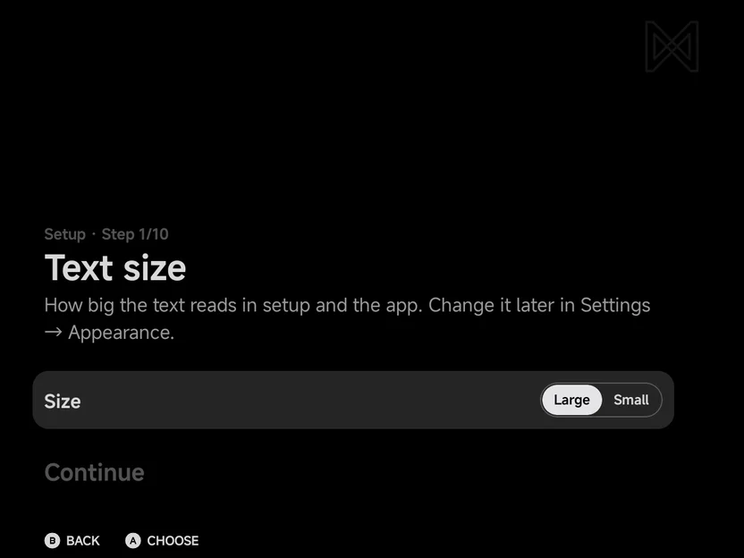{ .nx-wide }

3. **Bottom screen.** Only on a handheld with a built-in second screen: tap
   **This is the bottom screen** on the lower screen. See
   [Dual Screens & External Displays](dual-screen.md#first-run-setup).
4. **Permissions.** **All files access** and **Notifications**, where your
   phone has them. See [Allow All files access](#allow-all-files-access).
5. **Your folders.** The home folder, an extra ROMs folder, and the Android
   games on your phone. See [Choose a home folder](#choose-a-home-folder),
   [Add a ROMs folder](#add-a-roms-folder) and [Android games](#android-games).
6. **Your handheld.** **Do you also play on an NX Redux handheld?** Choose
   **Yes, I have one** or **No**.

    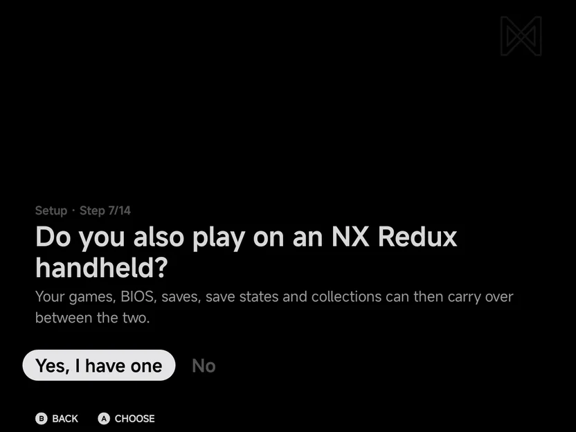{ .nx-wide }

    - With **Yes**, the next page is **Match your handheld**: set **Save
      format**, **Save state format** and **Use extracted file name** as on
      the handheld's **Settings → System**, so each loads the other's saves.

    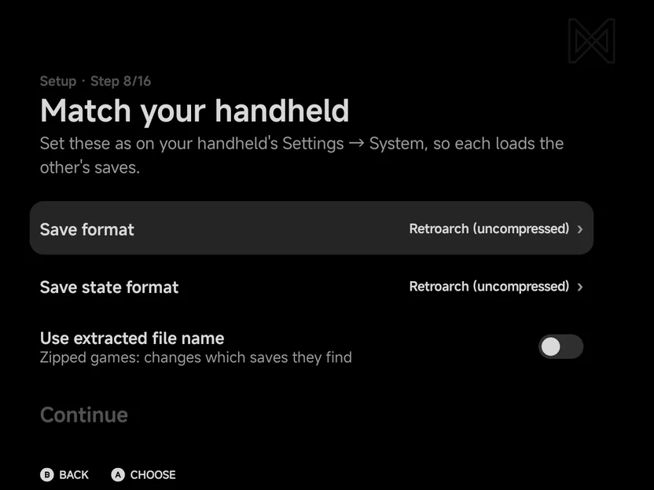{ .nx-wide }

7. **Bring your saves.** Copy battery saves and save states **From a
   folder**, **From a zip file** or **From RetroArch**, or **Skip**. See
   [Import saves](library.md#import-saves).

    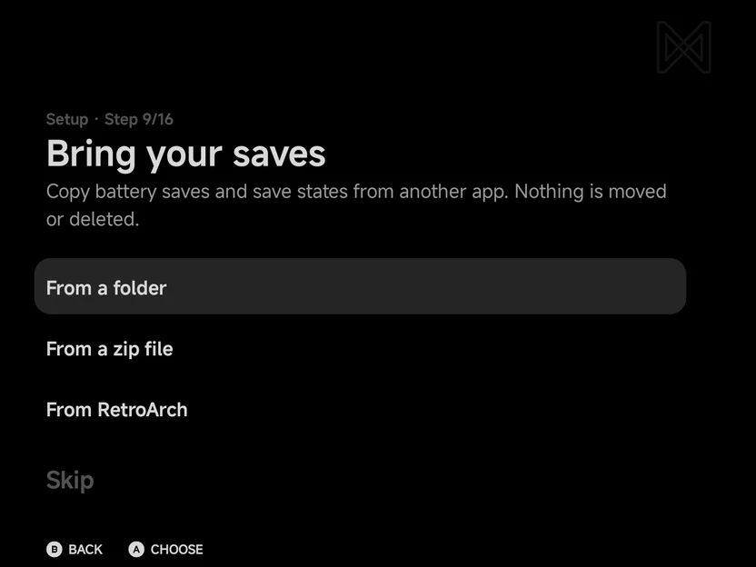{ .nx-wide }

    - With a handheld, [Device Sync](device-sync.md) opens next, in place:
      sync with the handheld now, or **Skip**.

8. **Fetch artwork.** Sign in to ScreenScraper or add a SteamGridDB or
   TheGamesDB key if you like, then **Fetch now** to fetch box art and
   screenshots in the background. See [Artwork](artwork.md).

    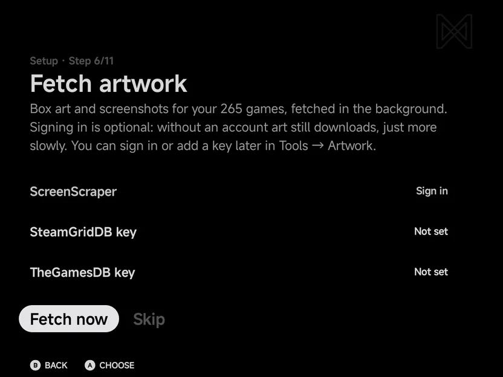{ .nx-wide }

9. **RetroAchievements.** **Sign in** or **Skip**. Signed in, the next page
   offers to download the achievement data in the background. See
   [RetroAchievements](retroachievements.md).

    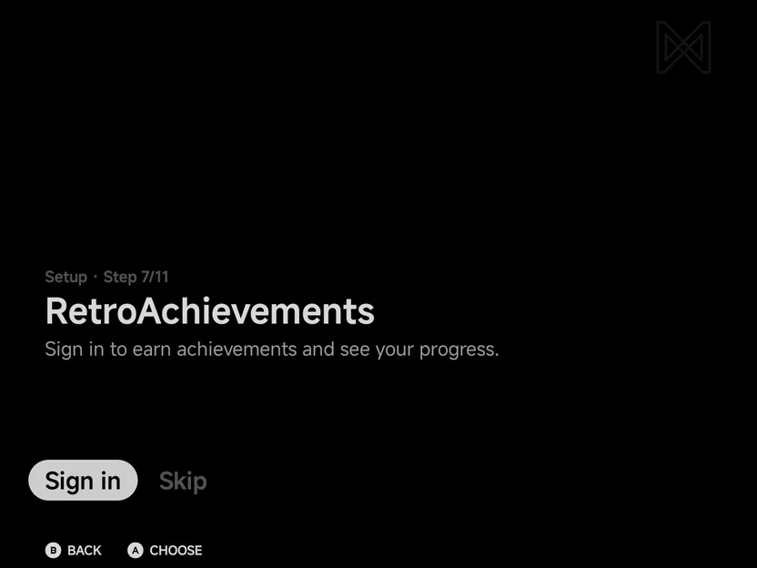{ .nx-wide }

10. **Customise the layout?** **Yes, customise** picks the menu's look page by
    page, each with a picture. **Use the defaults** skips them. See
    [Menu Layouts](layouts.md).

    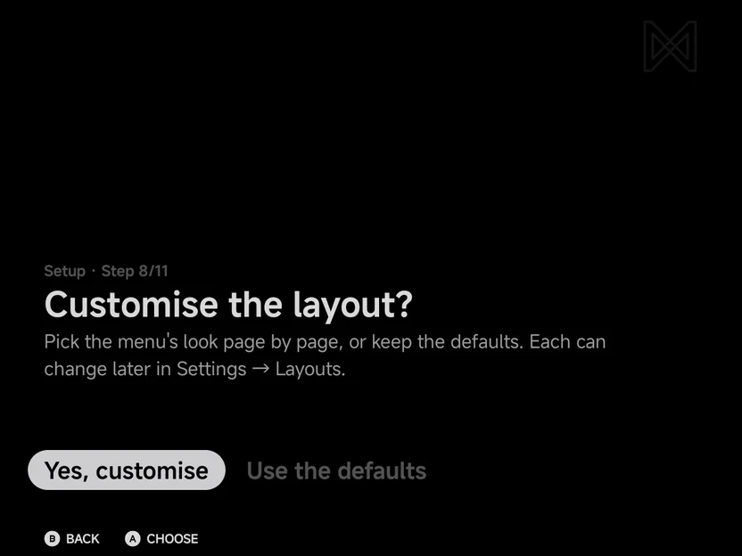{ .nx-wide }

    - Without a controller, the first page is **On-screen pad in the
      menu**: **Pad skin** On or Off, and its **Pad theme**. See
      [Pad skin](appearance.md#pad-skin).
    - With a controller, or the pad skin on, **Page title and button
      hints** shows or hides each.
    - Then a page each for the **Home**, **Consoles**, **Collections** and
      **Tools** layouts.

    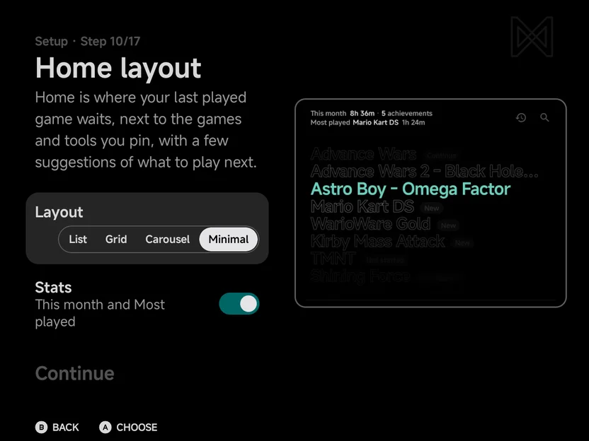{ .nx-wide }

    - Last, **Game lists layout**, with the **Games tab** switch, On or Off.
      See [Games tab](main-menu.md#games-tab).

    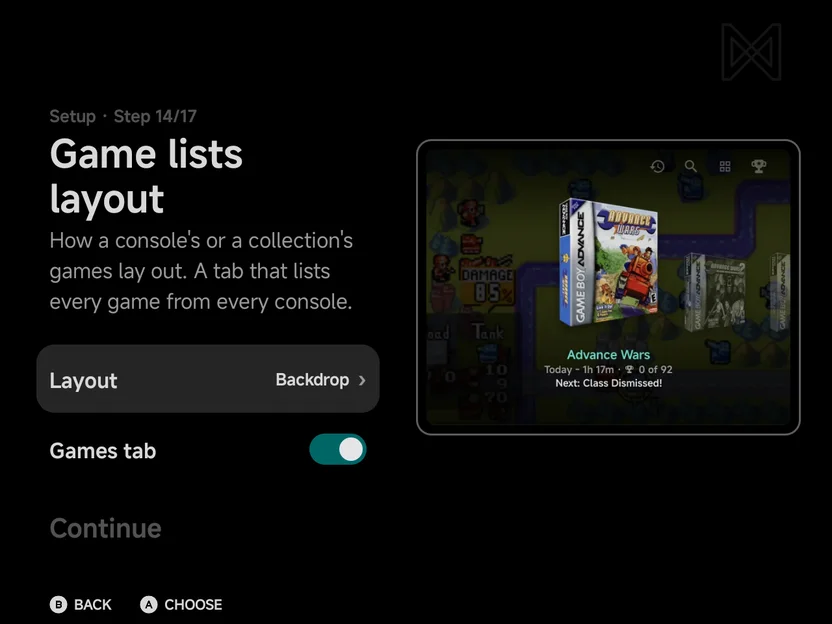{ .nx-wide }

11. **Pick your accents.** Your **Accent** and **Secondary accent**.

    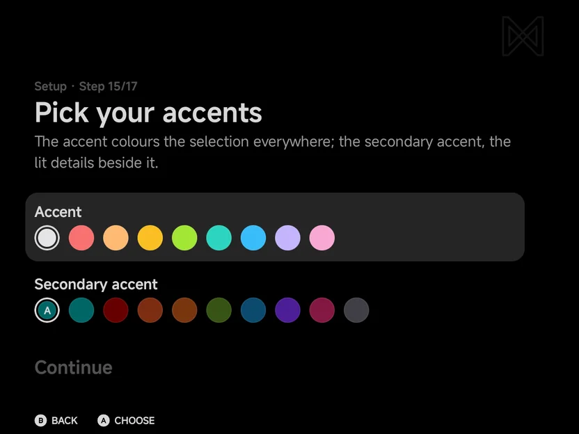{ .nx-wide }

12. **Who's this for?** **Just me** goes on. **My kids** sets up
    [Kids Mode](kids-mode.md) right there.

    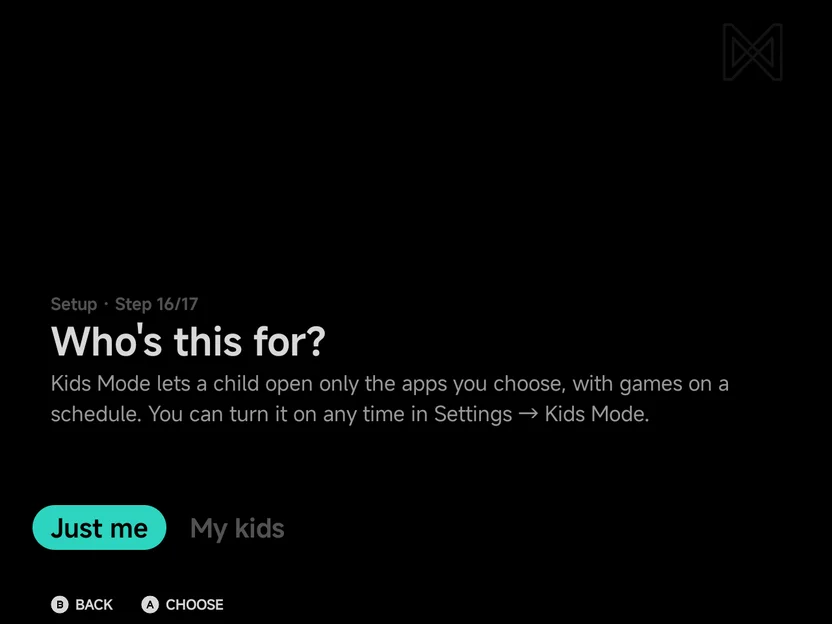{ .nx-wide }

13. **Ready, player one.** Press **Press Start** to open the main menu.

    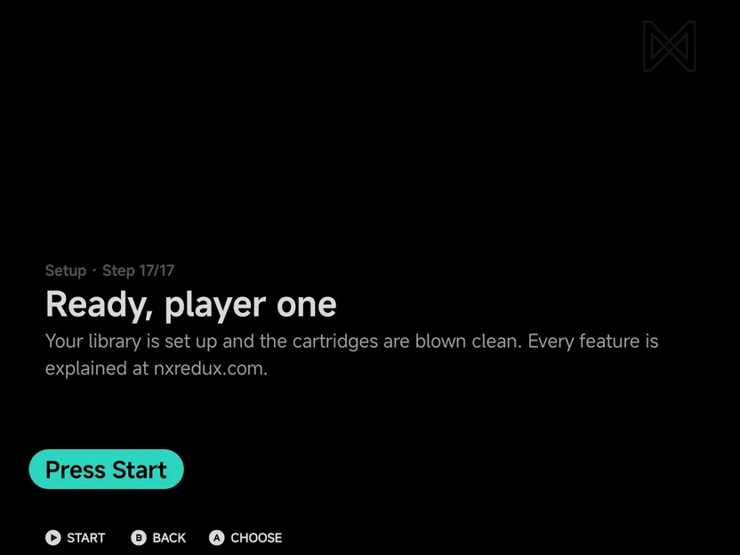{ .nx-wide }

Everything setup asks can be changed later in **Tools → Settings**.

??? info "More detail"
    - From **Text size** on, the page title counts the steps, such as
      **Setup · Step 3/11**. The total grows when an answer adds pages, such
      as **Yes, I have one** or **Yes, customise**.
    - Setup doesn't ask about your controller's buttons. If `SELECT`,
      `START` or `MENU` doesn't answer, see
      [System buttons](controls-settings.md#system-buttons).
    - Sign-ins and keys are typed on the [NX keyboard](about.md#keyboard),
      which works with touch or a controller.

## Allow All files access

On Android 11 and later, setup's **Permissions** page lists **All files
access**, which makes the library faster:

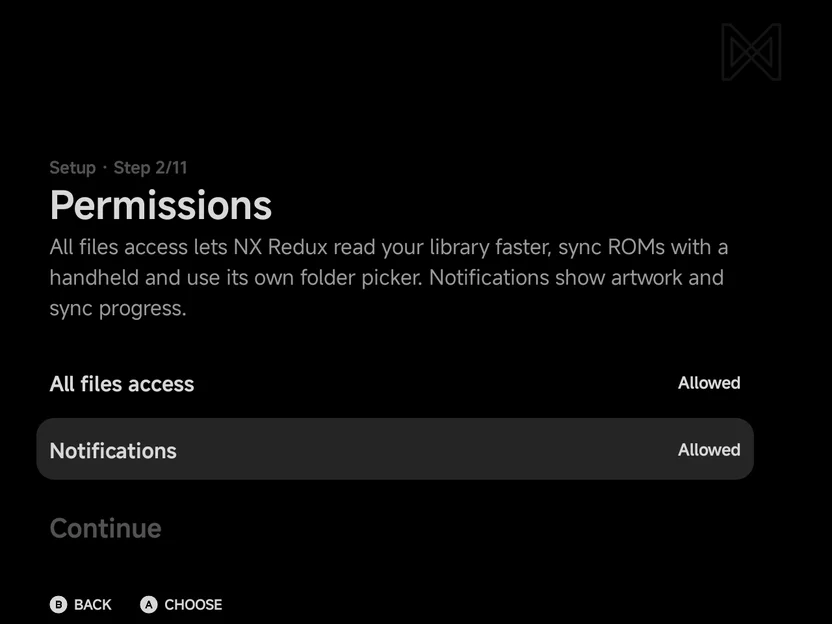{ .nx-wide }

- Select the row, turn the switch on in Android's page, then come back.
- Choose **Continue** to go on, with or without it.

Change it later in **Tools → Settings → Library → All files access**.

??? info "More detail: what All files access is for"
    The app uses it to read your library faster, to show its own folder
    picker, and to sync ROMs with a handheld. Without it, the app uses
    Android's folder picker.

## Choose a home folder

With All files access on, the app asks you to **Pick a home folder**: an
empty folder, or one NX Redux used before. Press `A` **Pick folder** and
choose it. Without All files access there is nothing to pick: the home folder
is [`Android/media/com.nxredux.mobile/`](#without-all-files-access).

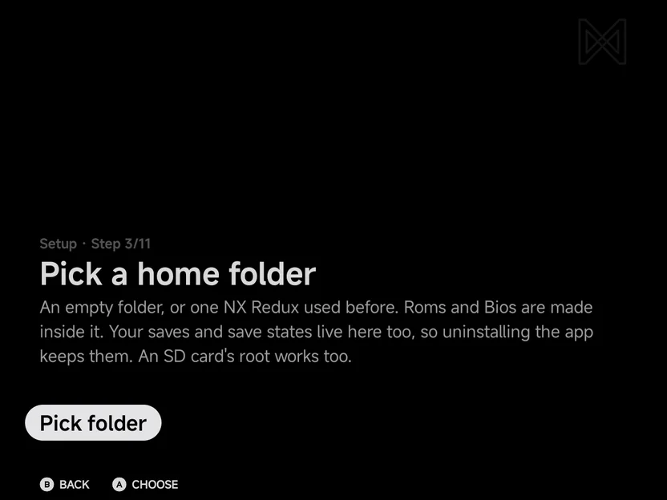{ .nx-wide }

The app creates the NX Redux layout inside the folder you pick:

| Folder | What goes there |
| --- | --- |
| `Roms/<Display Name (TAG)>/` | Games, one folder per system |
| `Bios/<TAG>/` | BIOS files for systems that need them |
| `Collections/` | Your game collections, once you make one |
| `Cheats/<TAG>/` | The [cheat download](cheats.md) |
| `Saves/<TAG>/` | Battery saves, one folder per system |
| `.userdata/shared/` | Save states, their pictures, recents, play time |
| `.userdata/android/` | This phone's emulator settings and hidden games |

You can add these yourself, and the app makes some when it needs them:

| Folder or file | What it is |
| --- | --- |
| `Shaders/` | Your own [shaders](in-game-menu.md#your-own-shaders) |
| `Textures/N64/` | [Nintendo 64](emulators/nintendo-64.md) texture packs |
| `Logs/` | Log files, while the [Debug log](about.md#debug-log) is on |
| `kids-mode.flag` | There while [Kids Mode](kids-mode.md#forgotten-pin) is on |

The folders show in file managers, so you can copy games in from a
computer. The home folder can sit on an SD card. A games folder from an NX Redux handheld works
unchanged.

Saves, save states and settings are kept in the home folder too, laid out as
on the handheld's card. `.userdata` is a hidden folder: turn on hidden files
in your file manager to see it. See [Saves](library.md#saves).

??? info "More detail"
    - The app's own [folder picker](library.md#the-folder-picker) opens. It
      needs All files access.
    - On a folder with other files, the picker says games found in it will
      be sorted into `Roms`.
    - When the folder already holds games, the next page says **Found N
      games in** the folder, a line per console.
    - Games outside `Roms/`, and a console split over two folders, are tidied
      into `Roms/` while **Move them into …/Roms** is on (the default). The
      switch shows only when there is something to tidy.

    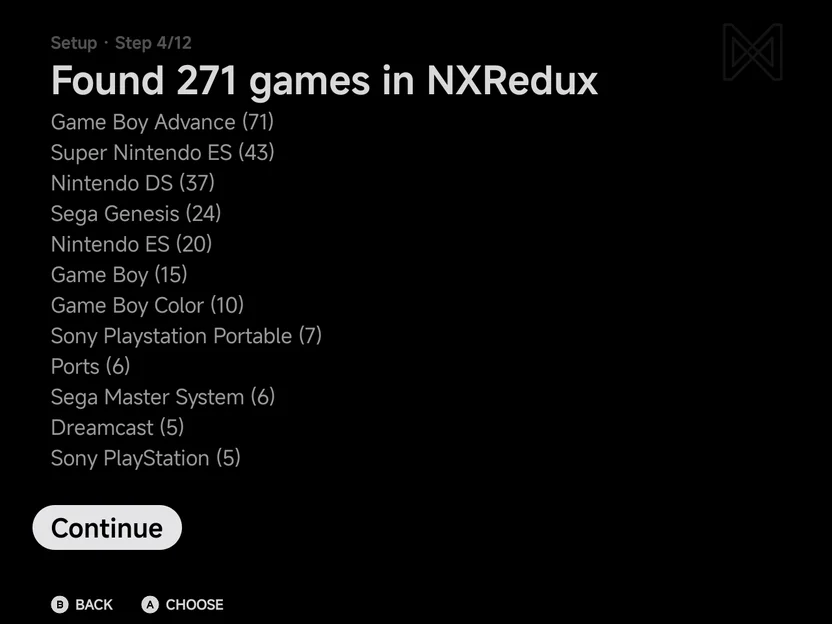{ .nx-wide }

!!! note "Pick a folder, not a root"
    Android's picker can't use the storage root, the SD card root or the
    Download folder. Pick or create a folder inside one of them, such as
    `NXRedux`. With All files access, the app's own picker can use an SD
    card's root, but not the phone's storage root, and can make a folder for
    you with `X` **New folder**.

## Without All files access

Without All files access the app has no home folder to pick. It uses its own
folder instead:

```text
Android/media/com.nxredux.mobile/
├── Roms/
├── Bios/
├── Collections/
├── Cheats/
├── Saves/
└── .userdata/
```

It has the same layout as the home folder above. Setup tells you where it is
and that you can put ROMs and BIOS files there with a file manager. You can
still add extra ROM folders.

!!! warning "Uninstalling removes this folder"
    Android deletes `Android/media/com.nxredux.mobile/` when you uninstall the
    app, saves included. Copy it somewhere safe first, or give the app All
    files access and a home folder of your own.

Turn All files access off later and the app switches to this folder. The
**All files access** row in **Tools → Settings → Library** says so, and the
games and saves in your own home folder are out of reach until
you turn the access back on. Then the app goes back to your home folder by
itself.

Saves made in one folder are not copied to the other. If you want a save in
both places, copy the files by hand.

## Back up and move to a new phone

Everything you play is in the home folder, so a copy of it is a backup.

- **Device Sync.** Sync the new phone with the old one, or with a handheld.
  See [Device Sync](device-sync.md).
- **Copy the folder.** Copy the whole home folder to a computer, and later to
  the new phone. Include the hidden `.userdata` folder: file managers and some
  computer tools skip hidden files unless you turn them on. On the new phone,
  [pick that folder as the home folder](#choose-a-home-folder).

Because the saves are in the home folder, uninstalling and reinstalling the
app keeps them, as long as the home folder is your own and not
`Android/media`.

## Upgrading from an earlier version

Version 0.3.0 and earlier kept saves, states and settings inside the app.
The first time you open a newer version, the app moves them for you.

- **All files access on.** The move happens in the background. Nothing to do.
  If the home folder can't be reached just then, the app plays from the old
  place and tries again next time.
- **A home folder picked without All files access.** One screen explains that
  saves can now live in your own folder, and asks for All files access.
    - **Allow** switches your folder over and moves your saves into it.
    - **Not now** moves your saves into `Android/media/com.nxredux.mobile/`.
      Your old folder stays where it is and becomes an extra ROM folder, so
      your games are still there. Its `Bios/` and `Collections/` are copied
      across.
- **All files access was on, and is off now.** The same screen shows once.
  **Allow** moves your saves into your home folder. **Not now** waits: the app
  keeps using the old place and moves nothing.

If the same save exists in both places, the newer one is kept and the older is
kept next to it as a `.bak` file. If your saves can't move, the library says
**Saves couldn't move to your home folder. They're still inside the app.**

Box art and RetroAchievements data under your old home's `Roms/` are not
moved. The app fetches the RetroAchievements data again.

## Add a ROMs folder

Right after the home folder, the app asks **Add a ROMs folder?**

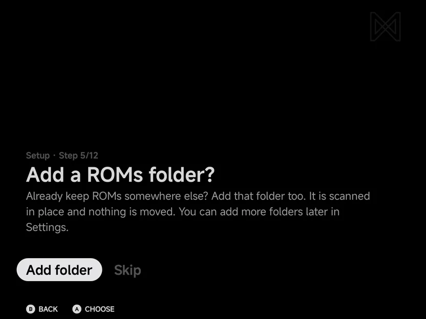{ .nx-wide }

- If you already keep games somewhere else on the phone, press `A`
  **Add folder** and pick that folder. It is scanned in place: nothing is
  moved.
- Choose **Skip** to go on without one.

You can add more folders later in **Tools → Settings → Library → Add ROM
folder**. See [Library & ROM folders](library.md).

## Android games

When the app finds games installed on your phone, the last folder step asks
**Add N Android games to Consoles?** and lists them.

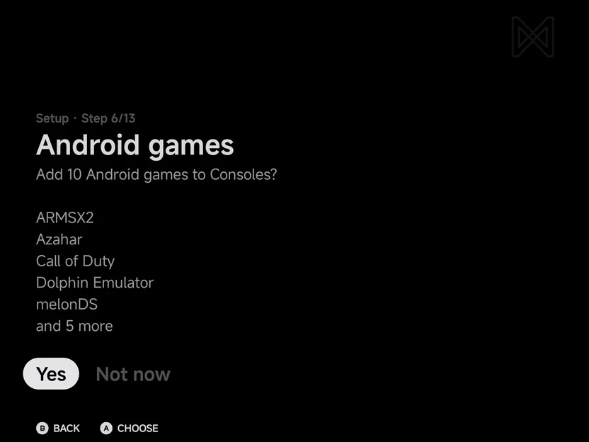{ .nx-wide }

- Choose **Yes** to add them. They show up as an **Android** console on
  the Consoles tab.
- Choose **Not now** to leave them out.

The question is asked once. Change the list any time in **Tools → Settings
→ Library → Android games**. See
[Launcher Mode & Android Games](launcher.md).

??? info "More detail"
    On an install that already has a library, the question can show once as a
    dialog over the main menu instead.

## Next steps

- [Main Menu & Home](main-menu.md): the tabs, Home and the game lists.
- [Controls](controls.md): the on-screen pad, controllers and the buttons in
  the menus.
- [Kids Mode](kids-mode.md): a play schedule for a child's device.
- [In-game Menu](in-game-menu.md): save states, options and Save Changes.
- [Game Switcher](game-switcher.md): resume recent games.
