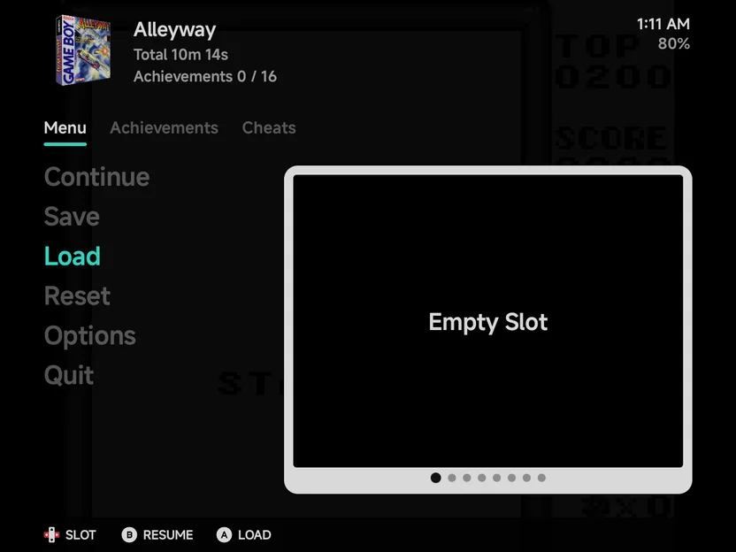
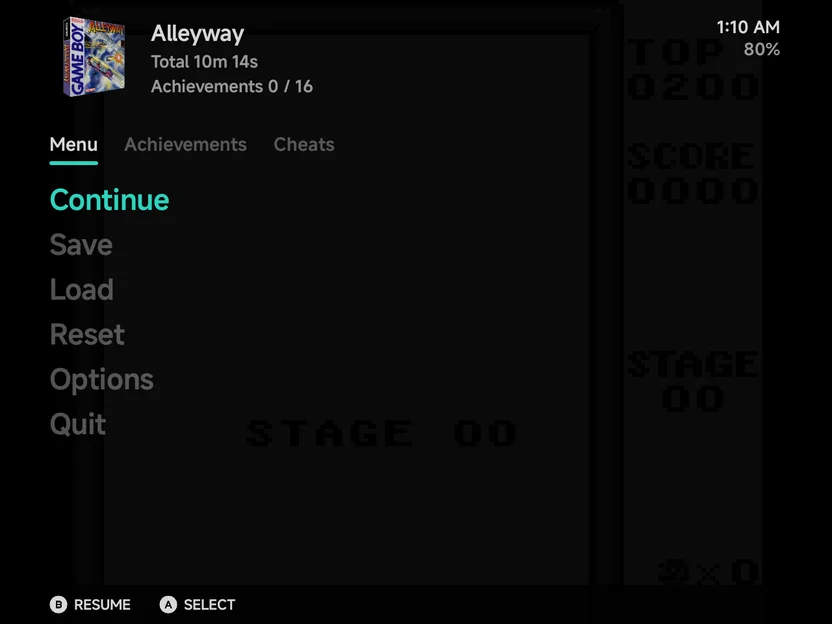
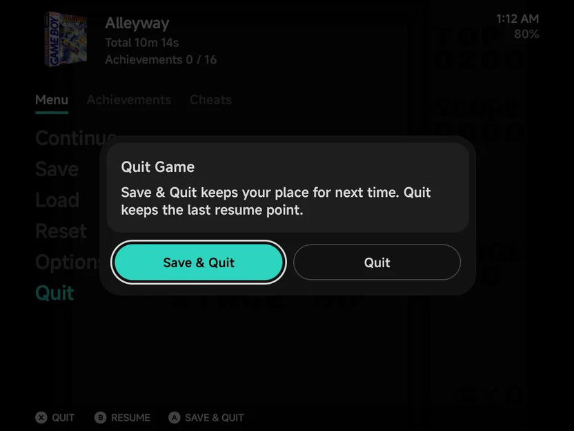
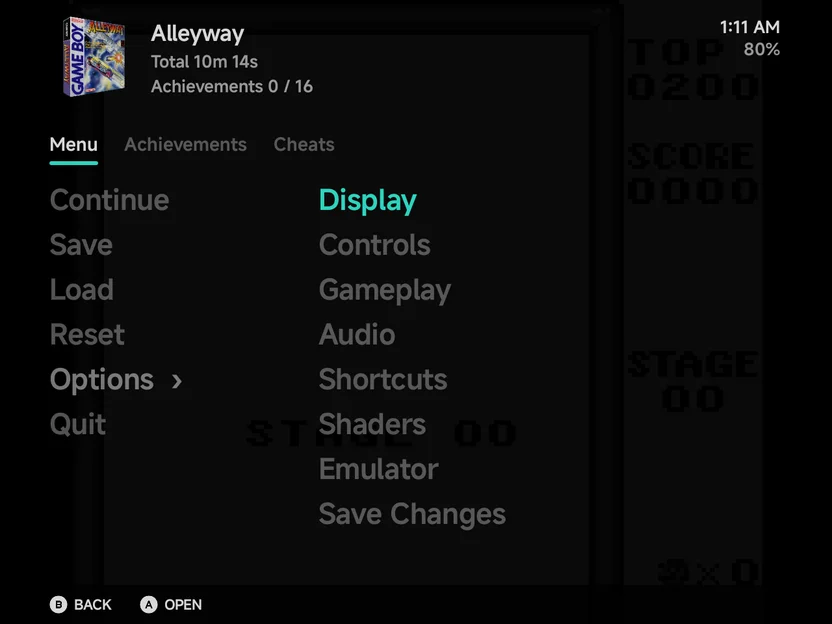
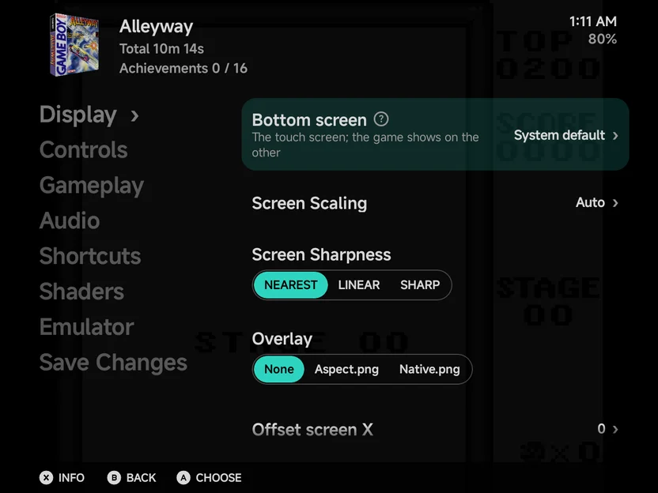
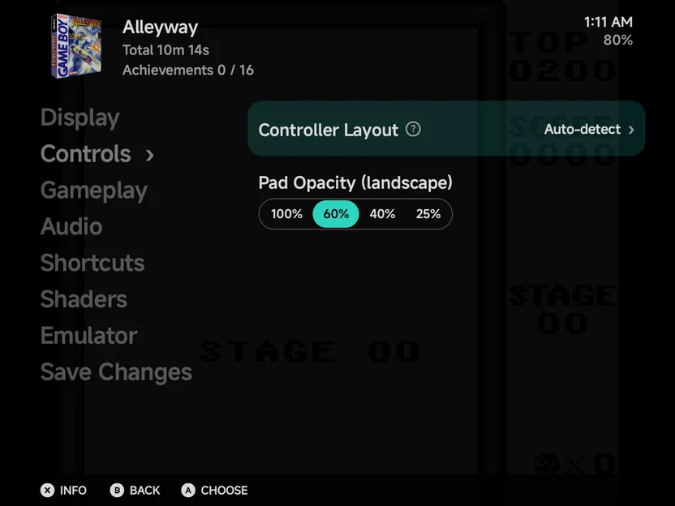
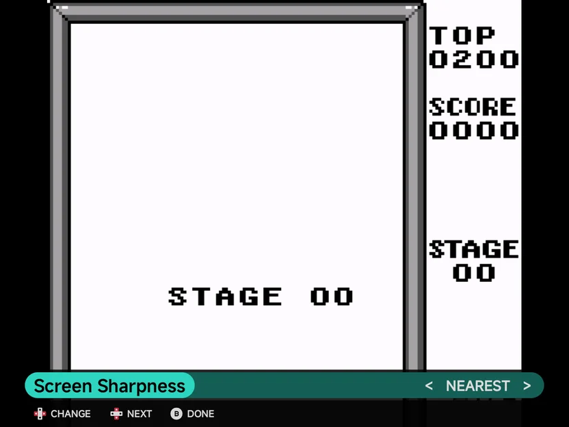
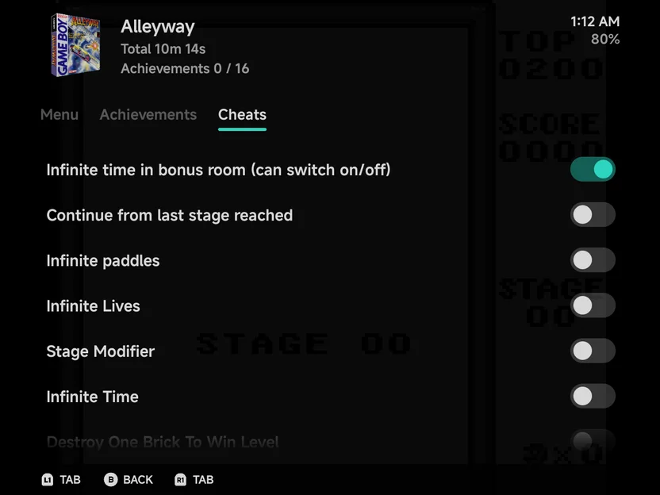
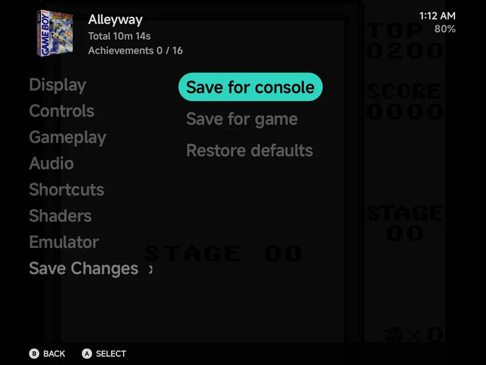

# In-game Menu

While a game is running, open the in-game menu in any of these ways:

- press `MENU` on the on-screen pad or a controller,
- hold `SELECT` and `START` together (in a multiplayer game, on Player 1's
  controller only),
- use Android's Back gesture or button.

The game pauses while the menu is open.

- `B` goes back one page.
- `B` on the first page, or `MENU` on any page, returns to the game.

The game's header runs across the top of every page: its box art, name, play
time and achievement count, with the time and battery level. Under it, on
the first page, runs the game panel's [tab row](#the-game-panel): **Menu**,
**Achievements**, **Cheats** and **Players**.

{ .nx-wide }

With a [pad skin](controls.md#pad-skins), the menu sits in the skin's screen
glass, with the pad around it to drive it.

While a game is linked to another device, the menu is shorter. See
[In a multiplayer session](#in-a-multiplayer-session).

??? info "More detail"

    - Some consoles have shortcuts of their own; see their pages under
      [Emulators](emulators/index.md).
    - On a controller, `A` and `B` are the letters printed on it, as
      [Controller Layout](#controls) names them, on every console.
    - The menu uses your **Accent** and **Secondary accent** from
      [Appearance](appearance.md): the highlighted word is in the accent,
      and the value bar on the secondary accent. Its rows, the save slot's
      text and its dialogs follow [**Text size**](appearance.md#text-size)
      there too.
    - In the skin's glass the menu is laid out for the glass's shape, and
      the skin's row of touch shortcuts hides while the menu is open. On a
      Nintendo DS or 3DS skin on a phone held upright, the menu covers both
      screens. On a foldable's inner screen or a tablet, the menu opens in
      the skin's bottom screen and the paused game stays on the top one:
      see [Two screens in one skin](foldables.md#two-screen-skin).
    - On a wide landscape screen, such as an unfolded foldable held sideways
      or a phone in landscape, the menu shows two pages side by side. See
      [Foldables & Large Screens](foldables.md#two-pane-screens).
    - In portrait, the **Options** page opens beside the first page where
      its words fit, and a deeper page takes the whole width.
    - With a [second screen](dual-screen.md) in use, the menu opens on the
      bottom screen, under the game panel's header, with no tab row. The
      top screen shows the paused picture under a pause mark.
    - While the menu is open the game doesn't keep the screen on, so a
      paused game sleeps on your device's screen timeout. A live netplay
      match keeps the screen on.
    - With no controller and no pad on screen, the hints along the bottom
      show only what a tap can't do, such as **Locked only** and **Mute**
      on the Achievements page.

## The first page

| Row | What it does |
| --- | --- |
| **Continue** | Return to the game. |
| **Disc** | Games with more than one disc only. `LEFT` / `RIGHT` change the disc, such as `1/2`. |
| **Save** | Save a state to the chosen slot. |
| **Load** | Load the state in the chosen slot. |
| **Reset** | Restart the game, after asking. |
| **Use top screen** | Only while another app holds the top screen. Moves the game there. See [Dual Screens & External Displays](dual-screen.md). |
| **Options** | Open the [options pages](#options). While it is highlighted, its pages show on the right. |
| **Quit** | Leave the game. See [Quitting](#quitting). |

There are 8 save state slots. On **Save** and **Load**, `LEFT` / `RIGHT` (or
a sideways swipe) choose the slot, and `A` saves or loads. The preview on the
right shows the slot's screenshot and date, or **Empty Slot**. On
**Options**, the right side shows its pages, and `A`, `RIGHT` or a tap on
one moves into them.

??? info "More detail"

    - Changing the disc works as opening the lid and swapping it would. `A`
      on **Disc** shows what the row does.
    - **Reset** opens **Reset game?** with **Reset** and **Cancel**, and the
      line **Progress since your last save will be lost.**
    - Where the screen is narrow, the slot preview and the Options pages
      show below the rows instead of beside them.
    - A save state's screenshot is the game's picture alone; on Nintendo DS
      and 3DS, the top screen.

## The game panel

The game panel is the tab row across the first page, under the header, and
the tab under it. **Menu** is always there; the others show only when they
apply.

| Tab | Shows when | What it holds |
| --- | --- | --- |
| **Menu** | Always | The rows of [the first page](#the-first-page). |
| **Achievements** | The game has a RetroAchievements set | The game's [achievements](#achievements). |
| **Cheats** | The emulator takes cheats | The game's [cheats](#cheats), each with a switch. |
| **Players** | The game has more than one player | Which controller is which player. See [Players](multiplayer.md#the-players-page). |

{ .nx-wide }

With a controller:

- `L1` / `R1` switch tabs from anywhere on the first page.
- `UP` from **Continue** moves onto the tab row. There `LEFT` / `RIGHT`
  step the tabs, and `DOWN` goes into the tab.
- In a tab, `UP` / `DOWN` move between its rows, and `A` presses the
  highlighted one: it turns a cheat on or off, or changes a player's
  controller.
- `A` on the **Achievements** or **Players** tab name opens its full page:
  [Achievements](#achievements) or
  [Players](multiplayer.md#the-players-page).
- `B` on another tab goes back to **Menu**.

By touch, tap a tab, a cheat or a player row.

??? info "More detail"

    - A tab other than **Menu** takes the menu's whole width.
    - On the **Menu** tab, the right side shows the save slot on **Save**
      and **Load**, the Options pages on **Options**, and nothing on the
      other rows.
    - The tab row stays up over the **Options** page while it is drawn
      beside the first page. A tap on a tab there goes back to the first
      page.
    - The shortcuts for save, load, fast forward and the rest are the
      [touch buttons](#shortcuts) on the pad skin, not tiles in the menu.
    - On a [second screen](dual-screen.md#the-game-panel), the game panel
      has tabs of its own, with **Shortcuts** and **Settings**.

## Quitting

On **Quit**:

- `A` **Save & Quit** saves your place, then leaves. The
  [Game Switcher](game-switcher.md) can then resume the game where you left
  it.
- `X` **Quit** leaves without it, so the game's last resume point stays as it
  was.

Both keep the game's battery save. Leaving the app with the game open also
saves your place. Either way you land straight back where you started the
game: Home, the game list or the Game Switcher.

On a controller, a **Save & Quit** [shortcut](controls-settings.md#shortcuts)
does the same without opening the menu. It is unbound until you set it.

{ .nx-wide }

??? info "More detail"

    - **Save & Quit** saves a hidden resume state.
    - A tap on **Quit** opens the **Quit Game** dialog with the same two
      choices, **Save & Quit** and **Quit**, and the line **Save & Quit keeps
      your place for next time. Quit keeps the last resume point.** Tap
      outside it, or press `B`, to stay in the menu.

## In a multiplayer session

While the game is linked to another device, the menu shows only what can't
break the link. There are no tabs, save states, options or reset.

| Session | Rows |
| --- | --- |
| A [netplay](netplay.md) match | **Continue** and **Leave** |
| A link session from the Netplay menu (Game Boy and Game Boy Advance cable; Nintendo DS, 3DS and PSP wireless) | **Continue**, **Disconnect** and **Quit** |
| A Nintendo DS, 3DS or PSP game with its [local wireless](local-wireless.md) on | **Continue**, **Disconnect** and **Quit** |
| [Cable Link over Wi-Fi](netplay.md#cable-link-over-wi-fi) | **Continue** and **Leave**; once the session is over, **Quit** alone |

- **Leave** ends the netplay session.
- **Disconnect** ends the link or leaves local multiplayer. The game plays
  on, on your own save, and the full menu comes back.
- **Quit** closes the game without saving a resume point, so the next launch
  doesn't land in the middle of a link.

A line above the hints says what the rows do. See
[Netplay → During a match](netplay.md#during-a-match) and
[Local Wireless](local-wireless.md).

??? info "More detail"

    - A menu left open for 60 seconds in a local wireless room disconnects
      by itself. The row counts down: **Disconnect (45s)**.
    - The full menu returns by itself when the game turns its wireless off.
    - Once a netplay match has ended and you play on alone, the menu shows
      **Continue** and **Quit**.
    - After a Cable Link over Wi-Fi session ends, the menu stays open with
      **Quit** alone: play after the last moment both phones agreed on is
      never saved.

## Touch

You can use the whole menu by touch:

- Tap a row to act on it, as `A` does. **Save** and **Load** take two taps:
  one to highlight the row, then another to save or load.
- On the options pages, the rows work as in [Settings](settings.md#touch):
  tap a switch row to flip it, tap one of a row's choices, or tap a value
  with `›` to open the list of its values.
- Each hint along the bottom is a button.

??? info "More detail"

    - The second tap on **Save** or **Load** can be on the row or on the slot
      preview.
    - Off the first page, a tap on the hint bar's empty space goes back.
    - A tap on a row that changes the picture opens
      [adjust mode](#adjust-mode), as `A` does. Its switch or choices still
      take their own taps.
    - Tap a description to close it.

## Options

{ .nx-wide }

| Row | What it's for |
| --- | --- |
| [Display](#display) | Scaling, sharpness, overlay, screen offset, the Nintendo DS and 3DS screens, 3D resolution and the debug HUD. |
| [Controls](#controls) | The controller rows, the console's own controls and **Adjust buttons**. |
| [Gameplay](#gameplay) | Fast forward, rewind and Frame Skip. |
| [Audio](#audio) | Resampling quality and Fill Audio Gaps. |
| [Shortcuts](#shortcuts) | This console's or game's own shortcuts. |
| [Shaders](#shaders) | Shader presets and their parameters. |
| [Emulator](#emulator) | The emulator's own settings. |
| [Save Changes](#save-changes) | Keep your changes for this console or this game, or restore defaults. |

A group shows only when it has rows for the console.

!!! important "Changes aren't saved until you use Save Changes"
    Changes in Options apply straight away but last only for this session.
    To keep them, use [Save Changes](#save-changes) before you quit. To undo
    a change, quit without saving.

To set these before a game starts, for a whole emulator or one game, use
[Emulator Settings](emulator-settings.md).

??? info "More detail"

    - The game's cheats are on the [Cheats](#cheats) tab.
    - Settings the game reads only when it starts aren't here: **Graphics
      API** ([Graphics API](emulators/index.md#graphics-api)), **Audio
      Buffer**, **Local Wireless** in the **Multiplayer** group, **PS2
      BIOS**, and the Wii's **Wii Screen** and **Pointer** rows. Changing
      them here would do nothing until the next launch. Set them for one
      game in [Game Settings](emulator-settings.md#game-settings), or for
      the console in [Emulator Settings](emulator-settings.md).
    - Two things are saved straight away instead: the Nintendo DS layout
      hotkeys (see [Nintendo DS](emulators/nintendo-ds.md#controls)) and
      achievement mutes (`X` on the [Achievements](#achievements) page).

## Display

The picture. The rows work as described in [Options rows](#options-rows).

{ .nx-wide }

| Option | Values | Default | What it does |
| --- | --- | --- | --- |
| **Layout** and the other screen rows | See [Nintendo DS](emulators/nintendo-ds.md) and [Nintendo 3DS](emulators/nintendo-3ds.md) | | How the two screens are arranged. Nintendo DS and 3DS only. |
| **3D Resolution** | See [Nintendo DS](emulators/nintendo-ds.md), [Nintendo 3DS](emulators/nintendo-3ds.md) and [PlayStation 2](emulators/playstation-2.md) | | Nintendo DS, 3DS and PlayStation 2 only. |
| **Bottom screen** | System default, Main screen, Second screen | System default | Picks the touch screen for this console, while a second screen is connected. See [Dual Screens & External Displays](dual-screen.md#for-one-console). |
| **Screen Scaling** | Auto, Native, Aspect, Fullscreen | Auto | **Auto**: fills the room the game has, at its shape (see below). **Native**: integer scaling. **Aspect**: the core's aspect ratio. **Fullscreen**: fills the screen. |
| **Screen Sharpness** | NEAREST, LINEAR, SHARP | NEAREST | **LINEAR** smooths lines. **SHARP** keeps pixels crisp and even when the picture isn't a whole multiple of the game's size. |
| **Overlay** | None, or an overlay bundled for this console | None | A frame image drawn around the game. |
| **Offset screen X** / **Offset screen Y** | −64 to 64 | 0 | Move the game image by this many pixels. |
| **Debug HUD** | Off, On | Off | Show frames per second, the core, the resolution and scaler information. |

With **Pad skin** on, the skin sets the picture's size and place, so
**Screen Scaling**, **Overlay**, the offsets and the Nintendo DS layout rows
aren't listed. Turn [**Pad skin**](appearance.md#pad-skin) off to use them
over a full-screen game.

**Auto** fits every console's picture to the room it has, at the game's
shape, at whatever size that comes to. Only **Native** keeps the picture
at a whole-number scale. With **Screen Sharpness** on **NEAREST**, a
picture between whole-number sizes is drawn sharp, as **SHARP** draws it,
so its pixels stay even.

**Native**, **Aspect** and **Fullscreen** size the game for the whole
screen, and the on-screen buttons may lie over its edges. The Nintendo DS
screens have their own
[layouts](emulators/nintendo-ds.md#screen-layouts).

??? info "More detail"

    - Pick **Native** for whole-number scales: they keep every pixel the
      same size, so pixel art, scanline shaders and grid overlays line up
      exactly.
    - **Fullscreen** uses non-square pixels.
    - **LINEAR** works best when the final image is high resolution: a core
      that outputs a high resolution, or upscaling with shaders.
    - While the app places the Nintendo DS or 3DS screens itself, **Overlay**
      and the offsets aren't listed.
    - A Nintendo 3DS layout row the pad skin ignores reads **Unavailable**,
      with the line **The pad skin places the screens**.
    - With the picture on a second screen, **Screen Scaling** and the
      offsets apply there.
    - Overlays are bundled for Game Boy, Game Boy Color, Game Boy Advance
      (`GBA` and `MGBA`), NES, Super Nintendo (`SFC` and `SUPA`), Mega Drive
      (`MD`), Game Gear, Atari Lynx and Neo Geo Pocket Color. None is shown
      until you pick one.

## Controls

The controller, the console's own controls and the on-screen buttons.

{ .nx-wide }

| Row | Consoles | Values | Default |
| --- | --- | --- | --- |
| **Controller Type** | Sega Genesis, Sega CD, 32X | Auto, 3 buttons, 6 buttons | Auto |
| **Controller Layout** | Every console | Auto-detect, Xbox (A at the bottom), Nintendo (A on the right) | Auto-detect |
| **New 3DS Controls** | Nintendo 3DS | Auto, On, Off | Auto |
| **Wii Controller**, **Motion Controls** | Nintendo Wii | See [Nintendo Wii & GameCube](emulators/wii-gamecube.md#wii) | Auto |
| **Pad Opacity (landscape)** | Every console, with **Pad skin** off | 100%, 60%, 40%, 25% | 60% |
| **Adjust buttons** | Every console, while the on-screen buttons are drawn and no controller is connected | | |

- **Controller Type** is the Sega pad the game sees.
- **Controller Layout** names the letters printed on your controller. See
  [Controls](controls.md#controller-buttons).
- **Pad Opacity (landscape)** is how opaque the see-through on-screen
  buttons are over the game.
- **Adjust buttons** opens the button layout editor over the paused game,
  for the layout you are playing on: move and resize the button groups, then
  go back to the menu. See
  [Button layout](controls-settings.md#button-layout).

??? info "More detail"

    - **Controller Type** **Auto** uses 6 buttons only for games made for
      them.
    - With **Controller Layout** set to your controller, its `A` is the
      console's `A`; the other layout gives the console's original button
      positions.
    - **Adjust buttons** shows only with no controller connected, since a
      controller hides the on-screen buttons. It edits the pad skin's
      layout, or the see-through buttons' own layout with **Pad skin** off.

## Gameplay

How the game runs.

| Row | Consoles | Values | Default |
| --- | --- | --- | --- |
| **Max FF Speed** | Every console | 2x to 8x | 4x |
| **Fast Forward Audio** | Every console | Off, On | Off |
| **Rewind** | Consoles whose emulator can rewind | Off, On | Off |
| **Rewind Audio** | Consoles whose emulator can rewind | Off, On | Off |
| **Frame Skip** | Nintendo Wii, GameCube | Auto, Off | Off |

- **Max FF Speed** is how fast fast forward runs. **Fast Forward Audio** and
  **Rewind Audio** play the game's sound while it runs fast or backwards.
- **Rewind** keeps the last moments of play so a
  [rewind shortcut](controls-settings.md#shortcuts) can go back. It uses
  battery, so it is off until you turn it on.
- **Frame Skip** is what the game does when the phone can't keep up.
  **Off** shows every frame and lets the game slow down a little. **Auto**
  skips frames to hold the game's speed.

## Audio

| Row | Values | Default |
| --- | --- | --- |
| **Audio Resampling Quality** | Low, Medium, High, Max | High |
| **Fill Audio Gaps** | Auto, On, Off | Auto |

- **Audio Resampling Quality** is how carefully the game's sound is
  converted to your phone's sample rate, as on the handheld. **High** sounds
  clean at little cost; **Max** is the cleanest and uses the most power;
  **Low** and **Medium** are the cheapest and can sound gritty, most of all
  on the Game Boy Advance.
- **Fill Audio Gaps** plays the game's sound a little slower, at the same
  pitch, when the game runs below full speed, instead of letting it
  crackle. **Auto** does it while **Frame Skip** is **Off**, where the game
  slows down instead of skipping frames.

**Audio Buffer** is read when the game starts, so it is set in
[Game Settings](emulator-settings.md#game-settings) or
[Emulator Settings](emulator-settings.md#an-emulators-settings).

??? info "More detail"

    - **Audio Resampling Quality** changes the sound at once. While fast
      forward plays its sound, it uses **Medium** at most, then goes back
      to your choice.
    - With **Fill Audio Gaps** at work, the sound plays about 50 ms later.

## Shortcuts

This console's or game's own [shortcuts](controls-settings.md#shortcuts),
over the ones in **Tools → Settings → Controls → Shortcuts**: one row per
shortcut, then **Touch button 1** to **Touch button 4**. A row ending in
**(default)** follows Controls; once you change it, it is this console's or
game's own.

- Press `A` on a shortcut, then the button you want. For a combination, hold
  `MENU` and press another button. `B` cancels the wait.
- `X` sets the row to **None** here, and `Y` puts it back to the default.
- On a touch button, pick its action as on any [options row](#options-rows).

With no controller connected, only the touch buttons are listed, under a
line saying to connect a controller to bind buttons. The shortcut rows, and
what you set on them, come back when one connects.

As with every Options page, keep your changes with
[Save Changes](#save-changes), for this console or this game.

??? info "More detail"
    - A shortcut on a button the console's own hotkeys use reads
      **Unavailable**, with the hotkey as its line. See
      [Console shortcuts](controls.md#console-shortcuts).
    - The rewind rows are left out for consoles whose emulator can't rewind.
    - **Toggle mic** is only listed for the Nintendo DS and 3DS.
    - **Save & Quit** and **Toggle mic** can't be touch buttons.

## Shaders

| Row | What it does |
| --- | --- |
| **Shader** | The shader preset to run, or None (the default). |
| **Shader Parameters** | The settings the active shader exposes. |
| **Reset Parameters** | Restore the shader's default parameter values. |

Shaders come bundled with the app, and you can add your own.

### Your own shaders

Put RetroArch GLSL shaders in a `Shaders/` folder in your
[home folder](getting-started.md#choose-a-home-folder). They appear at the
end of the **Shader** list, after the bundled ones, as `User/` and their
path: `Shaders/handheld/PT_SkyWalker541.glslp` shows as
`User/handheld/PT_SkyWalker541.glslp`.

| File | Listed |
| --- | --- |
| A `.glslp` preset anywhere in `Shaders/` | Yes |
| A single `.glsl` directly in `Shaders/` or in `Shaders/glsl/` | Yes |
| A preset's own passes and textures (`.glsl`, images in its folders) | No, the preset loads them |
| Anything else, such as a NextUI `.cfg` | No |

```text
Shaders/
├── handheld/
│   ├── PT_SkyWalker541.glslp
│   └── shaders/
│       └── PT_SkyWalker541.glsl
└── glsl/
    └── my-scanlines.glsl
```

The list is read again each time the in-game menu opens, so a shader you
copy in shows without restarting the game. App updates never touch the
folder.

!!! tip "Prefer the `.glslp`"
    A preset can ask for sharp pixels (`filter_linear0 = false`), as most
    pixel-art shaders need. A single `.glsl` has no such setting, so it
    follows **Screen Sharpness**; with **LINEAR** the game's pixels are
    smoothed before the shader sees them.

??? info "More detail"

    - Shaders use RetroArch's GLSL format, the `shaders_glsl` set. Slang
      (`.slangp`) and Cg presets aren't read.
    - A user preset's passes and lookup textures are read from inside
      `Shaders/`, relative to the preset.
    - A shader's parameters start from its own defaults. Values you tuned on
      another device don't come along.
    - Without a home folder (the data still inside the app), only the bundled
      shaders are offered.

??? info "More detail"

    - **Screen Sharpness** is used where the preset leaves the filter unset.
    - **Shader Parameters** and **Reset Parameters** show only while a
      shader is picked. **Shader Parameters** shows **No settings for this
      shader.** when it has none.
    - On Nintendo DS and 3DS, the shader is drawn on the top screen only.
    - The bundled presets include `crt/crt-geom`, `crt/zfast-crt`,
      `crt/crt-pi`, `crt/crt-easymode`, `handheld/dot`, `handheld/lcd3x`,
      `handheld/gameboy`, `interpolation/sharp-bilinear`,
      `xbrz/xbrz-freescale`, `nx/line` and `nx/grid`, plus the single shaders
      in `glsl/` (such as `lcd-perfect`, `crt-perfect` and `pixel-perfect`).

## Adjust mode

On a row that changes the picture, press `A` to see each change on the game
as you make it.

{ .nx-wide }

??? info "More detail"

    In adjust mode the menu shrinks to a strip over the paused game.

    - `LEFT` / `RIGHT` change the value.
    - `UP` / `DOWN` move to the previous or next picture setting on the same
      page.
    - `B` returns to the page, and `MENU` returns to the game.

    These rows open adjust mode: **Screen Scaling**, **Screen Sharpness**,
    **Overlay**, **Offset screen X** and **Y**, **Shader**, each shader
    parameter, and the Nintendo DS **Layout**, **Big Screen** and inset rows in
    **Display** (not **3D Resolution**: the paused game draws no new
    frame, so its change shows when you go back to the game).

    With the menu on the bottom of two screens there is no strip: the
    picture is on the other screen, so a change shows there as you make it
    on the page.

## Options rows

The rows on the options pages work as the [Settings](settings.md#buttons)
rows do. Each shows its name, a short line under it where that helps, and
its value on the right: a switch, a row of choices, or the value with `›`.
The pages scroll smoothly as you move.

| Button | What it does |
| --- | --- |
| `A` **Toggle** | On a switch: turn it on or off |
| `A` **Choose** | On a value with `›`: open the list of its values. `UP` / `DOWN` move, `A` picks, `B` closes |
| `A` **Adjust** | On a row that changes the picture: open [adjust mode](#adjust-mode) |
| `A` **Change** | On a row of choices, in two panes: start changing it. `LEFT` / `RIGHT` then step the value, and `A` or `B` finish |
| `LEFT` / `RIGHT` **Change** | On one page: step the value to the previous or next choice |
| `X` **Info** | Show the row's full description |

Where the menu shows two pages side by side, `LEFT` and `RIGHT` only move
between the pages: `LEFT` goes back to the page on the left, and `RIGHT`
opens the highlighted row's page. They never change a value there, so a row
changes only when you press `A` on it. Where the menu shows one page, `LEFT`
/ `RIGHT` change the value straight away. Touch changes a value directly
everywhere.

??? info "More detail"
    - The **?** icon beside a name, and `X` **Info**, show only when the
      row's line is cut off or there is more to read. Tap the icon to open
      the description.
    - `UP` / `DOWN` scroll a long description. `A`, `B` or `X` close it.
    - While you change a row of choices in two panes, `UP` / `DOWN` finish
      and move to the next row.
    - On one page, `A` on a row of choices steps to the next one.
    - In two panes, the open row on the left page is grey, with a `›` after
      it.

## Emulator

The running emulator's own settings, grouped into its categories. Only
options that can change while the game runs are listed, and a line at the
top says so. The rest apply when a game starts: set them in the game's
[Game Settings](emulator-settings.md#game-settings), or for every game in
**Tools → Settings → Emulation → Default settings**
([Emulator Settings](emulator-settings.md)).

??? info "More detail"

    - The Nintendo DS **Render Mode** is listed too; see
      [Nintendo DS](emulators/nintendo-ds.md#3d-rendering).
    - If there are none, the menu says **This emulator has no options that
      can be changed while running.**

## Cheats

The game's cheats are on the **Cheats** [tab](#the-game-panel). Each cheat
has a switch: tap the row, or press `A` on it with a controller, to turn it
**On** or **Off**. It applies straight away.

{ .nx-wide }

To keep the cheats you turned on, use **Save Changes → Save for game**. See
[Cheats](cheats.md) for where the cheat files come from.

??? info "More detail"

    - With no cheats for the game, the tab says **No cheats for this game.**
      and how to add some: download them with **Tools → Cheats & Patches**, or
      add a RetroArch `.cht` file, named as the file it looked for, in
      `Cheats/<TAG>/`.
    - When a game's cheats come from several files, each row names its
      source under the cheat, such as **GameShark**.
    - The tab is hidden for consoles whose cores don't take cheats, such as
      Nintendo 3DS and Atari 2600, and
      [in a multiplayer session](#in-a-multiplayer-session). See
      [Cheats → Where the files go](cheats.md#where-the-files-go) for the
      list.

## Achievements

The game's [RetroAchievements](retroachievements.md) are on the
**Achievements** [tab](#the-game-panel). With a controller on that tab's
name, `A` opens them as a full page, where you can filter and mute them.

Each row shows the badge, in colour once unlocked or greyed while locked,
the name with its points in a small pill, and the description. Rows have no
details page for now.

??? info "More detail"

    - The tab shows once the game's session has started: RetroAchievements is
      on, you are signed in, and the game has a set on RetroAchievements.
    - The order follows **Achievement sort order**.
    - On the page, `Y` switches between all achievements and only the locked
      ones. With every achievement unlocked, the locked list reads
      **Everything unlocked.**
    - `X` mutes or unmutes the achievement's notifications. A muted
      achievement shows `[M]` before its name.

## Save Changes

Keeps what you changed in Display, Controls, Gameplay, Audio, Shortcuts,
Shaders and Emulator.

{ .nx-wide }

| Choice | What it does |
| --- | --- |
| **Save for console** | Save for every game on this console. |
| **Save for game** | Save for this game only, including the cheats you turned on. |
| **Restore defaults** | Delete the saved settings the game uses now and go back one level: from game to console, or from console to the defaults. |

A game with its own settings uses only those; the console's settings apply
to the other games.

!!! warning "Save for console removes this game's own settings"
    If this game had its own settings, **Save for console** removes them, so
    it follows the console again. That also removes the cheats kept with
    **Save for game** and any DS layout hotkey changes.

## Notifications

In-game notifications, such as achievement unlocks, show in the top-left and
bottom-left corners of the game. With a pad skin or the see-through
buttons on screen, they show at the top centre instead, the notices under
the progress pill.

??? info "More detail"

    - In portrait the top-centre notices take the picture's full width and
      end above the pad, so they never cover the pad or a Nintendo DS or 3DS
      touch screen.
    - In landscape they stay clear of the pad's buttons in the top
      corners.
