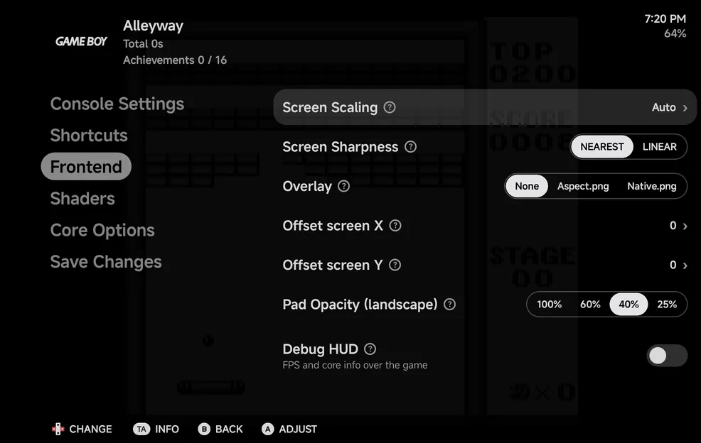

# In-game Menu

While a game is running, open the in-game menu in any of these ways:

- press `MENU` on the on-screen pad or a controller,
- hold `SELECT` and `START` together (in a multiplayer game, on Player 1's
  controller only),
- use Android's Back gesture or button.

The game pauses while the menu is open.

- `B` goes back one page.
- `B` on the first page, or `MENU` on any page, returns to the game.

The game's header runs across the top of every page: its box art, name, play
time and achievement count, with the time and battery level. On the first
page, the [game panel](#the-game-panel) sits on the right.

{ .nx-wide }

During a [netplay](netplay.md) match the menu shows only **Continue** and
**Leave**. See [Netplay → During a match](netplay.md#during-a-match).

??? info "More detail"

    - Some consoles have shortcuts of their own; see their pages under
      [Emulators](emulators/index.md).
    - On a controller, `A` and `B` are the letters printed on it, as
      [Controller Layout](#console-settings) names them, on every console.
    - The menu uses your **Accent** and **Secondary accent** from
      [Appearance](appearance.md): the highlighted row sits on the accent, and
      the value bar on the secondary accent. Its rows, the save slot's text and
      its dialogs follow [**Text size**](appearance.md#text-size) there too.
    - During a netplay match the menu has **Continue** and **Leave**, with no
      game panel. Once the match has ended and you play on alone, it shows
      **Continue** and **Quit**.
    - On a wide landscape screen, such as an unfolded foldable held sideways
      or a phone in landscape, the menu shows two pages side by side. See
      [Foldables & Large Screens](foldables.md#two-pane-screens).
    - In portrait, a page opened from the first page takes the whole width.
    - With a [second screen](dual-screen.md) in use, the menu opens on the
      main screen. When the touch screen is showing the game panel, the menu
      list slides in beside it.

## The first page

| Row | What it does |
| --- | --- |
| **Continue** | Return to the game. |
| **Disc** | Games with more than one disc only. `LEFT` / `RIGHT` change the disc, such as `1/2`. |
| **Save** | Save a state to the chosen slot. |
| **Load** | Load the state in the chosen slot. |
| **Options** | Open the [options pages](#options). While it is highlighted, its categories show on the right. |
| **Quit** | Leave the game. See [Quitting](#quitting). |

There are 8 save state slots. On **Save** and **Load**, `LEFT` / `RIGHT` (or
a sideways swipe) choose the slot, and `A` saves or loads. The preview on the
right shows the slot's screenshot and date, or **Empty Slot**. On
**Options**, the right side shows its categories, and `A`, `RIGHT` or a tap
on one moves into them. On the other rows, the right side shows the
[game panel](#the-game-panel).

??? info "More detail: Disc"

    Changing the disc works as opening the lid and swapping it would.

## Quitting

On **Quit**:

- `A` **Save & Quit** saves your place, then leaves. The
  [Game Switcher](game-switcher.md) can then resume the game where you left
  it.
- `X` **Quit** leaves without it, so the game's last resume point stays as it
  was.

Both keep the game's battery save. Leaving the app with the game open also
saves your place. Either way you land straight back where you started the
game: Home, the game list or the Game Switcher.

On a controller, a **Save & Quit** [shortcut](controls-settings.md#shortcuts)
does the same without opening the menu. It is unbound until you set it.

{ .nx-wide }

??? info "More detail"

    - **Save & Quit** saves a hidden resume state.
    - A tap on **Quit** opens the **Quit Game** dialog with the same two
      choices, **Save & Quit** and **Quit**, and the line **Save & Quit keeps
      your place for next time. Quit keeps the last resume point.** Tap
      outside it, or press `B`, to stay in the menu.

## Touch

You can use the whole menu by touch:

- Tap a row to act on it, as `A` does. **Save** and **Load** take two taps:
  one to highlight the row, then another to save or load.
- On the options pages, the rows work as in [Settings](settings.md#touch):
  tap a switch row to flip it, tap one of a row's choices, or tap a value
  with `›` to open the list of its values.
- Each hint along the bottom is a button.

??? info "More detail"

    - The second tap on **Save** or **Load** can be on the row or on the slot
      preview.
    - Off the first page, a tap on the hint bar's empty space goes back.
    - A tap on a row that changes the picture opens
      [adjust mode](#adjust-mode), as `A` does. Its switch or choices still
      take their own taps.
    - Tap a description to close it.

## The game panel

On the first page, the right side holds the game panel: the tabs
**Shortcuts**, **Achievements** (with a RetroAchievements set), **Cheats**
(when the emulator takes cheats) and **Players** (in a game with more than
one player). It's the same panel a
[second screen](dual-screen.md#the-game-panel) shows; see there for what
each tab holds.

{ .nx-wide }

With a controller:

- `RIGHT` on a row moves into the panel, onto its tabs. On **Disc**,
  `RIGHT` changes the disc instead.
- `L1` / `R1` switch tabs, in the panel or on the list.
- `UP` / `DOWN` move between the tabs and the tab's buttons or rows, and `A`
  presses the highlighted one.
- On the **Cheats** tab, `A` turns the highlighted cheat on or off. See
  [Cheats](#cheats).
- `A` on the **Achievements** or **Players** tab name opens its full page:
  [Achievements](#achievements) or
  [Players](multiplayer.md#the-players-page).
- `B`, or `LEFT` from the panel's left edge, goes back to the list.

By touch, tap a tab, a shortcut, a cheat or a player row.

??? info "More detail"

    - While **Save** or **Load** is highlighted, the slot preview takes the
      panel's place, and while **Options** is, its categories do.
    - The panel's controls show along the bottom while you are in it.

## Options

{ .nx-wide }

| Row | What it's for |
| --- | --- |
| [Console Settings](#console-settings) | Controller rows, fast forward and rewind, and some console-specific rows. |
| [Shortcuts](#shortcuts) | This console's or game's own shortcuts. |
| [Frontend](#frontend) | Scaling, sharpness, overlay, screen offset, pad opacity and the debug HUD. |
| [Shaders](#shaders) | Shader presets and their parameters. |
| [Core Options](#core-options) | The emulator core's own settings. |
| [Save Changes](#save-changes) | Keep your changes for this console or this game, or restore defaults. |

!!! important "Changes aren't saved until you use Save Changes"
    Changes in Options apply straight away but last only for this session.
    To keep them, use [Save Changes](#save-changes) before you quit. To undo
    a change, quit without saving.

To set these before a game starts, for a whole emulator or one game, use
[Emulator Settings](emulator-settings.md).

??? info "More detail"

    - The game's cheats are on the game panel's [Cheats](#cheats) tab.
    - **Console Settings** holds the controller rows, the Nintendo DS screen
      layouts, the Nintendo 3DS New 3DS Controls, and Portrait Pad for both
      and for arcade, WonderSwan and Atari Lynx.
    - Two things are saved straight away instead: the Nintendo DS layout
      hotkeys (see [Nintendo DS](emulators/nintendo-ds.md#controls)) and
      achievement mutes (`X` on the [Achievements](#achievements) page).

## Console Settings

The console's own rows. `LEFT` / `RIGHT` change a value, or use the row's
switch, choices or list as described in [Options rows](#options-rows).

{ .nx-wide }

| Row | Consoles | Values | Default |
| --- | --- | --- | --- |
| **Controller Type** | Sega Genesis, Sega CD, 32X | Auto, 3 buttons, 6 buttons | Auto |
| **Controller Layout** | Every console | Auto-detect, Xbox (A at the bottom), Nintendo (A on the right) | Auto-detect |
| **Layout (portrait)** and the other screen rows | Nintendo DS, Nintendo 3DS | See [Nintendo DS](emulators/nintendo-ds.md) and [Nintendo 3DS](emulators/nintendo-3ds.md) | |
| **New 3DS Controls** | Nintendo 3DS | Auto, On, Off | Auto |
| **Portrait Pad** | Nintendo DS, Nintendo 3DS, arcade, WonderSwan, Atari Lynx | Shown, Hidden | Shown |
| **Wii Controller**, **Motion Controls** | Nintendo Wii | See [Nintendo Wii & GameCube](emulators/wii-gamecube.md#wii) | Auto |
| **Bottom screen** | Every console, while a second screen is connected | System default, Main screen, Second screen | System default |
| **Max FF Speed** | Every console | 2x to 8x | 4x |
| **Fast Forward Audio** | Every console | Off, On | Off |
| **Rewind** | Consoles whose emulator can rewind | Off, On | Off |
| **Rewind Audio** | Consoles whose emulator can rewind | Off, On | Off |

- **Controller Type** is the Sega pad the game sees.
- **Controller Layout** names the letters printed on your controller. See
  [Controls](controls.md#controller-buttons).
- **Portrait Pad** hides the portrait pad band for a see-through pad over
  the game. On arcade, WonderSwan and Atari Lynx it applies to games taller
  than wide only. See
  [Hiding the portrait band](controls.md#hiding-the-portrait-band).
- **Bottom screen** picks the touch screen for this console. See
  [Dual Screens & External Displays](dual-screen.md#for-one-console).
- **Max FF Speed** is how fast fast forward runs. **Fast Forward Audio** and
  **Rewind Audio** play the game's sound while it runs fast or backwards.
- **Rewind** keeps the last moments of play so a
  [rewind shortcut](controls-settings.md#shortcuts) or the panel's
  **Rewind** can go back. It uses battery, so it is off until you turn it
  on.

Settings the game reads only when it starts, such as **Graphics API**, aren't
here. Set them in [Game Settings](emulator-settings.md#game-settings) or
[Emulator Settings](emulator-settings.md).

??? info "More detail"

    - **Controller Type** **Auto** uses 6 buttons only for games made for
      them.
    - With **Controller Layout** set to your controller, its `A` is the
      console's `A`; the other layout gives the console's original button
      positions.
    - The start-only settings are **Graphics API**
      ([Graphics API](emulators/index.md#graphics-api)), and the Wii's **Wii
      Screen** and **Pointer** rows. Changing them here would do nothing until
      the next launch. Set them for one game in Game Settings, or for the
      console in Emulator Settings.

## Shortcuts

This console's or game's own [shortcuts](controls-settings.md#shortcuts),
over the ones in **Tools → Settings → Controls → Shortcuts**: one row per
shortcut, then **Touch button 1** and **Touch button 2**. A row ending in
**(default)** follows Controls; once you change it, it is this console's or
game's own.

- Press `A` on a shortcut, then the button you want. For a combination, hold
  `MENU` and press another button. `B` cancels the wait.
- `X` sets the row to **None** here, and `Y` puts it back to the default.
- On a touch button, `LEFT` / `RIGHT` pick its action.

With no controller connected, only the touch buttons are listed, under a
line saying to connect a controller to bind buttons. The shortcut rows, and
what you set on them, come back when one connects.

As with every Options page, keep your changes with
[Save Changes](#save-changes), for this console or this game.

??? info "More detail"
    - A shortcut on a button the console's own hotkeys use reads
      **Unavailable**, with the hotkey as its line. See
      [Console shortcuts](controls.md#console-shortcuts).
    - The rewind rows are left out for consoles whose emulator can't rewind.
    - **Toggle mic** is only listed for the Nintendo DS and 3DS.
    - **Save & Quit** and **Toggle mic** can't be touch buttons.

## Frontend

Settings handled by NX Redux rather than the core, the same for every
console. `LEFT` / `RIGHT` change a value.

{ .nx-wide }

| Option | Values | Default | What it does |
| --- | --- | --- | --- |
| **Screen Scaling** | Auto, Native, Aspect, Fullscreen | Auto | **Auto**: the best fit for the screen and the console, with room for the pad (see below). **Native**: integer scaling. **Aspect**: the core's aspect ratio. **Fullscreen**: fills the screen. |
| **Screen Sharpness** | NEAREST, LINEAR | NEAREST | **LINEAR** smooths lines. |
| **Overlay** | None, or an overlay bundled for this console | None | A frame image drawn around the game. |
| **Offset screen X** / **Offset screen Y** | −64 to 64 | 0 | Move the game image by this many pixels. |
| **Pad Opacity (landscape)** | 100%, 60%, 40%, 25% | 40% | How opaque the on-screen buttons are where they overlap the game. |
| **Debug HUD** | Off, On | Off | Show frames per second, the core, the resolution and scaler information. |

**Auto** sizes the game by the kind of console:

| Consoles | Auto |
| --- | --- |
| Arcade and the 2D home consoles, such as NES, Super Nintendo, Genesis and TurboGrafx-16, and Doom | The largest whole-number scale of the game's height, at the console's shape |
| The handhelds, such as Game Boy, Game Boy Advance, Game Gear, WonderSwan and Lynx, and PICO-8 | Native: the largest whole-number scale, square pixels |
| Nintendo 64, PlayStation, PSP, Dreamcast, GameCube, Wii and Nintendo 3DS | Fills the room it has, at the game's shape |

In landscape the game sits between the [pad halves](controls.md#landscape),
in portrait above the pad band, centred both ways. **Native**, **Aspect** and
**Fullscreen** size the game for the whole screen, as before Auto, and the
landscape pad may lie over its edges. The Nintendo DS screens have their own
[layouts](emulators/nintendo-ds.md#screen-layouts).

??? info "More detail"

    - Whole-number scales keep every pixel the same size, so pixel art,
      scanline shaders and grid overlays stay even.
    - A **Screen Scaling** you picked before Auto came is kept. One left at
      the old default, **Aspect**, is now **Auto**.
    - **Fullscreen** uses non-square pixels.
    - **LINEAR** works best when the final image is high resolution: a core
      that outputs a high resolution, or upscaling with shaders.
    - **Pad Opacity** is for the landscape pad where it overlaps the game,
      and for the see-through pad of a [hidden portrait band](controls.md#hiding-the-portrait-band).
      Where the pad clears the game it is drawn solid. The portrait band is
      not affected.
    - While the Nintendo DS screens are drawn apart, **Overlay** reads
      **Unavailable**: overlays are off in those layouts.
    - Overlays are bundled for Game Boy, Game Boy Color, Game Boy Advance
      (`GBA` and `MGBA`), NES, Super Nintendo (`SFC` and `SUPA`), Mega Drive
      (`MD`), Game Gear, Atari Lynx and Neo Geo Pocket Color. None is shown
      until you pick one.

## Shaders

| Row | What it does |
| --- | --- |
| **Shader** | The shader preset to run, or None (the default). |
| **Shader Parameters** | The settings the active shader exposes. |
| **Reset Parameters** | Restore the shader's default parameter values. |

Shaders come bundled with the app. Unlike the handheld, you can't add your
own.

??? info "More detail"

    - **Screen Sharpness** is used where the preset leaves the filter unset.
    - **Shader Parameters** shows **No settings for this shader.** when it has
      none.
    - The bundled presets include `crt/crt-geom`, `crt/zfast-crt`,
      `crt/crt-pi`, `crt/crt-easymode`, `handheld/dot`, `handheld/lcd3x`,
      `handheld/gameboy`, `interpolation/sharp-bilinear`,
      `xbrz/xbrz-freescale`, `nx/line` and `nx/grid`, plus the single shaders
      in `glsl/` (such as `lcd-perfect`, `crt-perfect` and `pixel-perfect`).

## Adjust mode

On a row that changes the picture, press `A` to see each change on the game
as you make it.

{ .nx-wide }

??? info "More detail"

    In adjust mode the menu shrinks to a strip over the paused game.

    - `LEFT` / `RIGHT` change the value.
    - `UP` / `DOWN` move to the previous or next picture setting on the same
      page.
    - `B` returns to the page, and `MENU` returns to the game.

    These rows open adjust mode: **Screen Scaling**, **Screen Sharpness**,
    **Overlay**, **Offset screen X** and **Y**, **Shader**, each shader
    parameter, and the Nintendo DS screen rows in **Console Settings**.

## Options rows

The rows on the options pages work as the [Settings](settings.md#buttons)
rows do. Each shows its name, a short line under it where that helps, and
its value on the right: a switch, a row of choices, or the value with `›`.
The pages scroll smoothly as you move.

| Button | What it does |
| --- | --- |
| `LEFT` / `RIGHT` **Change** | Step the value to the previous or next choice |
| `A` **Toggle** | On a switch: turn it on or off |
| `A` **Choose** | On a value with `›`: open the list of its values. `UP` / `DOWN` move, `A` picks, `B` closes |
| `A` **Adjust** | On a row that changes the picture: open [adjust mode](#adjust-mode) |
| `X` **Info** | Show the row's full description |

??? info "More detail"
    - The **?** icon beside a name, and `X` **Info**, show only when the
      row's line is cut off or there is more to read. Tap the icon to open
      the description.
    - `UP` / `DOWN` scroll a long description. `A`, `B` or `X` close it.
    - On a row of choices, `A` steps to the next one.
    - On the first page, `A` on **Disc** shows what the row does.

## Core Options

The running core's own settings, grouped into the core's categories.
`LEFT` / `RIGHT` change a value. Only options that can change while the game
runs are listed.

??? info "More detail"

    - The Nintendo DS **Render Mode** is listed too; see
      [Nintendo DS](emulators/nintendo-ds.md#3d-rendering).
    - If there are none, the menu says **This core has no options that can be
      changed while running.**

## Cheats

The game's cheats are on the game panel's **Cheats** tab, beside the first
page. Each cheat has a switch: tap the row, or press `A` on it with a
controller, to turn it **On** or **Off**. It applies straight away.

{ .nx-wide }

To keep the cheats you turned on, use **Save Changes → Save for game**. See
[Cheats](cheats.md) for where the cheat files come from.

??? info "More detail"

    - With no cheats for the game, the tab says **No cheats for this game.**
      and how to add some: download them with **Tools → Cheat Database**, or
      add a RetroArch `.cht` file, named as the file it looked for, in
      `Cheats/<TAG>/`.
    - When a game's cheats come from several files, each row names its
      source under the cheat, such as **GameShark**.
    - The tab is hidden for consoles whose cores don't take cheats, such as
      Nintendo 3DS and Atari 2600, and during a netplay match. See
      [Cheats → Where the files go](cheats.md#where-the-files-go) for the
      list.

## Achievements

The game's [RetroAchievements](retroachievements.md) are on the game panel's
**Achievements** tab. With a controller on that tab's name, `A` opens them
as a full page, where you can filter and mute them.

Each row shows the badge, in colour once unlocked or greyed while locked,
the name with its points in a small pill, and the description. Rows have no
details page for now.

??? info "More detail"

    - The tab shows once the game's session has started: RetroAchievements is
      on, you are signed in, and the game has a set on RetroAchievements.
    - The order follows **Achievement sort order**.
    - On the page, `Y` switches between all achievements and only the locked
      ones. With every achievement unlocked, the locked list reads
      **Everything unlocked.**
    - `X` mutes or unmutes the achievement's notifications. A muted
      achievement shows `[M]` before its name.

## Save Changes

Keeps what you changed in Console Settings, Shortcuts, Frontend, Shaders and
Core Options.

{ .nx-wide }

| Choice | What it does |
| --- | --- |
| **Save for console** | Save for every game on this console. |
| **Save for game** | Save for this game only, including the cheats you turned on. |
| **Restore defaults** | Delete the saved settings the game uses now and go back one level: from game to console, or from console to the defaults. |

A game with its own settings uses only those; the console's settings apply
to the other games.

!!! warning "Save for console removes this game's own settings"
    If this game had its own settings, **Save for console** removes them, so
    it follows the console again. That also removes the cheats kept with
    **Save for game** and any DS layout hotkey changes.

## Notifications

In-game notifications, such as achievement unlocks, show in the top-left and
bottom-left corners of the game.

??? info "More detail"

    In landscape, and in portrait with the band hidden, notifications move
    to the top centre so they don't cover the controls. In landscape they
    fit between the pad's shoulder buttons.
