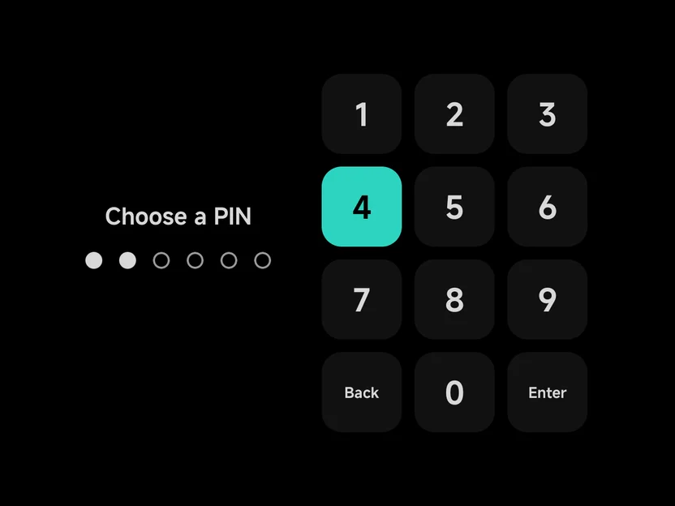
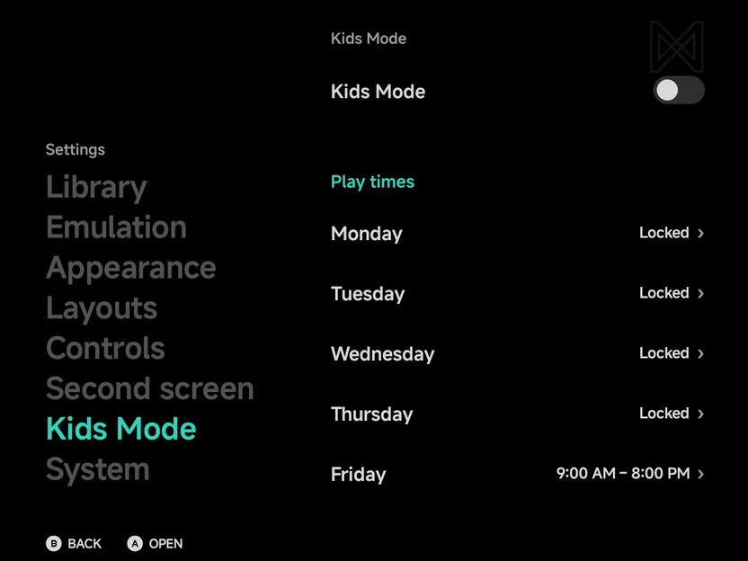
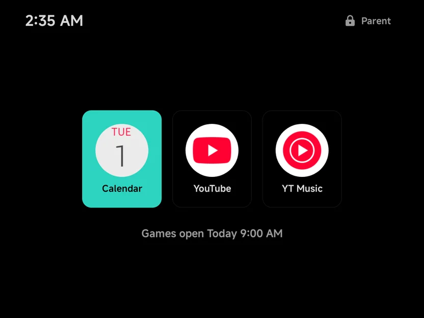
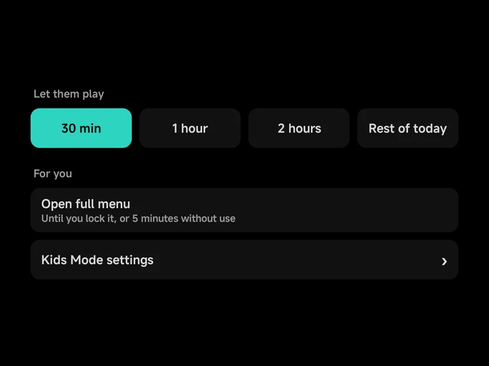
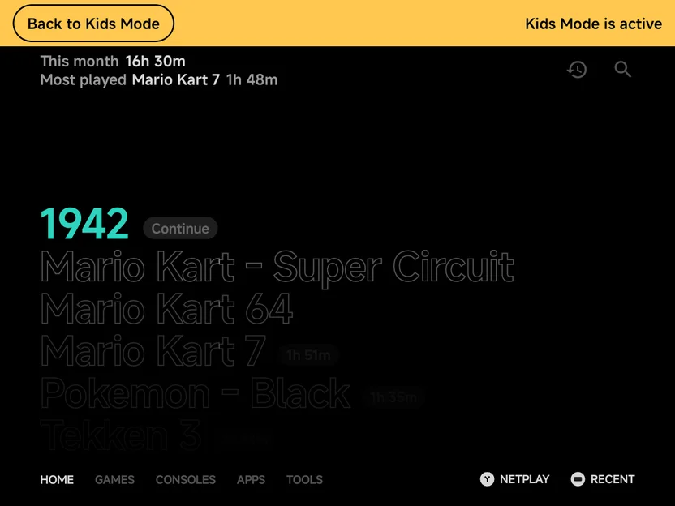

# Kids Mode

Kids Mode is for a phone or handheld a young child uses, with NX Redux as
its home screen. You set a play time for each day and pick a few apps.
Games open only in the play times. Outside them your kid sees large tiles
of the apps you allowed, and nothing else in NX Redux opens without your
PIN.

It is made to keep a young child who taps around out of the games, Tools
and Settings. It is not a device lock: see [Limits](#limits).

## Turn it on

Turn **Tools → Settings → Kids Mode → Kids Mode** On. First-run setup
offers the same on its last step, **Who's this for?**: choose **My kids**.

The first time, a short **Kids Mode setup** follows:

1. **Choose a PIN.** Six digits, typed twice: the second time the page
   reads **Enter the PIN again**. If the two differ, the page says **PINs
   didn't match** and starts over.

   { .nx-wide }

2. **Allowed apps.** Switch on the apps your kid may open while games are
   closed. Pick at least one: **Continue** stays off until you do.
3. **Play times.** One row per day, each **Locked** or a time range. Open a
   day to change it. See [Play times](#play-times).
4. **Usage access.** **Grant** opens Android's page; turn NX Redux on there
   and come back. It lets NX Redux send your kid back from apps that aren't
   allowed. **Skip** goes on without it.
5. **Alarms & reminders.** Only where Android asks for it. **Grant** lets
   the warning and the lock come on time; without it they can come a few
   minutes late.
6. **Use as home screen.** Required: Kids Mode only turns on while NX Redux
   is the home app. Choose **Use as home screen** and say yes to Android's
   question. This step is skipped when NX Redux is the home app already.
   See [Use as home screen](launcher.md#use-as-home-screen).

Kids Mode is on as soon as setup ends, and follows the play times straight
away: on a locked day the tiles come up at once.

!!! warning "Apps not to allow"
    Don't allow Settings, a file manager or the Play Store. From them your
    kid could turn Kids Mode off or install games.

??? info "More detail"
    - `B` **Cancel** leaves setup with Kids Mode off. The apps and times
      you chose so far are kept, the PIN is not.
    - A step whose permission is already granted is skipped.
    - If you turn Android's home question down, Kids Mode stays off and a
      notice says **Kids Mode is off: NX Redux isn't the home app**.
    - In the apps list, an app Android marks as a game says **Game** under
      its name.
    - Once a PIN is set, turning Kids Mode On again skips setup. Only the
      home step shows, when NX Redux isn't the home app.
    - From first-run setup, the steps end on setup's last page. **Press
      Start** then opens the tiles on a locked day.

## Settings

**Tools → Settings → Kids Mode** holds everything setup asked:

| Row | What it does |
| --- | --- |
| **Kids Mode** | On or Off. Off keeps your PIN, play times and allowed apps. |
| **Change PIN** | Choose a new 6-digit PIN, typed twice. Shows once a PIN is set. |
| **Monday** to **Sunday** | The day's play time: **Locked**, or a range such as **9:00 AM – 8:00 PM**. |
| **Allowed apps** | The apps your kid can open while games are closed. |
| **Forgot PIN?** | Shows where the `kids-mode.flag` file is. See [Forgotten PIN](#forgotten-pin). |

{ .nx-wide }

While Kids Mode is on, a warning row shows for anything it is missing.
Select the row to fix it.

| Warning | What it means |
| --- | --- |
| **Guard off** | Usage access is not granted, so NX Redux can't send your kid back from an app that isn't allowed. |
| **Exact timing off** | Alarms & reminders is not allowed, so the warning and the lock can come a few minutes late. |
| **Not the home screen** | NX Redux isn't the home app, so Home leaves it and the lock can't bring your kid back from other apps. |

While Kids Mode is on, this page opens only after your PIN. See
[The parent's PIN](#the-parents-pin).

### Play times

Each day has one play time, or none.

- **Locked** On keeps games closed all day.
- **From** and **To** set the range in half-hour steps. `Left` / `Right`
  step the time, and `A` or a tap opens a list of times. **To** can go up
  to **Midnight**.

Every change is saved at once. By default Monday to Thursday are locked,
and Friday to Sunday are 9:00 AM to 8:00 PM.

## While games are closed

Outside the play times, the tiles screen takes the place of the main menu:

- your allowed apps as large tiles. A tap, or `A`, opens one;
- when games open next, such as **Games open Tomorrow 9:00 AM**;
- the clock at the top left;
- a **Parent** button with a lock at the top right, for your PIN. `MENU`
  opens it too.

Nothing goes back from this screen, and Home returns to it.

{ .nx-wide }

### The guard

While games are closed, any app that isn't on your list is sent back to the
tiles: a game reopened from Recents, a Play Store link, Android's Settings.
A notification reads **Kids Mode is on** while the guard watches.

??? info "More detail"
    - The guard needs Usage access. Without it the **Guard off** warning
      shows in Settings.
    - The keyboard, the notification shade, the volume panel, permission
      prompts and the share sheet are left alone.
    - An NX Redux game reopened from Recents closes again at once.

## While games are open

In a play time, or a timed unlock you gave, your kid gets the main menu
with these differences:

- **No Tools tab.** Settings and the Apps drawer are out of reach with it.
- **An Apps tab** holds the allowed apps, as the same large tiles.
- **A lock icon** sits after Search at the top of the main menu's pages. It
  asks for your PIN.
- **Game menus are shorter.** `MENU` on a game offers only what plays it
  (Netplay and **Use top screen** included), pins it or takes it off
  Recent, and its achievements. Game Settings, hiding, renaming, art,
  collections and the Emulator and Console choices are left out.
- **No pinned tools.** Tools and apps pinned to Home are hidden while Kids
  Mode is on, and no menu offers to pin one.

### When the time ends

Ten minutes before a play time or an unlock ends, a warning shows once:
**Games close in 10 minutes. Save your game now.** It shows in the game, on
the menu, or as a notification when another app is in front.

At the end, a running game quits and the tiles come up. The game's battery
save is written, but no resume point: what your kid didn't save in the game
itself is lost.

## The parent's PIN

Press the lock, on the tiles screen or the main menu, and type your PIN on
the **Parent PIN** pad.
`START` or **Enter** confirms, and `B` or **Back** deletes a digit.

After the PIN, a sheet offers:

| Choice | What it does |
| --- | --- |
| **30 min**, **1 hour**, **2 hours**, **Rest of today** | Under **Let them play**: games open for that long, counted from now. **Rest of today** lasts until midnight. |
| **Open full menu** | The whole menu, Tools and Settings included, for you. |
| **Kids Mode settings** | The full menu, opened on **Settings → Kids Mode**. |

{ .nx-wide }

**Open full menu** reads "Until you lock it, or 5 minutes without use".
A timed unlock gives your kid the same menu as a play time. When a play
time and an unlock overlap, games close at the later of the two ends.

### The full menu

While you have the full menu, an amber bar sits above every page: **Back to
Kids Mode** on the left, **Kids Mode is active** on the right. The tab row
keeps the **Apps** tab beside the others.

{ .nx-wide }

- Tap **Back to Kids Mode** to hand the device back. A timed unlock you
  gave keeps running.
- With a controller, use **Lock Kids Mode**, the first row in **Tools**. It
  also ends a timed unlock.
- The full menu ends by itself after 5 minutes without input, or when the
  screen turns off.

??? info "More detail"
    - After five wrong PINs in a row, the PIN pad waits 30 seconds: **Try
      again in 30 s**.
    - The PIN pad and the sheet close by themselves after 60 seconds
      without input, when the screen turns off, and when NX Redux leaves
      the front.
    - Playing a game counts as input for the full menu's 5 minutes. Time in
      another app doesn't.
    - A menu or prompt you left open closes when the full menu ends.

## On two screens

On a [dual-screen](dual-screen.md) device, the tiles show on the bottom
screen and the top screen shows the backdrop. The guard watches both
screens: an app that isn't allowed is covered on the top screen and sent
back.

## Forgotten PIN

Kids Mode keeps a file named `kids-mode.flag` in your home folder.
**Settings → Kids Mode → Forgot PIN?** shows its path.

Delete the file with a file manager or from a computer. The next time NX
Redux comes to the front, Kids Mode is off and the PIN is cleared. Your play times and
allowed apps stay, and turning Kids Mode on again asks for a new PIN.

??? info "More detail"
    - Only a missing file in a home folder the app can read counts. An SD
      card that is out, or a folder that can't be read, never turns Kids
      Mode off.
    - If the file can't be written, the row says **Flag file couldn't be
      created — check All files access**.
    - Deleting the file ends a timed unlock too.
    - After a change of home folder, a fresh flag file is written in the
      new one.

## Limits

Kids Mode is a guard for a young child, not a lock on the device.

- **Anyone who can delete `kids-mode.flag` turns it off.** That is why a
  file manager must not be an allowed app.
- **It needs NX Redux as the home app.** If another launcher becomes the
  home app, Home leaves NX Redux and the lock can't bring your kid back.
- **The guard runs only while games are closed.** In a play time Kids Mode
  hides Tools, Settings and the Apps drawer, but doesn't watch other apps.
- **Without Usage access there is no guard,** and without Alarms &
  reminders the lock can come a few minutes late.
- **An allowed app is trusted.** What your kid does inside it, a browser's
  links for example, is up to that app.
