# Main Menu & Home

The main menu is split into five tabs: **Home**, **Games**, **Consoles**,
**Collections** and **Tools**. The app opens on Home, or on the first tab you
have not hidden.

Each tab and the game lists can be drawn in different styles, picked in
[Menu Layouts](layouts.md): see [Home](#home), [Games](#games-tab),
[Consoles](#consoles), [Collections](#collections), [Tools](#tools) and
[Game lists](#game-lists).

You can drive every screen with the on-screen pad, a controller or touch.
See [Controls](controls.md).

The tabs sit along the bottom of the screen. Home's stats and the **Recent**
and **Search** icons sit at the top. The main menu has no hint bar: its
buttons work without one, and the icons stand in for `SELECT` and `START`.

??? info "More detail"
    - Consoles, Collections, Tools and the game lists can each be a list, a
      grid, a carousel or Minimal (just the names), and game lists have one
      more style, Backdrop.
    - While [Button hints](layouts.md#page-title-and-button-hints) is on, a
      hint or two sit at the right of the tab row, where there is room:
      `SELECT` **Recent**, `START` **Search**, and `Y` **Netplay** first on a
      Home game that has it. One shows upright, two sideways: sideways on
      such a game that is **Netplay** and **Recent**, and **Search** is left
      to its icon.
    - Game lists, Recent, search results and the tools have a full hint bar
      while Button hints is on.
    - The on-screen pad is a [pad skin](controls.md#pad-skins) drawn round
      the menu. While a controller is connected the menu has no pad and
      fills the screen.
    - On two screens the main menu stays on the bottom screen, and the top
      one shows the highlighted game's details. See
      [Dual Screens](dual-screen.md).
    - In [Kids Mode](kids-mode.md) the menu is cut down: no Tools tab during
      play time, an **Apps** tab with the allowed apps, no pinned tools on
      Home, and a lock icon after **Search** for the parent's PIN.

## Tabs

| Tab | What it holds |
| --- | --- |
| [**Home**](#home) | Your last game, play stats, and the games and tools you pinned |
| [**Games**](#games-tab) | Every game from every console, A to Z |
| [**Consoles**](#consoles) | One entry per system that has games in it |
| [**Collections**](#collections) | Your own lists of games |
| [**Tools**](#tools) | The built-in tools, Settings included |

- **Switch tabs** with `L1` / `R1`, tap a tab, or swipe the page sideways.
  `Left` / `Right` switch tabs too.
- An empty tab, such as Collections before you make one, is left out.
  Games and Consoles show once the library has games.
- You can hide any tab in [Layouts](layouts.md#showing-and-hiding-tabs).
  `MENU` on any item still opens a hidden tab, so Settings is always
  reachable.

??? info "More detail"
    - The tab order wraps around.
    - `Left` / `Right` switch tabs:
        - in List and Minimal, and in a Vertical Carousel, always;
        - in a Grid, from the first or last column of a row (the d-pad
          moves along the row first);
        - in a Horizontal Carousel, when you push past the first or last
          item;
        - on Home, when you push past the left or right edge.
    - Holding `Left` / `Right` never runs on through the tabs: each switch
      takes a fresh press.
    - Swiping sideways switches tabs in List, Minimal and Grid. The page
      slides with your finger while the tabs and the icons stay put, and
      the tab changes once you let go past a third of the way, or flick. A Carousel
      swipe moves its row instead.
    - Touching and holding the tab row also opens a hidden tab. If a tab you
      are on goes away, the menu moves to the next tab.

### The tab row

The tabs along the bottom show where you are: the current tab's word is
lit. The d-pad never moves onto them; `L1` / `R1`, a tap or a swipe switch
tabs.

{ .nx-wide }

| Button | What it does |
| --- | --- |
| `L1` / `R1` | Switch tabs |
| `SELECT` | Open the [Game Switcher](game-switcher.md) (the **Recent** icon) |
| `START` | [Search](#search) your games (the **Search** icon) |

??? info "More detail"
    - With **Page title** hidden in
      [Layouts](layouts.md#page-title-and-button-hints) there is no tab row,
      and `L1` / `R1` switch tabs. Home's stats move into a header at the
      top, beside the icons.
    - With only one tab left, an **NX Redux** title stands in its place. The
      same goes for a tab opened over another.
    - `SELECT` and `START` act when you let go of them. Pressed together,
      `SELECT` + `START` opens the highlighted item's menu, as `MENU`
      does, for a controller without a `MENU` button.

### Tips

The first time the main menu shows after the app starts, a **Tips** dialog
sums up its buttons: `MENU` for the highlighted item's menu (or `SELECT` +
`START`, or a button you set in
[System buttons](controls-settings.md#system-buttons)), `START` to search
and `SELECT` for the Game Switcher. The first game list, or the
[Games](#games-tab) tab, shows **Game list tips**: `Y` for
[Netplay](netplay.md) and `X` for the game's achievements.

**Got it** (`A`) closes a tip until the next time the app starts. **Don't
show again** (`B`) closes it for good.

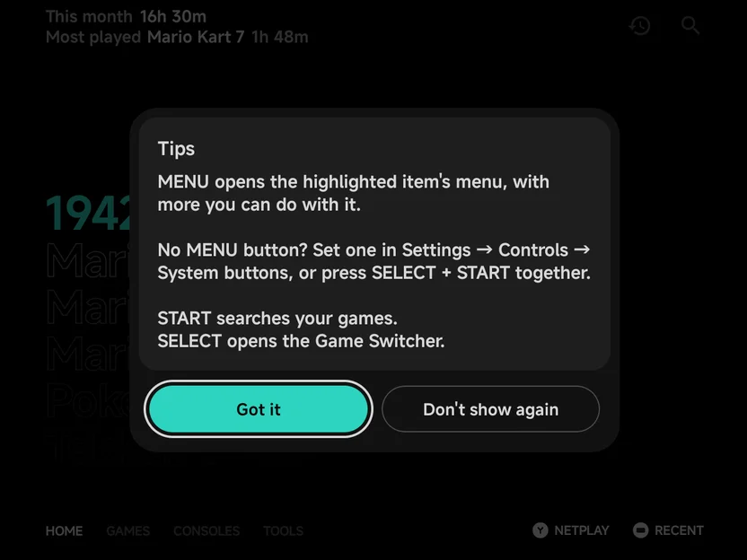{ .nx-wide }

## Home

Home is the starting point: your most recent game, this month's play time,
and everything you pinned. It comes in four layouts, **List**, **Grid**,
**Carousel** and **Minimal** (the default). Pick one in
[Settings → Layouts → Home → Layout](layouts.md#home).

Every layout starts with a two-line stats strip:

- **This month:** your play time this calendar month, and the
  [RetroAchievements](retroachievements.md) you unlocked (while signed in).
- **Most played:** the month's most played game and its time.

In every layout the buttons are the same:

| Button | What it does |
| --- | --- |
| `A` **Play** / **Resume** / **Open** | Start the game, or open the tool. **Resume** continues from its auto-save |
| `Y` **Netplay** | Play the selected game with another device. Shown for games that have [netplay](netplay.md) |
| `MENU` **Options** | **Pin** / **Unpin**, and **Play from start** when the game has an auto-save |
| `SELECT` **Recent** | Open the [Game Switcher](game-switcher.md) |
| `START` **Search** | [Search](#search) your games |

With touch, tap an item to select it, tap it again to play or open it, and
long-press for the menu.

??? info "More detail"
    - A month without play shows **No play yet** on the first line, and no
      second line.
    - [Stats](layouts.md#home-stats) in Layouts → Home hides the strip.
      [Extra info](layouts.md#extra-info) hides the play time and
      achievements on the cards.
    - The `Y` **Netplay** and `MENU` buttons work without hints; **Netplay**
      also leads the game's `MENU` list on Home.
    - While [Kids Mode](kids-mode.md) is on, Home shows no pinned tools.
    - `A` shows **Play** when the game has no auto-save.
    - **Play from start** leads the `MENU` list. There is no menu on **Pick a
      game**, unless a tab is hidden and the menu offers it.
    - Games without art get a generated abstract picture, so every card looks
      different.

### List

Everything on Home in one list, with the selected game's picture behind it.

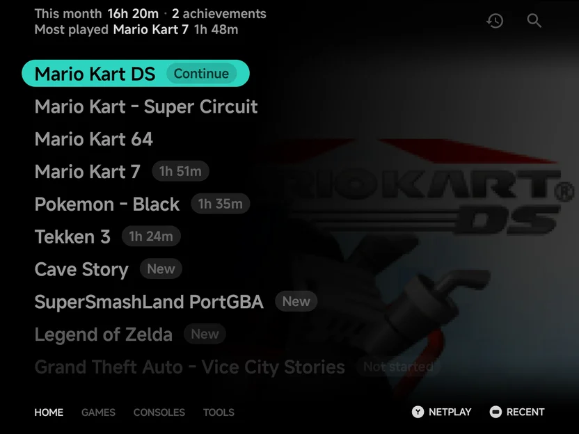

- **The list** starts with your most recent game, tagged **Continue** (or
  **Pick a game** on a fresh install). Then come your pinned games, games
  from the [shelves](foldables.md#shelves), and your pinned tools.
- **Tags.** A shelf game carries **New** or **Not started** after its name,
  and a **Most played** game its play time; the selected row's tag is lit.

| Button | What it does |
| --- | --- |
| `Up` / `Down` | Move through the list. It wraps around at either end; a held button stops at the end |
| `Left` / `Right` | Switch tab |

??? info "More detail"
    - The stats sit on two lines at the top, left-aligned, with a row's gap
      before the list.
    - The Continue game is selected when Home opens. Pinned games follow in
      the order you pinned them, then the shelf games, then every pinned
      tool. Each shelf holds at most 4 games. The shelves show in List on
      any screen size.
    - Behind the selected game its picture shows, dimmed, fading out
      smoothly into the tabs. A pinned tool has no picture behind it.
    - The list sits on the tabs and grows up the screen. Where more rows
      scroll in, it fades out at that edge, with no scroll arrows.
    - The rows show names and tags only: List Home has no line of game
      info, and no **+N**.
    - On a fresh install, with only **Pick a game** in the list, its card
      fills the screen.

### Grid

Cards and squares, the selected one in colour.

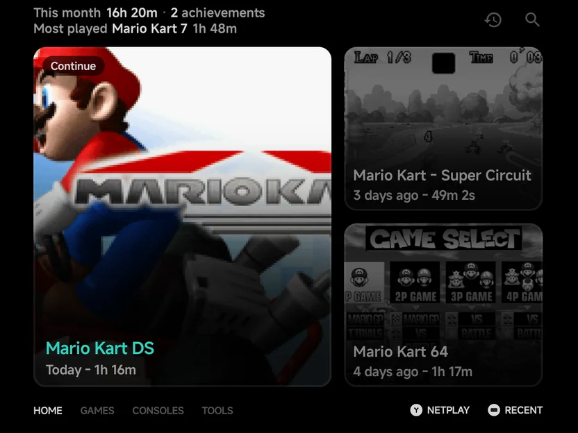

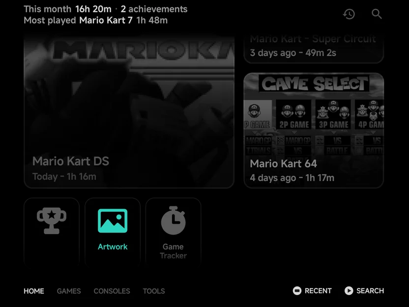

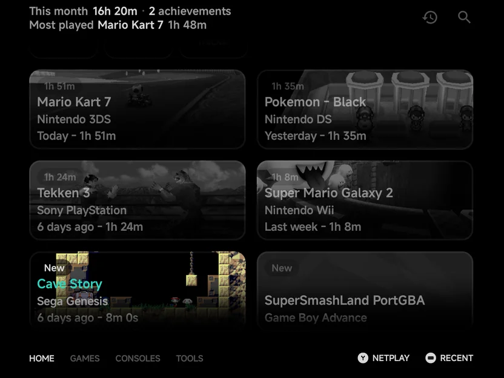

- **Continue card.** Your most recent game, with when you last played it and
  for how long. Press `A` to jump back in. On a fresh install it reads
  **Pick a game** ("Nothing played yet") and opens the Consoles tab.
- **Pinned tools** sit under it as tiles, each an icon over its name, the
  same tiles as the [Tools](#tools) tab. If they don't all fit, the last
  tile is **+N**, which opens the Tools tab.
- **Pinned games** fill the rows below, each with its name and play time.
- **Shelves** of games to pick from come last: **Most played**, **New**,
  **Not started** and **Pick up again**, each game with its shelf's badge (a
  **Most played** game's is its play time). See
  [Shelves](foldables.md#shelves).
- **The selection is in colour.** The selected card is in full colour with
  its name in your accent; the other cards are grey and dimmed, their names
  and badges too.

| Button | What it does |
| --- | --- |
| D-pad | Move between the cards |
| `MENU` **Options** | **Pin** or **Unpin** the selected game or tool (**Play from start** first on a game with an auto-save) |
| `SELECT` **Recent** | Open the [Game Switcher](game-switcher.md) |
| `START` **Search** | [Search](#search) your games |
| `Y` **Netplay** | Play the selected game with another device. Shown for games that have [netplay](netplay.md) |
| `A` **Resume** / **Play** | Start the selected game. **Resume** continues from its auto-save; **Play** shows when it has none |
| `A` on a pinned tool | Open the tool |
| `A` on **+N** | Open the Tools tab |

??? info "Touch on Home"
    - Tap a card to select it, then tap it again to play or open it. This
      goes for the Continue card, pinned games and pinned tools.
    - A long press opens the same menu as `MENU`.
    - Drag up and down to scroll without selecting anything. Let go mid-drag
      and the page glides on.
    - Swipe sideways to switch tabs.

??? info "More detail"
    - The stats strip sits on two lines at the top. The Continue card
      wears a **Continue** badge. Each card has a faint edge, so a dark
      picture still shows its shape.
    - The page fades at the top once scrolled, and at the bottom while more
      is below. A fixed gap keeps the last row clear of the tabs.
    - While the Consoles tab is hidden, **Pick a game** opens it over Home,
      and a long press opens the hidden-tab menu. **+N** works the same way
      while Tools is hidden.
    - Home scrolls when there are more pinned games than fit.
    - In portrait the Continue card runs across the page, with up to two
      rows of tool tiles under it. The card gets shorter to make room for
      them.
    - In landscape, the first one or two pinned games sit beside the
      Continue card, and the screen holds just that top section. A scroll
      away come the tool tiles in one row, then the other pinned games. A
      narrow landscape phone keeps the row on the first screen, under a
      shorter Continue card.
    - With the stats strip or the tab row hidden, their room goes to the
      Continue card.
    - The shelves show on every screen size, portrait and landscape alike,
      one after another with no labels. Their cards are the pinned games' size, in
      the same grid: two to a row in portrait, four on a tablet. A shelf
      holds up to 4 games in portrait and on a row of four, and 3 on a
      narrower landscape row. A **New** or **Not started** game shows its
      console under its name.

### Carousel

The same games in one row of cards, centred on the screen, with your pinned
tools in a row of squares underneath. Swipe the carousel to scroll it.

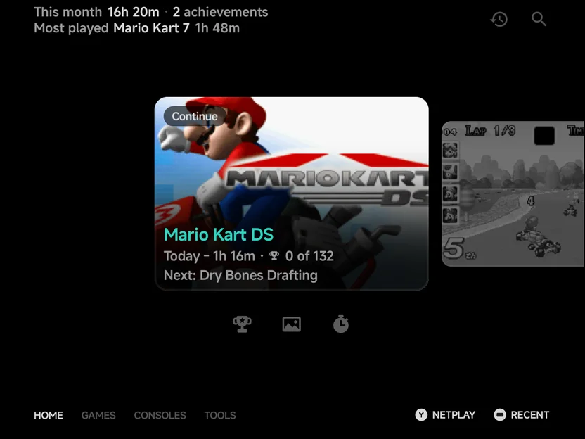

- **The carousel** starts on the **Continue** card (or **Pick a game** on a
  fresh install), then your pinned games, then the shelf games.
- **Game info** (name, last played, play time, then its genre, year and
  publisher, or its achievements) shows inside the selected card, its name
  in your accent. [Game info](layouts.md#game-info) in Layouts picks
  between the details and the achievements.
- **The selection is in colour**, as on [Grid](#grid): the cards beside it
  are grey and dimmed.

| Button | What it does |
| --- | --- |
| `Left` / `Right` | Move along the carousel or the tools row. Past either end, switch tab |
| `Down` | From the carousel, go to the tools row (the square you last used) |
| `Up` | From the tools row, back to the carousel |

??? info "More detail"
    - The stats sit on two lines at the top.
    - The Continue card has a **Continue** badge and is selected when Home
      opens. Shelf games follow in the order **Most played**, **New**, **Not
      started**, **Pick up again**, each badged with its shelf name (a **Most
      played** game with its play time). Each shelf holds at most 4 games.
      The shelves show in Carousel on any screen size.
    - Game info sits at the bottom of the selected card over a dark fade,
      like the Grid's Continue card. The cards beside it show their picture
      only.
    - The tools are icon squares, the same size in portrait and landscape.
      The carousel and the tools row fill the room between
      the stats and the tabs; in landscape they sit centred on the screen's
      height as one group. When the tools don't all fit, the last square is
      **+N**, which opens the Tools tab.

### Minimal

The default layout. Just the names, big, on plain black: no art, no cards.

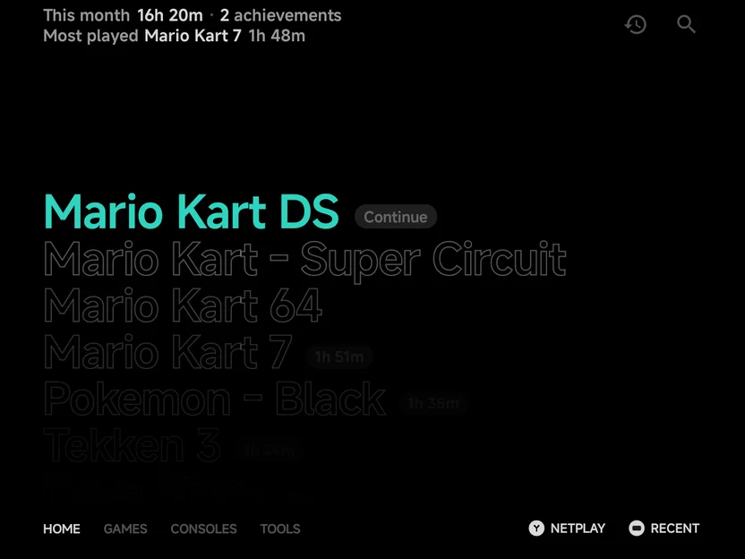

- **The list** holds the same items as [List](#list): Continue, your pinned
  games, the shelf games and your pinned tools.
- **The selected name** is solid in your accent colour, one row under the
  stats strip. The other names are its outline, fading the further they are
  from it: below it from half strength down to nothing at the bottom of the
  screen, above it fainter still.
- **Its tag** (**Continue**, a **Most played** game's play time, **New**,
  **Not started**, **Pick up again**, **Tool**) sits at the end of the selected name, as a pill in your
  Secondary accent.

| Button | What it does |
| --- | --- |
| `Up` / `Down` | Move through the names. It wraps around at either end; a held button stops at the end |
| `Left` / `Right` | Switch tab |

??? info "More detail"
    - A long name wraps at its words onto up to three lines.
    - With touch, drag the names up and down; let go and they settle on the
      name you threw them to.
    - A game or a tool opens at once, as in every other layout.

## Pinning games and tools

- **Pin a game:** press `MENU` on it in a game list and choose **Pin Item**.
  **Unpin Item** removes it again. On Home, `MENU` on the Continue card or a
  shelf game offers **Pin**, and on a pinned game **Unpin**.
- **Pin a tool:** press `MENU` on it in the Tools tab and choose **Pin**.
  **Unpin** removes it.
- You can pin up to **12** games. At the limit the app says
  "Pins are full (12). Unpin one first."
- While [Kids Mode](kids-mode.md) is on, a tool's menu has no **Pin**, and
  Home leaves out the pinned tools.

## Games { #games-tab }

Every game you can play, from every console and your
[Android games](launcher.md), in one list from A to Z. Hidden games are
left out. Each game opens with its own console's emulator.

The tab is an ordinary [game list](#game-lists), drawn in the game lists'
style from [Layouts](layouts.md#game-lists), with the tab row at the bottom
where a game list has its hint bar. Its title names the selected game's
console, such as **Game Boy Advance**, and it has a game list's info line
and [title icons](#title-icons).

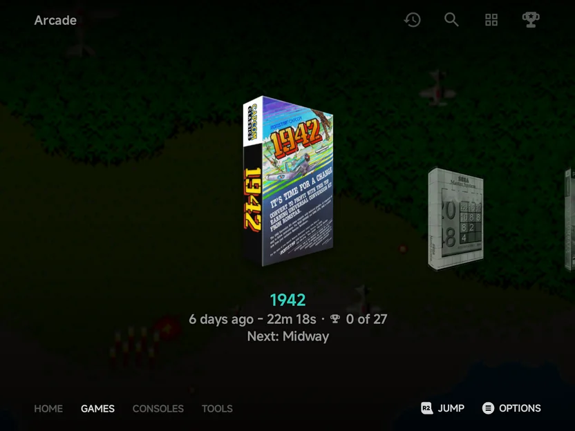

| Button | What it does |
| --- | --- |
| `L1` / `R1` | Switch tabs |
| `L2` / `R2` | Jump to the first game of the previous or next letter |
| `Left` / `Right` | Switch tabs, as on the other tabs |
| `A` **Resume** / **Open** | Launch the game |
| `X` **Achievements** | Open the [achievements panel](#achievements-panel) |
| `Y` **Netplay** | Play the game with another device, for games that have [netplay](netplay.md) |
| `MENU` **Options** | The game's [context menu](#context-menus) |
| `SELECT` | Open the [Game Switcher](game-switcher.md) |
| `START` | [Search](#search) all your games |

Hide the tab with **Visible** in
[Layouts → Games](layouts.md#games-tab); hidden, it still opens from `MENU`
like the other [hidden tabs](#hidden-tabs).

??? info "More detail"
    - The tab is left out while the library has no games.
    - In List, each row names the game's console tag, as search results do.
    - The **Search** icon and `START` search every game here, not only this
      list, since the list already holds them all.
    - A ROM's `MENU` has the items of a [search result](#context-menus); an
      Android game's has **Pin Item** / **Unpin Item** and its art item.
    - With Button hints on, the hints that fit sit at the right of the tab
      row: `R2` **Jump** first, then **Options**, **Achievements**,
      **Netplay** and `A`.
    - `Left` / `Right` switch tabs as on any tab: always in List, Minimal
      and a vertical Carousel or Backdrop, past the ends of a row in a
      horizontal one, and from the first or last column in a Grid.
    - The highlight follows the game through a rescan, a hide or a newly
      added Android game.

## Consoles

One entry per system that has games in it, each with its logo and how many
games it holds. The tab is drawn in its style from
[Layouts](layouts.md#consoles): **List**, **Grid**, **Carousel** (the
default) or **Minimal**.

| Button | What it does |
| --- | --- |
| `A` **Open** | Open the console's [game list](#game-lists) |
| `SELECT` **Recent** | Open the [Game Switcher](game-switcher.md) |
| `START` **Search** | [Search](#search) your games |

Collections and Tools take the same buttons, and `MENU` adds their options.

??? info "More detail"
    In the List and Carousel styles the selected console's controller shows
    too, unless you set Layouts → Consoles → **Background** to **Background** or **None**
    in [Layouts](layouts.md#consoles-background).

### List { #consoles-list }

A plain list, with the selected console's controller beside it.

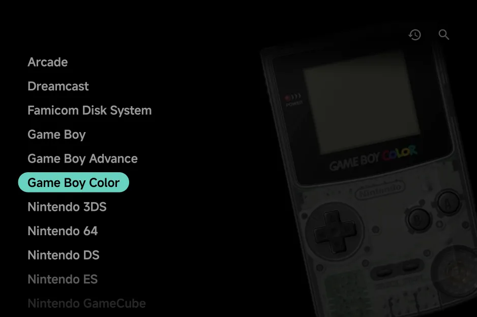

`Up` on the first row wraps to the last, and `Down` on the last row wraps to
the first.

??? info "More detail"
    - Only a fresh press wraps: holding the button stops at the end.
    - Where more rows scroll in, the list fades out at that edge, with no
      scroll arrows. The highlight stays a row clear of the fade.
    - Collections and Tools lists work the same way.

### Grid { #consoles-grid }

Rows of console logos that scroll up and down, each logo alone. The selected
one is lit, with its game count under it.

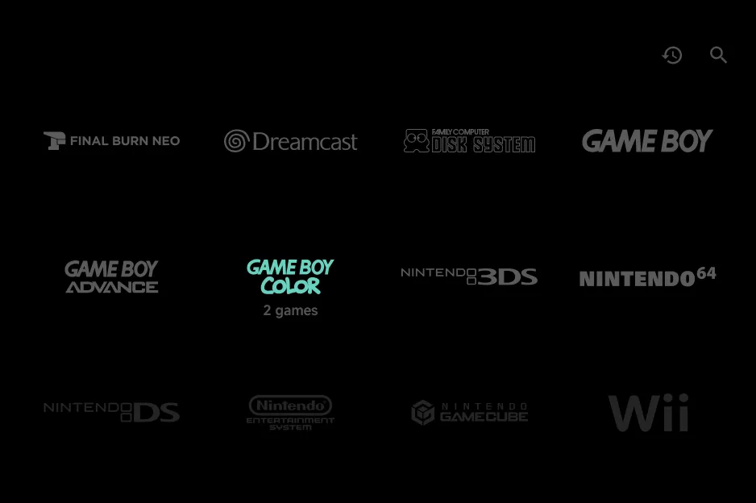

- `Up` / `Down` move a row, `Left` / `Right` along it. From the first or
  last column, `Left` / `Right` switch tab.
- Swipe up and down to scroll, sideways to switch tab.

??? info "More detail: rows and columns"
    - As many columns fit as the screen's width allows, each at least a set
      width (wider for game screenshots than for logos and icons), with
      12 dp between them. Turned sideways there are always at least three.
    - The rows fill the height (at least three), and the grid comes to rest
      on a whole row. A row cut by the top or bottom edge fades out, and the
      selection stays a row clear of the edge.
    - The logos are sized by how much of the tile they cover, so wide and
      tall logos look the same size.
    - Collections and Tools in Grid work the same way, with each
      collection's name and each tool's icon in place of a logo.

### Carousel { #consoles-carousel }

A single row with the selected console's logo large in the middle, over its
controller, and its neighbours to the sides.

### Orientation

A Carousel, and a game list's Carousel or [Backdrop](#games-backdrop), can
also run **down** the screen instead of across: set its **orientation** row
in [Layouts](layouts.md) to **Vertical**.

- `Up` / `Down` move through the items, wrapping as a [List](#consoles-list) does.
- `Left` / `Right` switch tabs on a tab, and move a page in a game list (see
  [Game lists](#game-lists)).

<figure markdown>

<figcaption>Consoles, Horizontal</figcaption>
</figure>

<figure markdown>

<figcaption>Consoles, Vertical</figcaption>
</figure>

### Minimal { #consoles-minimal }

The consoles' names alone, big, as on [Minimal Home](#minimal): the selected
one solid in your accent, the others outlined and fading away from it. `Up`
and `Down` wrap as a [List](#consoles-list) does.

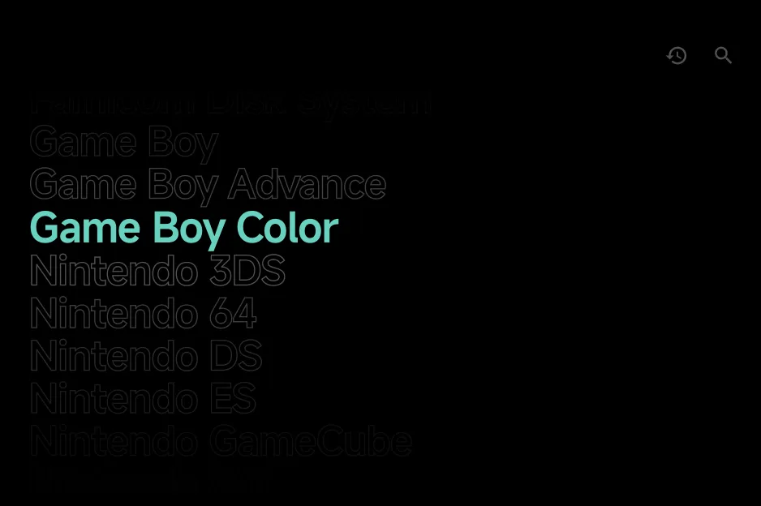

??? info "More detail"
    - `A` fades the other names, then the console's name flies up into the
      game list's title as its games rise in, when the game lists are
      Minimal too. `B` drops the title back into its place.
    - Collections in Minimal work the same way. A tool opens at once.

## Collections

Your own lists of games, each with its name and game count. The tab appears
once you have a collection, and `A` **Open** opens its
[game list](#game-lists). By default it is Minimal; pick its style in
[Layouts](layouts.md#collections). The styles work as on
[Consoles](#consoles).

<figure markdown>

<figcaption>Carousel</figcaption>
</figure>

<figure markdown>

<figcaption>Minimal</figcaption>
</figure>

To build one from a game list:

1. Press `MENU` on a game.
2. Choose **Add to Collection**.
3. Pick an existing collection, or **New Collection…** to make one and name
   it.

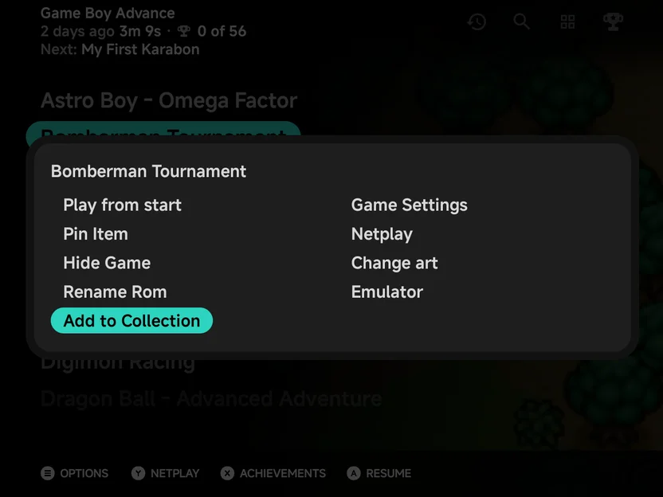

Press `MENU` on a collection, or long-press it, to **Rename** or **Delete**
it. Delete asks first, and removes only the list: the games stay in your
library.

??? info "More detail"
    - Collections are saved in the `Collections/` folder in your home folder.
    - In the Carousel each collection is only as wide as its name, and the
      space between neighbours stays the same, so short and long names sit
      evenly along the row.

## Tools

The built-in tools, each with its icon: **RetroAchievements**,
**Game Tracker**, **Artwork**, **Cheats & Patches**, **Device Sync** and
**Settings**, and **Apps** with every Android app on the phone, plus any
apps you add to Tools from there (see
[Android apps](launcher.md#android-apps)). By default it is a Grid; pick
its style in [Layouts](layouts.md#tools). The styles work as on
[Consoles](#consoles), except that the Grid uses one fixed tile on every
screen: the icon over a name of up to two lines. When every tool fits on
the screen, the Grid uses the fewest columns that fill the rows in view,
and centres the rows (seven tools with room for 6 × 3 sit as 3, 3 and 1).
With more tools than fit, every row is full and the rest scroll.

<figure markdown>

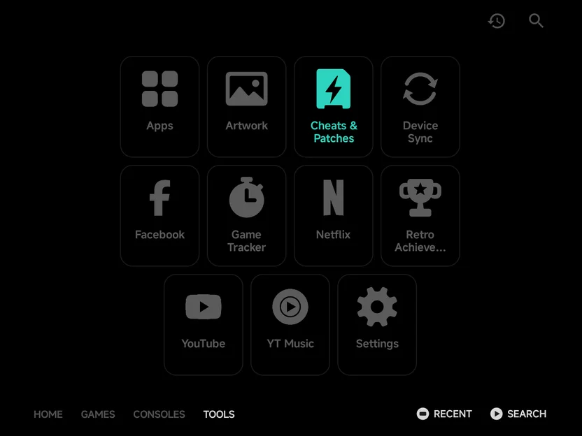

<figcaption>Grid</figcaption>
</figure>

<figure markdown>

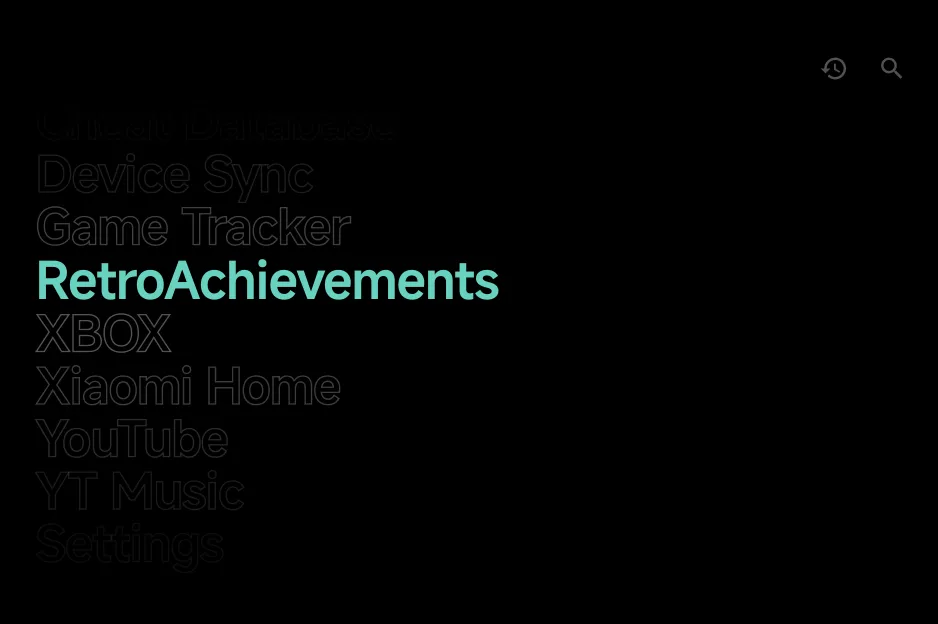

<figcaption>Minimal</figcaption>
</figure>

`A` **Open** opens the tool. `MENU` on a tool, or a long press, offers **Pin**
or **Unpin**, which puts it on [Home](#pinning-games-and-tools).

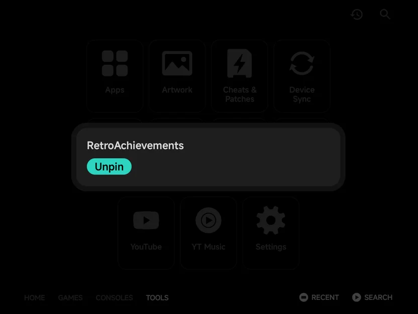

The tools have their own pages: [RetroAchievements](retroachievements.md),
[Game Tracker](game-tracker.md), [Artwork](artwork.md),
[Cheats & Patches](cheats.md), [Device Sync](device-sync.md) and
[Settings](settings.md).

??? info "More detail"
    - In the Carousel each tool is only as wide as its icon, and the space
      between neighbours stays the same.
    - RetroAchievements, Artwork, Cheats & Patches and Device Sync open in
      the same look as Settings: large words at the bottom left under a
      small title.
    - On two screens a tool opens on the bottom screen.
    - In [Kids Mode](kids-mode.md) the Tools tab is hidden during play
      time. In the parent's full menu it gains a **Lock Kids Mode** row.

## Game lists

Opening a console or a collection shows its games. The page title names the
console or collection, e.g. **Sega Genesis**. The list is drawn in the game
lists' style from [Layouts](layouts.md#game-lists): **List**, **Grid**,
**Carousel**, **Backdrop** (the default) or **Minimal**. It is the same for every game
list.

The selected game shows when you last played it and your total play time
("Today - 11m 0s"), then its genre and its year and publisher. Game names
leave out the region and version text in brackets.

By default a game that has achievements shows your achievement progress in
place of the genre and release; set [Game info](layouts.md#game-info) in
Layouts to **Details** to keep the genre and release.

| Button | What it does |
| --- | --- |
| `MENU` **Options** | Open the game's context menu |
| `SELECT` | Open the [Game Switcher](game-switcher.md) |
| `START` | [Search](#searching-a-game-list) this list |
| `X` **Achievements** | Open the [achievements panel](#achievements-panel) |
| `Y` **Netplay** | Play the game with another device. Shown for games that have [netplay](netplay.md) |
| `B` | Return to the tab |
| `A` **Resume** / **Open** | Launch the game. **Resume** continues from its auto-save; **Open** shows when it has none |
| `L1` / `R1` | Jump to the first game of the previous or next letter |
| `Left` / `Right` | Move a page up or down: in List, Minimal and a vertical Carousel or Backdrop |

A long press on a game opens the context menu too. To start a game with an
auto-save from the beginning, choose **Play from start** in its menu.

**Jumping through a long list.** `L1` / `R1` work in every layout. They step
through the games by first letter: names starting with a digit or a symbol
come first, then `A` to `Z`, then names starting with an accented letter.
`Left` / `Right` move by as many games as the screen shows, and stop at the
first and last game. Hold either button to keep going.

??? info "More detail"
    - The genre shows as outlined pills, as many as fit the line, and
      **Game** for a game with none. The details come from ScreenScraper
      with the art; see [Game info](artwork.md#game-info).
    - With **Game info** on **Achievements** (the default), a game with
      achievements shows your progress and the next achievement to go for.
      This needs you signed in to [RetroAchievements](retroachievements.md).
    - A horizontal Carousel and a Grid have room for both, so they show the
      details and the achievements whatever **Game info** says.
    - On two screens the top screen shows the game's details, so the list
      leaves its info line out, and a vertical Carousel or Backdrop is drawn
      as its horizontal one. See [Dual Screens](dual-screen.md).
    - The hint bar has no `B` **Back**, to leave room for the game's own
      actions. `B` still returns to the tab. When the hints don't fit, `A`
      **Select** and `B` **Back** are the first to go.
    - `L1` / `R1` jump only in a console's list. Recently Played, a
      collection, Hidden games and search results aren't in name order, so
      there they do nothing. On the [Games](#games-tab) tab `L2` / `R2`
      jump instead.
    - In Grid and in a horizontal Carousel or Backdrop, `Left` / `Right` move
      one game, as before.
    - `L1` from inside a letter goes to the start of the letter before it,
      as on the handheld.

### List { #games-list }

The games as rows, with the selected game's picture filling the background
or in a box (see [List art](layouts.md#list-art)).

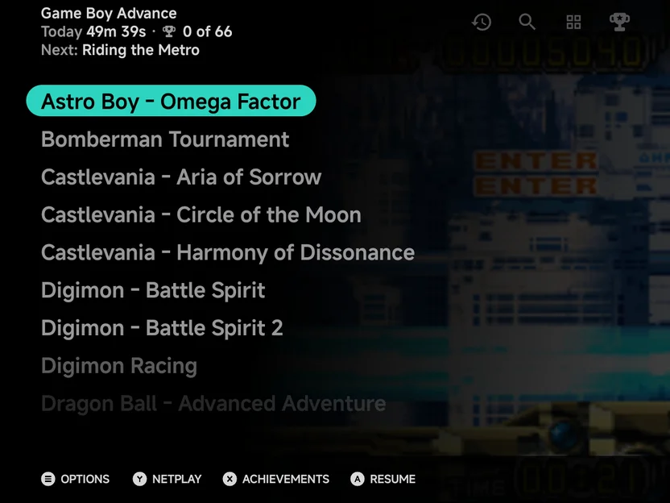

`Up` and `Down` wrap at the ends, as on a [tab](#consoles-list).

??? info "More detail"
    The selected game's info sits under the list's title, with half a row's
    gap before the games. While the trophy icon shows, a second line under
    it is kept for the release or the next achievement, so the list never
    moves. With [Page title](layouts.md#page-title-and-button-hints)
    hidden, the info moves to the bottom row, where the hints would be,
    while Button hints is hidden or with touch alone.

    The list fades out at the edge where more games scroll in, with no scroll
    arrows.

### Grid { #games-grid }

Rows of tiles with each game's screenshot, scrolling up and down as on
[Consoles](#consoles-grid). The selected tile is in colour with its name in
your accent; the others are grey and dimmed, their names too. The selected
game's play time and achievements sit under the list's title, and its genre
and release inside its tile. While the title is hidden, the tile holds them
all.

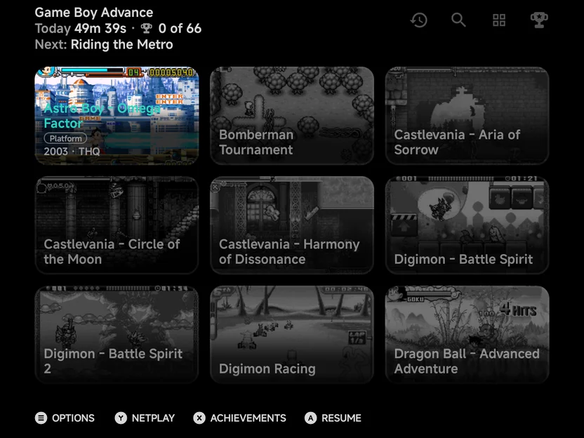

### Carousel { #games-carousel }

The selected game is large in the middle, with its play time,
achievement count and next achievement at the bottom of the picture. Its
name sits below the picture, and its genre and release under the name.

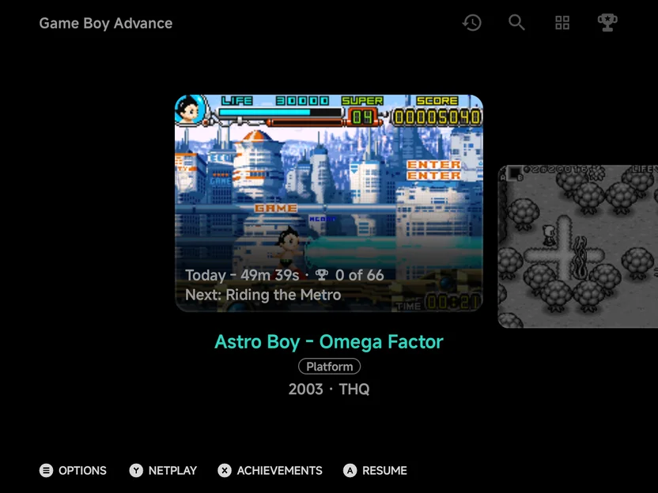

??? info "More detail"
    - A game's stats sit over a dark fade. The side games get smaller the
      further they are from the middle, and are grey and dimmed. The
      selected game's name is in your accent.
    - The selected game and its caption sit centred on the screen's height.
      On a short landscape screen the picture shrinks so the caption fits.
    - In every carousel, games, consoles and Home alike, the selected card
      is never wider than 60% of the screen, so its neighbours show.
    - A game with no genre, year or publisher stored has nothing under its
      name.

### Backdrop { #games-backdrop }

The default. The selected game's box art stands over its dimmed screenshot, with its
neighbours' boxes to the sides, in grey. Its caption gives the name in your
accent, then the play time and genre, then the year and publisher on their
own line. With [Game info](layouts.md#game-info) on **Achievements** (the
default), a game's achievement count and next achievement take those
places when it has achievements.

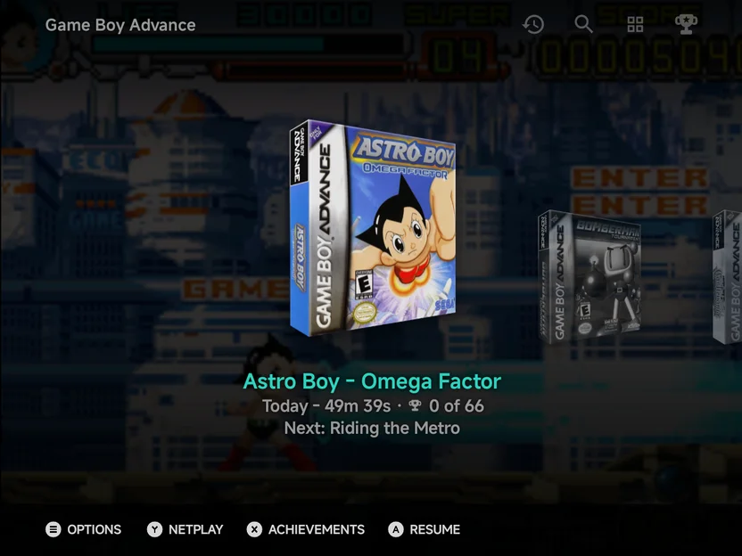

### Minimal { #games-minimal }

The games' names alone, big, as on [Minimal Home](#minimal), under the page
title: no art. The selected game's info sits under the title while the title
shows. `Up` and `Down` wrap as a
[List](#games-list) does.

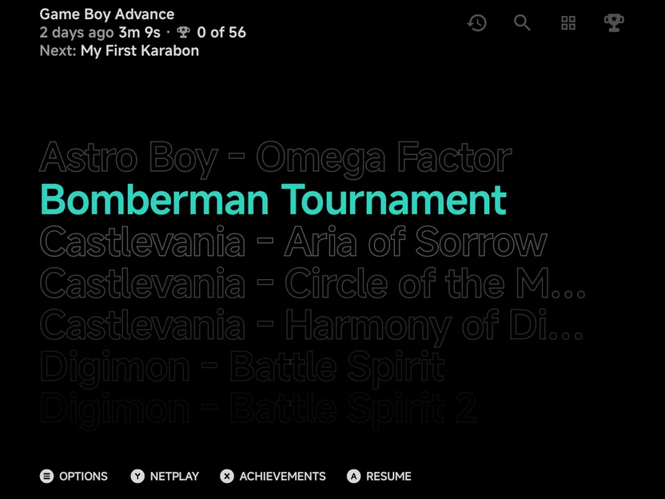

??? info "More detail"
    The selected game's info sits under the title, as in a
    [List](#games-list). `A` opens the game at once.

### Vertical game lists { #game-lists-alignment }

A Carousel or Backdrop game list can run down the screen (see
[Orientation](#orientation)). The caption's name wraps onto up to three
lines, and the play time, the genre or trophy count, and the release or
next achievement each take a line of their own. The stack sits on
the left and the details on the right; set **Alignment** in
[Layouts → Game lists](layouts.md#game-lists) to **Right** to swap the sides.

<figure markdown>

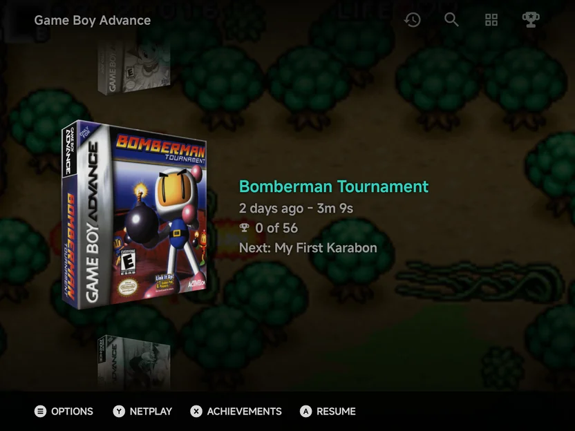

<figcaption>Backdrop, Vertical, Left</figcaption>
</figure>

<figure markdown>

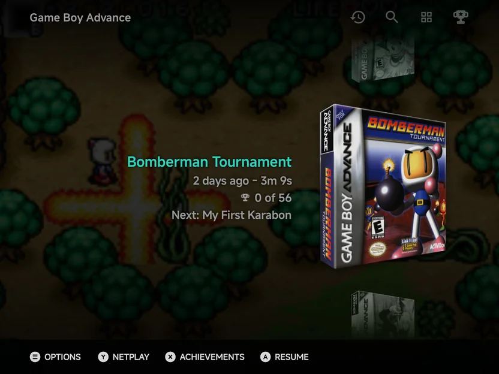

<figcaption>Backdrop, Vertical, Right</figcaption>
</figure>

### Title icons

On a device with a touchscreen, icons sit at the right of a game list's
title:

| Icon | What it does |
| --- | --- |
| **Recent** | Open the [Game Switcher](game-switcher.md) |
| **Search** | [Search](#searching-a-game-list) this list |
| **Layout** | Pick the game list layout. It applies to every game list. See [Menu Layouts](layouts.md) |
| Trophy | Open or close the [achievements panel](#achievements-panel) |

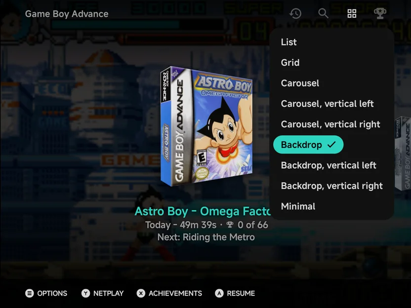

??? info "More detail"
    - The **Layout** dropdown offers **List**, **Grid**, **Carousel**,
      **Carousel, vertical left** / **right**, **Backdrop**, **Backdrop,
      vertical left** / **right** and **Minimal**, in a box as wide as its
      longest name. On two screens the vertical ones are left out.
    - **Layout options** and **Achievements panel** in Layouts → Game lists
      hide the Layout and trophy icons. See
      [Layouts](layouts.md#layout-options-and-achievements-panel).
    - Without a touchscreen only **Recent** shows; `START`, `X` and
      Layouts stand in for the rest.
    - With Page title hidden, the icons stay at the top right of the page.

### Searching a game list

`START`, or the **Search** icon, searches only the games of the list you are
in. The prompt is titled after the list, such as **Search Sega Genesis**,
and is typed like the main [Search](#search). From the results, `B` returns
to the list, on the game you had selected in the results.
Matching works as in [Search](#how-matching-works).

??? info "More detail"
    The results are titled with the list and your words, such as **Sega
    Genesis: sonic**.

### Achievements panel

While you are signed in to [RetroAchievements](retroachievements.md), `X` or
the trophy icon opens a panel from the right with the selected game's
achievements. See [RetroAchievements on game lists](retroachievements.md#on-game-lists)
for its buttons.

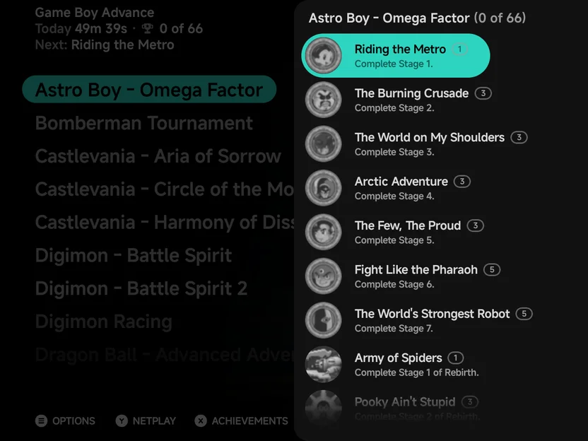

??? info "More detail"
    - Tapping the selected game's name or info line opens the panel too.
    - The panel is at least 320 dp wide and never more than 80% of the
      screen it slides over.
    - With **Achievements panel** hidden, `X` still opens it, and the game's
      menu ends with **Achievements**.

## Context menus

Press `MENU` on a game to see what you can do with it. The menu depends on
where the game is listed.

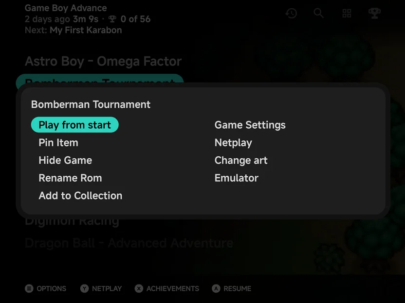

| Item | What it does |
| --- | --- |
| **Play from start** | Start the game from the beginning instead of its auto-save. Shown first when the game has one |
| **Pin Item** / **Unpin Item** | Pin the game to Home, or take it off |
| **Hide Game** | Hide the game from its list |
| **Rename Rom** | Change the name the list shows |
| **Add to Collection** | Add the game to a collection, or start a new one |
| **Game Settings** | This game's own emulator settings. See [Emulator Settings](emulator-settings.md) |
| **Netplay** | Play the game with another device. See [Netplay](netplay.md) |
| **Fetch art** | Download art for this game. See [Artwork](artwork.md) |
| **Change art** | Pick this game's pictures from every source, in place of **Fetch art** once the game has art. See [Change art](artwork.md#change-art) |
| **Emulator** | Pick which emulator runs this game. See [Emulators](emulators/index.md) |
| **Remove from Collection** | Take the game out of the collection you are in |
| **Achievements** | Open the [achievements panel](#achievements-panel). Shown last, only while its icon is hidden |

- **Hidden games** are listed in **Tools → Settings → Library → Hidden
  games**. Press `A` **Unhide** there to bring one back.
- **Unassigned games** are files in an extra ROM folder that the app could
  not match to a system. Open them from **Tools → Settings → Library →
  Unassigned games**, and use **Console** to say which system a game belongs
  to. See [Library & ROM folders](library.md).

??? info "More detail: which items show where"
    | List | Items |
    | --- | --- |
    | A console | **Play from start** when the game has an auto-save, then **Pin Item**, **Hide Game**, **Rename Rom**, **Add to Collection**, **Game Settings**, **Netplay**, **Fetch art** (or **Change art**), and **Emulator** on systems with more than one emulator |
    | A collection | The same, with **Remove from Collection** at the end |
    | [Search](#search) results and the [Games](#games-tab) tab | The same as a console, without **Emulator** |
    | Unassigned games | **Hide Game**, **Rename Rom**, **Console** |
    | The Android console | **Pin Item** / **Unpin Item**, then **Fetch art** or **Change art** |

    - **Fetch art** shows only for systems the art sources know, and only
      for a game with no art yet. A game that has art shows **Change art**
      instead. The Android console's menu has them too.
    - **Netplay** shows only for systems that have [netplay](netplay.md).
      When the `Y` **Netplay** hint is not on screen (touch only, Button
      hints hidden, or **Netplay hint** hidden in
      [Layouts](layouts.md#page-title-and-button-hints)), **Netplay** moves
      up, right after **Play from start**. On Home and the
      [Games](#games-tab) tab it always sits there.
    - A menu with 9 to 16 items shows as two columns when the screen is wide
      enough, split evenly (5 and 4 for nine items). `Left` / `Right` move
      between the columns. `Up` / `Down` loop
      round the items.
    - The Android console holds the Android games you added. See
      [Launcher Mode & Android Games](launcher.md).
    - During [Kids Mode](kids-mode.md)'s play time a game's menu keeps only
      **Play from start**, **Netplay**, **Pin Item** / **Unpin Item** and
      **Achievements**.

### Hidden tabs

When you hide a tab in [Layouts](layouts.md#showing-and-hiding-tabs), `MENU`
on any item of the main menu ends with an entry for each hidden tab
(**Games**, **Consoles**, **Collections** or **Tools**). Pick one to open that tab over
the current one; `B` returns.

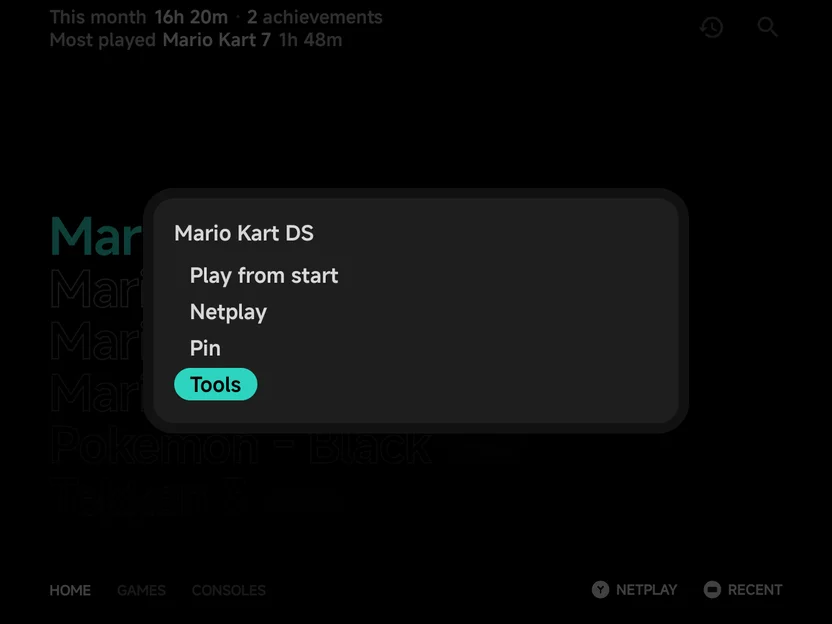

??? info "More detail"
    - Only a hidden tab that has something in it is offered. Items that
      have no menu of their own, such as a console, get a menu with just
      these, captioned **NX Redux**.
    - On two screens, while an Android app holds the top screen, the menu
      ends with **Use top screen**, which takes the screen back. With
      touch, a floating **Top screen** button does the same. See
      [Dual Screens](dual-screen.md).

## Search

Press `START` on the main menu, or tap the **Search** icon, to search all
your games. It works from any tab. In a game list, `START` searches only that
list: see [Searching a game list](#searching-a-game-list).

1. The **Search** prompt opens, with your last search filled in.
2. Type part of a name on the [NX keyboard](about.md#keyboard) and press
   `START`, or the keyboard's **Search** key.
3. The matches open as a game list titled **Search:** and your words, such
   as **Search: mario kart**.

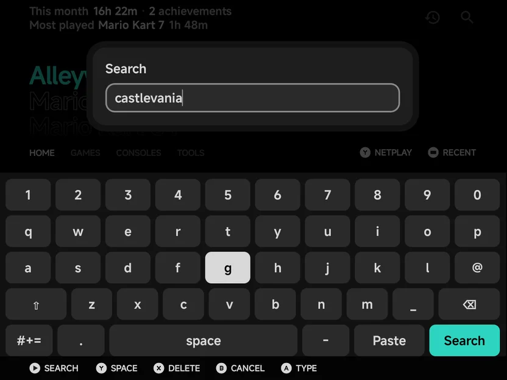

`B`, or a tap outside the prompt, closes it without searching.

The results list games from every console, in your game list style. In
List each row carries its console's tag, such as `GBA`. The list reads **No
results** when nothing matches.

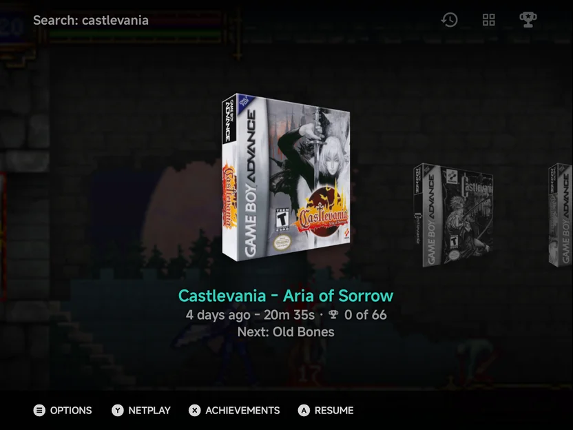

| Button | What it does |
| --- | --- |
| `MENU` **Options** | The game's context menu |
| `X` **Achievements** | Open the [achievements panel](#achievements-panel) |
| `Y` **Netplay** | Play the game with another device, for games that have [netplay](netplay.md) |
| `B` | Return to the tab and the item you searched from |
| `A` **Resume** / **Open** | Launch the game, from its auto-save when it has one |

??? info "More detail"
    - The **Search** icon shows once you have games.
    - On the keyboard the d-pad moves, `A` types, `X` deletes and `Y` adds a
      space. With **Settings → System → Keyboard** set to **Android**, the
      prompt has its own buttons instead, and `A` or the keyboard's Done
      searches.

### How matching works

The search looks in each game's name, its file name and its console tag.

- **Case, accents and punctuation don't matter.** `pokemon` finds
  *Pokémon*, and `pac man` finds *Pac-Man*.
- **Words can come in any order**, and each can be part of a word.
  `kart mario` finds *Mario Kart: Super Circuit*.
- **No typos.** Each word you type has to be there.

??? info "More detail"
    - **Roman numerals and digits match.** `final fantasy 6` finds *Final
      Fantasy VI*, and `vi` still finds *Virtua Fighter*.
    - **Words can be glued together.** `pacman` finds *Pac-Man*.
    - Names that start with your search come first, then names where every
      word starts a word, then the rest. Each group is A to Z.
    - Unassigned games, games without an emulator and Android games are not
      searched.
