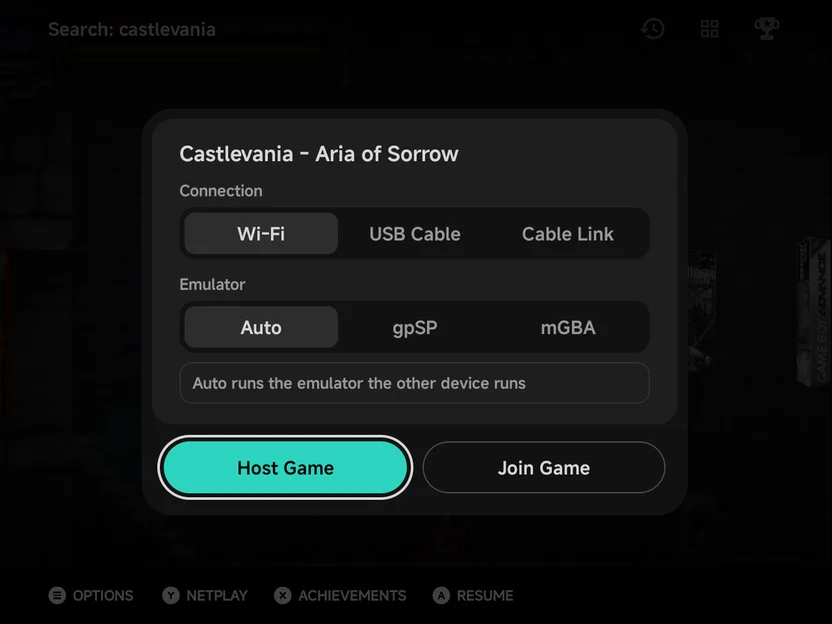
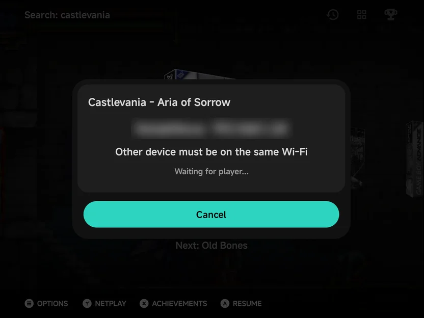
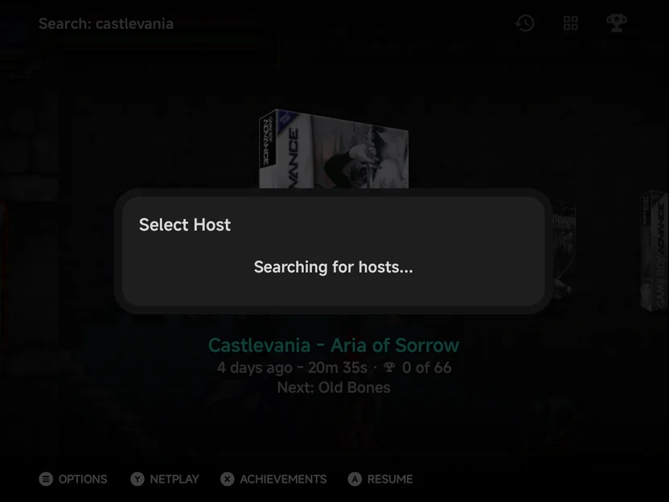
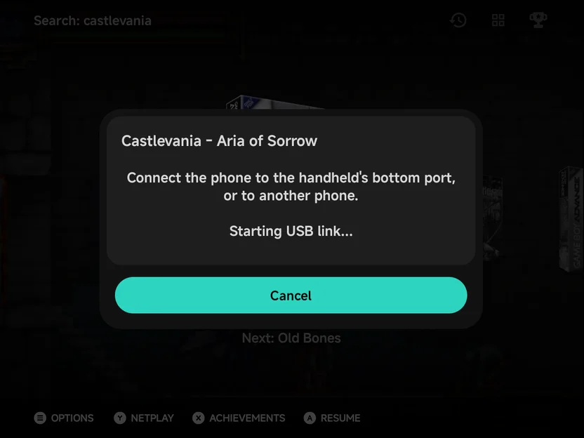
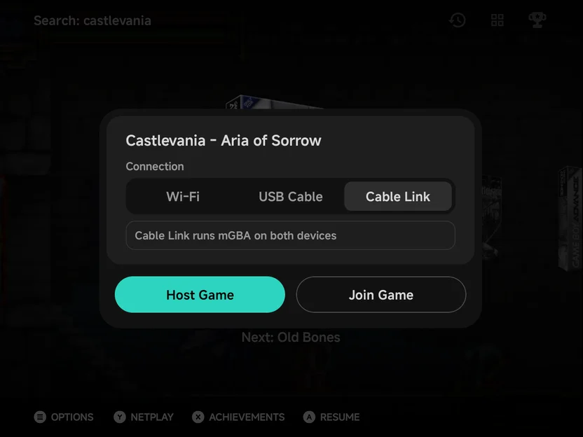

# Netplay

Two players, two devices, one game. Netplay links your phone with another
phone or with an NX Redux handheld (TrimUI Brick, Brick Pro or Smart Pro S),
over Wi-Fi or a USB-C cable. Game Boy and Game Boy Advance games get a link
cable too, for trades and versus battles, and two phones can play any Game
Boy Advance cable game with [Cable Link over Wi-Fi](#cable-link-over-wi-fi).

There is no IP to type. Save data is copied before the match starts, and
your own save is never overwritten by someone else's.

Two people on one phone, each with a controller? That is
[Local Multiplayer](multiplayer.md) instead. Nintendo DS, Nintendo 3DS and
PSP games meet by themselves when a game turns its wireless on: see
[Local Wireless](local-wireless.md).

## Starting a session

1. Both players pick the same game. On the phone, highlight it on Home or
   in a game list and press `Y` **Netplay**.
2. The **Netplay** menu opens, titled with the game.

    

3. Both players choose the same **Connection**: **Wi-Fi**,
   [**USB Cable**](#usb-cable) or, for a Game Boy Advance game,
   [**Cable Link**](#cable-link-over-wi-fi).
4. One player picks **Host Game**, the other **Join Game**.
5. The joiner picks the host (over Wi-Fi), the host's save is copied, and
   the game starts on both devices.

On a handheld, press `Y` on the game and pick **Host Game** or **Join Game**,
then **WiFi** or **USB Cable**. See the handheld's
[Netplay](../handheld/netplay.md) page.

!!! note "Keep the handheld up to date"
    Keep the handheld on the latest NX Redux: older versions can't pair with
    the phone. A PlayStation match on SwanStation needs a handheld newer
    than v2.5.1, whose SwanStation saves an older state format.

??? info "More detail"

    - In a game list, **Netplay** in the game's `MENU` menu does the same as
      `Y`. On a touchscreen with no controller there is no hint bar:
      long-press the game and pick **Netplay**, which then leads the menu.
    - `Y` **Netplay** only shows for games on a
      [supported system](#supported-systems). When the `Y` **Netplay** hint
      is hidden, **Netplay** moves to the top of the game's menu. See
      [Context menus](main-menu.md#context-menus).
    - The phone has no **Hotspot** choice, so don't pick it on the handheld.

### The Netplay menu

The menu is one card, titled with the game, with **Host Game** and **Join
Game** side by side under it.

| Control | What it does |
| --- | --- |
| **Connection** tabs | **Wi-Fi**, **USB Cable** or **Cable Link**. |
| **Emulator** tabs | Which emulator runs the match: **Auto** or one by name. See [Emulator](#emulator). |
| **Host Game** | Wait for the other player to join. |
| **Join Game** | Find the host and join it. |
| **Wi-Fi settings** | Opens Android's Wi-Fi settings, when the phone isn't on Wi-Fi. |

Tap a tab or a button. With a controller, `UP` / `DOWN` move between the
lines, `LEFT` / `RIGHT` change the tab or move between **Host Game** and
**Join Game**, and `A` picks. The menu opens on **Host Game**. `B` closes
it.

??? info "More detail"

    - **Connection** is remembered for next time. It only shows when the
      game has more than Wi-Fi to choose from: **USB Cable** on phones that
      can use the cable, **Cable Link** for Game Boy Advance games. PSP
      games have no **USB Cable**.
    - **Emulator** only shows for systems with more than one, and not on
      **Cable Link**, which reads **Cable Link runs mGBA on both devices**.
    - **Wi-Fi settings** shows with the line **Connect to Wi-Fi first**.
    - For a Game Boy Advance game the menu first reads **Reading the
      game...** while it works out how the game links.

### Hosting

The host's screen shows the phone's name and address and **Waiting for
player...**. The other device must be on the same Wi-Fi. When a player
connects, the game starts. `B` **Cancel** stops hosting.

??? info "More detail"

    - The screen stays on while it waits.
    - When a player connects, the status reads **Player connected**, then
      **Sending saves...**.
    - If a joiner is turned away, such as one on another emulator, the host
      keeps waiting for the next one.

### Joining

Over Wi-Fi, **Join Game** opens **Select Host**, listing every device hosting
on the same network, phones and handhelds alike, such as **Contra III - The
Alien Wars (192.168.1.23)**. Press `A` on the host to join. `B` goes back to
the menu.

??? info "More detail"

    - After `A`, the screen reads **Connecting...**, then **Receiving
      saves...**, then **Connected - starting game...**.
    - The list reads **Searching for hosts...** until a host shows up. After
      two minutes with none it says **No host found.**

### Different versions of one game

You can join a host running a sister version of your game, such as Pokémon
Ruby and Sapphire. The phone asks first (not on **Cable Link**, where two
different games are expected):

> The host is running *Pokemon - Ruby Version* 
> You are running *Pokemon - Sapphire Version* 
> Join anyway?

Press `A` **Join** to join, or `B` **Back** to pick another host. Only join
when you know the two games link: the app can't tell a sister version from
a different game.

## USB Cable

No Wi-Fi nearby, or a laggy one? Join the two devices with a USB-C data
cable. A cable is steadier than Wi-Fi, and it is how a phone and a handheld
play the Game Boy Advance's real link cable.

**Phone and handheld:**

1. Plug the cable into the handheld's **bottom** USB-C port (the charging
   port) and into the phone.
2. On the phone, set **Connection** to **USB Cable** and pick **Host Game**
   or **Join Game**.
3. On the handheld, press `Y`, pick the other role and choose **USB Cable**.

**Two phones:**

1. Join them with a USB-C to USB-C cable.
2. Both set **Connection** to **USB Cable**. One picks **Host Game**, the
   other **Join Game**.
3. If they don't connect, open the USB notification on one phone and switch
   **USB controlled by** to the other phone.

- **Android asks once to allow a VPN.** It only carries the cable link.
  Turn off any other always-on VPN app first: it blocks the cable.
- **Same NX Redux version on both.** Otherwise the phone says **Both devices
  need the same NX Redux version.**
- **2 players only.** Either device can host.

??? info "More detail"

    - There is no host list: the joiner connects straight to the other end of
      the cable. The host's screen reads **USB** and **Connected by USB
      cable**.
    - Host and Join don't depend on the cable: either device can host,
      whichever end of the cable it has.
    - If no link comes up within about 30 seconds, the phone says **No USB
      link** and what to check: the handheld's bottom port, **USB Cable**
      picked on the handheld, or **USB controlled by** on two phones.
    - Pull the cable out mid-game and plug it back in before the countdown
      ends (about 28 seconds), and the match carries on.
    - A phone that can't use the cable has no **USB Cable** tab.
    - PSP games have no **USB Cable** tab: they link over Wi-Fi only.
    - If the other phone took control of the USB connection, the phone says
      so and points to **USB controlled by**.

## Supported systems

Netplay works only for games in these folders. Every other system, such as
Dreamcast, has no `Y` **Netplay**.

| System | `Roms` folder | Emulator for the match | Netplay type |
| --- | --- | --- | --- |
| NES / Famicom Disk System | `FC`, `FDS` | FCEUmm | Lockstep |
| Super Nintendo | `SFC` | Snes9x, or Supafaust | Lockstep |
| Super Nintendo | `SUPA` | Supafaust, or Snes9x | Lockstep |
| Sega Genesis, Master System, Game Gear, SG-1000, Sega CD | `MD`, `SMS`, `GG`, `SG1000`, `SEGACD` | PicoDrive, or Genesis Plus GX | Lockstep |
| Sega Genesis, Master System, Game Gear, SG-1000, Sega CD | `GPGX` | Genesis Plus GX, or PicoDrive | Lockstep |
| Sega 32X | `32X` | PicoDrive | Lockstep |
| PlayStation | `PS` | PCSX-ReARMed, or SwanStation | Lockstep |
| PlayStation | `PSX` | SwanStation, or PCSX-ReARMed | Lockstep |
| Arcade | `FBN` | FinalBurn Neo | Lockstep |
| Nintendo 64 | `N64` | Mupen64Plus-Next | Lockstep, 2 players ([details](emulators/nintendo-64.md#netplay)) |
| Game Boy / Game Boy Color | `GB`, `GBC` | Gambatte | **GB Link** |
| Game Boy Advance | `GBA` | gpSP, or mGBA (for games with a Wi-Fi mode, or over the USB Cable) | **GBA Link**, or [Cable Link](#cable-link-over-wi-fi) between two phones |
| Game Boy Advance | `MGBA` | mGBA, or gpSP | **GBA Link**, Wi-Fi for [games with a Wi-Fi mode](#game-boy-advance-link), or [Cable Link](#cable-link-over-wi-fi) between two phones |
| Nintendo DS | `NDS` | melonDS DS | [Local wireless](local-wireless.md), between phones |
| Nintendo 3DS | `3DS` | Azahar | [Local wireless](local-wireless.md), between phones |
| PSP | `PSP` | PPSSPP | [Local wireless](local-wireless.md) (ad hoc), between phones, Wi-Fi only |

| Netplay type | What it means |
| --- | --- |
| **Lockstep** | Both devices run the same game and swap controller input every frame. For games with a two-player mode. |
| **GB Link** / **GBA Link** | The link cable between two Game Boys. Trades and versus battles in single-player cartridges work between the two devices. |
| **Local wireless** | The console's own wireless play. Host on one phone and join on the other, then use the game's own wireless or ad hoc menu. These games also meet without the Netplay menu: see [Local Wireless](local-wireless.md). |

!!! info "Game Gear"
    The Game Gear has one controller port, so only games that read a second
    pad react to the other player.

??? info "More detail"

    The Game Gear's two-player games used the link cable, which netplay
    doesn't connect. Both devices still play the same game in step.

### Emulator

Systems with two emulators have **Emulator** tabs on the menu.
`LEFT` / `RIGHT` change them.

- **Auto** (default): the phone runs whatever the other device runs, as
  the note under the tabs says. Leave it on Auto unless you need one
  emulator.
- **An emulator by name**: the phone runs only that one. A device on another
  emulator can't join.

If the two don't match, the joiner is told what to change.

??? info "More detail"

    - Auto follows the other device only when this folder offers its
      emulator. With two phones on Auto, the host's emulator wins. A handheld
      can't switch, so a phone always follows a handheld.
    - A mismatch message reads, for example, **The host is using PicoDrive
      (MD folder). Pick the game from the same folder on both devices.**, or
      **Set Emulator to PicoDrive.** when that is one of its own choices.
    - The host flashes **A player using Genesis Plus GX was turned away.**
      and keeps waiting.

### Game Boy Advance link

Game Boy Advance games link as two GBAs on a cable:

- **Over Wi-Fi**: the link is emulated for the games that need it, and the
  wireless adapter works (the Union Room in FireRed, LeafGreen and
  Emerald). gpSP does this for every game with a link mode. mGBA does it
  for games with a **Wi-Fi mode**: the wireless adapter games, the Pokémon
  cable games (Ruby, Sapphire and so on) and Advance Wars 1 and 2.
- **Over the USB Cable**: a real link cable. Cable link play works as on
  real hardware, such as Pokémon trades and battles, cross-game trades like
  FireRed with Ruby, and The Legend of Zelda: Four Swords. Wireless adapter
  games use the wireless adapter on mGBA too, as on gpSP.
- **Other cable games on mGBA** (Mario Kart: Super Circuit, Four Swords,
  Golden Sun and so on) don't link over plain **Wi-Fi**: `MGBA` games have
  no **Wi-Fi** tab for them. Use the **USB Cable**, or
  [**Cable Link**](#cable-link-over-wi-fi) between two phones.
- **gpSP and mGBA can link with each other** when both games use the same
  Wi-Fi mode, such as FireRed on one and LeafGreen on the other in the
  Union Room.

Both devices need an NX Redux that knows the Wi-Fi modes. Against one that
doesn't, mGBA over Wi-Fi is refused with **The other device can't link mGBA
over Wi-Fi. Update it, or use the USB Cable.**

For a cable trade between FireRed/LeafGreen and Ruby/Sapphire, the host sets
gpSP's **Link Cable Connectivity** core option to **Link Cable - Real (USB
only)** before hosting, in **Game Settings** or
[Emulator Settings](emulator-settings.md).

!!! tip "Give each device its own save"
    Two Pokémon games with the same save share a Trainer ID and refuse to
    trade.

??? info "More detail"

    - Setting **Emulator** to **mGBA** on a `GBA` game over Wi-Fi isn't
      possible when the game has no Wi-Fi mode: the phone says **mGBA links
      this game over the USB cable only.**
    - When the two games' modes can't link, both screens say why, such as
      **The other player's game links with the Wireless Adapter, this one
      with the Pokémon cable.**
    - The phone works out the game's Wi-Fi mode from the ROM when the
      **Netplay** menu opens. A game inside a `.zip` shows as having none.
    - **Link Cable Connectivity** picks the link mode, and the host's choice
      is used by both devices. Otherwise leave it on **Automatic**.
    - mGBA has the same option, **Link Cable Connectivity**, in
      **Settings → Emulation → Default settings → mGBA → Input & Auxiliary
      Devices**. It applies when a game starts. Leave it on its default: in
      a match with gpSP, or over Wi-Fi, the app sets the link mode for you.
    - It can't be changed in a match: the in-game menu has no Options during
      a match.

## Cable Link over Wi-Fi

**Cable Link** is the third **Connection** for Game Boy Advance games, in
both the `GBA` and `MGBA` folders. It gives two phones a real link cable
over Wi-Fi, for any two-player cable game: Mario Kart: Super Circuit, The
Legend of Zelda: Four Swords, Pokémon Ruby with Sapphire, and so on.

1. Both phones join the same Wi-Fi and open **Netplay** on their own game.
   The two games can differ, as two cartridges on one cable can.
2. Both set **Connection** to **Cable Link**.
3. One picks **Host Game**, the other **Join Game** and then the host.
4. The phones swap games and saves (**Sending game...** / **Receiving
   game...** with a percentage), and the game starts on both.

Each phone runs both players' Game Boy Advances on mGBA, whichever emulator
the folder uses, and only button presses cross the network.

- **Two phones only.** An NX Redux handheld can't join.
- **Two players, each with their own cartridge.** Single-cartridge
  multiplayer isn't supported.
- **The game must be unzipped.** A game inside a `.zip` is refused with
  **Cable Link over Wi-Fi needs the game unzipped.**
- **Both phones pick Cable Link.** Otherwise both say **The other phone
  isn't on Cable Link over Wi-Fi.**

Your save is written only from moments both phones agreed on, so a dropped
connection can't leave the two saves out of step. See
[Saves](#saves) and [During a match](#during-a-match).

Its settings are on mGBA's page, **Settings → Emulation → Default
settings → mGBA**, under **Cable Link**:

| Row | Values | What it does |
| --- | --- | --- |
| **Input delay** | Auto, 1 to 8 (default 1) | How many frames a button press waits, the same on both phones. Auto starts at 2 and rises when the network stalls. It applies from the next session. |
| **Delay overlay** | On, Off | Shows the current input delay during a session, such as **Delay 2**. |
| **Clear link ROM cache** | | Deletes the game files kept from earlier sessions. The row shows their size. They are sent again next time. |

??? info "More detail"

    - A phone that doesn't have the other player's game receives it for the
      session. It is kept in a hidden cache, not added to your library.
    - mGBA's page is listed in Default settings even when gpSP is your Game
      Boy Advance emulator.
    - The two phones compare their games as they play. If they drift apart
      the screen reads **Syncing...** while the host's game is copied over.
    - `B` and Android's Back never leave a session: use the in-game menu.

## Saves

Your own save is never overwritten by the other player's.

| Netplay type | Whose save is used |
| --- | --- |
| **Lockstep** | The host's. Its save is copied to the joiner, so both start from the host's progress. |
| **GB Link** and **GBA Link** | Each player's own. Nothing is copied. |
| **Cable Link** | Each player's own. The other player's save is borrowed for the session and never written. Yours is saved up to the last moment both phones agreed on. |
| **Local wireless** | Each player's own. Nothing is copied. |

- **The joiner** plays on a copy: its own save is left as it was, and
  progress made in the match isn't kept.
- **The host** plays on its real save, so its progress is kept, unless the
  match runs on an emulator that doesn't share the folder's saves.
- If the host has no save for the game, both start fresh.

!!! note "Hosting clears the resume point"
    Hosting on your real save clears the game's resume point, so
    [Resume](game-switcher.md) can't roll the save back.

??? info "More detail"

    - The emulators that share saves: gpSP and mGBA, Snes9x and Supafaust,
      PCSX-ReARMed and SwanStation.
    - A host on another emulator, such as Genesis Plus GX for a Sega game on
      PicoDrive, plays on a copy. The game starts with **Using Genesis Plus
      GX for this match - progress won't be saved.**
    - Only battery saves travel (`.srm` and `.sav`). Save states are never
      copied.
    - If the copy fails, the join stops with **Could not copy the host's
      saves.** A host that can't share its saves starts the match on empty
      saves and says **Saves not copied - playing on empty saves.**

## During a match

A match has no save states, rewind, fast forward, cheats, reset, options
or disc changes. A lockstep match has no achievements either. A link
session and a Cable Link session do earn
[achievements](retroachievements.md), as each player plays their own game.
Each device is one player: every controller on the phone, and the
on-screen pad, play as that player.

In a lockstep match the in-game menu shows only two rows, under **Leave
netplay?**, with no game panel beside them:

| Row | What it does |
| --- | --- |
| **Continue** | Back to the game. |
| **Leave** | Ends the match for both, and returns you to the game list. |

A link session (**GB Link**, **GBA Link**, or a DS, 3DS or PSP game started
from the Netplay menu) shows three:

| Row | What it does |
| --- | --- |
| **Continue** | Back to the game. |
| **Disconnect** | Ends the link. You keep playing on your own save (see [below](#when-a-link-session-ends)). |
| **Quit** | Closes the game, and tells the other device first. No resume point is written. |

A Cable Link session shows **Continue** and **Leave**.

!!! warning "Come back within 30 seconds"
    While your menu is open, or the app is in the background, the other
    player sees **Other player paused (30 s)** counting down. Come back
    before it runs out, or the match ends.

A DS, 3DS or PSP game keeps running under your menu instead, and leaves
the room after 60 seconds: see
[Local Wireless → In a session](local-wireless.md#in-a-session).

| Notice | What it means |
| --- | --- |
| **Waiting for the other player... (N s)** | The other device stopped sending. The match ends if it doesn't come back within 30 seconds. |
| **Other player paused (N s)** | The other player opened their menu or left the app. |
| **Netplay ended** | The other player left or the connection was lost. You keep playing on your own. |
| **Syncing...** | Cable Link: the two games drifted apart and the host's is being copied over. |

??? info "More detail"

    - The features are off to keep both devices in step.
    - The menu's line reads **Leaving ends the netplay session.** In a link
      session it reads **Disconnect ends the link. You keep playing on your
      own save.** While the menu is open, your input stops.
    - Notices show at the top of the screen.
    - After **Netplay ended** in a match (not a link session) the menu is
      **Continue** / **Quit**. On a copy the notice reads **Netplay ended -
      progress here won't be saved.**
    - After a Cable Link session ends the menu is **Quit** alone, and reads
      **The Cable Link session is over. Your save is kept up to the last
      moment both phones agreed on.** A session also ends when a phone
      can't run both games at full speed, or when the two games keep
      drifting apart; the notice says which.
    - A quit from a linked game writes no resume point: resumed alone, the
      game would be in the middle of the link.
    - The screen stays on during a match, and over Wi-Fi the phone keeps
      its Wi-Fi out of power saving. With
      [Screen care](about.md#screen-care) on, an idle match dims but never
      sleeps.
    - If the match can't start or breaks, a **Netplay failed** dialog says
      why, such as **Could not reach the other device.** or
      **Netplay failed - the other device's emulator doesn't match.**, and
      you go back to the game list.

### When a link session ends

In a link session each player plays their own game on their own save, so
nothing is lost when the link ends. Once it ends, the game becomes a
normal game: the full in-game menu comes back, with save states, cheats,
options and the game panel. Leave the game with **Quit** as usual.

A link session ends when you choose **Disconnect**, or, for a Game Boy
Advance link, when the other player leaves or the connection drops. A Game
Boy link can't tell when the other player has gone, so choose
**Disconnect** when you're done trading or battling.

For a DS, 3DS or PSP game, **Disconnect** leaves the room and the game
plays on. What happens next is on the
[Local Wireless](local-wireless.md#disconnect) page.

## Not supported

- More than two players, except in DS, 3DS and PSP
  [local wireless](local-wireless.md).
- DS, 3DS and PSP sessions, and Cable Link, with an NX Redux handheld:
  they are between phones.
- The handheld's **Hotspot** mode.
- Rollback netplay, such as the handheld's Dreamcast GGPO.
- Systems outside the [table above](#supported-systems).
- The Super Game Boy (`SGB`): put Game Boy games in `GB` or `GBC` for link
  play.
