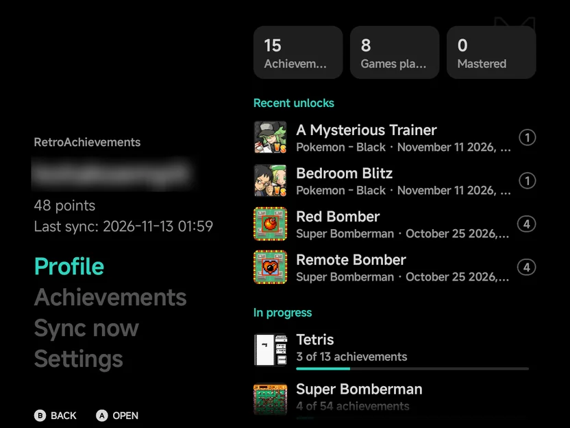
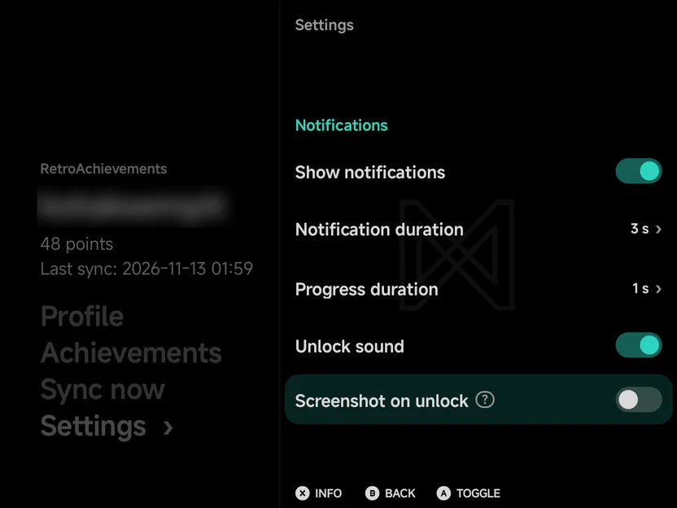
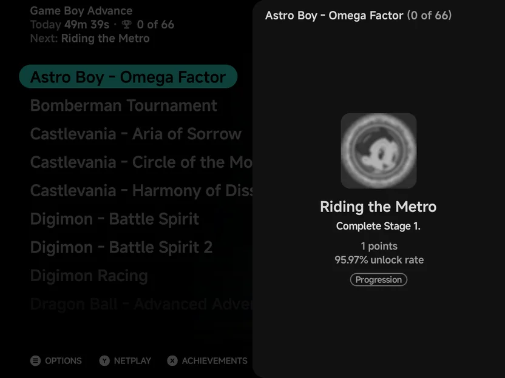
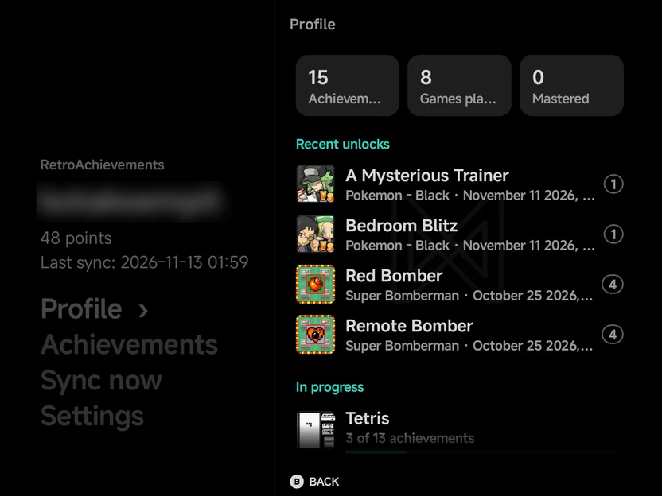
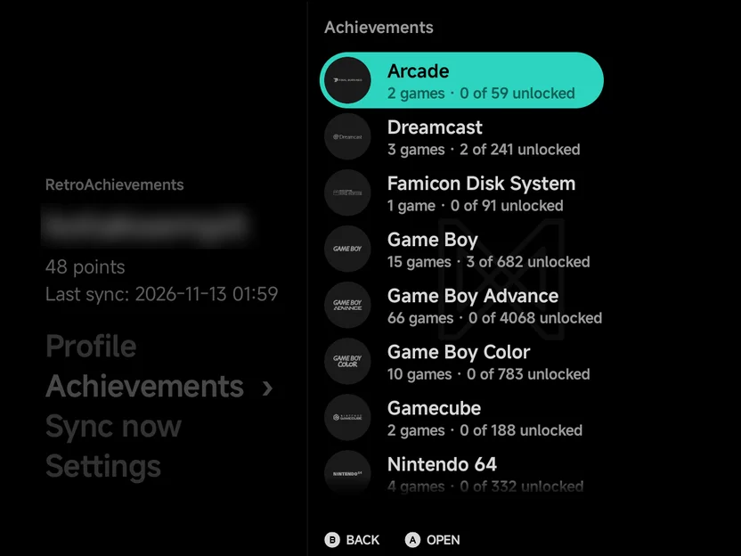
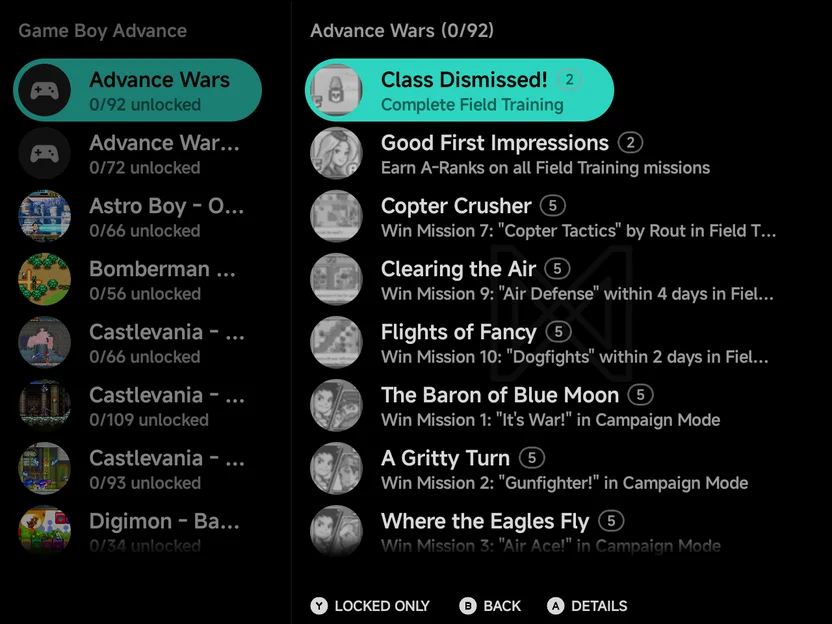
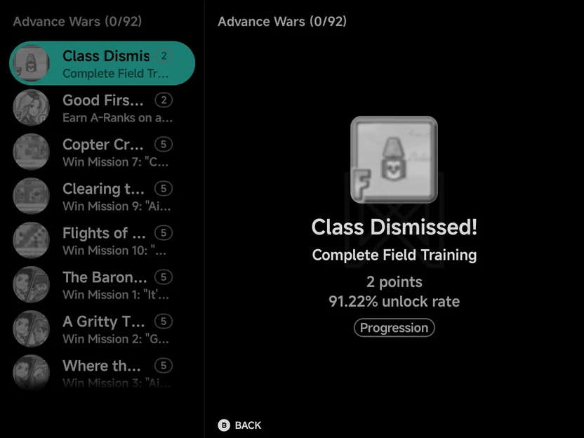

# RetroAchievements

NX Redux for Android supports [RetroAchievements](https://retroachievements.org/),
with offline play. **Tools → RetroAchievements** is the home for the feature:
sign in, browse your achievements and change its settings there. Once you are
signed in, game lists also show a game's achievements in a
[panel](#on-game-lists).

{ .nx-wide }

The page looks like [Settings](settings.md). Under a small
**RetroAchievements** label it shows your username, your points and when you
last synced, then its rows as large words: **Profile**, **Achievements**,
**Sync now** and **Settings**.

??? info "More detail"

    - While unlocks wait to be synced, **Sync now** shows how many, such as
      **Sync now (1)**.
    - Signed out, the page reads **Not signed in** and **Sign in under
      Settings** instead.
    - After you start [Download all game data](#downloading-all-game-data), a
      fifth row, **Progress**, such as **Progress (12/340)**, opens its
      progress page.
    - On a wide landscape screen the highlighted row's page shows on the
      right, and your [profile](#profile) shows there beside **Profile**.
      See [Foldables & Large Screens](foldables.md#two-pane-screens).

!!! info "Softcore only"
    NX Redux for Android is not an RA-approved hardcore client, so there is no
    hardcore mode. Unlocks count as softcore, and nothing is blocked
    while achievements are on: cheats and save states work as usual.

## Setting up

You need a free [retroachievements.org](https://retroachievements.org/)
account.

1. Open **Tools → RetroAchievements → Settings**.
2. Choose **Sign in**, enter your **Username** and **Password**, and choose
   **Sign in**. You type on the [NX keyboard](about.md#keyboard): `SELECT`
   goes to the next field and `START` signs in.
3. The line under **Sign out** shows **Signed in as** your username, and
   **Enable achievements** turns **On**.

First-run setup asks you to sign in too, and can start
[Download all game data](#downloading-all-game-data) for you. See
[Getting Started](getting-started.md).

{ .nx-wide }

The page's rows sit in groups: **Account**, **Notifications**,
**Achievements** and **Reset**. They work like
[Settings](settings.md#buttons): switches, values with `›`, and the ? icon
or `X` **Info** for a row's full description. The page also has:

| Row | Default | What it does |
| --- | --- | --- |
| **Enable achievements** | On after you sign in | Track achievements in games. Needs a sign-in. |
| **Download all game data** | — | Cache achievement data for your whole library. See [Downloading all game data](#downloading-all-game-data). Needs a sign-in. |
| **Show notifications** | On | Show unlock and progress notices in games. |
| **Notification duration** | 3 s | How long achievement notices stay (1–5 s). |
| **Progress duration** | 1 s | How long a progress notice stays (Off, 1–5 s). |
| **Unlock sound** | On | Play a chime when an achievement unlocks. |
| **Screenshot on unlock** | Off | Save the game's picture when an achievement unlocks, to `Pictures/NX Redux/Achievements`. |
| **Achievement sort order** | Unlocked first | How achievements are sorted, here and in the in-game menu. See [below](#sort-orders). |
| **Reset account data** | — | Sign out and forget sessions and unsynced unlocks. Game data and badges stay. |
| **Erase all achievement data** | — | Delete every cached game and unsynced unlock, and sign out. |
| **Reset settings to defaults** | — | Put the notification and sort settings back and turn **Enable achievements** off. You stay signed in. |

!!! warning "Reset and erase delete unsynced unlocks"
    **Reset account data** and **Erase all achievement data** forget unlocks
    that haven't been synced yet. Run [Sync now](#syncing) first. Both ask to
    confirm.

??? info "More detail"

    - The app keeps only the sign-in token RetroAchievements returns, not your
      password. The sign-in prompt says so: **Your password is only used to
      sign in. It is never stored.**
    - Signed out, **Enable achievements** and **Download all game data** are
      dimmed and read **Needs a sign-in**.
    - If a sign-in fails, the line under **Sign in** shows the error.
    - **Download all game data** shows how many games are cached under its
      name, such as `48 games cached`.
    - **Enable achievements**, **Show notifications**, **Unlock sound** and
      **Screenshot on unlock** are switches: `A` or a tap flips them.
    - **Unlock sound** and **Screenshot on unlock** work by themselves, with
      **Show notifications** on or off.
    - A screenshot holds the game's picture alone, without the notice or the
      pad, as a `.png` named after the game and the achievement. It shows in
      your phone's gallery. Before Android 10 it goes to the app's own
      pictures folder instead.
    - On **Notification duration**, **Progress duration** and **Achievement
      sort order**, `A` or a tap opens a list of the values to pick from, and
      `LEFT` / `RIGHT` step the value. The durations stop at their ends.
    - The page never opens with **Sign out** highlighted, so a stray `A`
      can't sign you out.
    - **Sign out** asks to confirm too. Signing out turns achievements off,
      and signing in again needs your password. Your unsynced unlocks, game
      data and badges stay.
    - With **Erase all achievement data**, badges and game fingerprints kept
      in your ROM folders stay.
    - In first-run setup, **Achievement data** → **Download now** starts the
      download in the background.

## Earning achievements

Start a recognised game and unlocks are tracked as you play.

- When the game loads, a notice shows its name and how many achievements you
  have, or **No achievements for this game**.
- An **Achievement Unlocked** notice with the badge pops up when you earn
  one, with a chime. See **Unlock sound** and **Screenshot on unlock**
  [above](#setting-up).
- The in-game menu gains an [Achievements](in-game-menu.md#achievements)
  tab with the game's achievements, and so does the game panel on a
  [second screen](dual-screen.md#the-game-panel). Its header shows your
  count, such as **Achievements 3 / 40**.

??? info "More detail"

    - Progress notices, such as collectible counters, show for the **Progress
      duration**.
    - On the in-game [Achievements](in-game-menu.md#achievements) page,
      press `Y` to show only locked achievements, and `X` to mute one
      achievement's notices.
    - In the in-game menu and on a second screen, achievements have no
      details page for now.
    - With **Show notifications** off, unlock and progress notices, **Game
      Mastered!**, server errors and the connection lost and reconnected
      notices are hidden. These still show: the game loading, no achievements
      for this game, sign-in failed, offline at the start, first-time setup
      and synced unlocks.
    - In portrait over the on-screen pad, notices sit at the bottom left of
      the game's picture.
    - **With another player:** in [netplay](netplay.md), achievements are off
      in a session where both devices run one shared game. They stay on
      where each player runs their own game: Game Boy and Game Boy Advance
      link play, and DS, 3DS and PSP
      [local wireless](local-wireless.md). In
      [Cable Link over Wi-Fi](netplay.md#cable-link-over-wi-fi) they count
      for your own game only.

## On the Home tab

Home's stats strip shows how many achievements you unlocked this calendar
month, such as **12 achievements**, beside **This month** and your play time.
See [Home](main-menu.md#home).

??? info "More detail"

    Unlocks still waiting to be synced count too. Signed out, the strip leaves
    the achievements out.

## On game lists

Signed in, any game list can show the highlighted game's achievements in a
panel that slides in from the right. Open it with `X` (**Achievements** in
the hint bar), or on a touchscreen, the trophy icon at the right of the
list's title.

Under a game's play time, the menus show its achievements, such as **3 of
40** and **Next:** with your next goal, when the game has some. A game
without achievements shows its genre, year and publisher. To show those for
every game, set [Layouts → Game info](layouts.md#game-info) to **Details**.
A horizontal Carousel and a Grid show both.

| Button | What it does |
| --- | --- |
| `UP` / `DOWN` | Move through the achievements |
| `LEFT` / `RIGHT` | Go to the previous or next game. The panel follows. |
| `A` | Show the highlighted achievement's details |
| `B` | Back from the details, or close the panel |
| `X` | Close the panel |

On touch, tap an achievement for its details. Android's Back, or a tap beside
the panel, closes it.

If the game has no cached data yet, the panel downloads its achievements and
shows **Downloading this game's achievements…** until they arrive.

??? info "More detail"

    - A tap on the highlighted game's name or info also opens the panel
      (Carousel and Backdrop, and List's info line).
    - The panel heads with the game's name and its progress, such as **Drill
      Dozer (3 of 56)**, and lists the achievements as [Browsing your
      achievements](#browsing-your-achievements) does, in the
      [sort order](#sort-orders) from Settings. It takes 60% of the screen's
      width in portrait and 45% in landscape, never under 320 dp and never
      over 80%, so the list shows beside it.
    - On [two screens](dual-screen.md), the top screen shows the highlighted
      game's achievements: a count, a bar and the next goal. A tap on them
      opens the panel on the bottom screen.
    - Android's Back leaves the details first, then closes the panel.
    - **No cached data yet:** the download is what [Download all game
      data](#downloading-all-game-data) does for one game, in the background.
      Moving on to another game doesn't stop it.
    - **Not recognised:** when RetroAchievements doesn't know the game's file,
      the panel says so with the file's hash: it may be a different version, a
      hack or a bad dump. A file that can't be read says **Couldn't read this
      game's file to identify it.** Neither is downloaded again.
    - **No connection:** the panel says **Couldn't download this game's
      achievements: no connection.** It tries again the next time you open it.
    - A game with no achievements, or on a console RetroAchievements doesn't
      cover, reads **This game has no achievements.**
    - Signed out, there is no panel: no trophy icon, no `X` hint and no menu
      entry.
    - **Settings → Layouts → Game lists → Achievements panel** set to
      **Hide** removes the trophy icon and the `X` hint; `X` still opens the
      panel, and the game's context menu (`MENU`) gains an **Achievements**
      entry instead. See [Menu Layouts](layouts.md).

## Offline play

- **Earn offline.** With no connection, unlocks are saved on the phone until
  they reach RetroAchievements. **Sync now** shows how many are waiting, and
  so does each game in the [browser](#browsing-your-achievements).
- **Automatic sending.** The next time you start a game with a connection,
  waiting unlocks are sent, and a notice says how many were synced.
- **Cached game data.** A game you have played online once keeps working
  offline. A game the app has never seen needs a connection the first time,
  and says so.
- To play every game offline, even ones you have never played online, use
  [Download all game data](#downloading-all-game-data).

## Downloading all game data

**Settings → Download all game data** caches achievement data and badges for
every game in your library, in the background. It needs a sign-in and a
connection, and opens its **Progress** page, which shows how far it is and the
time left, such as **12 / 340 · ~9 min left**.

| Button | What it does |
| --- | --- |
| `Y` **Pause** / **Resume** | Pauses before the next game, or carries on |
| `X` **Cancel** | Asks **Cancel download?** Games already downloaded keep their data. **Stop** ends the download. |
| `A` **Done** | Once it has ended: clears it, and the **Progress** row with it |
| `B` **Back** | Back to the RetroAchievements page. The download keeps running. |

On touch, **Pause**, **Cancel** and **Done** are buttons above the list.

The download keeps running when you leave the page or switch to another app,
with a **Downloading achievement data** notification. Running it again only
fetches what is new.

??? info "More detail"

    - It works through every game on a console RetroAchievements covers.
    - The first line can also read **paused**, **done**, **cancelled** or
      **stopped**, with the reason. The second line counts the games so far,
      such as **10 cached · 1 without achievements · 1 skipped**.
    - Below them is each game still to do, the current one first.

    | Status | Meaning |
    | --- | --- |
    | **Waiting** | Queued |
    | **Hashing** | Being identified. Zipped and 7z games are unpacked for this. |
    | **Downloading** | Its achievements and badges are being fetched |
    | **Skipped** / **Error** | It couldn't be done, followed by the reason, such as **couldn't read the file**. These stay listed. |

    - Games that finish well leave the list. A game already cached counts as
      skipped.
    - The notification has **Pause** and **Cancel** buttons. Paused, the
      notification goes away; resume it from the Progress page.
    - Android asks once whether the app may show notifications. If you say no,
      the download still runs, just without the notification.
    - A lost connection or a refused sign-in stops it. When it ends, a notice
      counts the games cached, without achievements and skipped.

## Syncing

**Sync now** on the RetroAchievements page needs a connection. It sends any
unlocks still waiting, and refreshes your points and the progress of your
cached games. A notice then says how many unlocks were synced, such as
**Synced 2 unlocks**, **Up to date**, or **Sync failed**.

??? info "More detail"

    - `B` cancels a sync; unlocks not yet sent stay waiting. While game data
      downloads, Sync now says **Wait for the game data download to finish**.
    - An unlock RetroAchievements could not take yet, such as when your
      sign-in has expired, stays waiting. The notice counts those **still
      pending**. Sign in again, then sync.

## Profile

**Profile** sums up your play on the games cached on this device.

- Three counts: **Achievements** unlocked, **Games played** and **Mastered**.
- **Recent unlocks**: your latest four, each with its badge, its game, when
  you earned it and its points.
- **In progress**: the three games nearest to mastery, each with its
  progress, such as **18 of 42 achievements**, and a bar.

It refreshes when the page opens and after a sync.

{ .nx-wide }

??? info "More detail"

    - A game counts as played once it has one unlock, and as mastered once
      every achievement is unlocked.
    - Before your first unlock it reads **Play a game with achievements and
      your unlocks show here.** Signed out, it reads **Sign in under
      Settings to see your profile.**
    - It counts what the device has cached, not your whole account. To
      include every game in your library, run
      [Download all game data](#downloading-all-game-data), then
      [Sync now](#syncing).

## Browsing your achievements

**Achievements** on the RetroAchievements page lists the consoles you have
cached games for, each with its logo, its game count and its progress, such
as `6 games · 14 of 320 unlocked`. Open a console for its games, each with
its art and progress, such as `12/40 unlocked`. It works offline.

{ .nx-wide }

Open a game to see its achievements. Each row shows the badge, in colour
once unlocked or greyed while locked, the name with its points in a small
pill, and the description. `Y` (on touch, the filter icon) shows only locked
ones, or all again. `A` opens an achievement's details.

{ .nx-wide }

{ .nx-wide }

??? info "More detail"

    - A game with unlocks waiting adds them to its line, such as
      `12/40 unlocked · 1 pending sync`. With nothing cached yet the page
      shows **No cached games** and **Play online once or download game data
      in Settings**.
    - The lists open at once from what the app last read, then refresh
      quietly.
    - An unlock waiting to sync shows its badge in colour, as an unlocked one
      does.
    - `Y` switches between **Locked only** and **Show all**, and a notice says
      which: **Showing locked achievements only** or **Showing all
      achievements**.
    - The details show its badge, description, points, when it was unlocked or
      its progress, its unlock rate, whether it is muted, and its type in a small
      pill: **Missable**, **Progression** or **Win Condition**.
    - On a wide landscape screen, such as an unfolded Fold held sideways, each
      level shows beside the one before it, with a `›` on the open row. See
      [Foldables & Large Screens](foldables.md#two-pane-screens).

## Sort orders

**Achievement sort order** offers: **Unlocked first** (the default),
**Display order**, **Display order (reverse)**, **Most common first**,
**Rarest first**, **Most points first**, **Fewest points first**, **Title
A–Z**, **Title Z–A**, **Type** and **Type (reverse)**.
