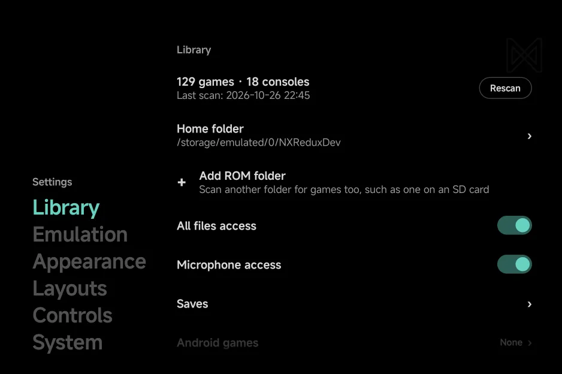
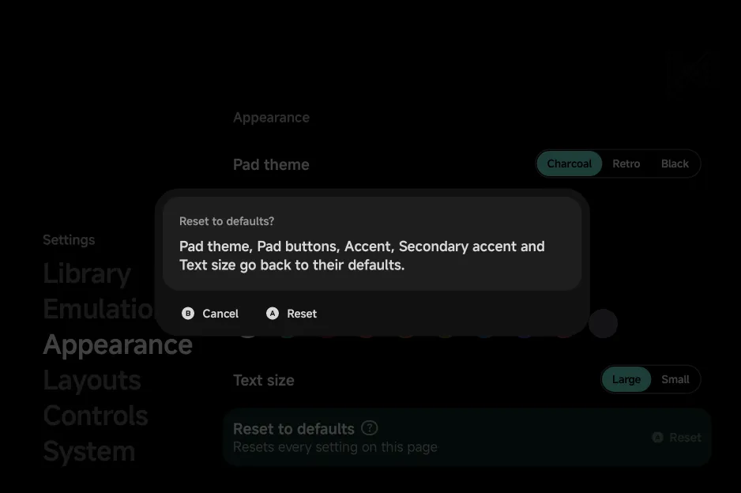
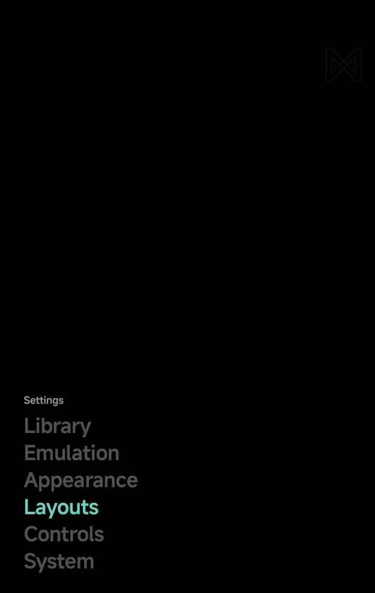

# Settings

Open **Tools → Settings** for the app's settings. They are split into six
sections, or seven while a second screen is connected.

{ .nx-wide }

| Section | What it holds |
| --- | --- |
| [**Library**](library.md#settings-library) | Your games and consoles with **Rescan**, the home folder, your ROM folders, All files access, **Saves**, Android games, and the Unassigned and Hidden games |
| [**Emulation**](emulator-settings.md) | **Default emulators**, and **Default settings** for each emulator's options |
| [**Appearance**](appearance.md) | Pad theme, Pad buttons, Accent, Secondary accent and Text size |
| [**Layouts**](layouts.md) | The style of each main menu tab and of the game lists, the page title and hints, and the Game Switcher |
| [**Controls**](controls-settings.md) | Pad vibration, Game rumble, Menu pad and Pad layout |
| [**Second screen**](dual-screen.md#settings) | **Enable** and **Bottom screen**. Shows only while a second screen is connected |
| [**System**](about.md) | Pause when unfocused, Use as home screen, Debug log, the app's version and your device's details, and the licenses |

- The sections sit as a block of words at the bottom left, the current one
  in your accent and the others grey. The top of the screen stays empty.
- Press `A` to open a section, and `B` to leave it. A tap on a section opens
  it.
- Each row shows its name, with a short line under it where that helps,
  such as a warning or what a change does. A setting shows its value on the
  right: a switch, a row of choices, or the value with `›`. A section label
  over a group of rows is in your accent.
- With touch alone, tap a row to use it, and use Android's Back gesture to
  leave. See [Touch](#touch).
- On a wide landscape screen, Settings shows the sections and the open page
  side by side: the rows start at the same height on every page, and grow
  down from there. See [Foldables & Large Screens](foldables.md#two-pane-screens).
- A reset row (**Reset to defaults**, **Clear all**, **Reset console**) asks
  first: `A` resets, `B` keeps everything.

{ .nx-wide }

Held upright, Settings shows one level at a time: first the section words,
then the open section's rows in their place. `B` goes back up a level.

<figure class="nx-phone" markdown>
{ .nx-phone__screen }
{ .nx-phone__frame }
</figure>

Upright

## Buttons

| Button | What it does |
| --- | --- |
| `A` **Toggle** | On a switch: turn it on or off |
| `A` **Choose** | On a value with `›`: open the list of its values. `Up` / `Down` move, `A` picks, `B` closes |
| `A` | On a row of choices: step to the next one |
| `A` **Select** | On any other row: open its page or run it |
| `Left` / `Right` **Change** | Step a value to the previous or next choice, on every kind of setting |
| `X` **Info** | Show the row's full description, when it has more to say |

## Touch

- **A control acts at once:** tap a switch to flip it, or the choice you
  want in a row of choices.
- **A value with `›`:** tap anywhere on the row to open the list of its
  values, then tap one to pick it. Tap outside the list to close it.
- **The row's name** selects the row without changing anything.
- **The ? icon** on the selected row opens the full description, as does a
  long press on any row that has one. Tap outside it to close it.

??? info "More detail"
    - "Touch alone" means no controller and no on-screen pad below the
      screen. There is no hint bar then.
    - The ? icon shows on the selected row only, and with `X` **Info** only
      where the row's line is cut off or there is more to read. Rows whose
      name says it all have no line.
    - There are no double taps anywhere in Settings.
    - Where rows run past the screen, they fade out at that edge a whole row
      at a time, and the selected row stays in view.
    - A row of choices too wide for its line becomes a value with `›`.
    - The list of values opens with the current value highlighted and marked
      with a dot. A long list scrolls.
    - The full description scrolls with `Up` / `Down`. `A`, `B` or `X` close
      it.
    - The rows in the **About** group of [System](about.md#about) only show
      information.
    - In portrait, the on-screen pad shows on the **Appearance** and
      **Controls** pages only (while
      [Menu pad](controls-settings.md#menu-pad) is On), so you can see the
      pad you are changing. The other Settings pages use the full height.
    - The side-by-side view shows on screens such as an unfolded Fold held
      sideways or most phones turned sideways.
